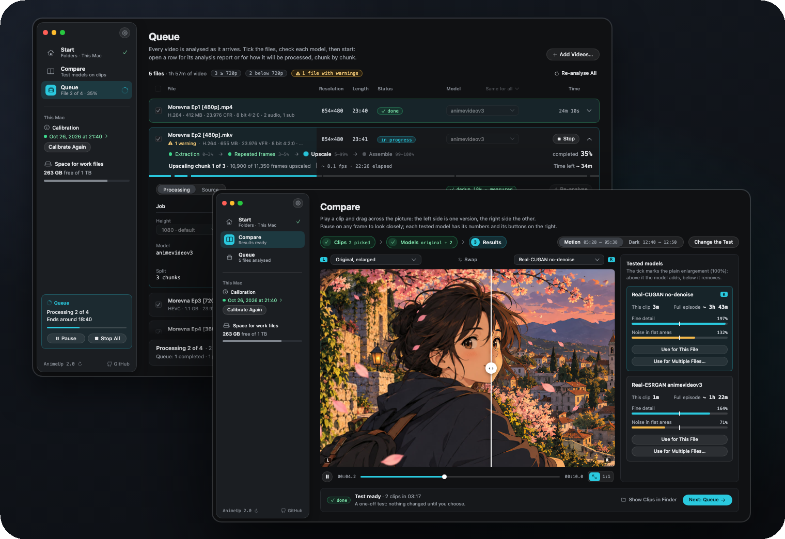
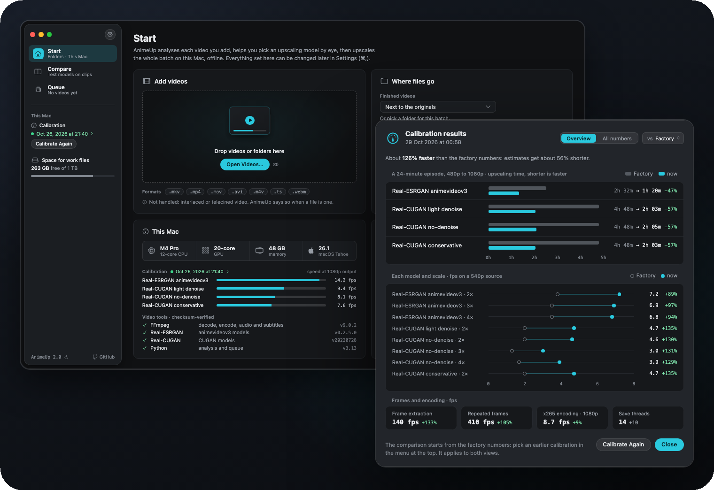
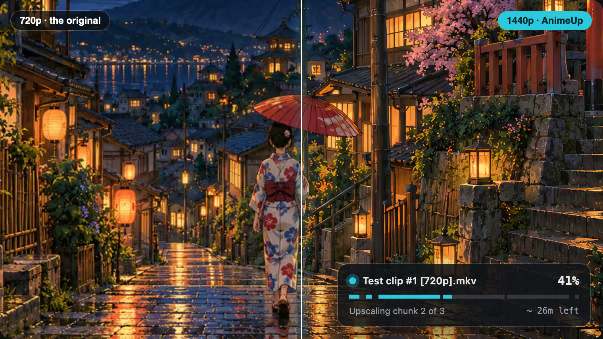

# AnimeUp


[](https://github.com/Interstellar0verdrive/AnimeUp/actions/workflows/tests.yml)
[](https://github.com/Interstellar0verdrive/AnimeUp/releases/latest)

**Local, offline anime upscaler for Apple Silicon Macs.**
AnimeUp batch-upscales anime episodes to 1080p and beyond with
[Real-ESRGAN](https://github.com/xinntao/Real-ESRGAN) and
[Real-CUGAN](https://github.com/bilibili/ailab/tree/main/Real-CUGAN)
(ncnn-vulkan builds, running on the Mac GPU through Metal). It's a native
Mac app: it analyses your sources, lets you compare models side by side on
difficult clips, and runs long, resumable jobs, all on your Mac and offline.





**[Read the user guide](https://interstellar0verdrive.github.io/AnimeUp/guide/)**: installing,
every page of the app, the model studies, and
[the design study behind 2.0](https://interstellar0verdrive.github.io/AnimeUp/guide/deep-dives/design/).
The app is in English and Italian (Settings › General).
*In italiano: [LEGGIMI](docs/it/LEGGIMI.md).*

---

## Features

- **Never degrades the source before the model sees it.** Frames are
  extracted at full quality, and your source files are only ever read.
- **Proper source analysis.** Resolution, frame rate, interlacing and telecine,
  truncated files and odd formats are detected as soon as a video enters the
  Queue, so they don't cause a crash halfway through.
- **Model comparison on real footage.** AnimeUp finds difficult clips in your
  episode (dark, bright, static, fast motion), renders them with each model
  and shows them in a split player, fitted to the window or at 1:1.
- **Four models, picked for you.** Real-ESRGAN animevideov3, Real-CUGAN
  light denoise, no-denoise and conservative. Each file gets the model that
  suits its resolution, and you can change it per file or for all of them.
- **Deduplication.** Anime is often animated "on twos" or "on threes".
  Repeated frames are upscaled only once, which measured nearly 2× faster.
- **Chunked, resumable jobs.** Work is saved one chunk at a time. A crash,
  a closed lid or a quit loses at most the current chunk, and **Resume**
  always reuses the original parameters.
- **Faithful output.** HEVC 10-bit (x265, CRF 18 `slower` by default) with
  **all original tracks remuxed**: audio, subtitles, chapters and attachments,
  fansub fonts included.
- **Honest time estimates.** A ten-minute calibration times every model on
  *your* Mac, at 480p and 1080p, and the results stay to compare with the next
  calibration.


<sub>A close-up of a picture at 720p, plainly enlarged on the left and upscaled to 1440p
by AnimeUp with Real-CUGAN no-denoise on the right. In the
[user guide](https://interstellar0verdrive.github.io/AnimeUp/guide/) you can drag the
divider yourself and see it at 1:1, and the
[examples](https://interstellar0verdrive.github.io/AnimeUp/guide/examples/) show all
four models on five kinds of source.</sub>

## Requirements

- A Mac with **Apple Silicon** (M1 or later)
- **macOS 26** (Tahoe) or later
- An internet connection **on the first launch only**. AnimeUp downloads
  Python and its video tools, then works offline.
- Disk space: upscaling extracts frames to disk, and a single episode can
  temporarily take tens of GB. AnimeUp shows the space each file needs and
  lets you set a cap.

## How it works

1. **Calibrate** once (about ten minutes, with the GPU idle), so every time
   estimate is based on your hardware. Start shows the measured speed of
   every model; click the calibration date for the full results.
2. **Add videos**: drop files or whole folders on the window, or use ⌘O.
   Each one is analysed as it arrives in the **Queue**: open a row for the
   full report.
3. **Compare** (recommended for the first episode of a series): pick the
   clips AnimeUp found, pick the models, and compare the results in the split
   player. Use the model you like for this file, or for several at once.
4. **Start the Queue.** The GPU runs one file at a time. Each row shows its
   four steps (Extraction, Repeated frames, Upscale, Assemble), speed and time
   left. Pause, Stop and Resume whenever you need.
5. **Finished videos** go next to the originals, or in a folder of your
   choice, under their original name plus the parameters, for example
   `Episode 01 [upscale 1080p cugan x3 crf18 dd].mkv`. A summary, a
   notification and the Dock icon tell you when the queue is done.

Closing the window doesn't stop a running job: it goes on in the background,
and clicking the Dock icon brings the window back. **⌘Q** quits and stops the
job, which you can resume later, losing at most the chunk in progress.

### Folders

| Where | What it's for |
|---|---|
| **Your videos** | Wherever they are. AnimeUp only reads them. |
| **Finished videos** | Next to the originals by default, or a folder you pick (Start › Where files go). |
| **Work files** | `~/Movies/AnimeUp Jobs` by default: jobs in progress or interrupted, one subfolder per file, deleted when a file finishes. They can take tens of GB, so pick a disk with room. |
| AnimeUp's data | `~/Library/Application Support/AnimeUp 2`: the video tools, Python, settings, calibration history and the job records. |

### Command line

The engine is also a command-line program, inside the portable folder (and the
source tree):

```bash
./animeup analyze FILE    # analyse a source
./animeup plan FILE       # show what would be done, without doing it
./animeup run FILE        # run a job from the terminal (same pipeline as the app)
./animeup calibrate       # calibrate time estimates on this Mac (~10 min)
./animeup doctor          # check that the folder is self-contained
./animeup setup           # (re)download missing binaries and models
./animeup test            # regression tests
```

The tests need no private material: without the maintainer's sample videos
they generate small synthetic clips with FFmpeg, and they run on every push
via GitHub Actions.

## Installation

### The app (recommended)

1. Download `AnimeUp-<version>-macos-app.zip` from the
   [latest release](https://github.com/Interstellar0verdrive/AnimeUp/releases/latest),
   unzip it and **drag `AnimeUp.app` into your Applications folder**.
2. Open it. The first time, macOS refuses because AnimeUp isn't signed by an
   identified developer (I don't have a paid Apple Developer account). Open
   **System Settings → Privacy & Security**, scroll down to the message about
   AnimeUp and click **Open Anyway**, then confirm. You only do this once.
3. A window lists the tools AnimeUp downloads: FFmpeg, Real-ESRGAN,
   Real-CUGAN and Python (about 220 MB, from pinned official releases, each
   verified by checksum). After that it works offline.

AnimeUp checks GitHub for a new release when it starts (you can turn this off
in Settings › Updates) and tells you when there is one.

**Coming from 1.x?** From 1.6.1 or later, **Install update** in the sidebar
installs 2.0 in place of the old app. 2.0 keeps its own data in
`~/Library/Application Support/AnimeUp 2`, so it downloads its tools again and
asks you to calibrate once. Your 1.x data isn't touched, and jobs interrupted
in 1.x can only be resumed from 1.x.

### The portable folder (command line)

`AnimeUp-<version>-macos-arm64.zip` is the engine as a self-contained folder,
used from the Terminal. Unzip it anywhere, then:

```bash
xattr -dr com.apple.quarantine ~/Downloads/AnimeUp   # once, if macOS blocks it
cd ~/Downloads/AnimeUp
./animeup setup     # downloads Python and FFmpeg into the folder, once
./animeup run FILE
```

### From source

```bash
git clone https://github.com/Interstellar0verdrive/AnimeUp.git
cd AnimeUp
./animeup setup     # downloads FFmpeg, Real-ESRGAN, Real-CUGAN and the models into bin/
tools/build_native.sh    # builds AnimeUp.app into dist/native (needs Xcode 26)
```

The launcher also fetches [uv](https://github.com/astral-sh/uv), the tool
that sets up the private Python environment, if you don't have it. Every
third-party download comes from a pinned official release and is verified
with SHA256, FFmpeg included (release 9.0.2), and FFmpeg is also checked
for the encoders and filters AnimeUp needs.

## Uninstalling

Quit AnimeUp (⌘Q), then delete `AnimeUp.app` from Applications and
`~/Library/Application Support/AnimeUp 2` (its tools, Python, settings and
calibration). To reach `~/Library` in Finder, choose **Go → Go to Folder…**
(⇧⌘G) and type the path. Or, in Terminal:

```bash
rm -rf /Applications/AnimeUp.app "$HOME/Library/Application Support/AnimeUp 2"
```

Your videos are left alone. The work folder (`~/Movies/AnimeUp Jobs`, or the
one you chose) may still hold interrupted jobs, which can be large: delete
what you no longer need. If you used 1.x, its data is in
`~/Library/Application Support/AnimeUp` and `~/Movies/AnimeUp`.

The portable folder keeps everything inside itself: take out the videos you
want to keep and delete the folder.

## Why FFmpeg isn't bundled

The static FFmpeg build AnimeUp uses is compiled with x264 and x265, which
makes it **GPLv3**. Redistributing it would mean shipping its complete
corresponding source code as well. AnimeUp therefore downloads it on first
launch from [Martin Riedl's macOS builds](https://ffmpeg.martin-riedl.de),
straight into `bin/`. AnimeUp only runs `ffmpeg`/`ffprobe` as separate
programs and doesn't link to them, so the two are separate works that only
talk through the command line.

The Real-ESRGAN and Real-CUGAN binaries, their models and uv are under
permissive licences. They are included in the release zip, with their
licence texts in [`LICENSES/`](LICENSES).

## License

Copyright (C) 2026 Interstellar0verdrive.

AnimeUp is free software: you can redistribute it and/or modify it under the
terms of the [GNU General Public License](LICENSE) as published by the Free
Software Foundation, either version 3 of the License, or (at your option) any
later version. It is distributed in the hope that it will be useful, but
WITHOUT ANY WARRANTY; without even the implied warranty of MERCHANTABILITY or
FITNESS FOR A PARTICULAR PURPOSE. See the GNU General Public License for more
details.

In plain words: you may use, study, change and share AnimeUp, and anything you
build from it and distribute must stay open under the same licence, with its
source code.

Releases up to and including 1.6.7 were published under the MIT License, and
copies of those releases keep it. From 1.6.8 on, AnimeUp is GPL-3.0-or-later.

Third-party components keep their own licences (see below). The guide's
model studies contain frames from Morevna Episode 3 and are licensed
CC BY-SA 3.0, like the footage.

## Credits & third-party licenses

AnimeUp is a front end and pipeline built around the work of others. Many
thanks to all of them.

| Component | Used for | License |
|---|---|---|
| [Real-ESRGAN](https://github.com/xinntao/Real-ESRGAN) by Xintao Wang et al. | `realesr-animevideov3` and `realesrgan-x4plus(-anime)` models | BSD-3-Clause ([text](LICENSES/Real-ESRGAN.txt)) |
| [Real-ESRGAN-ncnn-vulkan](https://github.com/xinntao/Real-ESRGAN-ncnn-vulkan) | Real-ESRGAN inference binary (release [v0.2.5.0](https://github.com/xinntao/Real-ESRGAN/releases/tag/v0.2.5.0)) | MIT ([text](LICENSES/Real-ESRGAN-ncnn-vulkan.txt)) |
| [Real-CUGAN](https://github.com/bilibili/ailab/tree/main/Real-CUGAN) by bilibili AI Lab | Real-CUGAN models (`models-se`, `models-pro`, `models-nose`) | MIT ([text](LICENSES/Real-CUGAN.txt)) |
| [realcugan-ncnn-vulkan](https://github.com/nihui/realcugan-ncnn-vulkan) by nihui | Real-CUGAN inference binary (release [20220728](https://github.com/nihui/realcugan-ncnn-vulkan/releases/tag/20220728)) | MIT ([text](LICENSES/realcugan-ncnn-vulkan.txt)) |
| [ncnn](https://github.com/Tencent/ncnn) by Tencent | Neural network inference framework inside both binaries | BSD-3-Clause ([text](LICENSES/ncnn.txt)) |
| [MoltenVK](https://github.com/KhronosGroup/MoltenVK) | Vulkan-on-Metal layer linked into both binaries | Apache-2.0 ([text](LICENSES/MoltenVK.txt)) |
| [FFmpeg](https://ffmpeg.org) 9.0.2, static macOS build by [Martin Riedl](https://ffmpeg.martin-riedl.de) | Decoding, analysis, encoding (x265), remuxing. **Downloaded on first launch, not distributed.** | GPLv3 for this build |
| [uv](https://github.com/astral-sh/uv) by Astral | Self-contained Python runtime and dependencies | MIT / Apache-2.0 ([MIT](LICENSES/uv-MIT.txt), [Apache](LICENSES/uv-APACHE.txt)) |
| [Typer](https://github.com/fastapi/typer) | Command-line interface | MIT |
| [Inter](https://github.com/rsms/inter) by Rasmus Andersson | Font attached to the synthetic test clips (`tests/fonts/`) | SIL OFL 1.1 ([text](LICENSES/Inter-OFL.txt)) |
| [JetBrains Mono](https://github.com/JetBrains/JetBrainsMono) | Font attached to the synthetic test clips (`tests/fonts/`) | SIL OFL 1.1 ([text](LICENSES/JetBrainsMono-OFL.txt)) |
| [Rich](https://github.com/Textualize/rich) | Terminal output | MIT |
| [Pillow](https://github.com/python-pillow/Pillow) | Image handling | MIT-CMU |
| [Big Buck Bunny](https://peach.blender.org) © 2008 Blender Foundation | 20-second sample clip in `samples/`, used for calibration | CC BY 3.0 |
| [Morevna Episode 3](https://archive.org/details/morevna-ep3) © Morevna Project | Footage in the guide's model studies and screenshots, which are therefore CC BY-SA 3.0 as well | CC BY-SA 3.0 |

Python dependencies are installed by uv from PyPI on first launch and are
not part of this repository.
