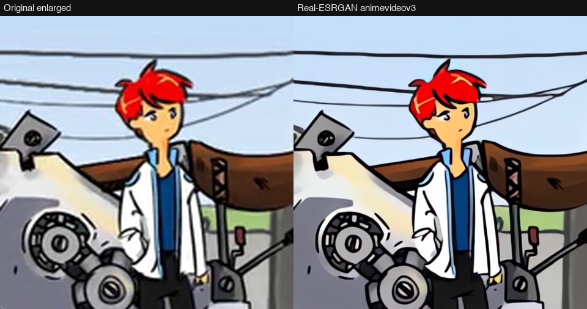
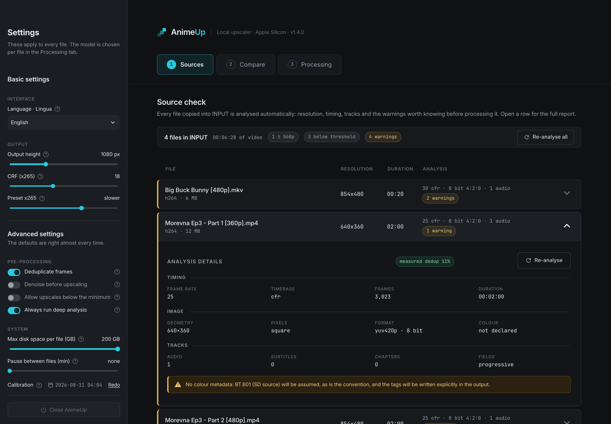
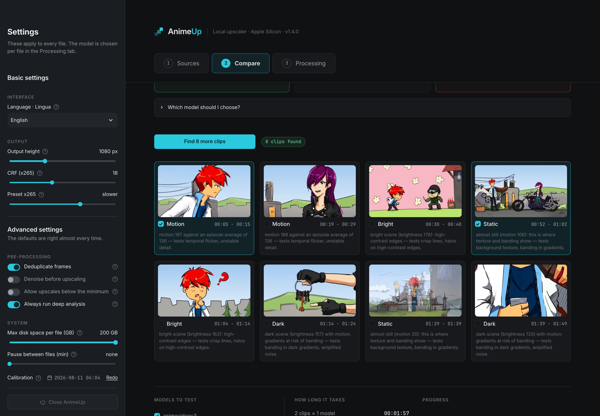
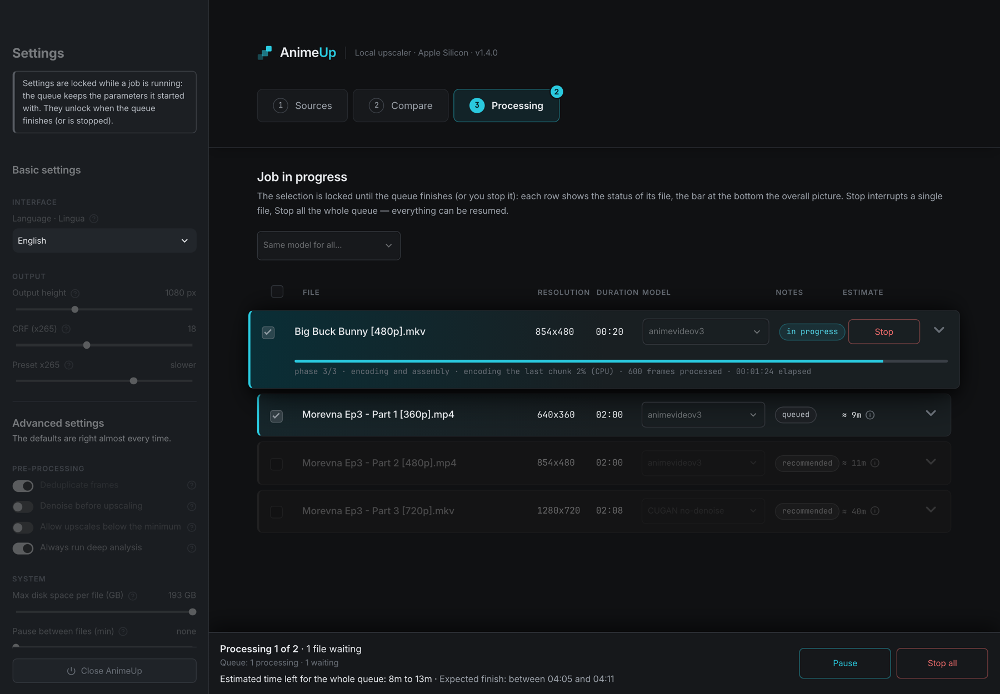

# AnimeUp

[](https://github.com/Interstellar0verdrive/AnimeUp/actions/workflows/tests.yml)
[](https://github.com/Interstellar0verdrive/AnimeUp/releases/latest)

**Local, offline anime upscaler for Apple Silicon Macs.**
AnimeUp batch-upscales anime episodes to 1080p and beyond with
[Real-ESRGAN](https://github.com/xinntao/Real-ESRGAN) and
[Real-CUGAN](https://github.com/bilibili/ailab/tree/main/Real-CUGAN)
(ncnn-vulkan builds, running on the Mac GPU through Metal). It comes with a
browser UI for analysing your sources, comparing models side by side on
difficult clips, and running long, resumable jobs.

Everything lives in one folder: Python, dependencies, binaries and models.
No Homebrew and no system Python are needed. Copy the folder to another Mac
and it works the same way there.


<sub>1:1 crop of a 360p source upscaled to 1080p: plain upscale (left) vs.
Real-ESRGAN animevideov3 (right), as shown in AnimeUp's Compare tab. Footage:
[Morevna Episode 3](https://archive.org/details/morevna-ep3), © Morevna
Project, CC BY-SA 3.0.</sub>

> **Language note:** the user interface is available in English and Italian
> (selectable in the sidebar; English by default). The in-depth docs are the
> [user guide](docs/guide/index.md) and the [tuning notes](docs/TUNING.md);
> Italian versions are in [docs/it/](docs/it/)
> ([LEGGIMI.md](docs/it/LEGGIMI.md), [TARATURE.md](docs/it/TARATURE.md)).

---

## Features

- **Never degrades the source before the model sees it.** Frames are
  extracted at full quality, and the files in `INPUT/` are only ever read.
- **Proper source analysis.** Resolution, frame rate, interlacing and telecine,
  truncated files and odd formats are detected before a job starts, so they
  don't cause a crash halfway through.
- **Model comparison on real footage.** AnimeUp finds difficult 10-second
  clips in your episode (dark, bright, static, fast motion) and renders them
  with each model. You can then compare 1:1 crops and pick by eye.
- **Model recommendation by source resolution.** Below ~380p Real-ESRGAN
  animevideov3 wins. Above ~560p Real-CUGAN no-denoise wins. In between,
  the UI tells you what to check.
- **Deduplication.** Anime is often animated "on twos" or "on threes".
  Repeated frames are upscaled only once, which measured nearly 2× faster.
- **Chunked, resumable jobs.** Work is saved one chunk at a time. A crash,
  a closed lid or a `kill` loses at most the current chunk. **Resume** always
  reuses the original parameters.
- **Faithful output.** HEVC 10-bit (x265, CRF 18 `slower` by default) with
  **all original tracks remuxed**: audio, subtitles, chapters and attachments,
  fansub fonts included.
- **Honest time estimates.** Estimates are calibrated on *your* Mac
  (`./animeup taratura`) and include the encoding passes, not just the
  upscale.

## Requirements

- A Mac with **Apple Silicon** (M1 or later)
- Developed and tested on macOS 26 (Tahoe)
- An internet connection **on the first launch only**. AnimeUp downloads a
  private Python runtime and FFmpeg into its own folder, then works offline.
- Disk space: upscaling extracts frames to disk, and a single episode can
  temporarily take tens of GB. The UI shows the space it needs and lets you
  set a cap.

## How it works

0. **Calibrate** *(optional, recommended on first launch)*: in the sidebar,
   **Calibration → Run now** times this Mac on a sample clip for about ten
   minutes, so every time estimate is based on your hardware instead of
   factory figures. See [Calibrate your Mac](docs/guide/02-calibration.md).
1. **Copy** your episodes (`.mkv`, `.mp4`, …) into `INPUT/`.
2. **Sources**: check the analysis of each file (resolution, frame rate,
   warnings). Click a row to expand it.

   

3. **Compare** (recommended for the first episode of a series): AnimeUp
   recommends a model for the file's resolution, finds difficult clips (dark,
   bright, static, fast motion), renders them with the models you pick and
   shows the results side by side, with 1:1 crops and one-click
   [video-compare](#optional-video-compare).

   

4. **Processing**: tick the files, confirm the suggested model and start the
   job. The GPU runs one job at a time. Progress, fps and the remaining time
   appear on each file's row.

   

5. The finished files appear in `OUTPUT/` under their original name plus the
   parameters, for example
   `Episode 01 [upscale 1080p cugan x3 crf18 dd].mkv`. A summary sums up the
   whole queue at the end.
6. **To quit**, click **Close AnimeUp** at the bottom of the sidebar. Running
   jobs keep going even if you close the browser or the Terminal. You'll find
   them again on the next launch.

The interface is in English and Italian: switch with **Language · Lingua** at
the top of the sidebar. More screenshots and every detail are in the
[user guide](docs/guide/index.md).

### Folders

| Folder | What it's for |
|---|---|
| `INPUT/` | Your source episodes. Never modified. |
| `OUTPUT/` | Finished files. |
| `JOBS/` | Jobs in progress or interrupted, one subfolder per episode. A subfolder deletes itself when its job finishes cleanly. |
| `anteprime/` | Cache for the Compare tab ("previews"). Safe to delete at any time. |
| `registri/` | Logs, plus job history, calibration and settings ("records"). |
| `bin/` | FFmpeg, the ncnn upscalers, the models and uv. |

### Command line

```bash
./animeup ui              # web UI (port 8899; --porta N to change it)
./animeup analyze FILE    # analyse a source
./animeup plan FILE       # show what would be done, without doing it
./animeup run FILE        # run a job from the terminal (same pipeline as the UI)
./animeup taratura        # calibrate time estimates on this Mac (~10 min)
./animeup doctor          # check that the folder is self-contained
./animeup setup           # (re)download missing binaries and models
./animeup test            # regression tests
```

The tests need no private material: without the maintainer's sample videos
they generate small synthetic clips with FFmpeg, and they run on every push
via GitHub Actions.

## Installation

### Option A: the app (recommended)

1. Download `AnimeUp-<version>-macos-app.zip` from the
   [latest release](https://github.com/Interstellar0verdrive/AnimeUp/releases/latest),
   unzip it and **drag `AnimeUp.app` into your Applications folder**. (Run
   from Downloads, macOS starts an unapproved app from a temporary read-only
   copy.)
2. Open it. The first time, macOS refuses because AnimeUp isn't signed by an
   identified developer (the project has no paid Apple Developer account).
   Open **System Settings → Privacy & Security**, scroll down to the message
   about AnimeUp and click **Open Anyway**, then confirm. You only do this
   once. (On recent macOS versions right-click → Open no longer bypasses
   this.)
3. A small window says *Preparing AnimeUp…* while it sets up a private
   Python runtime (about a minute, once). Then the welcome page asks to
   download its video tools (FFmpeg 9.0.2 and the upscaling engines, about
   180 MB, from pinned official releases verified by checksum). After that it
   works offline.
4. Your files live in **`~/Movies/AnimeUp`** (INPUT, OUTPUT, JOBS…); you can
   choose another folder, an external drive included, in the sidebar under
   *System → Data folder*. AnimeUp's own tools and environment live in
   `~/Library/Application Support/AnimeUp` (about 1 GB).

Quit with **⌘Q**: running jobs keep going in the background and reappear
when you reopen the app. To update, replace `AnimeUp.app` with the new one:
your data and settings are untouched. AnimeUp checks once a day for a new
release and shows a note in the sidebar (you can turn this off).

### Option B: the portable folder

`AnimeUp-<version>-macos-arm64.zip` is the same program as a self-contained
folder, handy to keep on an external drive or to use from the Terminal.

1. Unzip it anywhere and double-click **`Avvia AnimeUp.command`** ("Launch
   AnimeUp"). If macOS blocks it, use **System Settings → Privacy & Security
   → Open Anyway** as above, or run once in Terminal:

   ```bash
   xattr -dr com.apple.quarantine ~/Downloads/AnimeUp
   ```

2. A Terminal window opens: it sets up Python inside the folder and asks to
   download FFmpeg (once). Keep it open while you use AnimeUp: it's the
   server.
3. The interface opens in your browser at <http://localhost:8899>. It's only
   reachable from this Mac; `./animeup ui --rete` also lets other devices on
   your network open it.

### Option C: from source

```bash
git clone https://github.com/Interstellar0verdrive/AnimeUp.git
cd AnimeUp
./animeup setup     # downloads FFmpeg, Real-ESRGAN, Real-CUGAN and the models into bin/
./animeup ui
```

The launcher also fetches [uv](https://github.com/astral-sh/uv), the tool
that sets up the private Python environment, if you don't have it. Every
third-party download comes from a pinned official release and is verified
with SHA256, FFmpeg included (release 9.0.2), and FFmpeg is also checked
for the encoders and filters AnimeUp needs.

### Optional: video-compare

The Compare tab has buttons that open two renders side by side in
[video-compare](https://github.com/pixop/video-compare), a split-screen
player that lets you compare them in motion rather than as still crops.
It isn't bundled: it's GPL-2.0, and there is no self-contained macOS build.
Install it with [Homebrew](https://brew.sh) if you want it:

```bash
brew install video-compare
```

Without it, AnimeUp opens the two files in [IINA](https://iina.io) if
that is installed. Everything else works the same either way.

## Why FFmpeg isn't bundled

The static FFmpeg build AnimeUp uses is compiled with x264 and x265, which
makes it **GPLv3**. Redistributing it would mean shipping its complete
corresponding source code as well. AnimeUp therefore downloads it on first
launch from [Martin Riedl's macOS builds](https://ffmpeg.martin-riedl.de),
straight into `bin/`. AnimeUp only runs `ffmpeg`/`ffprobe` as separate
programs and doesn't link to them, so its own code stays under the MIT
licence.

The Real-ESRGAN and Real-CUGAN binaries, their models and uv are under
permissive licences. They are included in the release zip, with their
licence texts in [`LICENSES/`](LICENSES).

## License

AnimeUp is released under the [MIT License](LICENSE).
Third-party components keep their own licences (see below). The images in
`docs/images/` contain frames from Morevna Episode 3 and are licensed
CC BY-SA 3.0, like the footage.

## Credits & third-party licenses

AnimeUp is a front end and pipeline built around the work of others. Many
thanks to all of them.

| Component | Used for | License |
|---|---|---|
| [Real-ESRGAN](https://github.com/xinntao/Real-ESRGAN) by Xintao Wang et al. | `realesr-animevideov3` and `realesrgan-x4plus(-anime)` models | BSD-3-Clause ([text](LICENSES/Real-ESRGAN.txt)) |
| [Real-ESRGAN-ncnn-vulkan](https://github.com/xinntao/Real-ESRGAN-ncnn-vulkan) | Real-ESRGAN inference binary (release [v0.2.5.0](https://github.com/xinntao/Real-ESRGAN/releases/tag/v0.2.5.0)) | MIT ([text](LICENSES/Real-ESRGAN-ncnn-vulkan.txt)) |
| [Real-CUGAN](https://github.com/bilibili/ailab/tree/main/Real-CUGAN) by bilibili AI Lab | Real-CUGAN models (`models-se`, `models-pro`, `models-nose`) | MIT ([text](LICENSES/Real-CUGAN.txt)) |
| [realcugan-ncnn-vulkan](https://github.com/nihui/realcugan-ncnn-vulkan) by nihui | Real-CUGAN inference binary (release [20220728](https://github.com/nihui/realcugan-ncnn-vulkan/releases/tag/20220728)) | MIT ([text](LICENSES/realcugan-ncnn-vulkan.txt)) |
| [ncnn](https://github.com/Tencent/ncnn) by Tencent | Neural network inference framework inside both binaries | BSD-3-Clause ([text](LICENSES/ncnn.txt)) |
| [MoltenVK](https://github.com/KhronosGroup/MoltenVK) | Vulkan-on-Metal layer linked into both binaries | Apache-2.0 ([text](LICENSES/MoltenVK.txt)) |
| [FFmpeg](https://ffmpeg.org) 9.0.2, static macOS build by [Martin Riedl](https://ffmpeg.martin-riedl.de) | Decoding, analysis, encoding (x265), remuxing. **Downloaded on first launch, not distributed.** | GPLv3 for this build |
| [uv](https://github.com/astral-sh/uv) by Astral | Self-contained Python runtime and dependencies | MIT / Apache-2.0 ([MIT](LICENSES/uv-MIT.txt), [Apache](LICENSES/uv-APACHE.txt)) |
| [video-compare](https://github.com/pixop/video-compare) by Pixop | Optional side-by-side player for the Compare tab. **Not distributed**: installed separately by the user. | GPL-2.0 |
| [IINA](https://iina.io) | Optional fallback player for the Compare tab. **Not distributed.** | GPL-3.0 |
| [Streamlit](https://github.com/streamlit/streamlit) | Web UI | Apache-2.0 |
| [Typer](https://github.com/fastapi/typer) | Command-line interface | MIT |
| [Rich](https://github.com/Textualize/rich) | Terminal output | MIT |
| [Pillow](https://github.com/python-pillow/Pillow) | Image handling | MIT-CMU |
| [Inter](https://github.com/rsms/inter) by Rasmus Andersson | UI typeface | SIL OFL 1.1 ([text](LICENSES/Inter-OFL.txt)) |
| [JetBrains Mono](https://github.com/JetBrains/JetBrainsMono) | UI monospace typeface | SIL OFL 1.1 ([text](LICENSES/JetBrainsMono-OFL.txt)) |
| [Big Buck Bunny](https://peach.blender.org) © 2008 Blender Foundation | 20-second sample clip in `campioni/`, used for calibration | CC BY 3.0 |
| [Morevna Episode 3](https://archive.org/details/morevna-ep3) © Morevna Project | Footage in the screenshots and the before/after image in `docs/images/`, which are therefore CC BY-SA 3.0 as well | CC BY-SA 3.0 |

Python dependencies are installed by uv from PyPI on first launch and are
not part of this repository.
