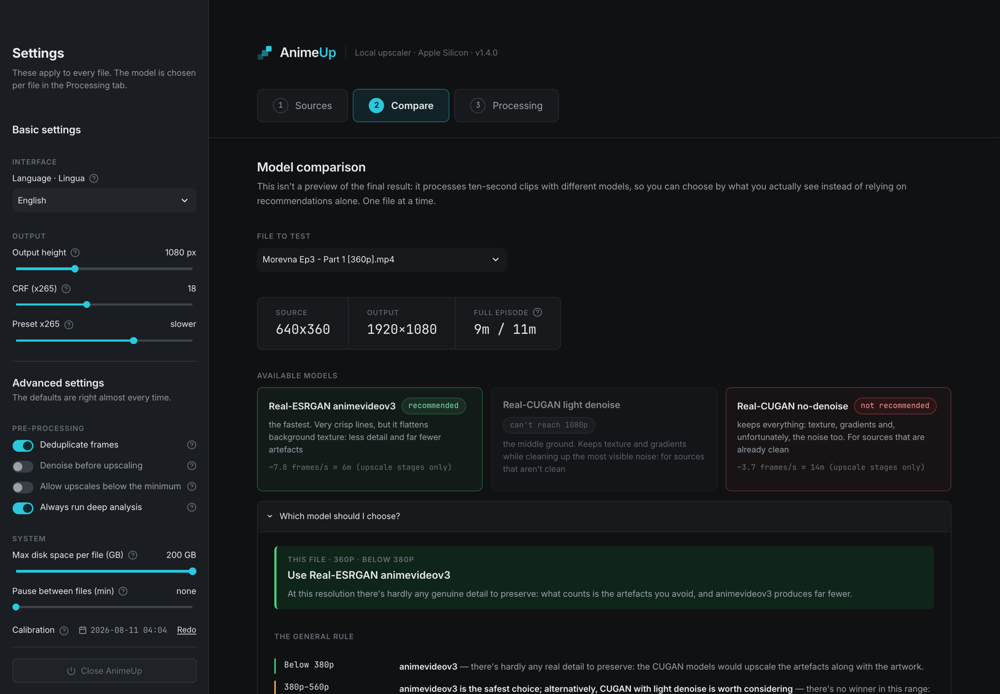
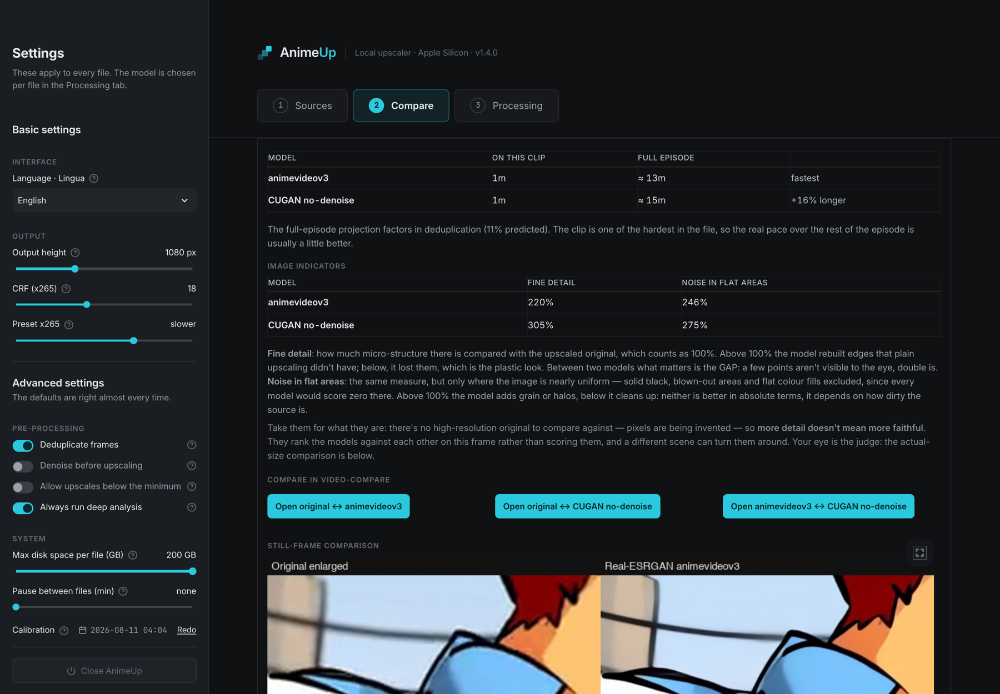
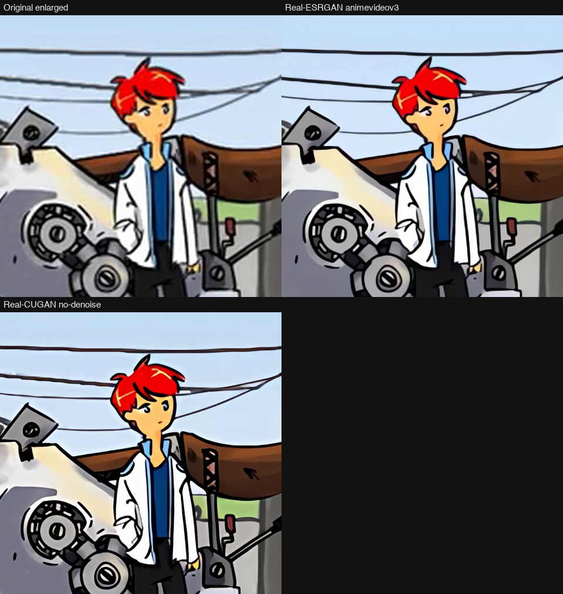
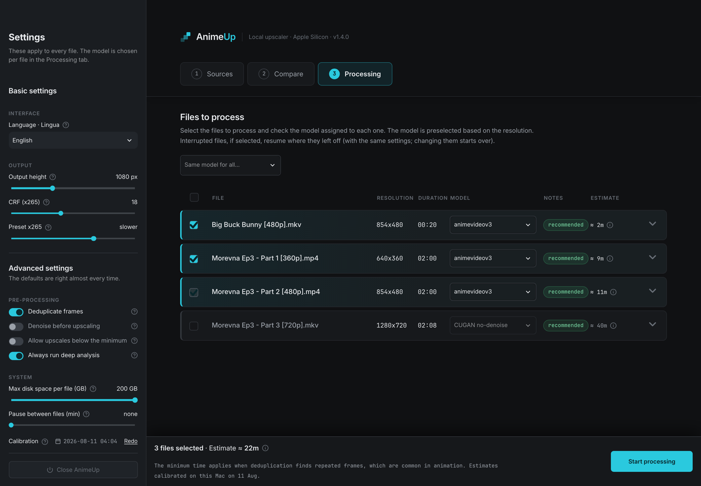

# AnimeUp — local anime upscaler (macOS / Apple Silicon)

*Italian version: [it/LEGGIMI.md](it/LEGGIMI.md)*

Upscales anime episodes to 1080p and beyond with Real-ESRGAN and Real-CUGAN
(ncnn-vulkan), locally and with no network access. Everything lives in this
folder: copy it to another Mac and it works exactly the same.

---

Screenshots use footage from [Morevna Episode 3](https://archive.org/details/morevna-ep3)
(© Morevna Project, CC BY-SA 3.0).

## The map

```
AnimeUp/
├── Avvia AnimeUp.command  ← double-click in Finder: opens the interface
├── animeup          ← the same, from the terminal: ./animeup ui
├── README.md        ← project overview
├── docs/
│   ├── USER_GUIDE.md  ← this file
│   ├── TUNING.md      ← why the parameters are what they are (measurements and comparisons)
│   └── it/            ← Italian versions (LEGGIMI.md, TARATURE.md)
│
│   —— YOUR folders (UPPERCASE: this is where you put things and take them) ——
├── INPUT/           ← put the episodes to process here (.mkv, .mp4…)
├── OUTPUT/          ← the upscaled files appear here
├── JOBS/            ← jobs in progress or interrupted, resumable.
│                      One subfolder per episode; it empties itself
│                      once the job is done. If it takes up a lot of space,
│                      a job is half-finished: resume it or delete its folder.
├── _WIP/            ← test material and backups (managed by hand)
│
│   —— internal folders (lowercase: don't touch, they look after themselves) ——
├── anteprime/       ← previews: cache for the Compare tab (can be regenerated)
├── registri/        ← records/logs: job reports, calibration, settings (+ diagnostic logs)
├── bin/             ← "vendored" ffmpeg, ffprobe, models and ncnn binaries
├── src/             ← the engine (Python, `animeup` package)
├── ui/              ← the Streamlit interface (+ fonts in ui/static)
├── tests/           ← regression tests: ./animeup test
├── design/          ← HTML mockup and visual spec: the source of truth for the UI
└── .streamlit .venv .python .cache  ← self-contained environment (hidden)
```

## The ideal workflow

1. **Copy** the episodes into `INPUT/`.
2. **Double-click `Avvia AnimeUp.command`** (or run `./animeup ui` from the
   terminal) → it opens at `http://localhost:8899`. The Terminal window that
   appears IS the server: leave it open for as long as you use the
   interface. Closing the browser doesn't shut anything down; closing the
   Terminal shuts down the interface but NOT any jobs in progress.
3. **Sources** — check the analysis of each file: resolution, frame rate,
   warnings (truncated files, odd formats). Each row expands like an
   accordion.

   
4. **Compare** *(recommended the first time you work on a series)* — try the
   models on 10-second difficult clips and choose by looking, rather than
   taking it on trust.

   

   

   

   
5. **Processing** — tick the files, confirm the proposed model, press Start.
   One job at a time: the GPU can't be shared. Progress, fps and time
   remaining appear in the file's row. The time remaining also includes the
   encoding passes for the chunks still to come, not just the upscale: they
   account for a good half of the work on an episode, and leaving them out
   made the estimate promise far less than the job would actually take.

   

   
6. The result lands in `OUTPUT/` with the original name plus the
   parameters, e.g. `Episodio [upscale 1080p cugan x3 crf18 dd].mkv`. When
   the queue is finished a **summary** appears: how many files, how long it
   took, average deduplication, warnings and — if there are any — which
   files were not completed.

   
7. **To close**: the **"Close AnimeUp"** button at the bottom of the sidebar
   (it shuts down the server; close the browser and Terminal whenever you
   like afterwards). Alternatively, close the Terminal window opened in
   step 2. Jobs in progress do NOT stop when you close: they carry on by
   themselves and you'll find them next time you open AnimeUp (to really
   stop them, use Stop / Stop all before closing). If you need the
   emergency route: `lsof -ti :8899 | xargs kill`

**Interruptions**: closing the Mac's lid, a crash, a kill — no need to panic.
The job stays in `JOBS/` and the row shows "interrupted", with two buttons:

- **Resume** is *locked down*: it restarts with the parameters the file
  originally started with (written to `parametri.json` inside its job
  folder), whatever the sidebar says at that moment. Resuming can never
  throw away work already done — not even the chunk grid is recalculated:
  the saved one is adopted, so chunks already encoded remain valid even if
  the free space or the GB slider changes.
- **Discard** throws away the half-finished job for THAT file (extracted
  frames, chunks, state) and frees up the GB: the row goes back to new, so
  you can redo it with different parameters or a different model. Two-step
  confirmation, in red. It never touches the source or the OUTPUT.

Both stay disabled while the GPU is working on another file: you can't
resume or discard with the engine running.

**Where it's best to stop**: work is secured one chunk at a time, not one
frame at a time. On resume, the chunk in progress restarts from its first
frame — any frames of that chunk already upscaled are redone. That's why the
row also says "742/1778 of chunk 3 of 10": it's the countdown to the next
point where a Stop costs nothing. The row's percentage remains that of the
frames processed, so it tells you how far the job has got, not how much is
already safe.

**Already done, but the file is gone**: if `esiti.jsonl` contains a job
report with exactly those parameters but the output is no longer in
`OUTPUT/` (moved, archived), the row says so instead of silently redoing it,
and asks for confirmation before putting the file back in the queue. A
defective output doesn't count as done: it stays marked "to redo".

**Persistent settings**: sidebar values are saved automatically to
`registri/impostazioni.json`, and on restart you get the values from the
last session, not the defaults. If there is a paused file that was started
with parameters different from the current ones, the sidebar says so and
offers a button to switch back to the paused file's parameters.

---

## Folder details

### INPUT/
The source episodes. The tool **never modifies them**: it only reads them.
Subfolders are allowed. All formats go through ffprobe: if a file is odd,
the Sources tab tells you, rather than a crash halfway through a job.

### OUTPUT/
The finished files: HEVC 10-bit video (x265, CRF 18 preset slower by
default) with **all original tracks remuxed** — audio, subtitles, chapters,
attachments (fansub fonts included). A file that finishes with serious
warnings is renamed `.PARZIALE.mkv` ("partial") instead of passing itself off
as good: running it again redoes it.

### JOBS/
One folder per job, named `<episode> <date> <fingerprint>`. Inside:
`frames/` (extracted frames), `chunk*-in/-up` (the chunk being processed),
`segments/` (pieces already encoded), `state.json` (the state used for
resuming), `in-corso.lock` (the PID of the active process),
`upscaler.pgid` (used to kill orphaned upscalers after a crash).

- When a job finishes **without** warnings, the folder deletes itself.
- With warnings it stays for inspection: the row in the UI says "done ·
  finished with warnings". You can delete it by hand without consequences
  (the output is in OUTPUT/).
- Interrupted: resume it from the UI (Resume button) or by running the same
  command again; the signature in `state.json` guarantees that different
  parameters never reuse the wrong frames.

### anteprime/ (previews; internal, can be regenerated)
Cache for the Compare tab: thumbnails, animated clips of the difficult clips,
the index of "difficult clips" (`.spezzoni/*.json`) and the comparison
renders, organised by episode and settings. **It can be emptied at any
time**: at worst the next difficult-clip scan is redone (a few minutes per
episode). The renders inside are ordinary MKV files: it's fine to copy them
out to show someone.

### registri/ (records/logs; internal)
Careful: two different things live side by side here, and the folder name is
misleading. The **`.log`** files (one per job, plus `lavorazione.log` and
`ui-server.log`) are purely diagnostic and can be deleted whenever you like.
The other files, however, are **data**, and deleting them returns AnimeUp to
the state of a brand-new machine:

- `esiti.jsonl` — the job report for every completed file (actual duration,
  measured deduplication, warnings, model used, name of the output
  produced). It's what makes the list say "done" and "Finished in ...", and
  it keeps the estimates true to this machine.
- `taratura.json` — the measured speed of this Mac: megapixels per second
  for each model and scale, extraction, encoding, the deduplication scan and
  the number of save threads. Without it, the estimates fall back to the
  factory estimates, measured elsewhere — and they are quite a long way off:
  on this very Mac the factory value for extraction says 60 f/s against 84
  measured.
- `impostazioni.json` — the sidebar preferences.
- `lanci.jsonl` — the log of runs: it appears the first time a queue is
  started. It feeds the end-of-queue summary (how many files, how long it
  took, average deduplication, warnings, which files were not completed).

Nothing breaks if you delete them: you lose the history, the calibration
(ten minutes to redo it with the link in the sidebar) and the preferences.
The reminder is also in `registri/NON_CANCELLARE.txt` ("do not delete").

### bin/
Vendored binaries: `ffmpeg`, `ffprobe`, `realesrgan-ncnn-vulkan`,
`realcugan-ncnn-vulkan`, the models, and `uv` (Python manager). This is what
makes the folder self-contained. If the sidebar shows "N system
dependencies", something is missing: `./animeup setup` rebuilds it.

### src/, ui/, tests/, design/
The program. `src/animeup/` is the engine (analysis → plan → extraction →
deduplication → upscale → encoding → remux); `ui/app.py` the interface;
`tests/run.py` the regression tests (every case corresponds to a real bug
that has already happened); `design/` contains the HTML mockup that is the
reference for the visuals. **Don't move these folders**: the Python
environment uses absolute paths.

---

## Useful commands

```
./animeup ui              # web interface (port 8899; --porta N to change it)
./animeup analyze FILE    # analyse a source, from the terminal
./animeup plan FILE       # what it would do, without doing it
./animeup run FILE        # job from the terminal (same pipeline as the UI)
./animeup test            # regression tests (run them after every change)
./animeup doctor          # checks that the folder really is self-contained
./animeup setup           # restores the vendored binaries
```

## Technical decisions in brief (the reasons are in [TUNING.md](TUNING.md))

- **Models**: below ~380p Real-ESRGAN animevideov3 wins; above ~560p CUGAN
  no-denoise wins; in between is a grey area and the UI suggests what to
  check.
- **One job at a time**: two upscalers on the same GPU slow each other down;
  the UI disables Start while a job is running.
- **Pause between files** (sidebar, default 5 min, 0 = off): in marathon
  sessions the chain rests between one episode and the next to give the CPU
  and GPU a breather. During the pause Start stays locked and the bar says
  when it resumes.
- **Deduplication**: animation "on twos/threes" repeats frames; they are
  processed only once (measured: times almost halved), with a check per
  chunk.
- **10-bit**: the output is yuv420p10le even from 8-bit sources (less
  banding); the ncnn binaries read 8-bit, and dithering on input mitigates
  this.
- **Hi444PP fansubs**: some encodes have "fake" keyframes that corrupt fast
  seeks (green blocks); extraction validates stderr and, if needed, starts
  again from scratch. This applies to previews AND comparison renders.
- **Crash robustness**: lock with PID (+ zombie check), the upscaler's pgid
  on disk to kill orphans on resume, GPU stall detected after 15 minutes
  without progress.
- **Save threads**: the ncnn binaries write PNGs with a separate thread
  pool, and beyond a certain number the disk becomes the bottleneck instead
  of the GPU. The right number varies from machine to machine, so
  calibration tries it on the spot (2, 4, 6 and 8) and keeps the best. On a
  machine that has never been calibrated a cautious value is used, not the
  maximum.
- **Estimates calibrated per machine, history per content**: `taratura.json`
  measures the hardware and is indexed by chip — if you change Mac, it has to
  be redone. `esiti.jsonl`, on the other hand, is about content (how many
  repeated frames to expect, how far off the estimates have been so far) and
  stays valid everywhere.

## Moving the folder / a second Mac

Copy the whole folder (external drive included): on first launch
`./animeup` repairs the Python environment by itself if needed. Neither
Homebrew nor a system Python is required. The only recognised variable is
`ANIMEUP_ROOT`, if you want to keep INPUT/OUTPUT elsewhere.

## If something goes wrong

| Symptom | What to do |
|---|---|
| I want to STOP a job in progress | **Stop** on the file's row interrupts only that file (the rest of the run carries on); **Stop all** in the bottom bar interrupts the file in progress and cancels the following ones. Either way, the interrupted file stays resumable. Without the interface: `kill $(cat "JOBS/<folder>/in-corso.lock")` |
| "another job is already in progress" but there isn't one | the lock belongs to a dead process: it clears itself on the next run; if it persists, delete `in-corso.lock` in that folder of JOBS |
| `.PARZIALE.mkv` file in OUTPUT | the job has serious warnings: run the file again, it is redone from wherever it can |
| previews with green/pink blocks | old cache from a file corrupted on seek: delete the subfolder in `anteprime/` and regenerate |
| the UI won't start: port in use | `lsof -ti :8899 \| xargs kill`, or `./animeup ui --porta 8900` |
| questions about the parameters | [TUNING.md](TUNING.md) explains every choice with the measurements |
