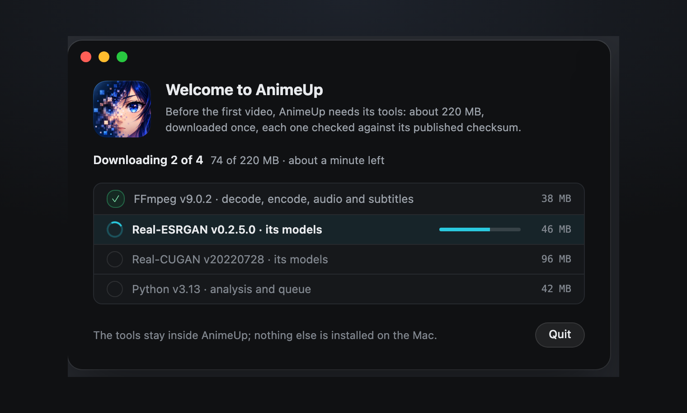

Overview · Install

# 01. Install and first launch

Download the app, approve it once in macOS, and let the first launch fetch AnimeUp's video tools.

## Install the app

1. Download **`AnimeUp-v2.0.0-macos-app.zip`** from the [latest release](https://github.com/Interstellar0verdrive/AnimeUp/releases/latest) and unzip it.
2. **Drag `AnimeUp.app` into Applications.** Don't run it from Downloads: until it's approved, macOS starts it from a temporary read-only copy.
3. Open it. macOS refuses, because AnimeUp isn't signed with an Apple Developer ID. Close the warning.
4. Open **System Settings › Privacy & Security**, scroll to the message about AnimeUp and click **Open Anyway**. Confirm with your password or Touch ID.
5. AnimeUp opens, and from now on it opens normally.

!!! note "Right-click › Open no longer works"
    On older macOS versions you could get past the warning with right-click › Open. macOS 15 and later only allow **Open Anyway** in Privacy & Security.

## The first launch: video tools

Before the first video, AnimeUp needs its tools. A window lists them, with their size, and downloads them one after another:

| Tool | What it's for |
|---|---|
| FFmpeg 9.0.2 | Decoding, encoding, audio and subtitles |
| Real-ESRGAN v0.2.5.0 and its models | The animevideov3 model |
| Real-CUGAN 20220728 and its models | The three Real-CUGAN models |
| Python 3.13 | The analysis and the queue |

{ .au }

About 220 MB in all. Each tool comes from its pinned official release and is checked against its published checksum before it's used. They stay inside AnimeUp's own folder: nothing else is installed on the Mac.

If the connection drops, the window says which tool stopped and offers **Try Again**, which picks up from where the download stopped. A tool that arrives damaged is set aside and downloaded again. When everything is in place, the window turns into the main window on **Start**, and from then on AnimeUp works offline.

If a tool goes missing later, or no longer matches its checksum, the same window comes back with only that tool.

## Where AnimeUp keeps its things

| What | Where |
|---|---|
| The program | `AnimeUp.app`, which is never modified |
| Settings, calibration, history, the video tools, Python | `~/Library/Application Support/AnimeUp 2` |
| Work files while a file is processed, and each file's log | `~/Movies/AnimeUp Jobs`, or the folder you choose in [Start](04-start.md#2-where-files-go) or [Settings › Folders](07-settings.md#folders) |
| Finished videos | Next to the originals, or the folder you choose |

[08. Files and folders](08-files-and-folders.md) explains what goes where in detail.

!!! info "Coming from AnimeUp 1.6"
    2.0 starts fresh: it keeps its own settings and calibration in `AnimeUp 2`, so the first launch downloads the tools again and asks you to calibrate once. Your 1.6 data stays where it was, untouched. Jobs interrupted in 1.6 can't be resumed from 2.0: finish them with 1.6 first, or start them again.

## Updating

**AnimeUp › Check for Updates…** asks GitHub for the latest release. If there's a newer one, a yellow note at the bottom of the sidebar says so, with **What's new** and **Install…**. AnimeUp also checks once a day on its own; you can turn that off in [Settings › Updates](07-settings.md#updates).

To update, download the new app from the release, quit AnimeUp and replace `AnimeUp.app` in Applications. Your settings, calibration and the Queue stay as they are. macOS asks for **Open Anyway** once more for each version downloaded with a browser.

## Removing AnimeUp

Delete the app, then `~/Library/Application Support/AnimeUp 2` (tools, settings and calibration) and, if you no longer need them, the work folder. Your original and finished videos are never inside AnimeUp's folders.

## The portable folder

The release also offers **`AnimeUp-v2.0.0-macos-arm64.zip`**: the same engine as a folder, without the app, used from the Terminal with `./animeup`. It's for running AnimeUp from an external drive or in scripts. See [Command line](reference/command-line.md).

[Next: 02. The interface at a glance →](02-interface.md)
