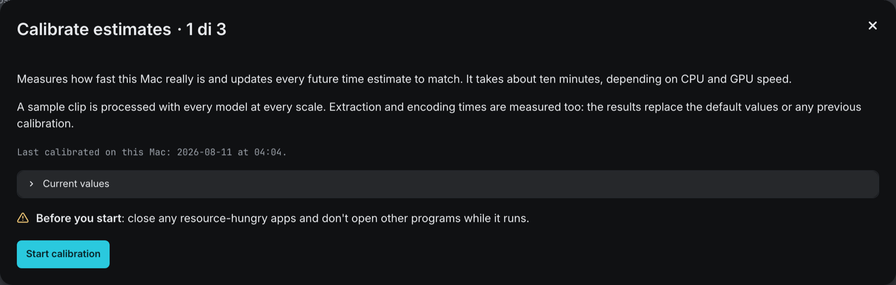
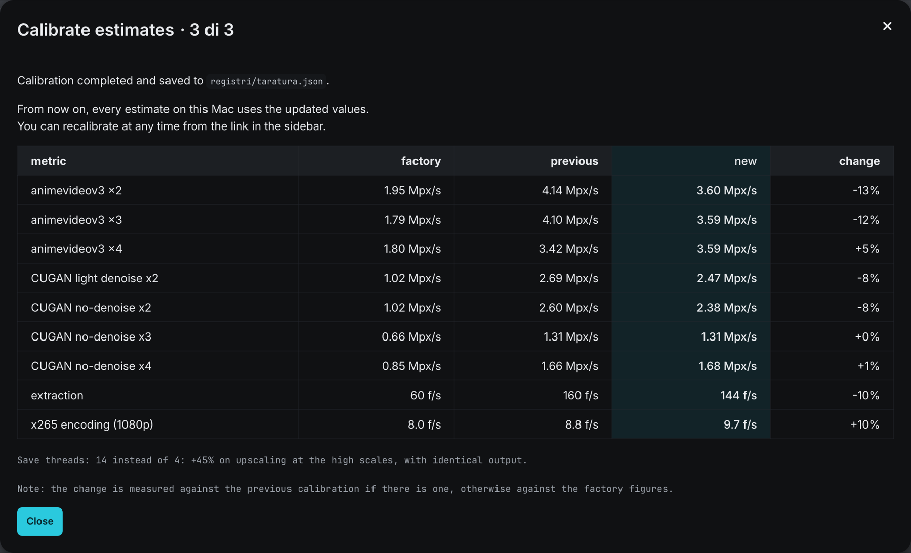

<span class="eyebrow">Step 02 · Calibration · optional, recommended</span>

# 02. Calibrate your Mac

A ten-minute stopwatch on a free sample clip that replaces AnimeUp's factory speed figures with your Mac's own, and picks the fastest safe setting for writing frames to disk.

!!! tip "Do it now, while the GPU is idle"
    The best moment to calibrate is right after installing: nothing is queued yet, and every estimate you see from the first episode onwards will already be right. It's optional: skip it and AnimeUp works exactly the same, only with less reliable time estimates.

## Why the estimates need it

Every time estimate in AnimeUp is built from a handful of speeds: how many megapixels per second each model upscales at each scale, how many frames per second FFmpeg extracts, how many frames per second x265 encodes at 1080p. Out of the box those speeds are **factory estimates**, measured on the Mac where AnimeUp was developed.

On a different chip they're all wrong by roughly the same factor: the difference in speed between that Mac and yours. A faster Mac sees estimates that are too long, a slower one sees promises it can't keep. Calibration measures those same numbers on **your** Mac, and from then on they replace the factory ones.

How far off can the factory figures be? On an Apple M4, for example, calibration measured extraction 40% faster than the factory value, the two Real-CUGAN models at scale 2 about 35% faster, and x265 encoding 18% slower. The full table is in the [tuning notes](../TUNING.md#how-far-the-factory-estimates-are-from-reality).

!!! note "The factory figures aren't a mistake"
    They're a starting point for a machine AnimeUp doesn't know yet. That's why the interface keeps telling you which kind of estimate you're looking at (see [How to tell whether you're calibrated](#how-to-tell-whether-youre-calibrated)).

## What it measures

Calibration processes a 20-second clip that ships with AnimeUp, `campioni/bbb-480p.mkv`: a scene from **Big Buck Bunny** (© 2008 Blender Foundation, CC BY 3.0), 854×480 at 30 fps, chosen for its continuous motion, because a benchmark on easy frames would lie. It runs the same commands a real job runs, with the same flags, in eleven steps:

| # | Step (as the progress line names it) | What is timed | What it changes |
|---|---|---|---|
| 1 | **frame extraction** | FFmpeg extracting all 600 frames of the clip to PNG, exactly as a job does | Extraction time in every estimate, scaled to each source's resolution |
| 2 | **save threads** | The same 80 frames upscaled with Real-ESRGAN animevideov3 at scale 4, once for each candidate number of PNG-writing threads | The number of save threads **every real job** uses from now on (see below) |
| 3–5 | **upscale animevideov3 x2**, **x3**, **x4** | Real-ESRGAN animevideov3 on 180 frames at each scale | Upscale time for that model and scale |
| 6 | **upscale CUGAN light denoise x2** | Real-CUGAN light denoise on 180 frames (it exists at scale 2 only) | Upscale time for that model |
| 7–9 | **upscale CUGAN no-denoise x2**, **x3**, **x4** | Real-CUGAN no-denoise on 180 frames at each scale | Upscale time for that model and scale |
| 10 | **x265 encoding** | The 180 frames from animevideov3 x3 encoded with the production settings (x265, 10-bit, preset `slower`, CRF 18, scaled to 1080p) | Encoding time in every estimate |
| 11 | **dedup scan** | The scan that looks for repeated frames, run on the extracted frames | Deduplication scan time in every estimate |

Every model at every scale it offers is timed, so whatever model and output height you later choose, its speed is a measured one.

The upscale steps are timed from the **first to the last PNG written**, not from the moment the command starts. That keeps model loading, which takes seconds against minutes of work, out of the measurement: on a short sample it would make a model look much slower than it is in production.

### The save-thread test

The upscalers write their output PNGs with a separate pool of threads, and on a fast GPU that pool, not the GPU, can become the bottleneck. The right number depends on your Mac's cores and on the disk AnimeUp lives on, so it can't be written once for everyone. Step 2 tries it on the spot:

- **Candidates**: 2, 4, 6, 8, 12 and 16 threads, but never more than your Mac has cores; your core count is always tried as well, and so is the default (4, or fewer on a Mac with fewer cores). A 10-core Mac, for example, tries 2, 4, 6, 8 and 10.
- **Rule**: a candidate replaces the default only if it's at least **5% faster** than the default on the same frames. Smaller differences are measurement noise, and changing a production setting for noise makes things worse while looking like an improvement.
- **Safety check**: a candidate is accepted only if its output is **bit-identical** to the default's, checked on the names and sizes of all frames plus content hashes spread across the batch. More threads may change the speed, never a single pixel.

This test takes about a minute and a half of the ten. Unlike the speeds, its result changes how AnimeUp **works**, not just what it predicts: from then on every upscale on this Mac uses the chosen number of threads. The details and example measurements are in the [tuning notes](../TUNING.md#save-threads-the-number-that-couldnt-be-written-in-the-table).

## What it needs

| | |
|---|---|
| Time | About 10 minutes on the Mac it was designed on; more or less on yours, depending on CPU and GPU speed. The remaining time shown corrects itself as the steps go by. |
| GPU | Idle. Calibration is a benchmark: anything else using the GPU or CPU makes every number wrong. |
| Jobs | None running, queued or pausing between files. Calibration refuses to start otherwise (see [Starting it](#start-it-from-the-sidebar)). |
| Disk | A little temporary space inside the AnimeUp folder (`.cache/taratura/`), cleaned up when it finishes or fails. |
| Sample clip | `campioni/bbb-480p.mkv`, which ships with AnimeUp. Don't delete the `campioni/` folder. |

!!! warning "Before you start"
    Close resource-hungry apps (video editors, games, other encoders, a browser full of video tabs) and don't open other programs while it runs. Plug a laptop into power: on battery, macOS may throttle the chip and calibration would record a slower Mac than you have.

## Start it from the sidebar

At the bottom of **Advanced settings → System** in the sidebar there's a **Calibration** row. Hover the **(?)** next to it for a one-line reminder of what it does.


| What the row shows | Meaning | Button |
|---|---|---|
| A calendar icon and **Never** | This Mac has never been calibrated: estimates use the factory figures. | **Run now** |
| A calendar icon and a date, such as `2026-08-11 04:04` | When this Mac was last calibrated. | **Redo** |

Click **Run now** (or **Redo**) to open the **Calibrate estimates** window.

The button is greyed out while a job is running, queued, or in the pause between files: the whole sidebar is locked then (see [03. The interface](03-interface.md)). Wait for the queue to finish, or stop it with **Stop all** in the Processing tab.

## The calibration window

The window goes through three stages in place: what it does, the stopwatch, and the results.

### Before: what it does and the current values



The window opens with a short explanation: it measures how fast this Mac really is, it takes about ten minutes, and a sample clip is processed with every model at every scale, with extraction and encoding timed too. The results replace the factory values or any previous calibration.

Below that, depending on the state of this Mac:

| What you see | Meaning |
|---|---|
| *This Mac has never been calibrated: estimates use the factory figures, measured on a different machine.* | First calibration. |
| *Last calibrated on this Mac: 2026-08-11 at 04:04.* and a **Current values** expander | A previous calibration exists. Open **Current values** to see three small tables: the measured speed of animevideov3 at x2, x3 and x4; of CUGAN light denoise x2 and CUGAN no-denoise x2, x3 and x4 (all in Mpx/s, megapixels of source per second); and **extraction** and **x265 encoding** in f/s. Underneath, a line about the save threads chosen last time. |
| A red box: *A job is running: the timer would be measuring a busy GPU and every number would be wrong. Use "Stop all" in the Processing bar, then reopen this window.* | A job, a queue or a pause between files is active. There's no start button until it's over. |

If nothing is running, a yellow note reminds you to close resource-hungry apps, followed by the **Start calibration** button.

### During: the stopwatch

Click **Start calibration**. The explanation disappears and the window shows:

- **Calibrating.**, with two reminders: *You can close this window: calibration carries on in the background and the results are saved automatically.* and *In the meantime, avoid starting anything CPU- or GPU-heavy, as it could throw off the measurements.*
- A bar split into eleven segments, one per step, each as wide as that step's expected share of the work: the upscale steps on Real-CUGAN at high scales are much longer than extraction, and an evenly split bar would say 55% when the real work is a third done.
- A status line such as `upscale CUGAN no-denoise x3 (8/11) · 47% · about 4 minutes left`. It starts as `preparing…` and ends as `done`.

<!-- IMG: the calibration window during a run: segmented bar and the status line with step, percentage and minutes left -->

The minutes left start from the factory figures (or your previous calibration) and correct themselves from the second step onwards, using how fast the steps done so far actually went.

!!! warning "Leave AnimeUp alone until it's done"
    Calibration runs inside the AnimeUp server, so:

    - **don't** close the Terminal window or click **Close AnimeUp** before it finishes: the run stops and nothing is saved;
    - **don't** start a job in the Processing tab while it runs: AnimeUp doesn't block it, and the two would share the GPU, spoiling the measurements and slowing down the job;
    - if you closed the window, check the date on the sidebar's **Calibration** row afterwards to confirm the new calibration was saved.

### After: the results



When the last step ends, the window shows *Calibration completed and saved to `registri/taratura.json`.*, then *From now on, every estimate on this Mac uses the updated values.* and *You can recalibrate at any time with the Redo button next to Calibration in the sidebar.*

The results table has one row per measurement:

| Column | What it shows |
|---|---|
| **metric** | The model and scale (for example `animevideov3 x2`, `CUGAN light denoise x2`, `CUGAN no-denoise x4`), then **extraction** and **x265 encoding (1080p)**. |
| **factory** | The built-in figure: the catalogue speed for each model (in Mpx/s), 60 f/s for extraction, 8.0 f/s for encoding. |
| **previous** | Your previous calibration, or `—` if this is the first. |
| **new** | What was just measured. |
| **change** | How much the new value differs, in percent: positive means faster. |

A note under the table explains that **change** is measured against the previous calibration if there is one, otherwise against the factory figure.

Between the table and that note, one line reports the save-thread test. It reads in one of these ways:

| Line | Meaning |
|---|---|
| *Save threads: 6 instead of 4: +12% on upscaling at the high scales, with identical output.* | A higher number was faster by more than 5% and produced identical frames: real jobs now use it. (The numbers are an example.) |
| *Save threads: 4 — tried 2, 4, 6, 8, 10, none did better.* | The default is the best on this Mac. |
| *Save threads: 4 — tried 2, 4, 6, 8, 10: the best gained only 3%, below the threshold that makes a change worthwhile.* | Something was slightly faster, but within the noise: the default stays. |
| *Save threads: 4 — the test of the default value failed, so nothing was changed.* | Without a valid measurement of the default nothing can be compared, so nothing changes. |

The dedup scan (step 11) is measured and used, but not listed in the table.

Click **Close** to finish. The sidebar row now shows today's date and **Redo**.

### If it stops with an error

The window shows *Calibration interrupted:* followed by the reason. Nothing is saved: your previous calibration, or the factory figures, stay in use.

| Reason | What to do |
|---|---|
| *sample clip missing: … campioni/bbb-480p.mkv is required (see campioni/README.md).* | The sample clip has been deleted or moved. Restore the `campioni/` folder from the release zip or the repository. |
| *a calibration is already running on this machine: wait for it to finish (it carries on even with the window closed).* | You reopened the window and started again while the first run was still going. Wait a few minutes and check the sidebar date. |
| *extraction failed: no frames produced* | FFmpeg couldn't read the clip. Run `./animeup doctor` to check FFmpeg, then try again. |
| *Real-ESRGAN animevideov3 x4: produced 170 of 180 frames — measurement unreliable, calibration stopped* (model and numbers vary) | An upscaler didn't finish its batch, so its speed can't be trusted. Check the free space on the AnimeUp disk, close other apps, and try again. |

## Run it from the command line

The same calibration is available in Terminal, from the AnimeUp folder:

```bash
./animeup taratura
```

(*Taratura* is Italian for calibration.) It has no options.

1. If a job is running or a queue is active, it stops at once with *A job is running: stop everything from the interface (or wait for it to finish) and run the calibration again.*
2. Otherwise it prints `Calibrating on Apple M4 — this will take ~10 minutes.` (with your chip's name) and a progress bar with the current step and the minutes left.
3. At the end it prints a table titled **Calibration of** your chip, with **model**, **scale**, **factory** and **measured** columns, plus rows for **extraction** and **x265 encoding (1080p)**, then the save-thread line and *Done: from now on the estimates on this Mac use these numbers.*

Press **Ctrl+C** to abandon a run: nothing is saved. The command line is handy over SSH, or to calibrate without the interface open; the result is the same file and the interface picks it up.

## Where the results are stored

Calibration writes to `registri/taratura.json` in the AnimeUp folder. Inside, results are stored **per chip**, under the name macOS reports for it (for example `Apple M4`), with:

- when it was run and on which clip;
- the measured speed of every model at every scale, in Mpx/s;
- extraction, x265 encoding and dedup-scan speeds, in f/s, and the clip's size, used to scale them to your sources' resolution;
- the save threads chosen, and every trial behind that choice.

Each Mac reads only its own entry. If you copy the AnimeUp folder to a Mac with a different chip, its calibration doesn't carry over: the sidebar shows **Never** there, and the estimates use the factory figures until you calibrate that Mac too. Your original Mac's entry stays in the file, untouched.

!!! danger "Don't delete `registri/`"
    The `.log` files in `registri/` are diagnostic and can go, but `taratura.json` is data. Delete it and this Mac goes back to factory estimates and the default save threads until you calibrate again. The same folder holds your job history and settings: see [07. Output files and folders](07-output-and-folders.md).

## When to redo it

| Situation | Redo? |
|---|---|
| A different Mac with a different chip | Yes. It shows **Never** anyway, because each chip has its own entry. |
| A different Mac with the **same** chip name (an M4 MacBook Air and an M4 Mac mini, say) | Yes. The entry is matched by chip name only, so the other Mac's figures would be used silently, and the same chip can come with a different number of GPU cores and different cooling. |
| After a macOS update | Recommended. System updates can change how fast the GPU path and FFmpeg run. |
| You moved the AnimeUp folder to a different disk | Recommended. The save-thread choice depends on the disk the frames are written to, and an internal SSD and a USB drive don't saturate at the same point. |
| The estimates look consistently off | Worth a try, after checking nothing else was running during the last calibration. |
| Out of curiosity | Any time. It takes ten minutes and only replaces this Mac's entry. |

!!! note "What calibration doesn't cover"
    Calibration measures the hardware. How many repeated frames your anime has, and how far the estimates have been off on the jobs already done, are learned separately from your job history (`registri/esiti.jsonl`), and that keeps improving the estimates with every finished file, calibrated or not. Likewise, during a job the time left for encoding is measured on that job's own chunks after the first: calibration is the fallback, not the final word. The [tuning notes](../TUNING.md#estimates) explain both.

## What happens if you skip it

Nothing breaks. AnimeUp processes your files exactly the same; the output is identical. What changes:

- **Estimates use the factory figures.** They can be tens of percent off in either direction on your Mac, so the per-file estimates in Processing, the **Full episode** figure in Compare and the times printed by `./animeup plan` and `./animeup run` are less reliable.
- **Upscales use the default save threads** (4, or your core count if lower), which is a measured, safe value but may leave some speed unused on a fast Mac.
- **The interface reminds you.** The note under the estimate in the Processing bar reads *Factory estimates: use "Run now" next to Calibration in the sidebar to tune them to this Mac in ~10 minutes.* instead of *Estimates calibrated on this Mac on 11 Aug.*

### How to tell whether you're calibrated

| Where | Calibrated | Not calibrated |
|---|---|---|
| Sidebar, **Calibration** row | A date and **Redo** | **Never** and **Run now** |
| Processing tab, bottom bar | *Estimates calibrated on this Mac on {date}.* | *Factory estimates: use "Run now"…* |


## Before you move on

!!! success "Check"
    - [ ] The sidebar's **Calibration** row shows a date and **Redo** (or you've decided to skip calibration for now).
    - [ ] Nothing else was using the GPU while it ran.
    - [ ] You know it's saved in `registri/taratura.json`, per chip, and that you'll redo it on another Mac, after a macOS update, or after moving AnimeUp to another disk.

[Next: 03. The interface and its settings →](03-interface.md)
