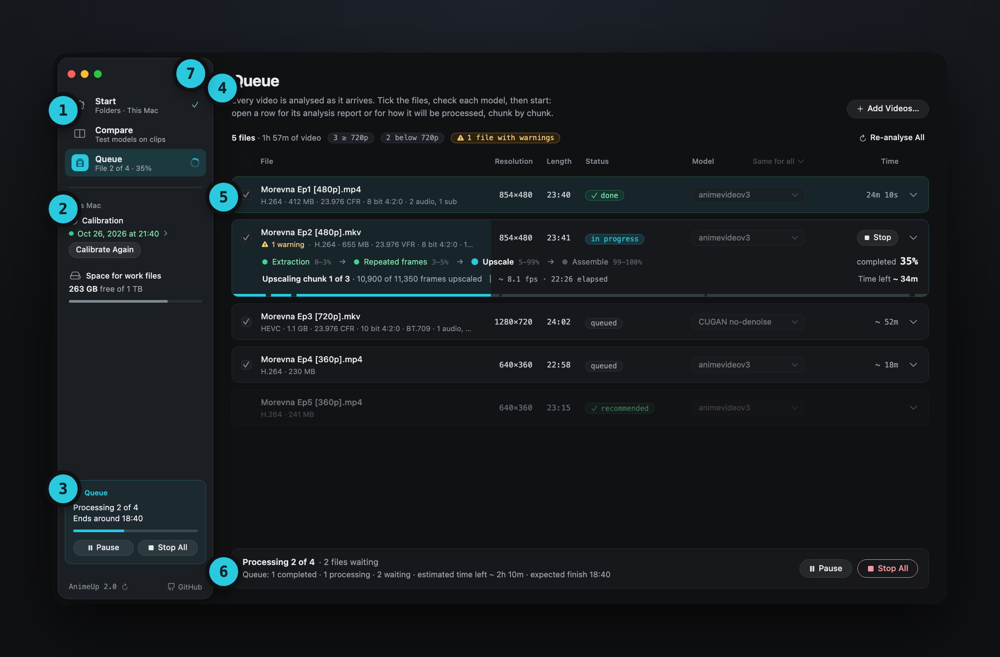

Overview · Interface

# 02. The interface at a glance

One window with three pages, a sidebar that always says what's going on, and a bar at the bottom for the action that matters now.

## The window

{ .au }

1. **The pages**: Start, Compare and Queue. Under each name, a line says what the page is doing: "Folders · This Mac", "Step 2 · models", "File 2 of 4 · 35%". A tick marks Start once it has nothing left to ask; a spinner marks the page that's using the GPU.
2. **This Mac**: whether this Mac is calibrated (click the date for the [calibration results](03-calibration.md#the-results)), and how much space is free for work files.
3. **The activity card**: whatever is using the GPU right now (the queue, a Compare test, a calibration) or the analysis of new videos, with its progress and its buttons (Pause, Stop All, Stop). When AnimeUp has an update, it appears here as a yellow note.
4. **The page**: its title, two lines on what it's for, and its main button at the top right (**Add Videos…** in the Queue).
5. **The content**: the file list, the cards, the player.
6. **The action bar**: what's selected and what happens next, with the page's main action (**Start Processing**, **Pause**, **Stop All**, **Next: Queue**).
7. **Settings** (⌘,): the gear at the top of the sidebar.

At the bottom of the sidebar: the version, a button to check for updates, and a link to the project on GitHub.

!!! tip "Everything stays usable while a file runs"
    The queue, a Compare test and a calibration run in the background. You can switch pages, add more videos or close the window: the work carries on, and the sidebar, the Dock icon and the notifications keep you posted.

## The three pages

| Page | What you do there | Chapter |
|---|---|---|
| **Start** | Add videos, choose where finished videos and work files go, see this Mac and how a batch goes | [04. Start](04-start.md) |
| **Compare** | Test the models on the hardest clips of a file and choose by eye | [06. Compare](06-compare.md) |
| **Queue** | See each file's analysis and plan, run the batch, follow it, see what each file came to, redo a file | [05. The Queue](05-queue.md) |

Adding videos keeps you on the page you're on. The **Next:** buttons at the bottom of Start and Compare take you to the following page.

## A narrow window

Below about 1240 points of width, the sidebar folds into a bar at the top of the window: the three pages as a segmented control, the calibration status and the Settings gear. The Queue shows its number of files in a small capsule. **View › Show Sidebar** (⌃⌘S) brings the sidebar back over the page when you need it.

The pages adapt too: Start's cards go in two columns or one, the Queue drops the columns that don't fit, and long texts keep balanced line breaks.

## Menus and shortcuts

| Menu | Command | Shortcut |
|---|---|---|
| AnimeUp | About AnimeUp · Check for Updates… · Calibrate This Mac… | |
| | Settings… | ⌘, |
| | Quit AnimeUp | ⌘Q |
| File | Open Videos… | ⌘O |
| | Show in Finder (the selected files) | ⇧⌘R |
| | Re-analyse | ⌘R |
| | Remove from List | |
| View | Start · Compare · Queue | ⌘1 · ⌘2 · ⌘3 |
| | Show Sidebar / Hide Sidebar | ⌃⌘S |
| Queue | Start Processing | ⌘↩ |
| | Pause / Resume | |
| | Stop All | ⌘. |
| | Stop the Compare Test | |
| Window | AnimeUp (brings the window back) | ⌘0 |
| Help | AnimeUp Guide · Model guide · Report a Problem… | |
| | Open Log in Console | ⌥⌘L |

The **Dock icon** has its own menu: **Open Videos…**, and **Pause** or **Resume** and **Stop All** while a queue runs. While a file is processed, the Dock icon shows its progress.

## Closing the window, quitting

Closing the window doesn't stop anything: the queue keeps going, its progress stays on the Dock icon, and ⌘0 or a click on the Dock icon brings the window back. The first time, an alert explains this (with **Don't show again**).

**Quit** (⌘Q) asks first if a file is being processed: quitting stops it, and you can resume it the next time you open AnimeUp, from where it stopped.

## Alerts

AnimeUp asks before anything that stops or throws away work, and its alerts use colour to say what kind of question it is:

| Colour | Used for | Examples |
|---|---|---|
| Red | Stopping or discarding work, a missing disk, errors | Stop this file?, Stop the whole queue?, Discard the work done?, The work disk isn't connected |
| Yellow | Something that needs your attention | Quit while a file is being processed?, Calibrate after the queue, a folder AnimeUp can't use |
| Blue | Information | An update is available, closing the window, no videos in a folder |

The same colours run through the whole app: a yellow note is worth a look, a red one means something stopped.

## Notifications

With **macOS notifications** on (Settings › General), AnimeUp sends a banner when a file is done (with its warnings, if any), when one stops, when the whole queue finishes and when a Compare test is ready. Clicking a banner brings AnimeUp to the front.

At the end of a queue a summary sheet also opens in the window: see [The end of the queue](05-queue.md#the-end-of-the-queue).

## Language

AnimeUp starts in the language of macOS if it's English or Italian, and in English otherwise. **Settings › General › Language** switches it at once. The menus follow from the next launch.

[Next: 03. Calibrate your Mac →](03-calibration.md)
