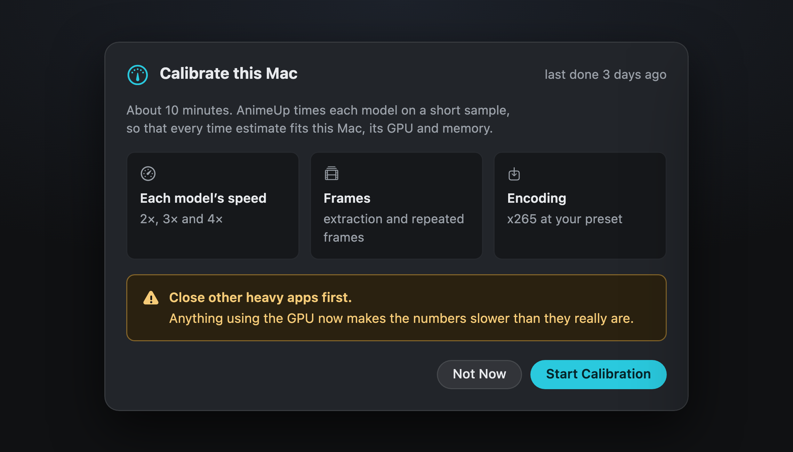
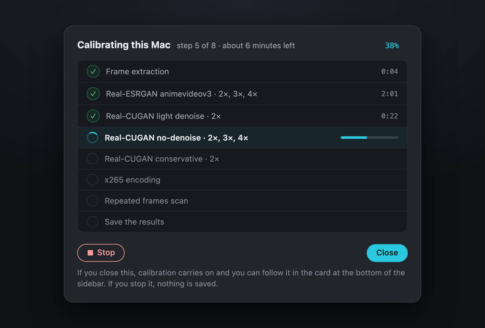
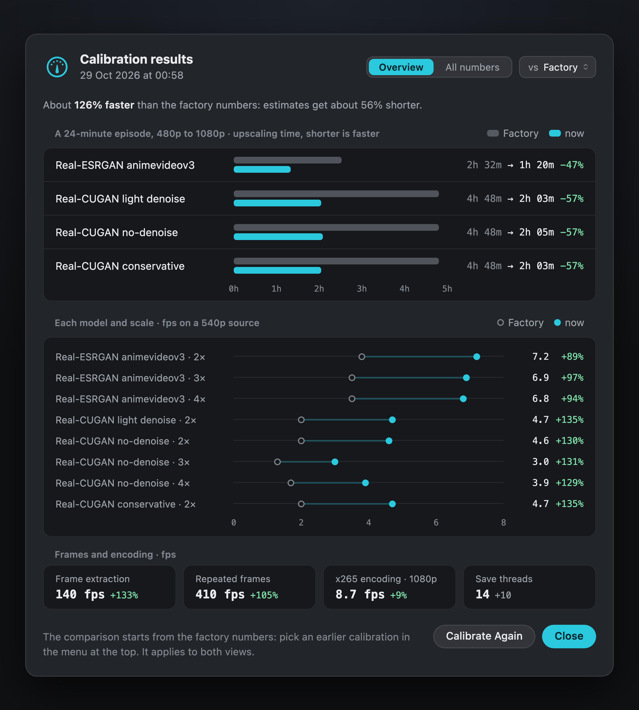

Using AnimeUp · Calibration

# 03. Calibrate your Mac

About ten minutes, once, with the GPU idle: AnimeUp times every model on your Mac, and from then on every estimate is about your machine and not someone else's.

## Why it's worth it

Every time estimate in AnimeUp is built from a few speeds: how fast each model upscales at each scale, how fast frames are extracted and scanned, how fast x265 encodes. Out of the box those speeds are **factory numbers**, measured on the Mac where AnimeUp was developed. On a different chip they're all off by roughly the speed difference between the two Macs: a faster Mac sees estimates that are too long, a slower one sees promises it can't keep.

Calibration measures the same numbers on **your** Mac. AnimeUp works without it, but its times are only a rough guide until you do it. The Queue says which kind of estimate you're looking at: "estimates calibrated on this Mac" or "factory estimates: calibrate this Mac for exact ones".

## Starting it

The first time, **This Mac** on Start suggests it, and the sidebar says **Not done yet** with a **Calibrate** button. You can also use **AnimeUp › Calibrate This Mac…** or **Calibrate Again** in the sidebar at any time.

{ .au }

The sheet says what will be timed:

- **each model's speed**, at 2×, 3× and 4×;
- **frames**: extraction and the repeated-frames scan;
- **encoding**: x265 at your preset.

Close other apps that use the GPU first (games, video editors): anything else running makes the numbers slower than they really are. Then click **Start Calibration**.

!!! info "Calibration and the queue never run together"
    While a queue is running, AnimeUp won't start a calibration: timing the models while the GPU is busy would give wrong numbers, so it asks you to calibrate when the queue finishes. The other way round, a queue can't start while calibration runs.

## While it runs

The sheet becomes a checklist: one row per model and per measurement, each ticked with its time as it finishes.

{ .au }

Each model is timed on a short sample (a scene from Big Buck Bunny, 854×480) at every scale it offers, and right after that at 2× on 1080p frames, because large sources run at a different speed per pixel. Real-CUGAN conservative shares no-denoise's network, so it's timed at 2× only and borrows the rest. A step that fails gets a red **stopped** chip.

You can close the sheet: calibration carries on, and the activity card in the sidebar shows its progress. **Stop** ends it without saving anything: the previous calibration (or the factory numbers) stays in use.

## The results

When it finishes, the results open. You can reopen them any time by clicking the calibration date in the sidebar or on Start.

{ .au }

**Overview** answers the question you care about: how much faster or slower this Mac turned out, and what that means for an episode. For every model it shows how long a 24-minute episode would take to upscale, before and after, a chart with a row for each model and scale, before and now, and tiles for extraction, the repeated-frames scan, x265 and the save threads.

**All numbers** lists everything that was measured, side by side with the factory numbers and with an earlier calibration: every model and scale (as speed on a 540p source), each model at 2× on 1080p sources, extraction, the repeated-frames scan, x265 encoding and the number of save threads.

The menu at the top chooses what to compare with: the factory numbers, or any earlier calibration of this Mac. AnimeUp keeps their history.

!!! note "Save threads"
    One of the numbers changes how AnimeUp *works*, not just what it predicts. The upscalers write their frames with a pool of threads, and on a fast GPU that pool can become the bottleneck. Calibration tries a few sizes and keeps the fastest one, but only if it's clearly faster than the default and produces exactly the same frames, bit for bit.

## When to calibrate again

- After a macOS update, or a change to your Mac.
- If the estimates drift: files regularly take much longer, or much shorter, than predicted.
- When the sidebar says **From an older version** (a calibration made with AnimeUp 1.x) or **From another Mac** (the settings folder was copied from a different Mac). A calibration belongs to the Mac it was made on: from another one it's ignored.

!!! tip "The estimates also learn by themselves"
    Every finished file teaches AnimeUp something: how many repeated frames similar files had, and how much time went into the steps the models don't count. Calibration sets the speeds; the history refines the rest.

[Next: 04. Start →](04-start.md)
