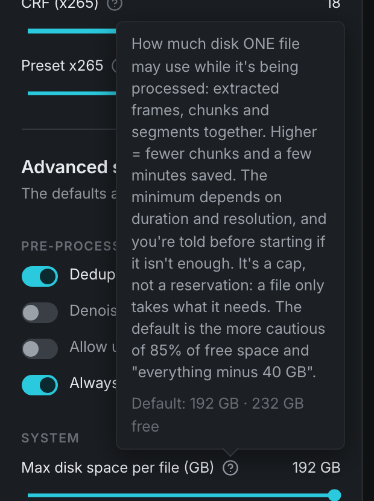
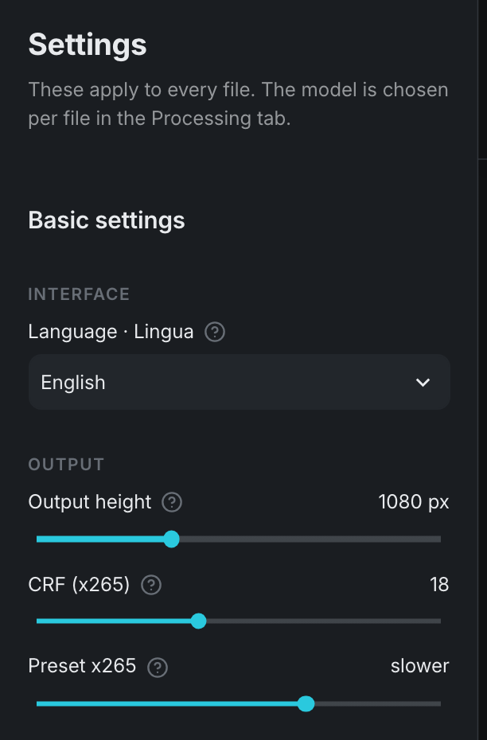
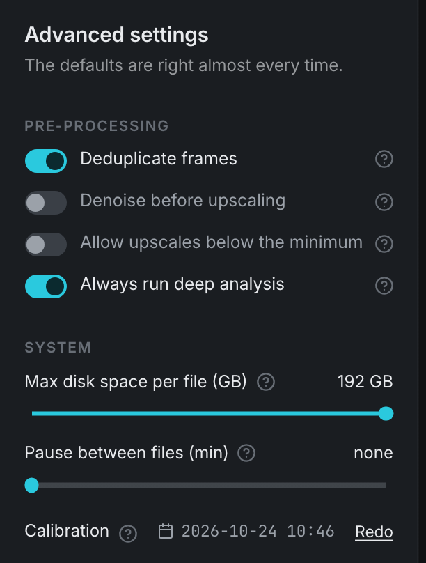
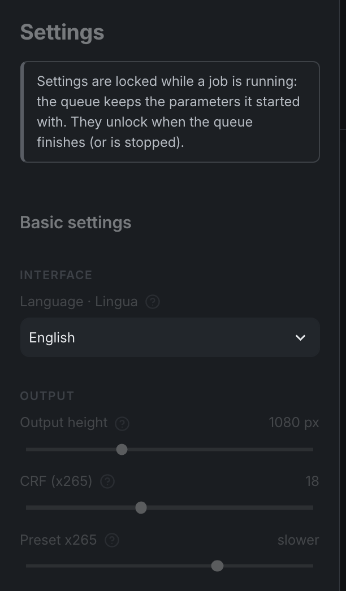
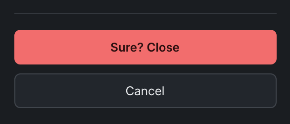

<span class="eyebrow">Step 03 · Interface</span>

# 03. The interface and its settings

A tour of the AnimeUp window and of every control in the sidebar: what it does, its range, its default and when you'd change it.


## The layout

The window has two parts:

- **The sidebar** on the left, titled **Settings**. It holds everything that applies to *all* files: output size, encoding quality, pre-processing, disk space, pauses, calibration, language. **Close AnimeUp** is pinned at the bottom.
- **The main area** on the right, with the header and three tabs. This is where you work on individual files.

When nothing is running, a caption under the sidebar title reminds you of the split: *"These apply to every file. The model is chosen per file in the Processing tab."* The model is the one setting that isn't in the sidebar. You pick it per file in [06. Processing](06-processing.md) after trying it in [05. Compare](05-compare.md).

## The header and the tabs


At the top are three numbered tabs, in the order you normally use them. The version you're running is shown in small grey type at the bottom of the sidebar (*"Local upscaler · Apple Silicon · v1.5.0"*).

| Tab | What you do there | Chapter |
|---|---|---|
| **1 Sources** | Check how each file in `INPUT/` was analysed | [04. Sources](04-sources.md) |
| **2 Compare** | Try the models on short difficult clips and judge them by eye | [05. Compare](05-compare.md) |
| **3 Processing** | Pick files and models, start, monitor, stop and resume | [06. Processing](06-processing.md) |

### Number badges

A small round badge on a tab, like the badges on iOS app icons, tells you how many things are waiting there:

| Tab | The badge counts | No badge means |
|---|---|---|
| **Sources** | Files waiting to be analysed, plus the one being analysed now | Every file in `INPUT/` has been analysed |
| **Processing** | Files left in the running queue: the one in progress plus those waiting their turn | No queue is running |

**Compare** never shows a badge. Counts above 99 show as `99+`.

### The address remembers the tab

The active tab is written into the page address, for example `http://localhost:8899/?scheda=lavorazione`. If you reload the page, or bookmark it, AnimeUp reopens on the same tab instead of going back to Sources. The values are the Italian internal names: `sorgenti`, `confronto`, `lavorazione`.

!!! tip "Dropdowns don't take typing"
    AnimeUp's dropdown menus ignore letters you type into them. With only a handful of options, typing a filter only ever produced "No results". Use the mouse, or the arrow keys, Enter and Esc.

## Help bubbles



Most controls have a round **(?)** icon next to them. Hover over it, or reach it with the Tab key, to open a bubble that explains the control. In the sidebar the bubble ends with a grey line, **Default: …**, giving the factory value, so you can always get back to it.

A **(i)** icon with a vertical bar works the same way, but it gives extra detail about a number that already makes sense on its own (for example, where an estimate came from). A (?) answers a question you might have. An (i) adds context you can skip.

## Basic settings



The sidebar has two sections: **Basic settings** and **Advanced settings**. Each slider shows its current value at the right-hand end of its label.

| Setting | What it does | Values | Default |
|---|---|---|---|
| **Language · Lingua** | Language of the interface and of the command-line messages | English, Italiano | English |
| **Output height** | Height of the finished video, in pixels | 720, 1080, 1440, 2160 px | 1080 px |
| **CRF (x265)** | Encoding quality: lower means higher quality and a bigger file | 14 to 24 | 18 |
| **Preset x265** | Encoding effort: slower gives a smaller file at the same quality | medium, slow, slower, veryslow | slower |

### Language · Lingua

The label is always in both languages, so you can find it even if the interface is in a language you can't read. Your choice applies straight away and is remembered. It also sets the language of the messages in the Terminal window and of `./animeup` commands, which read the same saved setting. This control is never locked, not even during a job, because it doesn't affect any job.

### Output height

The height of the output file. The width follows from the source's real aspect ratio, with square pixels: 4:3 stays 4:3 and anamorphic video isn't squashed.

- **Change it** when you want 1440p or 2160p, or 720p for very small sources.
- **Two limits apply.** AnimeUp won't make a file more than 4× taller than its source. If you ask for more, it lowers the target and warns you. It also refuses upscales below 1.25× (see **Allow upscales below the minimum** below).
- The output height is part of the output file name (see [07. Output files and folders](07-output-and-folders.md)).

### CRF (x265)

The quality setting of the x265 encoder. Lower is better quality and a bigger file. At the default of 18 the measured difference from lossless is 54 dB, which you can't see. Go lower (16, 14) only if you plan to edit or re-encode the output. Go higher (20 to 24) if file size matters more than the last bit of fidelity.

### Preset x265

How much time x265 spends looking for the most efficient way to compress each frame. Slower presets give a **smaller file at the same quality**. They don't change the upscale, only the encoding step, which runs on the CPU between chunks. `veryslow` makes encoding noticeably longer for a modest saving in size. `medium` and `slow` save encoding time at the cost of a bigger file.

!!! note "The preset appears in the file name only when it isn't `slower`"
    Two jobs that differ only in preset would otherwise write to the same file name. So a non-default preset is added to the name, for example `[… crf18 dd veryslow]`.

## Advanced settings



Under the section title the sidebar says *"The defaults are right almost every time."* It means it: change these only for a specific reason.

### Pre-processing

| Setting | What it does | Default |
|---|---|---|
| **Deduplicate frames** | Upscales repeated frames only once | on |
| **Denoise before upscaling** | Applies a light denoise filter to the source frames before the model | off |
| **Allow upscales below the minimum** | Lets through jobs that AnimeUp would normally refuse | off |
| **Always run deep analysis** | Measures deduplication on every source in advance, for better time estimates | on |

**Deduplicate frames.** Anime is often drawn "on twos" or "on threes": the same drawing stays on screen for two or three frames. With this on, AnimeUp upscales each drawing once and reuses the result. On the footage tested this halved processing time. The check is strict. A frame is skipped only if no pixel on any colour channel differs from the last kept frame by more than 16/255. The map is also checked by an independent audit before use, and any frame wrongly marked as a repeat is processed after all. Turn it off only to rule it out while troubleshooting. Its effect is shown as `dd` in the output file name. See [How a job works inside](deep-dives/how-it-works.md) for the details.

**Denoise before upscaling.** Only useful on noisy sources: the models would otherwise amplify compression noise along with the artwork. The filter is conservative (FFmpeg `hqdn3d=1.5:1.5:6:6`), but it is still a filter on your source, so try it in [Compare](05-compare.md) before using it on a whole series. AnimeUp never turns it on by itself. Shown as `dn` in the file name. Changing it means the frames have to be extracted again if you resume a job (see [How a job works inside](deep-dives/how-it-works.md)).

**Allow upscales below the minimum.** Normally AnimeUp refuses an upscale smaller than 1.25×, because it costs the same GPU hours for very few extra pixels. With this on it:

- processes files whose gain is below 1.25×, including sources already at the target height. Those come out labelled `supersampling` instead of `upscale`;
- lets a model that can't reach the target height go ahead anyway, with a plain lanczos resize covering the rest. That is enlargement with no added detail.

Both cases add a "Forced: …" warning to the plan. Leave it off unless you know why you need it.

**Always run deep analysis.** It measures how many frames deduplication will skip on *each* source, instead of guessing from files you processed before. This gives much more accurate time estimates before you start. It takes roughly 11 seconds for a 360p file, 40 seconds for 720p and 69 seconds for 1080p, once per file. The result is saved. When it's off you can still ask for it file by file with the **Deep analysis** button in [Sources](04-sources.md). It affects estimates only, never the output.

### System

| Setting | What it does | Values | Default |
|---|---|---|---|
| **Max disk space per file (GB)** | Cap on the disk space ONE file may use while it's being processed | 50 GB up to a cap based on free space | the cap itself (see below) |
| **Pause between files (min)** | Minutes of rest between one file and the next in a queue | 0 to 30 (0 shows as "none") | 5 min |

#### Max disk space per file (GB)

While a file is processed, AnimeUp needs room for the extracted source frames, the chunk being upscaled and the encoded segments. This slider sets the most it may use for one file, all of that together. AnimeUp decides how to split the work into chunks to stay within it.

- **Higher** means fewer, bigger chunks, which saves a few minutes (each chunk has a fixed cost of about a minute).
- **Lower** means more chunks. There's a floor, though: the source frames and the video can't be split. If the space you set isn't enough even for those, the plan tells you before you start, with the number you'd need.
- **The minimum is 50 GB.** Below that no ordinary file can be processed: the source frames alone of a 24-minute 720p episode take 31 GB.

**It's a cap, not a reservation.** A file only takes what it needs, and a generous cap costs nothing. It only stops AnimeUp from refusing a job that would actually fit.

**The default is a rule, not a number.** The default, and the slider's maximum, is the more cautious of two values:

- 85% of the free space on the disk where the AnimeUp folder lives;
- all the free space minus 40 GB.

On a nearly full disk the second wins, so macOS always keeps some room. On an empty disk the first wins. The help bubble's **Default:** line shows the result for your disk, for example `193 GB · 233 GB free`.

!!! info "Recalculated every time you open AnimeUp"
    This slider does not remember a value you set by hand. Each time you open AnimeUp, or reload the page, it goes back to the rule above. This is deliberate. A remembered low value had ended up at the slider's minimum on a disk with hundreds of free gigabytes, costing extra chunks and hours. Raising it costs nothing, so it always starts high.

**The "Lowered to" note.** If free space shrinks while AnimeUp is open, so that the value on the slider no longer fits the disk, the sidebar lowers it and tells you so in a note like this: *"The space you set (300 GB) is no longer available on this disk: 120 GB free. Lowered to 80 GB, which leaves enough room for the system."* Nothing is wrong. The new value is simply the cap for today's disk.

#### Pause between files (min)

Minutes of rest between one file and the next, to give the CPU and GPU a break during long runs.

- During the pause **Start** stays disabled and the bottom bar shows when work resumes.
- The pause happens only *between* files: never before the first, never after the last, and not for files skipped because they're already done.
- **0** turns it off (the slider then reads "none").
- The default is 5 minutes so that marathon runs get their breaks without you having to remember. (On the command line, `./animeup run --pausa` defaults to 0. See the [command-line reference](reference/command-line.md).)

### Check for updates

On by default. Once a day AnimeUp asks GitHub for the latest release; if there's a newer one, a note appears at the top of the sidebar, *AnimeUp x.y.z is available. Download it*, linking to the release page. Nothing is downloaded or installed automatically, and it's the only connection AnimeUp makes by itself after the first launch. Turn it off here if you prefer.

### Data folder (app only)

In the app, the **System** section also shows where your files live (by default `~/Movies/AnimeUp`) with a **Change…** link that opens the macOS folder picker. AnimeUp switches to the new folder within a few seconds (the window reloads) and remembers it for the next launches; files already in the old one aren't moved. If at launch the chosen folder isn't available (an external drive that isn't connected), AnimeUp uses `~/Movies/AnimeUp` and shows a note here and in the Sources tab. The same choice is offered in the Sources tab when INPUT is empty. In the portable folder this row doesn't exist: the data stays next to the program (see [`ANIMEUP_ROOT`](07-output-and-folders.md#keeping-data-somewhere-else-animeup_root) for the Terminal way).

### Calibration

At the bottom of System, the **Calibration** row shows when this Mac was last calibrated (a calendar icon with date and time, or **Never**) and a button: **Run now** the first time, **Redo** afterwards. The button opens the calibration window. Calibration times this Mac on the sample clip (models, extraction and encoding) and adapts every estimate to its real speed. It takes about 10 minutes, with the GPU idle. Everything about it is in [02. Calibrate your Mac](02-calibration.md).

The button is disabled while a job is running: measuring a busy GPU would give false numbers.

## While a job is running: the locked sidebar



As soon as a queue is running, is paused, or any job is alive, the sidebar locks. A note appears under the title:

> Settings are locked while a job is running: the queue keeps the parameters it started with. They unlock when the queue finishes (or is stopped).

Why: the running queue uses the parameters it was started with, so changing the sidebar would have no real effect on it. But the file list would re-judge every row against the new values, and a finished episode could suddenly look "not done" just because the CRF on screen had changed.

What stays usable while locked:

| Control | Locked? |
|---|---|
| Output, Pre-processing and System sliders and toggles | Locked and greyed out, help bubbles hidden |
| **Calibration** button | Disabled |
| **Language · Lingua** | Still usable (it doesn't affect any job) |
| **Close AnimeUp** | Still usable |

## The paused-file note

When an interrupted job is waiting in `JOBS/` and it was started with different settings from the ones in the sidebar now, a yellow note appears at the top of the sidebar:

> There's a paused file that was started with different parameters (CRF, Output height). Resume will still use its own parameters: changes here only apply to new jobs.

The names in brackets are the settings that differ. It's information, not a warning of danger. **Resume** in Processing always uses the parameters saved with that job (in its `parametri.json`), whatever the sidebar says, so resuming can never throw away work already done.

Under the note is a button, **Reset the sidebar to the paused file's parameters**. It copies that job's values back into the sidebar, for when you want new jobs to match the interrupted one. If several jobs are interrupted, the note refers to the most recent one. The note is hidden while the sidebar is locked.

!!! note "Disk space is left out"
    **Max disk space per file (GB)** is recalculated from free space every time you open AnimeUp, so it almost never matches the value saved with an interrupted job. It isn't compared, and **Reset the sidebar…** doesn't copy it back: an old value measured on a disk that has changed since would be wrong. It doesn't matter for resuming either: a resumed job keeps the chunk layout it started with.

## "N system dependencies"

If a warning chip like **2 system dependencies** appears near the bottom of the sidebar, followed by *"The folder isn't self-contained: `./animeup setup`"*, some of the four external programs AnimeUp needs (`ffmpeg`, `ffprobe`, `realesrgan-ncnn-vulkan`, `realcugan-ncnn-vulkan`) are either missing from the folder's `bin/` or being taken from elsewhere on your Mac. AnimeUp may still work, but the folder is no longer portable. To fix it, run this in a Terminal window from the AnimeUp folder:

```bash
./animeup setup
```

Then check with `./animeup doctor`. When everything is in place the chip disappears: AnimeUp says nothing when all is well. See [Troubleshooting](reference/troubleshooting.md) if `setup` fails.

## Close AnimeUp

!!! note "In the app"
    The app has no **Close AnimeUp** button: quit it like any Mac app, with **⌘Q** or **AnimeUp → Quit AnimeUp**. Jobs keep running in the background, exactly as described below.




**Close AnimeUp**, with a power icon, is anchored at the bottom of the sidebar. It shuts down the interface (the local server running in the Terminal window). Closing works in two steps:

1. Click **Close AnimeUp**. It turns into two buttons, **Sure? Close** and **Cancel**. If you don't confirm within about 10 seconds, the confirmation lapses and the single button comes back.
2. Click **Sure? Close**. The page shows *"AnimeUp has shut down"* and *"You can close this window and the Terminal window."*

!!! warning "Running jobs keep running"
    Closing AnimeUp does NOT stop a job. Jobs run as separate processes: they carry on in the background and are still there next time you open AnimeUp. When a job is running, the confirmation step says so first: *"The running job will NOT stop… To stop everything, use "Stop all" in Processing first."* To really stop, use **Stop** or **Stop all** in [Processing](06-processing.md) before closing.

Closing the browser tab shuts nothing down. Closing the Terminal window shuts down the interface, but not running jobs, the same as **Close AnimeUp**.

## Your settings are remembered

Every sidebar value is saved automatically to `registri/impostazioni.json` whenever it changes. The next time you open AnimeUp you get the values from your last session, not the factory defaults. The one exception is **Max disk space per file (GB)**, which is always recalculated as explained above. A saved value that's out of range (for example, a file edited by hand) is ignored and the default is used.

## Before you move on

!!! success "Check"
    - [ ] You know the three tabs and what their badges count
    - [ ] Output height, CRF and preset are set the way you want (the defaults are a good start)
    - [ ] You know Max disk space per file is a cap, not a reservation
    - [ ] You know closing AnimeUp doesn't stop a running job

[Next: 04. Sources →](04-sources.md)
