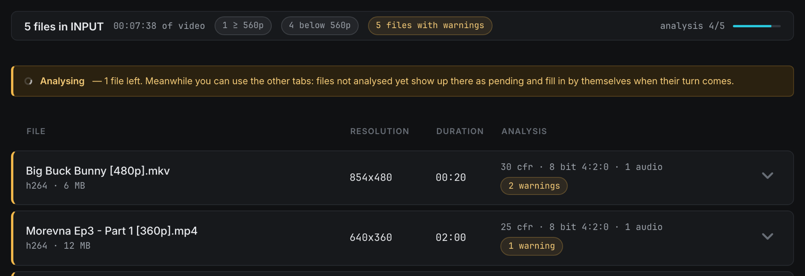
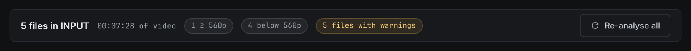
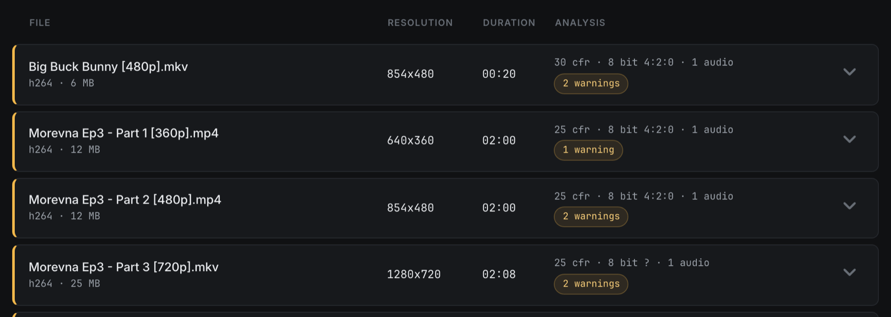
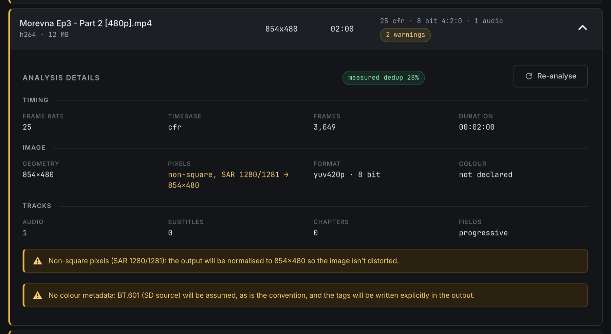

Step 04 · Sources

# 04. Sources: check your files

The Sources tab analyses every video in `INPUT/` on its own and tells you, before you spend hours of GPU time, whether anything about a file needs your attention.

## What you need first

Copy the episodes you want to process into the videos to process folder, `INPUT/`. In the portable folder it's inside the AnimeUp folder. In the app it's `~/Movies/AnimeUp/INPUT` unless you chose another one (see [Video folders](03-interface.md#video-folders-app-only)). A few rules:

- AnimeUp only looks at files directly inside `INPUT/`: it doesn't look inside subfolders.
- Recognised extensions: `.mkv`, `.mp4`, `.mov`, `.avi`, `.m4v`, `.ts`, `.webm`.
- A whole series is fine, and files can have different resolutions.
- You don't need to reload the page. A file you copy in while AnimeUp is open shows up within a few seconds and joins the analysis queue.

If `INPUT/` is empty, the tab shows **No videos in INPUT** and reminds you where to copy the files. The other two tabs have nothing to work on either until you add something.

## Analysis runs by itself

You don't press anything to start the analysis. As soon as AnimeUp opens, whichever tab you land on, it queues every file in `INPUT/` that hasn't been analysed yet and works through them **one at a time, in order**.

It works on one file at a time on purpose: each analysis decodes the whole video, so two at once would compete for the disk and CPU without finishing any sooner. Expect roughly twenty seconds per file. Results are saved, so a file is analysed only once. The next time you open AnimeUp, a file you've already analysed appears straight away. If you rename it, move it or change it, it's analysed again.

While the analysis runs, a yellow banner appears above the list:

> **Analysing** — 3 files to go. Meanwhile you can use the other tabs: files not analysed yet show up there as pending and fill in by themselves when their turn comes.

That's literal: you can go to **Compare** or **Processing** and carry on. The page refreshes itself every second or two until the queue is empty.

!!! info "What \"analysis\" actually checks"
    Without decoding the picture, AnimeUp reads the video packets to classify the timing (constant, variable, or constant with missing frames). It then makes one full pass with FFmpeg's `idet` filter to find interlacing and telecine, and reads geometry, pixel format, colour tags and tracks from the container. There's no sampling: one full pass costs seconds, and decisions based on a guess can't be undone later.

## The summary bar

At the top of the tab, one bar sums up the whole folder.

| Element | What it shows |
|---|---|
| **N files in INPUT** | How many video files AnimeUp found. |
| **HH:MM:SS of video** | The total running time of all those files. |
| **N ≥ 560p** chip | Files whose height is 560 pixels or more. |
| **N below 560p** chip | Files below 560p. |
| **N files with warnings** chip (yellow) | How many *files* have at least one analysis warning (not the total number of warnings: that's the **N warnings** chip on each row). Only shown when at least one file has a warning. |
| **analysis X/Y** + bar | Shown while the analysis is running, or while some files are still unanalysed: how many files are done out of the total. |
| **Re-analyse all** button | Shown in place of the counter when nothing is being analysed. |

!!! note "Which threshold?"
    560p is where AnimeUp's model recommendation changes: from 560p up there's real detail worth preserving, and **Real-CUGAN no-denoise** is recommended. Below it, **Real-ESRGAN animevideov3** is the safer base. "Below 560p" isn't a quality verdict or an error. It only tells you how your folder splits between the two cases. See [05. Compare](05-compare.md) and [The models](deep-dives/models.md).

### Re-analyse all

**Re-analyse all** analyses every file again from scratch, ignoring the saved results. You'll rarely need it. Use it when files in `INPUT/` changed but kept the same name, or when you simply don't trust what was saved. While it runs, the old results stay visible, so the list doesn't empty out. Each row shows **queued** until its turn comes. If **Always run deep analysis** is on in the sidebar, the deep measurement is redone too.

## The file list

Below the bar, one row per file, with four columns:

| Column | Content |
|---|---|
| **File** | The file name, and underneath it the video codec and size in MB (e.g. `h264 · 12 MB`). |
| **Resolution** | Width × height as stored in the file. |
| **Duration** | Running time (MM:SS, or H:MM:SS for anything over an hour). |
| **Analysis** | The analysis state or a one-line summary (see below). |

On the far right, a chevron opens and closes the row's details. You can keep several rows open at once, which is handy for comparing two files side by side.

### Row states

The coloured strip on the left of each row and the text in the **Analysis** column tell you where each file stands.

| What you see | What it means | What to do |
|---|---|---|
| Yellow chip **analysing…** with a spinner, blue strip | This file is being analysed right now. | Wait a few seconds. |
| Grey chip **queued**, row slightly dimmed | Waiting its turn in the queue (also shown after you ask for a re-analysis). | Nothing. |
| Grey chip **not analysed**, row dimmed, chevron disabled | No saved result and not in the queue yet. It usually turns into **queued** at the next refresh. | If it stays this way, the file probably can't be read: check it plays in a normal player. |
| One-line summary, green strip | Analysed, nothing to report. | Nothing. |
| One-line summary plus a yellow **N warnings** chip, yellow strip | Analysed, with something worth reading. | Open the row and read the warnings. |

### The one-line summary

Once a file is analysed, the **Analysis** column condenses the result into one line, for example:

`23.976 cfr · 10 bit 4:2:0 · bt709 · 2 audio, 1 subs, 6 ch`

In order: the frame rate and timebase, the bit depth and chroma subsampling, and the field mode if the file isn't progressive (`interlaced`, `telecine`, `unknown`). Then the colour space, if the file declares one, and the tracks (`audio`, `subs`, `ch` for chapters), each shown only when present. The exact values live in the details panel. The summary only lets you spot an odd file without opening it.

## Analysis details

Open a row with its chevron to see the full report.

At the top of the panel, next to the **Analysis details** title, you'll find the deduplication measurement (explained [below](#measured-deduplication)) and the **Re-analyse** button.

### Timing

| Field | What it means | Highlighted when |
|---|---|---|
| **Frame rate** | The measured frame rate, with the exact fraction where it matters (e.g. `23.976 (24000/1001)`). | — |
| **Timebase** | `cfr`: constant frame rate, the normal case. `vfr`: the frame rate varies. `cfr with gaps`: constant, but frames are missing. `unknown`: too few packets to judge. | Anything other than `cfr` |
| **Frames** | The number of video packets actually found in the file. | — |
| **Duration** | Running time as HH:MM:SS. | — |

### Image

| Field | What it means | Highlighted when |
|---|---|---|
| **Geometry** | Width × height stored in the file. | — |
| **Pixels** | `square`, or `non-square, SAR 32:27 → 854×480`: the sample aspect ratio and the size the image is actually meant to be displayed at. | Pixels aren't square |
| **Format** | Pixel format and bit depth, e.g. `yuv420p10le · 10 bit`. | — |
| **Colour** | The declared colour space (e.g. `bt709`), or `not declared`. | Never: see the note below |

### Tracks

| Field | What it means | Highlighted when |
|---|---|---|
| **Audio** | Number of audio tracks. All of them are copied into the output untouched. | — |
| **Subtitles** | Number of subtitle tracks, with their formats in brackets (e.g. `2 (ass, subrip)`). | — |
| **Chapters** | Number of chapters. | — |
| **Fields** | `progressive`, `interlaced`, `telecine`, `unknown`, or `not analysed` if the field scan couldn't run. | Anything other than progressive |

Highlighted values appear in yellow. They're the ones that change the result. A missing colour tag isn't highlighted because it isn't a problem: AnimeUp fills it in by convention (BT.601 below 720p, BT.709 from 720p up) and writes the tags explicitly in the output.

Below the grid, each warning for the file appears in its own yellow box with a ⚠ sign. They're all listed in [Every analysis warning](#every-analysis-warning).

### Measured deduplication

Deduplication skips the identical frames of animation drawn "on twos". How many there are decides how long a job takes. A normal analysis doesn't measure it, because measuring costs more time than the rest of the analysis. Without a measurement, AnimeUp falls back on what it saw in files already processed, which can be badly wrong: the help text quotes a real case where the inferred figure was 6.5% against a true 33%, an estimate off by almost four hours out of thirteen.

The deep analysis measures it directly: six 4-second windows spread across the file, using the same rule as the real deduplication. What you see in the panel depends on the sidebar setting **Always run deep analysis** (see [03. The interface](03-interface.md)):

| What you see | When | Meaning |
|---|---|---|
| Green chip **measured dedup 11%** | The measurement has been done | About 11% of frames are expected to be skipped. The estimates in Compare and Processing use this figure. |
| **Deep analysis** button | **Always run deep analysis** is off and the file has no measurement yet | Click it to measure this file only. It runs in the background, in the same queue as the analysis. |
| **measuring…** | **Always run deep analysis** is on and the file is being measured or waiting its turn | Wait: the chip replaces it when done. |
| **dedup can't be measured on this file** | **Always run deep analysis** is on, but the measurement failed or was impossible | Usually the file is too short: the six windows need about ten seconds of usable footage. Estimates fall back on the inferred value. |

The measurement takes about 11 seconds for a 360p file, 40 seconds for 720p and 69 seconds for 1080p. It's done once per file and saved. The analysis already done isn't repeated.

!!! tip "When to turn deep analysis off"
    **Always run deep analysis** is on by default, and that's right for most people. Turn it off if you keep a large folder of files of which you'll only process a few. You then measure just the ones you care about with the **Deep analysis** button.

### Re-analyse

**Re-analyse** analyses this single file again from scratch, ignoring the saved result. The row shows **queued** and then **analysing…** while it runs. Use it if you replaced the file with another one of the same name.

## Every analysis warning

These are all the warnings the analysis can raise. Most of them describe something AnimeUp will handle by itself. Two describe things it deliberately won't handle.

| Warning (as shown) | What it means | What AnimeUp does / what you should do |
|---|---|---|
| **File probably truncated**: the container declares *N*s but the video stops *M*s earlier. The output would end there. | Fewer video frames than the declared duration needs (more than 2% short, and never less than two seconds' worth). Typical of an interrupted download. | The output will stop where the video stops. Get a complete copy of the file before you spend hours on it. |
| **VFR source**: the frame rate varies. It will be normalised during extraction, without re-encoding the source. | Variable frame rate. | Handled: frames are extracted on a constant grid at the detected frame rate. Nothing to do. |
| ***N* frames missing (*G* gaps in the sequence)**: the rip is incomplete. Gaps will be filled by repeating the previous frame so the duration doesn't change. | Constant frame rate, but frames are missing. | Handled as described, so audio stays in sync. A better source is still preferable if you have one. |
| **The container declares *X* fps but the timestamps say *Y* fps.** Using the measured value. | The header and the actual timestamps disagree. | Handled: AnimeUp trusts the measured timestamps. Nothing to do. |
| **Non-standard frame rate (*X*)**: probably an inaccurate rip. Check the preview result. | The measured rate doesn't match any standard rate (23.976, 24, 25, 29.97, 30, 48, 50, 59.94, 60, 12, 15, 16) within 0.1%. | Processing goes ahead at the measured rate. Run a short test in [Compare](05-compare.md) and check the motion looks right. |
| **Interlaced content**: AnimeUp doesn't deinterlace, and the model would upscale the combing lines into permanent artefacts. Prepare the file with a dedicated tool first, then put it back in INPUT. | Most frames are interlaced. | **Not handled.** AnimeUp doesn't deinterlace. Prepare the file with a dedicated tool first, then put the result back in `INPUT/`. |
| **3:2 telecine detected**: the content is 23.976 inside a 29.97 container. AnimeUp doesn't do inverse telecine: recover the original frames with a dedicated tool first, then put the file back in INPUT. | Film content padded with repeated fields. | **Not handled.** AnimeUp doesn't do inverse telecine either. Same remedy as for interlaced content. |
| **Non-square pixels (SAR *x:y*)**: the output will be normalised to *W*x*H* so the image isn't distorted. | Anamorphic video (common on DVDs). | Handled: the short axis is stretched to the correct shape, and no real pixels are thrown away. Nothing to do. |
| **mov_text subtitles**: they can't be copied into MKV and will be converted to SRT. | MP4-style subtitles. | Handled: converted to SRT in the output. Styling, if any, is lost. |
| **No usable video track**: this file can't be processed. | The file has no readable video. | Remove it from `INPUT/`, or check that it plays in a normal player. |
| **No colour metadata: BT.709 (HD source) will be assumed**, as is the convention, and the tags will be written explicitly in the output. | No colour tags, file 720p or taller. | Handled. This is informational. |
| **No colour metadata: BT.601 (SD source) will be assumed**, as is the convention, and the tags will be written explicitly in the output. | No colour tags, file below 720p. | Handled. This is informational. |

!!! warning "Interlaced and telecined files"
    AnimeUp's own detection can't reliably tell hard telecine from true interlacing, and the wrong fix destroys the original progressive frames instead of recovering them. That's why it doesn't attempt either. If you process such a file anyway, the job runs, but the combing lines are upscaled into the output. Prepare these files with a dedicated deinterlacing or inverse-telecine tool first.

!!! note "Warnings don't block you"
    Apart from **No usable video track**, no warning stops you from processing a file. They're there so you decide with full knowledge, rather than finding a problem after hours of GPU time.

## Before you move on

!!! success "Check"
    - [ ] Every file you want to process appears in the list, with the right resolution and duration.
    - [ ] The analysis counter has reached the total (or you know which files are still queued).
    - [ ] You've opened every row with a yellow warnings chip and read the warnings.
    - [ ] Any **truncated**, **interlaced** or **telecine** file has been replaced or prepared with another tool.
    - [ ] If you care about accurate time estimates, the files you'll process show a **measured dedup** chip.

[Next: 05. Compare →](05-compare.md)
