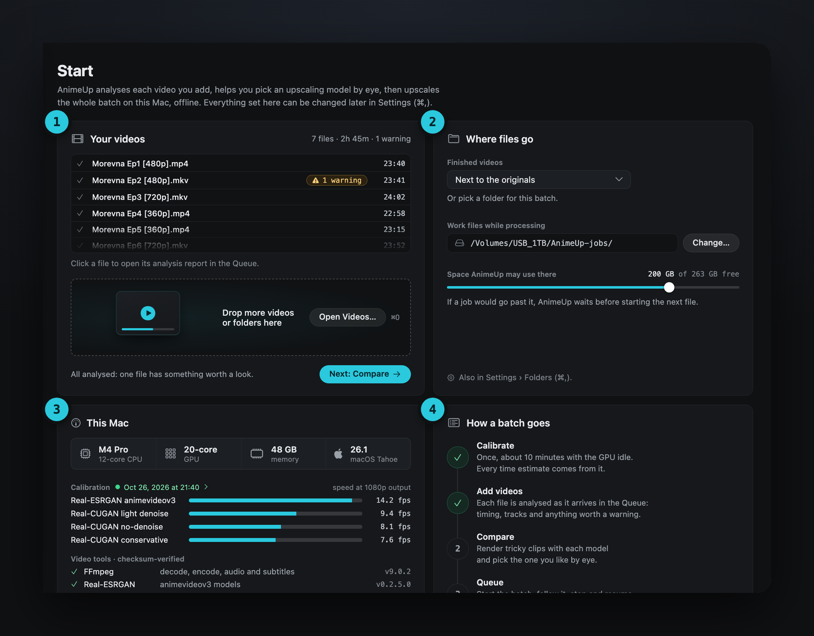

Using AnimeUp · Start

# 04. Start

The page AnimeUp opens on: where videos come in, where they go, and what this Mac can do.

{ .au }

## 1 · Add videos

Drop video files or whole folders on the drop area, or click **Open Videos…** (⌘O). A folder brings in the videos inside it, and those in its subfolders too if **Include subfolders** is ticked in the Open panel: the choice is remembered and also applies to dropped folders. Anything that isn't a video is skipped; if a folder has no videos at all, AnimeUp says so.

AnimeUp takes .mkv, .mp4, .mov, .avi, .m4v, .ts and .webm files, as the formats on the card show. Interlaced or telecined video isn't handled: AnimeUp says so when a file is one.

Once videos arrive, the card becomes **Your videos**: each file with its length and its state, a grey tick once it's analysed, a green one once its video is made, and a yellow chip if something is worth a look. Click a file to open its analysis report in the Queue. You can keep dropping more.

!!! note "Videos already in the Queue are left out"
    Adding a file that's already there changes nothing, and videos AnimeUp made itself are never added again.

## 2 · Where files go

**Finished videos** go **next to the originals** by default, each in the same folder as its source. **Choose a Folder…** sends them all to one folder instead. The choice applies from the next files you add, and stays until you change it.

**Work files while processing** is where AnimeUp keeps a file's extracted frames and chunks while it works on it: heavy, but temporary. By default it's `AnimeUp Jobs` in your Movies folder; **Change…** picks another, an external disk is fine. It must be a folder of its own, outside the finished videos' folder, so cleaning up never touches a finished video.

**Space AnimeUp may use there** is the most one file may take on that disk while it's processed: with less space, the file is split into more, smaller chunks. When you change the work folder, the limit goes back to the most the rule allows on that disk; on a nearly full disk a note says how much is left for the system instead.

The same choices are in [Settings › Folders](07-settings.md#folders).

## 3 · This Mac

Your chip, GPU, memory and macOS; the calibration, with its date and the measured speed of every model at 1080p output; and the video tools with their versions, each verified by checksum.

Before the first calibration, this card suggests it: see [03. Calibrate your Mac](03-calibration.md).

## 4 · How a batch goes

The four steps of a batch, ticked as you get through them: calibrate, add videos, compare, queue. When the card is wide enough, each step has a small drawing.

[Next: 05. The Queue →](05-queue.md)
