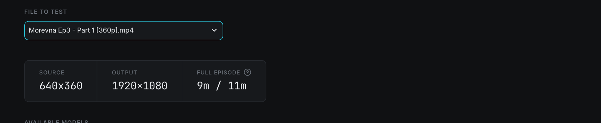
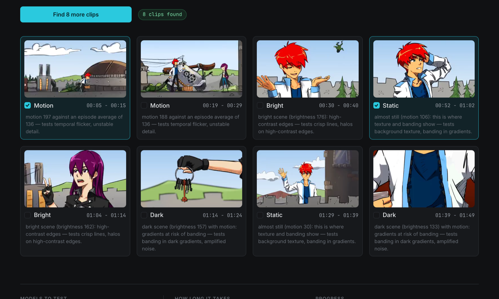
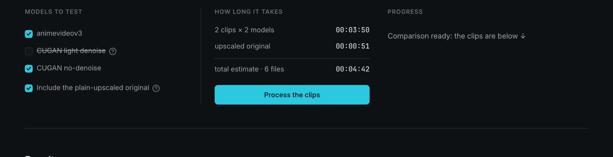
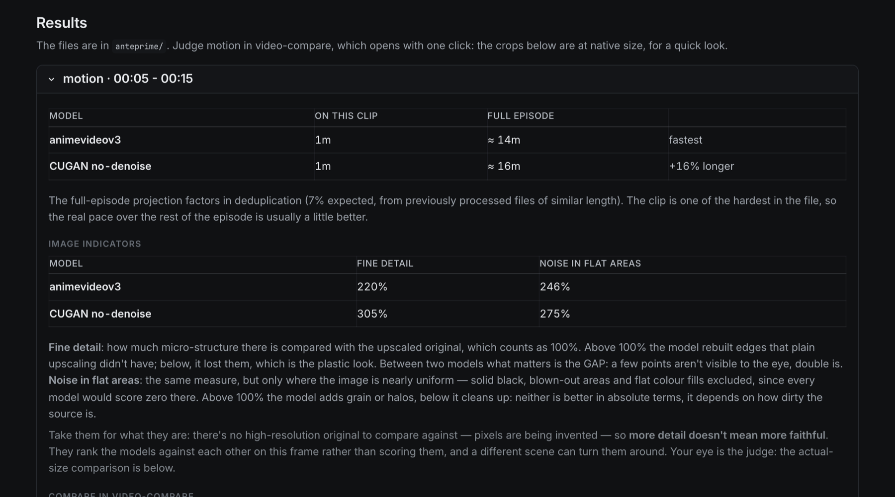
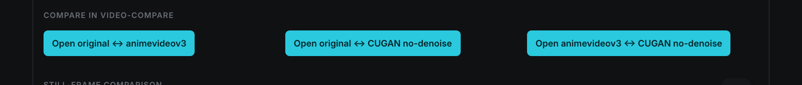

Step 05 · Compare

# 05. Compare: choose the model by eye

The Compare tab runs the models on a few ten-second "difficult" clips from your file, so you choose by what you see instead of relying on the recommendation alone.

## What Compare is, and isn't

Compare **isn't a preview of the final file**. It doesn't process the episode, and nothing it produces goes into `OUTPUT/`. It picks short clips where the models behave differently (still scenes, fast motion, dark and bright scenes), processes them with the models you tick and lays the results out side by side. You're answering a question that would otherwise cost four hours: *"Which model do I want for this series?"*

It works on **one file at a time**. It's most useful the first time you work on a series or a new source: once you've chosen for one episode, the same choice usually holds for the rest of that release.

!!! info "Optional, but recommended"
    You can skip this step: Processing always proposes a recommended model for each file. Compare is there for the cases where the recommendation isn't certain (the 380p–560p band) and for when you'd rather see the result with your own eyes.

## File to test

The **File to test** drop-down lists every file in `INPUT/`. Pick the one you want to try. The first time you select a file, a spinner says *Analysing the source (10 to 50 seconds the first time, depending on resolution, then instant)...*: AnimeUp is building the processing plan with your current sidebar settings. After that, switching back to the file is instant.

If a plan can't be built (for example, the upscale would be smaller than the minimum and **Allow upscales below the minimum** is off), the error appears here in red and the rest of the page isn't shown.

Under the drop-down, three tiles sum up the job:

| Tile | What it shows |
|---|---|
| **Source** | The file's resolution, e.g. `640x360`. |
| **Output** | The resolution the output will have with your current **Output height**, e.g. `1920×1080`. The width follows the real display shape, so 4:3 stays 4:3. |
| **Full episode** | How long processing the whole file would take with these settings. |

**Full episode** often shows **two figures**, such as `9m / 11m`. Deduplication skips repeated frames, and the time depends on how many it finds. The first figure assumes it finds as many as an anime usually has (or as many as your previous files of this kind had), the second assumes it finds none. When the two are within 5% of each other (for instance when deduplication was measured on this file, or is off) you see a single figure. Hover the **(?)** for the same explanation.

!!! tip "Tighter estimates"
    The range narrows when the file has a **measured dedup** value (see [04. Sources](04-sources.md#measured-deduplication)) and when your Mac has been calibrated (see [02. Calibration](02-calibration.md)).

## Available models

Three cards, one per model, ordered from the one that preserves least to the one that preserves most:

| Card | Description shown |
|---|---|
| **Real-ESRGAN animevideov3** | the fastest. Very crisp lines, but it flattens background texture: less detail and far fewer artefacts |
| **Real-CUGAN light denoise** | the middle ground. Keeps texture and gradients while cleaning up the most visible noise: for sources that aren't clean |
| **Real-CUGAN no-denoise** | keeps everything: texture, gradients and, unfortunately, the noise too. For sources that are already clean |

More on each model in [The models and when to use them](deep-dives/models.md).

### The chips

Each card carries the verdict for **this file's** resolution band:

| Chip | Meaning |
|---|---|
| **recommended** (green card) | The model AnimeUp would pick for this file. |
| **worth checking** (yellow card) | A real alternative in this band: test it in Compare before deciding. Only appears between 380p and 560p, on CUGAN light denoise. |
| **not recommended** (red card) | Likely to give worse results at this resolution. You can still test it and use it. |
| **can't reach 1080p** (greyed card) | With your current settings this model can't produce the output height. The number is your output height. |
| no chip | Nothing particular to say about this model for this file. |

Which chips appear, by source height:

| Source height | animevideov3 | CUGAN light denoise | CUGAN no-denoise |
|---|---|---|---|
| below 380p | recommended | not recommended | not recommended |
| 380p – 559p | recommended | worth checking | not recommended |
| 560p and up | — | — | recommended |

**can't reach** wins over any other verdict, because it's arithmetic, not opinion. The usual case is **Real-CUGAN light denoise**: it only exists at 2×, so from a 360p source it can reach 720p but not 1080p.

### The speed line

Under the description, each usable card shows a line like:

`~7.8 frames/s ≈ 6m (upscale stages only)`

That's the model's upscaling speed on **this** file in frames per second, and the time to upscale every frame of the file at that speed. It counts **only the upscale**: no deduplication, encoding or pauses between chunks. That's on purpose: those costs are the same whichever model you choose, and leaving them out shows the real difference between models. For the true total, look at the **Full episode** tile. Greyed-out (can't reach) cards have no speed line.

## Which model should I choose?

This expandable panel answers the question in two parts.

**This file** comes first. A heading such as **This file · 360p · below 380p** is followed by the choice and one sentence explaining why:

| Band | Choice shown | Why |
|---|---|---|
| below 380p | **Use Real-ESRGAN animevideov3** | At this resolution there's hardly any genuine detail to preserve. What counts is the artefacts you avoid, and animevideov3 produces far fewer. |
| 380p – 560p | **animevideov3 or CUGAN light denoise?** | There's no winner in this range: it depends on how dirty the file is. animevideov3 is the baseline that gets the least wrong. If the file deserves more detail, compare it with CUGAN light denoise on a few clips. |
| 380p – 560p, light denoise can't reach the output | **Use Real-ESRGAN animevideov3** | Light denoise would be worth considering, but from this height it can't reach the output height with the current settings. |
| 560p and up | **Use Real-CUGAN no-denoise** | The source has real detail to preserve: CUGAN keeps lines and textures that animevideov3 would smooth out. |

When the choice is genuinely open (the middle band, with light denoise reachable), the whole panel turns **yellow**. That's the case where you should open it and run a test.

**The general rule** follows: the same three bands, for all files. Below 380p, animevideov3. Between 380p and 560p, animevideov3 as the safe choice with CUGAN light denoise worth considering. Above 560p, CUGAN no-denoise. The middle band follows your **Output height**, because light denoise only exists at 2×: at 1080p it's suggested only from 540p up (and the text says so), at 1440p or higher it drops out of the band and animevideov3 is the only advice. With **Allow upscales below the minimum** on, the full rule comes back. As the panel notes, this comes from 1:1 comparisons of several real jobs, not from theory.

## Find the difficult clips

Below the panel, a short line explains what clips are. Press **Find the difficult clips** to start.

AnimeUp scans the whole file twice, once for **motion** and once for **brightness**. A yellow line shows the step: *Scanning the source: under a minute...*, then *Scanning motion (1 of 2)* and *Scanning brightness (2 of 2)*. On full episodes this takes roughly 28 seconds at 360p, 30 seconds at 480p and 51 seconds at 720p. The scan result is saved, so if the page is reloaded halfway through or you come back later, nothing is lost (you may see *Taken from the previous scan*).

It then extracts a short muted preview of each clip (*Extracting 8 clips to view...*), which takes a few seconds. A green chip reports how many were found, e.g. **8 clips found**.

How clips are chosen:

- Each clip lasts **10 seconds**.
- Each batch looks for **two clips of each of the four types**, so up to eight.
- The first five seconds of the file are skipped, clips never overlap, and two clips of the same type are kept far apart so you don't get the same scene twice.

### Find 8 more clips

After the first batch, the button becomes **Find 8 more clips**. New clips are **added** to the ones already on the page, taken from other parts of the file. When there's nothing different enough left, you'll see *There are no more clips different enough from the ones already found: the file is too short, or very similar to itself throughout.*

| Message | Meaning |
|---|---|
| **No clips found: the file is too short.** | The file needs at least about twenty seconds of video. |
| **Couldn't analyse the source:** *error* | FFmpeg couldn't read the file. Check it in [04. Sources](04-sources.md). |
| *This file doesn't allow seeking: decoding from the start…* | Some encodes have unreliable keyframes. AnimeUp decodes from the start instead of jumping, which is slower (usually a few minutes per episode), but the clip is correct. |

## The clip cards

The clips appear in a grid, four per row. Each card has:

- a **looping preview** of the clip (muted, reduced size), so you can tell a still scene from a moving one;
- a **checkbox** with the clip type, and the time range on the right (e.g. `00:05 - 00:15`);
- a **reason** and **what it tests**, e.g. *motion 197 against an episode average of 136 — tests temporal flicker, unstable detail.*

| Type | How it's picked | Reason shown | What it tests |
|---|---|---|---|
| **Motion** | The highest average motion in the file | motion *N* against an episode average of *M* | temporal flicker, unstable detail |
| **Static** | The lowest motion | almost still (motion *N*): this is where texture and banding show | background texture, banding in gradients |
| **Dark** | The darkest scenes that still have some motion | dark scene (brightness *N*) with motion: gradients at risk of banding | banding in dark gradients, amplified noise |
| **Bright** | The brightest scenes that still have some motion | bright scene (brightness *N*): high-contrast edges | crisp lines, halos on high-contrast edges |

Motion and brightness are on a 0–255 scale, averaged over the clip. **Dark** and **bright** are relative to the file: on a show that's bright throughout, the "darkest" clip can still have a fairly high brightness value.

### Selecting clips

Tick the clips you want to process. The whole card lights up when selected. Two clips are usually enough: one **Motion** and one **Static** or **Dark** cover most of the differences. Every clip you add multiplies the time (see below). Your selection is remembered per file while AnimeUp stays open.

## Models to test, How long it takes, Progress

Under the clips, three columns set up and run the test.

### Models to test

One checkbox per model: **animevideov3**, **CUGAN light denoise**, **CUGAN no-denoise**.

- By default only the model currently chosen for this file is ticked: the recommended one, unless you picked another for this file in Processing. Tick more to compare them.
- A model that **can't reach** the output height is **disabled**: a test at a different scale would be useless for choosing. Hover it to see why. When some selectable model isn't recommended for this file, the same tooltip adds a note such as *Note: CUGAN no-denoise can still be selected, but isn't recommended for this file.*
- Your ticks are kept per file while AnimeUp is open, even if you switch tabs.

### Include the plain-upscaled original

**Include the plain-upscaled original** is **on** by default. It adds a reference version: the same clip simply enlarged to the output size, with no model. Without a reference you can't tell real detail from detail the model made up, and the **Image indicators** need it as their baseline. It costs only an encode per clip, so keep it on unless you're short of time.

### How long it takes

Until at least one clip and one model are selected, this column says *Select at least one clip and one model.* Then it shows a breakdown:

| Row | Meaning |
|---|---|
| **2 clips × 1 model** | Time to upscale and encode the selected clips with the selected models. |
| **upscaled original** | Extra time for the reference version (only if included). |
| **total estimate · 4 files** | The total, and how many video files will be produced (clips × versions). |

The estimate counts upscaling (using your calibrated speeds, if you've calibrated) plus encoding of every version at your **CRF** and **Preset x265**. That's why slow presets make the test noticeably longer at 1080p and above.

Press **Process the clips** to start.

### Progress

The bar in the **Progress** column shows the real percentage, updated frame by frame, with the clip and the step being processed, e.g. *motion 00:05 — Real-CUGAN no-denoise · 42%*.

!!! warning "Don't touch the interface while it runs"
    Any click on the page, or leaving it, interrupts the test: a limit of how Streamlit runs the page. If that happens, click **Process the clips** again. It picks up where it left off, and the versions already finished are kept. A clip whose processing fails is reported in red and the others carry on.

When it's done, the column says *Comparison ready: the clips are below ↓* and the page scrolls to the results.

!!! note "Clips use your current settings"
    The clips are processed exactly as the real job would be: same **Output height**, **CRF**, **Preset x265**, and **Denoise before upscaling** if it's on. The only difference is that every frame is upscaled, with no deduplication. Change a setting and run again, and you get a new set of files rather than overwriting the old one. Clips already produced with the same settings are reused instantly.

## Results

The **Results** section has one expandable panel per clip, titled with its type and range (e.g. *Motion · 00:05 - 00:15*), open by default. A note reminds you the files are in `anteprime/`, and that motion is best judged in video-compare.

### Time per model

| Column | Meaning |
|---|---|
| **model** | The model (the plain-upscaled original isn't listed). |
| **on this clip** | How long that model took on this clip, upscale plus encode. |
| **full episode** | The projection: the clip time scaled to the whole file, minus deduplication. |
| *(last column)* | **fastest**, or **+16% longer** compared with the fastest. Only shown when you tested two or more models. |

Under the table, a line says which deduplication figure the projection used: **off**, **11%, measured on this file**, **expected, from previously processed files of similar length**, **predicted**, or **on but not yet quantified, so it will finish sooner**. It also reminds you that the clip is one of the hardest in the file, so the real pace over the rest of the episode is usually a little better.

Times are rounded to whole minutes, with one minute as the minimum. For two models that both finish a short clip in under a minute and a half, **on this clip** shows `1m` for both, and the percentage in the last column is what tells them apart.

### Image indicators

Two measurements on the middle frame of the clip, each expressed as a percentage of the **plain-upscaled original**, which counts as 100%:

| Indicator | What it measures | How to read it |
|---|---|---|
| **fine detail** | How much micro-structure (edges, fine lines, texture) there is. | Above 100%: the model rebuilt edges plain upscaling didn't have. Below: it lost them, which gives the "plastic" look. Between two models, what matters is the **gap**: a few points aren't visible to the eye, double is. |
| **noise in flat areas** | The same measure, only in nearly uniform areas. Solid black, blown-out areas and flat colour fills are excluded. | Above 100%: the model adds grain or halos. Below: it cleans up. Neither is better in absolute terms. It depends on how dirty the source is. |

A dash (—) means that value couldn't be measured for that model. If neither indicator can be measured, the table is replaced by a line explaining why:

| Message | Meaning |
|---|---|
| *Image indicators unavailable: they need the frames of the upscaled original as a baseline, and this comparison doesn't include it.* | You turned off **Include the plain-upscaled original**. |
| *Image indicators unavailable: this frame has no areas uniform enough to measure.* | Not enough measurable flat areas on this frame. The 1:1 crops are still below. |

!!! warning "Take the numbers for what they are"
    There's no high-resolution original to compare against: the models are inventing pixels. So **more detail doesn't mean more faithful**. The indicators rank the models against each other on one frame, and a different scene can turn them around. Your eye is the judge.

### Compare in video-compare

One button per pair of versions, e.g. **Open original ↔ animevideov3**, **Open original ↔ CUGAN no-denoise**, **Open animevideov3 ↔ CUGAN no-denoise**. Each opens the two clips side by side, so you can judge motion, flicker and texture at full size.

| What happens | Message |
|---|---|
| [video-compare](https://github.com/pixop/video-compare) is installed | *opened in video-compare: left \| right*. A split-screen window opens. Drag across it to move the divider. |
| It isn't installed, but IINA is in `/Applications` | *video-compare isn't installed: opened in IINA*. Both files open in IINA, without the split view. |
| Neither is installed | An error suggesting `brew install video-compare`. |

video-compare is optional and not part of AnimeUp: install it with Homebrew if you want the split view.

### Still-frame comparison

Below the buttons, a **crop sheet**: the same 480 × 480 pixel area cut from the middle frame of every version, two per row and labelled (*Original enlarged*, *Real-ESRGAN animevideov3*, *Real-CUGAN no-denoise*…). AnimeUp picks the most detailed area of the frame by itself.

The crops are at **actual size (1:1)** and are shown at their natural width. Scaling them would hide the very artefacts you're looking for. If the sheet doesn't fit the box, open the PNG separately rather than zooming the page out.

### Paths of the generated files

At the bottom of each panel, every file produced is listed with its full path (*Upscaled original file:*, *Real-ESRGAN animevideov3 file:*…), followed by **Open the folder in Finder**, which opens the clip's folder.

## Where the files go

Everything Compare produces lives in `anteprime/` inside the AnimeUp folder:

| Path | Content |
|---|---|
| `anteprime/<file name + code>/<height>p-<crf>-x<scale>-<preset>/<clip>/` | One folder per clip and per set of settings (with `-dn` added when denoise is on). |
| …`/animevideov3.mkv`, `cugan.mkv`, `cugan-denoise.mkv` | The clip processed by each model. |
| …`/originale.mkv` | The plain-upscaled original. |
| …`/confronto_1a1.png` | The 1:1 crop sheet. |
| …`/tempi.json` | The measured time per model, so the projection survives a reuse. |
| `anteprime/.spezzoni/` | The saved clip scans and the small preview videos of the cards. |

The clip folders take their names from the internal clip type (`movimento`, `statico`, `scuro`, `luminoso`) plus the start time, e.g. `movimento_00m05s`. The MKV files are ordinary video files: you can copy them out to show someone.

!!! tip "You can empty anteprime/ at any time"
    It's only a cache. At worst, the next clip scan for a file is redone (under a minute per episode) and the clips are processed again. See [07. Output files and folders](07-output-and-folders.md).

!!! note "Results after a reload"
    The **Results** section lives in the open page. If you reload the browser or restart AnimeUp, the clip selection and the results disappear from the page, but the files stay in `anteprime/`. Select the same clips and models and press **Process the clips**, and they come back almost instantly, without being reprocessed.

## Making the decision

Compare doesn't set anything by itself. Once you've chosen, go to **Processing** and pick that model for the file (or for every file in the series with **Same model for all…**). See [06. Processing](06-processing.md).

## Before you move on

!!! success "Check"
    - [ ] You've read the **This file** verdict in **Which model should I choose?**
    - [ ] If the panel was yellow (380p–560p), you tested both animevideov3 and CUGAN light denoise on at least two clips.
    - [ ] You've looked at motion in video-compare (or IINA), not just at the numbers.
    - [ ] You've checked the 1:1 crops for halos, plastic-looking textures and amplified noise.
    - [ ] You know which model you'll select in Processing.

[Next: 06. Processing →](06-processing.md)
