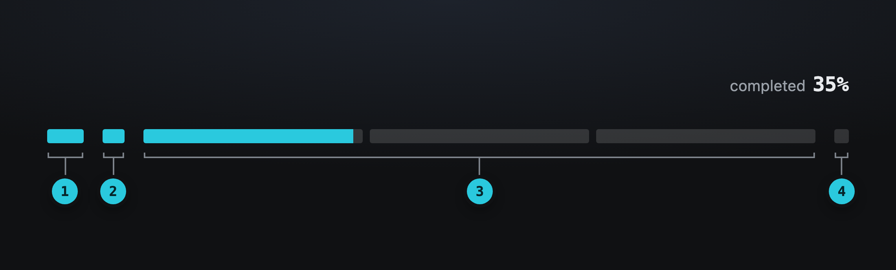
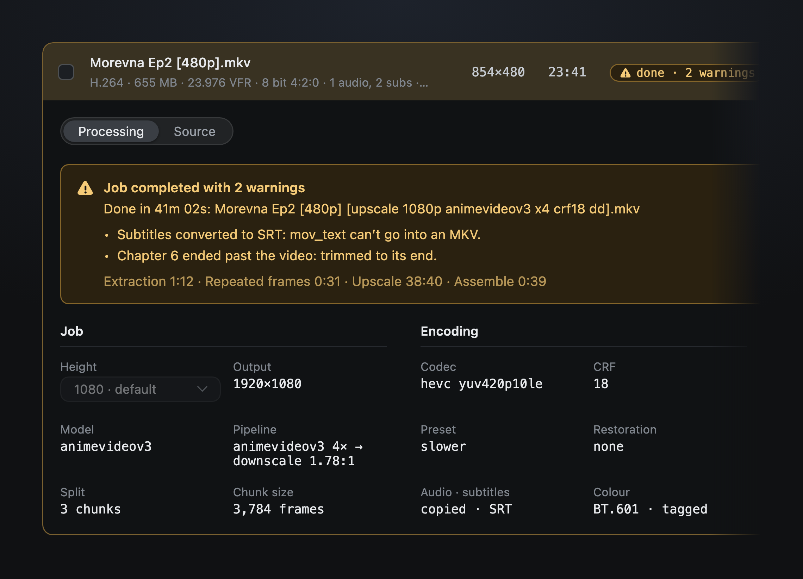
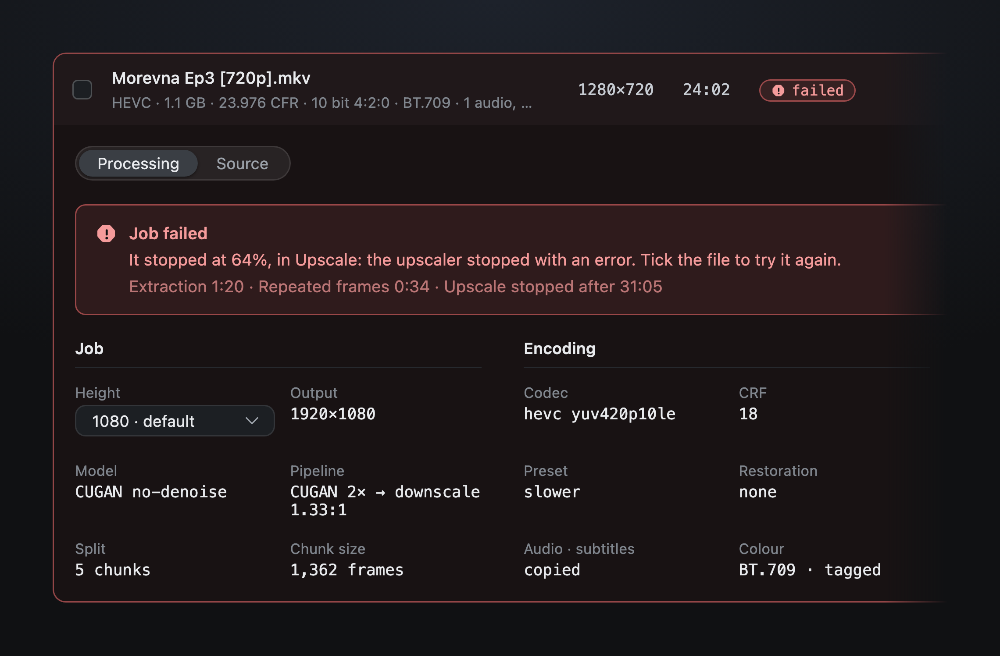
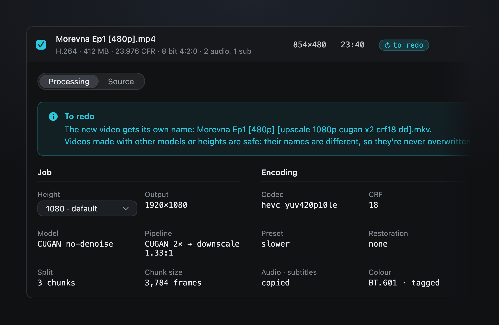
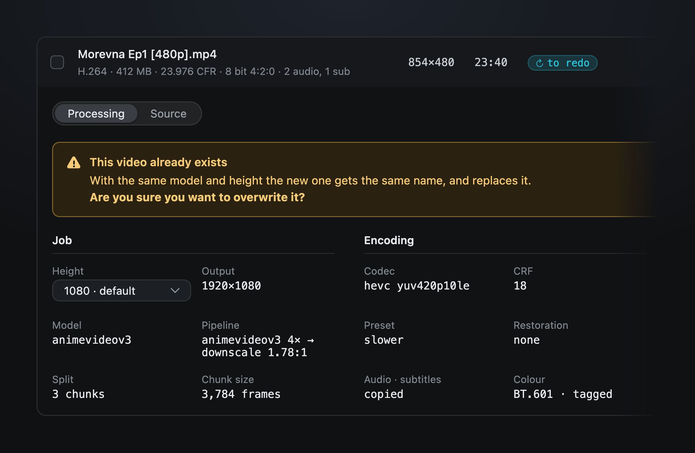
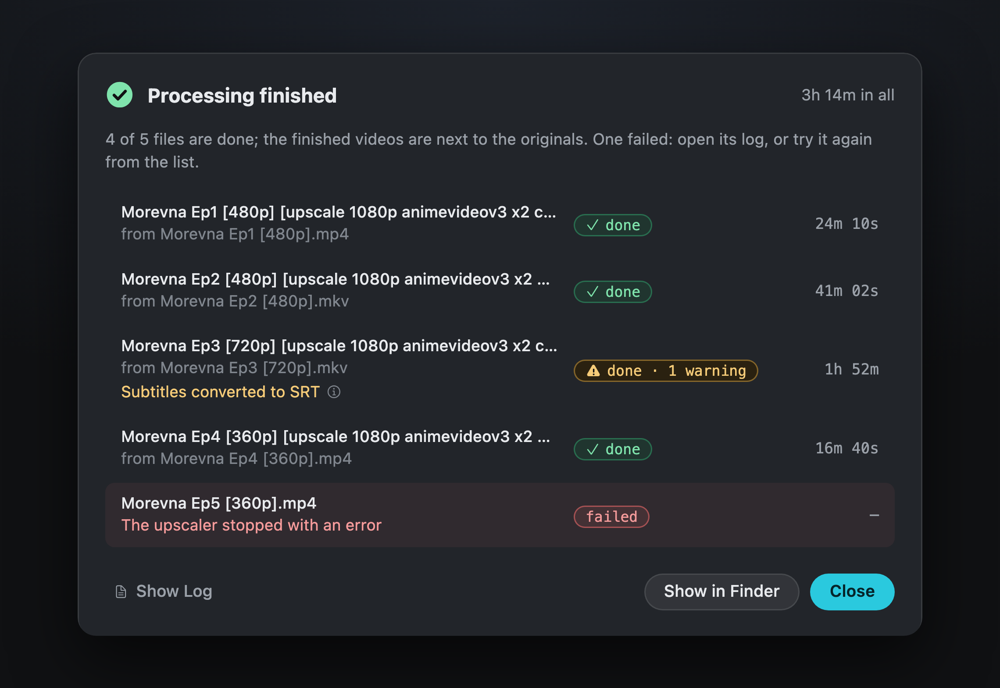

Using AnimeUp · Queue

# 05. The Queue

Every video you add lands here. Each one is analysed as it arrives, gets a model and an estimate, and waits for you to tick it and start.

## The list

Each row is one file:

| Column | What it shows |
|---|---|
| **File** | The name, and under it codec, size, frame rate, colour and tracks |
| **Resolution**, **Length** | From the analysis |
| **Status** | A chip: analysing, analysed, queued, in progress, paused, done, failed, interrupted… |
| **Model** | The model this file will use. **Same for all** above the column sets one model for every analysed file it can process. |
| **Time** | The estimate before it runs, **Stop** while it runs, the real time once it's done |

Above the list, a summary: how many files, how much video, how many are below 720p, and how many have warnings. **Re-analyse All** runs the analysis again on every file. Right-click a row (or use the **File** menu) for **Show in Finder**, **Re-analyse** and **Remove from List**; a removal can be undone with ⌘Z.

Click a row to open its **drawer**, with two tabs: **Processing** (how the file will be, or was, processed) and **Source** (the analysis report). The drawer keeps the same height whichever tab is open.

## Analysis

Each file is analysed as soon as it arrives, one at a time: **awaiting analysis**, then **analysing** with its elapsed time, then **analysed**. Reading the file takes a second; checking the fields and measuring its repeated frames take longer.

The **Source** tab shows the report in three groups:

- **Timing**: frame rate, timebase (constant or variable), frames, duration, bitrate, size;
- **Image**: geometry, pixel shape, format and bit depth, colour, codec, primaries and transfer;
- **Tracks**: audio, subtitles, chapters, fields (progressive or interlaced), container.

Anything worth knowing comes as a yellow note under the report, with what AnimeUp will do about it. For example, a variable frame rate "will be normalised during extraction, without re-encoding the source". A file AnimeUp can't process (interlaced, telecined, unreadable) says why, and can't be ticked.

!!! info "Repeated frames"
    Animation often holds the same drawing for two or three frames. AnimeUp upscales each drawing once and reuses it, which saves a lot of time. The analysis measures how many repeated frames a file has on samples spread across it ("dedup 18% · measured"), and the estimate uses that number. With **Always run the deep analysis** off in Settings, each file gets a **Deep Analysis** button instead.

## The plan for each file

Once analysed, a file gets a **model**, chosen from its height, with a chip that says how well it fits:

| Chip | Meaning |
|---|---|
| recommended | The model AnimeUp would pick for this source |
| worth checking | A good fit, but it's worth a look in Compare |
| not recommended | A poor fit for this resolution |
| chosen by you | You picked it: AnimeUp keeps it |

Not sure? Test them in [Compare](06-compare.md), and use the one you like for this file or for several at once.

The **Processing** tab shows how the file will be processed, in three groups:

- **Job**: the **Height** (a menu: the default from Settings, or another for this file only), the output size, the model, the pipeline (for example "animevideov3 4× → downscale 1.78:1"), how many chunks and how many frames each;
- **Encoding**: codec, CRF, preset, audio and subtitles, colour;
- **Output file**: the name of the video it will make, and its folder.

A yellow note under the groups explains anything unusual, such as "Tight on space: 18 GB is left for chunks after the frames, so 5 chunks instead of fewer".

!!! tip "What the name says"
    The finished video keeps the original name and adds what was done: `Morevna Ep2 [480p] [upscale 1080p animevideov3 x4 crf18 dd].mkv`. Videos made with different models or heights get different names, so they never overwrite each other.

## Starting

Tick the files to process. The action bar shows how many are selected and their total estimate, for example "3 files selected · estimate ~ 2h 09m", and whether the estimates come from this Mac's calibration. Click **Start Processing** (⌘↩).

Files run one after another: those with the same model and height together, in the order of the list. While they run, ticks and models are locked, but everything else stays usable: Compare, Start, the other files' reports, adding more videos.

## Following a file

The file being processed shows its progress right in its row.

<video class="au" autoplay muted loop playsinline poster="../img/v2/GuideRow.webp" aria-label="A file being processed: the row fills as the work goes on">
  <source src="../img/v2/GuideRow.webm" type="video/webm">
  <source src="../img/v2/GuideRow.mp4" type="video/mp4">
</video>

<video class="au" autoplay muted loop playsinline poster="../img/v2/GuideRowLeft.webp" aria-label="Close-up of the left half of the row, numbered 1 to 4">
  <source src="../img/v2/GuideRowLeft.webm" type="video/webm">
  <source src="../img/v2/GuideRowLeft.mp4" type="video/mp4">
</video>

1. **The file**: its name, then codec, size, frame rate and tracks from the analysis.
2. **The four steps**: Extraction, Repeated frames, Upscale, Assemble. Green ones are done, the current one pulses.
3. **What it's doing now**: "Upscaling chunk 1 of 3 · 10,900 of 11,350 frames upscaled", then the speed of this step, how long it has left and how long it has been running.
4. **The bar**: one piece per step, the upscale split into its chunks, each filling in turn.

<video class="au" autoplay muted loop playsinline poster="../img/v2/GuideRowRight.webp" aria-label="Close-up of the right half of the row, numbered 5 to 8">
  <source src="../img/v2/GuideRowRight.webm" type="video/webm">
  <source src="../img/v2/GuideRowRight.mp4" type="video/mp4">
</video>

<ol start="5">
<li><strong>The status</strong>: in progress, or paused.</li>
<li><strong>The model</strong>: fixed while the file runs.</li>
<li><strong>Stop</strong>: stops this file only.</li>
<li><strong>The whole file</strong>: how much is done and how long is left.</li>
</ol>

### The four steps

{ .au }

1. **Extraction**: every frame comes out of the video, once, from start to finish.
2. **Repeated frames**: identical frames are found, so each drawing is upscaled only once.
3. **Upscale**: the GPU enlarges the frames, chunk by chunk. Each chunk is then encoded, and its frames deleted, before the next one: the row says "Encoding chunk 2 of 3 · 40% encoded" meanwhile. This step is almost all of the wait.
4. **Assemble**: the encoded chunks are joined, and the audio, subtitles, chapters and fonts of the original are added.

The time left on the right comes from how long the finished chunks really took, so it holds steady instead of jumping with the last minute's speed. Until the upscale starts it's the plan's estimate; during the first chunk it comes from the measured speed.

The action bar shows the whole queue: "Processing 2 of 4 · 2 files waiting", with the estimated time left and the expected finish. The finish time only moves when the estimate really changes: at most once a minute, or at once if it changes a lot. The sidebar's activity card shows which file is running and when the queue should end.

## Pause, stop, resume

| Action | What it does | What's kept |
|---|---|---|
| **Pause** | Freezes the work exactly where it is | Everything. **Resume** continues from the same frame; the paused time isn't counted. |
| **Stop** (on the row) | Stops this file; the next one starts | The chunks already done. The file becomes **interrupted**. |
| **Stop All** (⌘.) | Stops the file in progress; the ones after it don't start | The chunks already done |
| **Resume** (on an interrupted row) | Starts the file again from the chunk it was in | |
| **Discard** | Deletes the work files of an interrupted file | The original is never touched; processing it again starts from the beginning |

AnimeUp asks before stopping or discarding anything. Quitting AnimeUp while a file runs stops it too, and you can resume it the next time.

An interrupted file resumes with the values it started with, even if you've changed the settings since: its row says "own settings: 1440p · CRF 16", and Settings says which file keeps other values.

!!! tip "Where stopping is cheapest"
    Work is saved one chunk at a time. Stopping in the middle of a chunk means that chunk starts again from its first frame on resume. The row's "10,900 of 11,350 frames" shows how close the next safe point is.

### A pause between files

With **Pause between files** set in Settings › General, the queue rests a few minutes after each file to let the Mac cool down. The next file's row says when it starts, and **Start Now** skips the wait. The pause isn't counted in any time.

## What each file came to

Open a finished row for its outcome, on top of the same details it ran with.

{ .au }

- **Job completed**: the time it took and the name of the video it made. A file stopped and resumed counts the work of all its runs ("Done in 1h 12m, over 2 runs").
- **with warnings**: each warning on its own line, for example subtitles converted to SRT, or a variable frame rate put on a constant grid. The video is fine; the warnings say what AnimeUp had to adjust.
- Under them, how long each step took.

**Show in Finder** selects the video made, and **Show Log** (under Output file) opens the file's log.

{ .au }

A file that **failed** says where it stopped and why, with the steps it did finish. Tick it to try again, or open its log.

## Redo a finished file

**Redo** puts a finished file back in the queue, for instance to try another model or another height.

{ .au }

With another model or height, the new video gets its own name, so the one already made stays where it is. The note shows the new name. **Don't Redo** takes it back.

{ .au }

With the same model and height, the new video would get the same name and replace the old one, so AnimeUp asks first: **Overwrite** or **Don't Redo**. The file is ticked only once you say yes.

## The end of the queue

When the last file is done, a summary sheet lists the videos made, each with the file it came from, its time and its warnings; files that failed or were stopped say so, and after **Stop All** the files the queue never reached read **not started**. **Show in Finder** selects the videos made.

{ .au }

AnimeUp also sends a macOS notification, if they're on, and the Dock icon's progress disappears.

[Next: 06. Compare →](06-compare.md)
