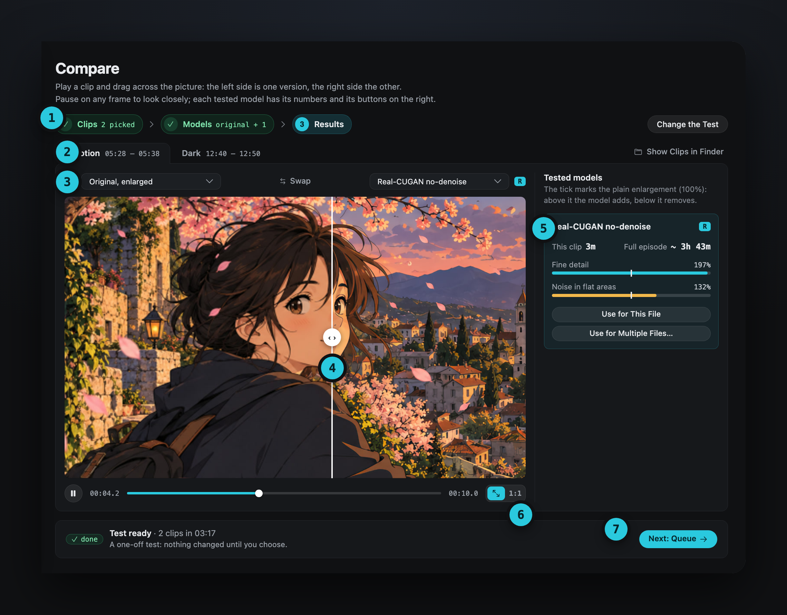

Using AnimeUp · Compare

# 06. Compare

A quick test to choose a model by eye: AnimeUp renders a few hard moments of one file with the models you pick, and shows them side by side. It changes nothing on its own: each file's model is still set in the Queue.

## Step 1 · Clips

Pick the **file to test** at the top: any analysed file in the Queue.

AnimeUp looks for its hardest 10-second moments, in four kinds:

| Kind | What it tests |
|---|---|
| **Motion** | Flicker, unstable detail |
| **Static** | Fine detail, texture |
| **Dark** | Banding, noise in shadows |
| **Bright** | Sharp lines, halos |

Tick the clips to test. Two usually say enough: one in motion, one dark or still. **Find 8 More Clips** looks for others. A short file may have only one or two clips; a file shorter than 10 seconds can't be tested here (its model can still be chosen in the Queue).

## Step 2 · Models

Tick the models to try. Each card says what the model is good at and how long it would take on the whole episode; a tag says which source it suits ("best below 380p", "for clean 720p–1080p"…). **Include the original, plainly enlarged** adds a reference version: it shows what each model adds or removes.

| Model | In short |
|---|---|
| Real-ESRGAN animevideov3 | The fastest. Very crisp lines, but it flattens background texture. |
| Real-CUGAN light denoise | The middle ground: keeps texture, cleans the most visible noise. |
| Real-CUGAN no-denoise | Keeps everything: texture, gradients, and the noise too. |
| Real-CUGAN conservative | The most faithful: keeps paper and film grain, and leftovers too. |

The box above the cards says which model fits which source; **Model guide** (also in the Help menu) opens [The models and when to use them](deep-dives/models.md), which goes deeper.

The bar at the bottom says how many versions will be rendered and how long the test takes. Click **Start the Test**.

!!! info "The test and the queue share the GPU"
    If a queue is running, the test waits for it to finish, or for you to pause it (**Pause the Queue** is right there). A test can't be paused, only stopped: the versions already rendered are kept, and **Render the Rest** fills the gaps later.

## Step 3 · Results

Each version appears as soon as it's ready, so you can start looking before the end. The test runs in the background: switch pages or close the window, and it carries on.

{ .au }

1. **The steps**: Clips, Models, Results. **Change the Test** goes back to them.
2. **The clips**, one tab each, with their time range in the episode.
3. **The two versions** shown: the left side of the picture and the right one. Any model, or the original. **Swap** exchanges them.
4. **The divider**: drag it across the picture. Play the clip, or pause on any frame to look closely.
5. **The tested models**, each with its time on this clip and on the full episode, and two indicators: **fine detail** and **noise in flat areas**, against the plain enlargement (the tick at 100%). Above the tick the model adds, below it removes.
6. **Fit or 1:1**: fit the clip to the player, or show one video pixel per screen pixel.
7. **Next: Queue**, when you're done.

**Show Clips in Finder** opens the rendered clips, if you want to watch them in another player.

## Use what you chose

Under each tested model:

- **Use for This File** sets it as this file's model in the Queue;
- **Use for Multiple Files…** opens a list of the files in the Queue with their current model. Ticked files switch to this one. Files where it would be a poor fit (for their resolution) start unticked; you can still tick them.

[Next: 07. Settings →](07-settings.md)
