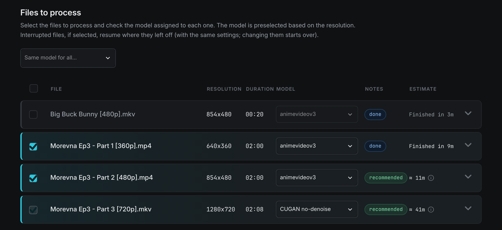
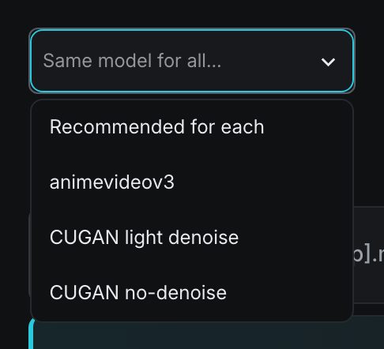
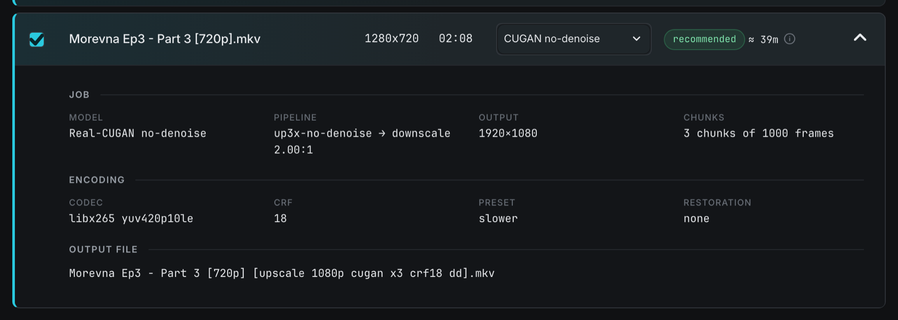
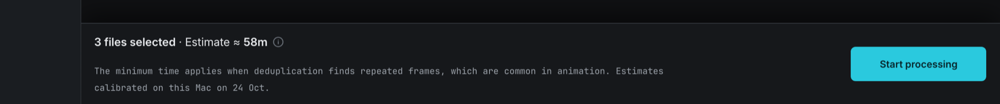
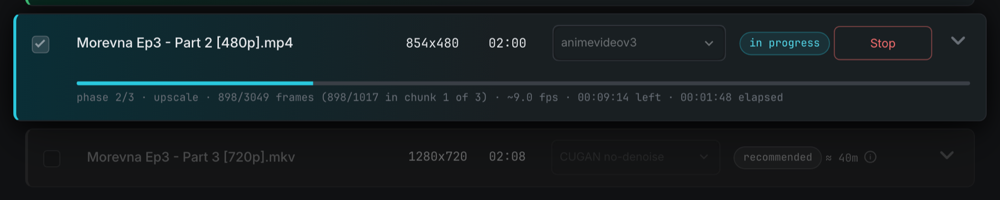
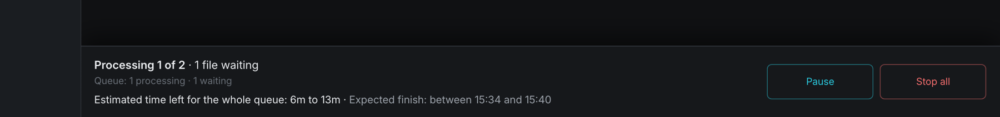
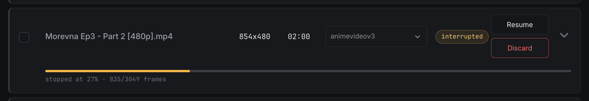
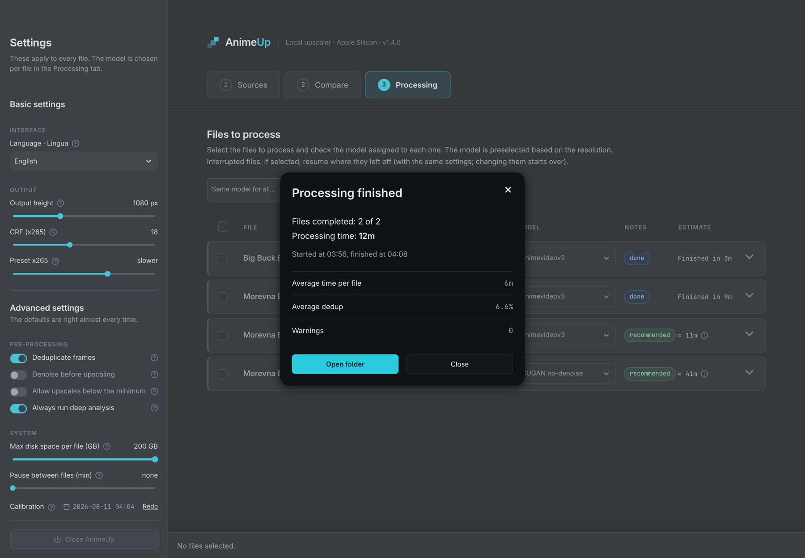

Step 06 · Processing

# 06. Processing: run, monitor, stop and resume

This is where the real work happens: you tick the files, check the model on each row, press **Start processing**, and follow the queue until the summary window appears.

!!! info "One job at a time"
    AnimeUp processes **one file at a time**. A second job running alongside wouldn't break anything, but it would share the GPU, roughly doubling both jobs' times and making every estimate wrong. While a queue is running (or resting between files), **Start processing** stays unavailable. You can still look around, open rows and read details.

## The page at a glance

The tab has three parts:

| Part | What it shows |
|---|---|
| Title and hint | **Files to process** when the machine is idle, **Job in progress** while a queue runs. The hint under it changes to match. |
| The file list | One row per file in `INPUT/`: tick box, name, resolution, duration, model, notes, estimate, and an arrow that opens the row's details. |
| The bottom bar | When idle: the selection summary, the total estimate and **Start processing**. While running: where the queue is, the time left, **Pause**/**Resume** and **Stop all**. |

If `INPUT/` is empty the tab only says **No files in INPUT.** See [04. Sources](04-sources.md) for how files get there.

## The file list

### Column by column

| Column | What it shows |
|---|---|
| (tick box) | Whether the file goes into the next launch. The box in the header ticks or clears **all files** at once (its tooltip: "Select or deselect all files"). |
| **File** | The file name as it is in `INPUT/`. |
| **Resolution** | Width × height of the source. |
| **Duration** | Running time of the source. |
| **Model** | The model this file will be processed with. See [Choosing the model](#choosing-the-model). |
| **Notes** | A coloured chip with the most important thing to know about this row. See [The Notes chips](#the-notes-chips). |
| **Estimate** | How long this file should take, or how long it actually took (**Finished in …**), or the **Stop**/**Resume**/**Discard** buttons when the file is running or interrupted. |
| (arrow) | Opens or closes the row's details panel. |

A ticked row gets a coloured left border; unticked rows are slightly dimmed.

### Ticking files

- Tick a row to add it to the launch, untick it to take it out. The header box does all rows at once.
- **You can't tick a file that hasn't been analysed yet** (chip **awaiting analysis**). Without its analysis there's no plan, so there would be nothing to start. Analysis runs by itself in the background as soon as AnimeUp sees the file. The row fills in on its own, and the page refreshes every 5 seconds while analysis is working.
- **You can't tick the file that is currently being processed.**
- Your ticks survive switching tabs. If a file disappears from `INPUT/` while AnimeUp is open, its tick is dropped. A file that the scan briefly fails to read (for example a slow external disk) keeps its tick.
- While a queue is running, the boxes become **indicators**: a fixed tick on every file that's part of the current launch (done, running, interrupted or queued), and an empty, greyed box on the others. Rows that have nothing to do with the launch are dimmed. You get normal tick boxes back when the queue finishes or you stop it.

!!! tip "Ticking an interrupted file"
    Ticking an interrupted file and pressing **Start processing** continues it where it left off, as long as the settings in the sidebar are the same as when it started. If they differ, the parts that depend on the changed settings are redone. To be sure you continue with the original settings, use the row's **Resume** button instead (see [Interruptions](#interruptions-and-resuming)).

### Choosing the model

Each analysed row has its own model selector. The three options, as they appear in the list:

| Option | Full name |
|---|---|
| **animevideov3** | Real-ESRGAN animevideov3 |
| **CUGAN light denoise** | Real-CUGAN light denoise |
| **CUGAN no-denoise** | Real-CUGAN no-denoise |

The selector starts on the **recommended** model for that file's resolution. Hover over it to see why ("720p source: a modest upscale, so it pays to keep texture and gradients", and so on). In the open list the recommended model is marked. The rules, by source height:

| Source height | Recommended | Worth checking | Not recommended |
|---|---|---|---|
| 560p and above (576p, 720p…) | CUGAN no-denoise | — | — |
| 380p to 559p | animevideov3 | CUGAN light denoise | CUGAN no-denoise |
| below 380p | animevideov3 | — | CUGAN light denoise, CUGAN no-denoise |

The reasons behind these bands are in [The models and when to use them](deep-dives/models.md). If you're unsure, test the candidates on difficult clips in [05. Compare](05-compare.md) first.

What the selector shows also depends on the file's history. On a file that's **done** it shows the model that produced the output. On an **interrupted** file it shows the model the job started with. Only a choice you make yourself overrides that (for example to redo a finished file with another model).

The selector is disabled on the running row and on every row while a queue is running: the plans for that launch are already fixed.

### Same model for all…

The drop-down above the list sets the model on every row in one go. It's an action, not a setting: once applied it goes back to showing **Same model for all…**, because changing a single row afterwards would make it untrue.

| Option | What it does |
|---|---|
| **Recommended for each** | Puts each row back on the model recommended for *its* resolution. On a file processed earlier with a different model, this really switches it to the recommended one. It doesn't restore the old model. |
| **animevideov3** | Sets animevideov3 on every row. |
| **CUGAN light denoise** | Sets CUGAN light denoise on every row. |
| **CUGAN no-denoise** | Sets CUGAN no-denoise on every row. |

Rows whose resolution is unknown are skipped. The chips next to each row keep judging the model per file, so setting CUGAN no-denoise on everything will show **not recommended** on the low-resolution files. The drop-down is disabled while a queue is running.

## The Notes chips

The Notes column shows **one** status per row, picked in a fixed order of importance. A file that's running shows **in progress** even if it was also "done" before, for example. Chips with a dotted underline have a tooltip: hover or focus them for the full explanation.

| What you see | What it means | What to do |
|---|---|---|
| **recommended** (green) | The selected model is the recommended one for this resolution. | Nothing: go ahead. |
| **worth checking** (yellow) | The selected model is a reasonable alternative for this resolution, but whether it's better depends on the file. Only shown for CUGAN light denoise on 380p–559p sources. | Compare it with animevideov3 in [05. Compare](05-compare.md). |
| **not recommended** (red) | The selected model is a poor fit for this resolution (for example CUGAN no-denoise on a 360p file, which would enlarge compression artefacts). | Switch back, unless Compare convinced you otherwise. |
| (no chip) | On sources of 560p and above, only the recommended model gets a chip; choosing another one shows nothing. | — |
| **in progress** (blue) | This file is being processed right now. | Follow it on the row, see [While a queue is running](#while-a-queue-is-running). |
| **paused** (yellow) | The job is frozen by **Pause**: no GPU, no CPU. On resume it continues from exactly this point, and the paused time isn't counted in the file's duration. | **Resume** in the bottom bar. |
| **queued** | The file is waiting for its turn in the current launch. | Nothing. |
| **interrupted** (yellow) | A job for this file was started and didn't finish: stopped by you, or cut short by a crash, a closed lid or a killed process. Its work so far is kept in `JOBS/`. | **Resume** or **Discard**, see [Interruptions](#interruptions-and-resuming). |
| **own settings** (grey, next to **interrupted**) | The interrupted job was started with settings that differ from the ones now in the sidebar. The tooltip lists them (height, CRF, preset, GB, model). Disk space alone doesn't turn it on: it's recalculated at every launch. **Resume** will use those original settings, not the current ones. | To redo it with the new settings, **Discard** it first, then start it again. |
| **done** (blue) | The output for this file, with exactly the current settings, exists in `OUTPUT/`. Ticking it does nothing: it's skipped. | To redo it, change a setting or the model, or move the output away. |
| **done** with a tooltip | The file was produced with exactly these settings, but the output is no longer in `OUTPUT/` (you probably moved it to your library). | Nothing, unless you want it again: tick it and confirm in the bottom bar (see [Already processed](#already-processed-files-redo-or-dont-redo)). |
| **1 warning** / **n warnings** (yellow, next to **done**) | The job finished, but left notes. Hover for the text. | Read them. Usually informational. |
| **needs redoing** (red) | The last job produced a damaged file. The output was set aside as `….PARZIALE.mkv` instead of keeping its proper name in `OUTPUT/`. | Run it again (see [Damaged output](#damaged-output-parzialemkv)). |
| **awaiting analysis** (grey) | The background analysis hasn't reached this file yet. The tick box is disabled. | Wait. The row fills in by itself. |
| **can't be processed** (red), or a more specific red chip | No plan can be built for this file with the current settings. Hover for the full reason. | See the next table. |

### Files that can't be processed

The red chip names the obstacle in two or three words. The tooltip, and the row's details panel, give the full sentence with the fix. If you tick such a file anyway, it's listed under the file list as **can't be processed — name — reason**, and it's left out of the launch.

| Chip | Why | Fix |
|---|---|---|
| **upscale too small** | The source is already at, or larger than, the output height, or the enlargement is below the 1.25× minimum. It would cost the hours of a full upscale for a handful of extra pixels. | Raise **Output height** in the sidebar, or turn on **Allow upscales below the minimum** (see [03. The interface](03-interface.md)). |
| **can't reach 1080p** (or another height) | The selected model can't get that high from this source. A plain lanczos resize would have to cover the last stretch, which is enlargement with no added detail. The tooltip suggests a model that can, or the highest honest target. | Pick the model it suggests, or lower **Output height**. |
| **unsupported scale** | The model doesn't support the scale that would be needed. | Pick another model. |
| **can't be processed** | Any other reason the plan can't be built. | Read the tooltip. |

## The estimate

### On each row

The **Estimate** column shows the **most likely** duration, for example **≈ 40m**. When the possible range is wide enough to matter, an **(i)** icon appears next to it. Hover it for:

| Line | Meaning |
|---|---|
| **Estimated duration** | The title. |
| **Most likely: …** | The number shown on the row. |
| **Possible duration: … to …** | The range the real time should fall in. The low end assumes deduplication finds many repeated frames, the high end assumes it finds few. |
| (note) | Either **The actual duration depends on how many repeated frames are detected.**, or, once the file's repeated frames have actually been counted, **Dedup measured on this file: n% repeated frames. What remains is the usual gap between estimated and actual time.** |

The "most likely" figure is the one to plan with. Measured on five real jobs, it was off by 3.5% on average, compared with 10.6% for the low end and 36.1% for the high end.

On a finished file the estimate is replaced by the real time, **Finished in …**. If the file was processed in more than one go (interrupted and resumed), a **(?)** next to it explains the extra time: "Processing completed in n runs; the total time includes the chunks in progress that were redone from the start after each interruption (up to ~n minutes each time)."

!!! warning "Estimates are only as good as the calibration"
    Out of the box, every time is based on **factory figures** measured on a different Mac. On a faster or slower chip they're all wrong by roughly the same factor. Run the calibration once ([02. Calibrate your Mac](02-calibration.md)) and every estimate on this page starts using your Mac's real speed.

## Opening a row: the details panel

Click the arrow at the right end of a row to open its plan. Click it again to close it.

| Group | Field | What it shows |
|---|---|---|
| **Job** | **Model** | The full model name, for example Real-CUGAN no-denoise. |
| | **Pipeline** | The exact model file used, then the downscale ratio to the final size, for example `up2x-no-denoise → downscale 1.33:1`. The model enlarges by a whole factor, then the frame is scaled down to the exact output height. |
| | **Output** | Final width × height. |
| | **Chunks** | How the file is split for processing, for example **10 chunks of 3000 frames**. Chunks are what make a job resumable and keep disk use under the GB limit (see [Chunks](#chunks-why-they-matter)). |
| **Encoding** | **Codec** | Video codec and pixel format of the output. |
| | **CRF** | x265 quality value (from the sidebar). |
| | **Preset** | x265 speed preset (from the sidebar). |
| | **Restoration** | Pre-processing applied before the upscale, for example light denoise, or **none**. |
| **Output file** | | The name the finished file will have in `OUTPUT/`: the source name plus the parameters. See [07. Output files and folders](07-output-and-folders.md). |

Under the groups, any **warnings** for this plan appear with a ⚠ sign. You may see:

- **Forced: …**: you turned on **Allow upscales below the minimum**, and this file would normally have been refused (an upscale below 1.25×, or a model that can't reach the target). The job will run, but the warning tells you it costs the hours of a full upscale for little gain, or that the last stretch will be a plain resize.
- **Target lowered from 1080p to 960p: …**: from very small sources, 4× is the most a model can do without inventing everything, so the target is lowered and the row says so.
- **VFR source: …**: frames will be extracted on a constant grid.
- **mov_text subtitles converted to SRT**.
- **Low free space (n GB).**, **Tight on space: …** or a message that the GB you set aside isn't enough. See the disk space setting in [03. The interface](03-interface.md).

If the file has no analysis yet, the panel says **Analysing: the details appear as soon as the report is ready.** If no plan can be built, it shows the full reason instead of the groups.

### Details of a completed job

On a **done** file, the panel adds a **Job completed** group under the output name, with the real figures:

| Field | What it shows |
|---|---|
| **Result** | **all OK**, or **n warnings** (listed underneath). |
| **Start** / **End** | Day and time the job started and finished. |
| **Duration** | Total processing time. |
| **Dedup** | Share of frames found to be repeats and not upscaled. |
| **Average speed** | Frames per second over the whole job. |
| **Size** | Size of the output file, in MB (only while it's still in `OUTPUT/`). |
| **Folder** | A button, **OUTPUT · show in Finder**, that opens a Finder window with the file selected. |

## The bottom bar, before you start

| Element | What it says |
|---|---|
| **n files selected** | How many rows you've ticked. If nothing is ticked: **No files selected.** |
| **· n to process** + (i) | Appears only when fewer files will actually start than you ticked. The (i) breaks it down: **To process**, **In progress**, **Waiting for their turn**, **Already done**, **Cannot be processed**. |
| **· Estimate ≈ …** + (i) | The most likely total for the files that will start, **including the pauses between files** if you set **Pause between files** in the sidebar. The (i) shows **Most likely** and **Possible duration … to …**. |
| Small print | "The minimum time applies when deduplication finds repeated frames, which are common in animation.", followed by the calibration note. |
| **Start processing** | Starts the launch. Disabled when there's nothing to process, the machine is busy, or a calibration is running (a line in the bar says so). |

The calibration note tells you where the numbers come from:

- **Estimates calibrated on this Mac on 11 Aug.** (your date): they use your Mac's measured speed.
- **Factory estimates: use "Run now" next to Calibration in the sidebar to tune them to this Mac in ~10 minutes.**: they don't yet. See [02. Calibrate your Mac](02-calibration.md); `./animeup taratura` does the same from the Terminal.

### Already processed files: Redo or Don't redo

If you tick a file whose job was completed earlier with exactly these settings, but whose output is no longer in `OUTPUT/` (you moved it), AnimeUp **does not** redo it silently. Redoing an episode already in your library costs hours of GPU, so the safe default is to skip it. The bar says:

> n selected file(s) have already been processed, but their output is no longer in OUTPUT: skipped for now:
> *(names, up to two, then "and n more")*

with a button **Redo it from scratch** / **Redo them from scratch**. Press it and the message becomes:

> n already processed file(s) will be redone from scratch: *(names)*

with the opposite button, **Don't redo it** / **Don't redo them**, to change your mind. Both messages and both buttons can appear together. Your "redo" choice is used up by the launch: next time you'll be asked again.

A file whose output **is** still in `OUTPUT/` is simply counted under **Already done** and skipped.

### Starting

Press **Start processing**. What happens:

1. For a large batch, the bar first says **Starting: analysing the selected files, which can take up to a minute with a large batch. Please be patient...**
2. A green message confirms the launch, for example **Started: 3 with animevideov3. You can close this page.** followed by the log path (`registri/lavorazione.log`). If you picked different models on different rows, the files are grouped by model and run **one group after another**, never together: **Started: 2 with animevideov3 + 1 with CUGAN no-denoise (one after another).**
3. The title changes to **Job in progress**, the sidebar settings lock (see [03. The interface](03-interface.md)), and the page scrolls to the running row.

If something prevents the launch, you get an error instead: **Launcher not found at …: the job didn't start.**, or **The job didn't start (exit code n). More details in the log: …**. Check the log, and see [Troubleshooting](reference/troubleshooting.md).

!!! note "The queue keeps its settings"
    A launch uses the sidebar values from the moment you pressed **Start processing**. That's why the sidebar is locked while it runs: changing a value mid-queue would do nothing.

## While a queue is running

### The tab badge

The **Processing** tab shows a small number: how many files of the current launch are still to finish, **including the one running now**. It's visible from any tab, so you can keep an eye on the queue while you browse Sources or Compare.

### The running row

The running row is highlighted, shows **in progress** (or **paused**), and has a progress bar with a status line under it. Only the bar and the line refresh, every 5 seconds. The rest of the page stays still, so tooltips and drop-downs don't flicker.

A job goes through **three phases**. The line always tells you which one:

| Phase line | What's happening | Busy |
|---|---|---|
| `phase 1/3 · extraction · 5632 frames extracted` | The source is decoded into individual PNG frames on disk. Right at the start the total isn't known yet, so you only see the count. Once it is, the line shows `x/y frames`. | CPU |
| `phase 2/3 · upscale · 742/16000 frames (742/1778 in chunk 3 of 10) · ~4.2 fps · 2h 10m left · 35m elapsed` | The model enlarges the frames, one chunk at a time. Repeated frames found by deduplication are skipped and copied. | GPU |
| `phase 2/3 · encoding chunk 40% (chunk 3/10) (CPU) · … frames · upscale resumes shortly · … elapsed` | A finished chunk is being encoded to x265 before the next chunk is upscaled. No fps or time left is shown here on purpose: x265 writes in bursts, and a countdown would jump up and down. | CPU |
| `phase 3/3 · encoding and assembly · encoding the last chunk 2% (CPU) · 16000 frames processed · … elapsed` | All frames are upscaled. The last chunk is encoded… | CPU |
| `phase 3/3 · encoding and assembly · writing the final file 60% · …` | …then the segments are joined with the original audio and subtitles into the final file. | Disk |

What the numbers mean:

- **x/y frames**: frames processed out of the file's total. The percentage of the job is based on this.
- **(a/b in chunk n of m)**: how far the current chunk is, and which chunk out of how many. See [Chunks](#chunks-why-they-matter): this is the number to watch if you want to stop.
- **~n fps**: frames processed per second, averaged over about the last two minutes to smooth out GPU hiccups.
- **… left**: time to finish **this file**, based on the measured speed. It includes the encoding passes for the chunks still to come, not just the upscale. Those are a big share of the work, and leaving them out would promise far less than the job really takes. It appears once there's a measured speed to work from.
- **… elapsed**: time since this file started.

The bar fills with the processed frames during phases 1 and 2, up to 90%. Phase 3 (final encoding and assembly) fills the last 10%.

!!! note "Why the bar seems to stop"
    During **encoding chunk** the GPU is idle for a few minutes while the CPU encodes, so the frame count doesn't move. That's normal: the line says **upscale resumes shortly**. The same goes for phase 3: the bar is near its end but the file isn't written yet.

### Chunks: why they matter

Work is saved **one chunk at a time**, not one frame at a time. Each chunk is upscaled, then encoded into a segment, and only then is it safe. If a job stops, the chunk in progress starts again from its first frame when you resume: frames of that chunk already upscaled are redone.

That's why the row says `742/1778 in chunk 3 of 10`. It counts down to the next point where stopping costs nothing. If you plan to stop (to free the Mac, or before closing the lid), the best moment is just after a chunk finishes, for example when the line switches to **encoding chunk** and then to the next chunk. The row's main percentage shows how far the job has got, not how much of it is already safe.

### Queued rows and finished rows

- Files waiting in the launch show **queued** and keep their estimate.
- Files that finish during the launch turn **done** and show **Finished in …**. They stay visible, not dimmed: they're the results of this run.
- Files outside the launch are dimmed.

### The bottom bar during a queue

| Line | Example | Meaning |
|---|---|---|
| Title | **Processing 1 of 2 · 1 file waiting** | Position in the whole launch (counted across model groups). |
| Queue | Queue: 1 completed · 1 processing · 1 waiting | The breakdown of the launch. |
| Time | Estimated time left for the whole queue: 8m to 13m · Expected finish: between 04:05 and 04:11 | Everything still to do: the rest of the current file, the files still waiting **and the pauses between them**. The finish time gets a day when it isn't today. |

How the time left is worked out: for the running file it uses the **measured** speed, once at least one chunk encoding pass has been timed. Before that it falls back on the starting estimate, which already counts the encoding passes. The files still waiting use their estimates. Near the end it says **less than a minute** / **any minute now** instead of a time that has already passed. If no figure is available yet, the line just says **Processing: name**.

### Pause and Resume

**Pause** (in the bottom bar) freezes the job where it is and frees the CPU and graphics card. Use it when you need the Mac for something else for a while.

- Nothing is lost: it resumes from exactly the same frame. The time spent paused isn't counted in the file's duration.
- The row shows **paused** and `paused at 46% · 7400/16000 frames · resumes from here`.
- The button becomes **Resume** ("Wakes the job up exactly where it was: not a single frame is lost."). Press it to continue: **Resumed where it left off.**
- Pause works on the whole machine, which is why it's in the bar and not on a row. AnimeUp only ever runs one file at a time.

If pausing fails you'll see **Can't pause: …** with the reason, for example "there's nothing to pause right now (the job is changing phase)". Wait a few seconds and try again. **Can't resume: …** works the same way.

!!! tip "Pause vs Stop"
    **Pause** keeps the job in memory and loses nothing, but the job stays "running" and the queue waits. **Stop** ends the process: you can resume later, even after a restart, but the chunk in progress is redone. For a short break, pause. For a long one, or before shutting down, stop.

### The pause between files

If you set **Pause between files** in the sidebar, the queue rests for that many minutes before each file after the first, to give the CPU and GPU a break on long runs. During the rest, no row is running, and the bar says:

> Queue paused between two jobs: the next one (file 2 of 4) starts at 03:15

**Start processing** stays disabled during the rest, and **Stop all** is still there if you want to cancel the rest of the queue. The **Pause** button isn't shown during the rest, because nothing is running.

### Stop (one file) and Stop all (the queue)

| Button | Where | What it does |
|---|---|---|
| **Stop** | On the running row | Stops **only this file**. It becomes **interrupted** and can be resumed at any time. The other files in the launch carry on. |
| **Stop all** | In the bottom bar | Stops the file in progress (resumable) **and cancels** the remaining files of this launch: they don't start. |

Both ask for confirmation **in the button itself**. The first click turns **Stop** into **Confirm stop?** and **Stop all** into **Confirm? Stop all**. Click again within **10 seconds** to confirm. Otherwise it goes back to normal by itself.

After confirming:

- **Stop**: "Stop requested: the row will switch to "interrupted" in a few seconds."
- **Stop all**: "Launch stopped: the file in progress can still be resumed."

**Stop all** works in every state of the queue: while a file runs, while it's paused, during the rest between files, and in the first moments of a file before its first progress appears.

## Interruptions and resuming

A file becomes **interrupted** when its job ends before finishing, for whatever reason:

- you pressed **Stop** or **Stop all**;
- the Mac crashed, ran out of battery, or the lid was closed and the job didn't survive;
- the process was killed (from Activity Monitor, `kill`, a forced restart).

No need to panic in any of these cases. The row shows **interrupted**, a grey bar and `stopped at 46% · 7400/16000 frames`, with two buttons in the Estimate column.

### What survives an interruption

Everything that was finished is kept in the file's folder in `JOBS/`:

- the **extracted frames** (phase 1 isn't repeated if it had completed);
- the **chunks already encoded** (their segments);
- the deduplication map and the job's state;
- the **settings the job started with** (`parametri.json`).

What's lost is only the **chunk that was in progress**: on resume it restarts from its first frame.

### Resume

**Resume** continues the job from where it stopped. It's **locked to the original settings**: it uses the height, CRF, preset, disk space, deduplication, denoise, "allow below minimum" and model the file started with, whatever the sidebar says now. This way resuming can never throw away work already done. Even the chunk grid is reused as it was, so encoded chunks stay valid if your free space or the GB slider has changed since.

If the sidebar differs from the original settings, the row shows the **own settings** chip so you know. To redo the file with new settings instead, **Discard** it and start it again.

**Resume** is disabled:

- while another job (or a queue rest) is using the machine: one job at a time;
- while a calibration is running: the two would share the GPU, and the calibration would save wrong numbers;
- while the file's analysis isn't ready yet. Hover for "This file's analysis isn't ready yet: Resume becomes available as soon as the report arrives." This can happen right after reopening AnimeUp.

### Discard

**Discard** deletes the partial work of **this file only**: extracted frames, encoded chunks and state, that is, its folder in `JOBS/`. The row goes back to new and the disk space is freed. It **never** touches the source file in `INPUT/` or anything in `OUTPUT/`.

It's a two-step action: the first click turns the button into a red **Confirm? Discard**, and a second click within 10 seconds does it ("Job discarded: the row is back to new."). Like Resume, it's disabled while the machine is busy. Unlike Resume, it doesn't need the analysis: you can always free the space.

Use Discard when you want to redo a file with a different model or settings, or when you've decided not to finish it and want the gigabytes back.

!!! warning "Interrupted jobs take disk space"
    A half-finished job can hold tens of gigabytes of PNG frames. Resume it or discard it, don't leave it lying around. See [07. Output files and folders](07-output-and-folders.md) for what's inside `JOBS/`.

### Resuming after a crash, a closed lid or a kill

There's nothing special to do: open AnimeUp, go to **Processing**, and the file shows **interrupted** with **Resume**. If AnimeUp was itself closed during the crash, open it as usual (see [01. Install and first launch](01-install.md)). The job's lock file is recognised as belonging to a dead process and doesn't block anything.

If the queue had more files after the one that was cut, they don't restart by themselves. Resume the interrupted file, then tick the rest and start them again.

### Jobs outside INPUT

If a job exists in `JOBS/` for a file that's no longer in `INPUT/` (you moved the source, or it was a test started from the command line), it can't have a row. It appears in a separate section at the top, **In progress (outside INPUT)**, as a card with its name, **running** or **interrupted**, its model and a progress bar. Running cards also show the latest log line. An interrupted card says **resume it by starting the same file again**: put the source back in `INPUT/` and it gets its row, with Resume and Discard, back.

### Finished files with a leftover work folder

A job can finish, with its output in `OUTPUT/`, but leave its work folder behind. AnimeUp itself only keeps that folder when the output is **damaged** (see below), and then the output isn't left under its proper name. So a leftover next to a good output comes from somewhere else: an older version of AnimeUp, which kept the folder for warnings too, a cleanup that was cut short, or `--tieni-temp` on the command line. The row then says **finished · output in OUTPUT; its work folder was left behind in JOBS, Discard frees the space**.

The output is usable. **Discard** sits under the processing time, with the same two-step confirmation as on interrupted rows: it deletes only that folder in `JOBS/` ("Work folder deleted: the output in OUTPUT is untouched."). The output and the source file are never touched. Like every Discard, it's disabled while the machine is busy.

### Damaged output (`.PARZIALE.mkv`)

After assembly, AnimeUp checks the finished file. If it's **damaged** (for example frames are missing), it doesn't leave it in `OUTPUT/` under its proper name, where a later run would see it, think "already there" and skip it forever. Instead it renames it with **`.PARZIALE`** ("partial") before the extension, for example `Episode [upscale 1080p cugan x2 crf18 dd].PARZIALE.mkv`, and:

- counts the file as **not completed** in the summary;
- marks the row **needs redoing**;
- keeps the work folder in `JOBS/` for inspection.

To fix it, run the file again: tick it (or use **Resume** if the row offers it) and start. If it keeps happening, look at the log and [Troubleshooting](reference/troubleshooting.md). A common cause is the disk filling up mid-job.

## The summary window

When a launch finishes, the **Processing finished** window opens.

| Field | What it shows |
|---|---|
| **Files completed: n of m** | How many files of the launch produced a good output. |
| **Processing time** | Time actually spent working, **without** the pauses between files. |
| **Started at … , finished at …** | Clock times of the whole launch. If it crossed midnight: **Started on 12 Aug at 19:39, finished on 13 Aug at 17:46**. |
| **Average time per file** | Shown when more than one file completed. |
| **Pauses** | Time between files (the rests set with **Pause between files**, plus any gaps): the difference between the clock time of the launch and the processing time. Shown when it's over 90 seconds. |
| **Average dedup** | Average share of repeated frames skipped. Shown whenever deduplication was on, even at 0%, so you can tell "on, found nothing" from "off". |
| **Warnings** | Total warnings across the launch (details on each row). |
| **n file(s) not completed** | Shown only if something went wrong. Lists up to four names, then **and n more**. "Not completed" covers files that failed, files that couldn't be planned, files with a damaged output, and files you stopped with **Stop**. |

Two buttons:

- **Open folder** opens `OUTPUT/` in Finder and closes the window.
- **Close** just closes it.

Use one of the two buttons to dismiss it. If you close it with the × or Esc, it comes back on the next refresh until you do. When everything succeeded, a few balloons float up once.

When the window appears:

- as soon as the launch ends and nothing new has started, on whatever tab you're on;
- if AnimeUp (or the browser) was closed when the queue finished, **the next time you open it**;
- only **once** per launch: the "seen" mark is saved on disk, so it doesn't reappear after a restart;
- never on top of a new running queue: starting a new launch clears it.

When it appears, the selection is cleared, so the files you just processed aren't ticked again by mistake.

## Closing the browser or the Terminal during a job

Jobs run as **separate processes**, independent of the interface:

- **Closing the browser tab** changes nothing. Reopen <http://localhost:8899> whenever you like and the page picks up where the job is.
- **Closing the Terminal window**, or **Close AnimeUp** in the sidebar, shuts down the interface only. The running job **carries on in the background**, and you'll find it next time you open AnimeUp, still running or finished (with its summary waiting). See [03. The interface](03-interface.md).
- To really stop a job, use **Stop** or **Stop all** before closing.

!!! warning "Keep the Mac awake"
    While the Mac sleeps (lid closed, for example), no work gets done. If the job doesn't survive (power loss, crash), you'll find the file **interrupted** and can resume it. For long queues, keep the Mac awake and plugged in.

For the command-line way of running and stopping jobs, see the [Command-line reference](reference/command-line.md). For what each phase does inside, see [How a job works inside](deep-dives/how-it-works.md). The measurements behind chunk sizes, timings and parameters are in [TUNING.md](../TUNING.md).

## Before you move on

!!! success "Check"
    - [ ] Every file you want is ticked, analysed, and has a green **recommended** chip (or a model you chose on purpose in Compare).
    - [ ] The bottom bar shows the number of files you expect, and the estimate says "calibrated on this Mac".
    - [ ] You know the difference between **Pause**, **Stop** and **Stop all**, and that the chunk in progress is redone after a Stop.
    - [ ] You know that **Resume** keeps the original settings and **Discard** deletes only the work in `JOBS/`.
    - [ ] You've seen the **Processing finished** window and know where your files are.

[Next: 07. Output files and folders →](07-output-and-folders.md)
