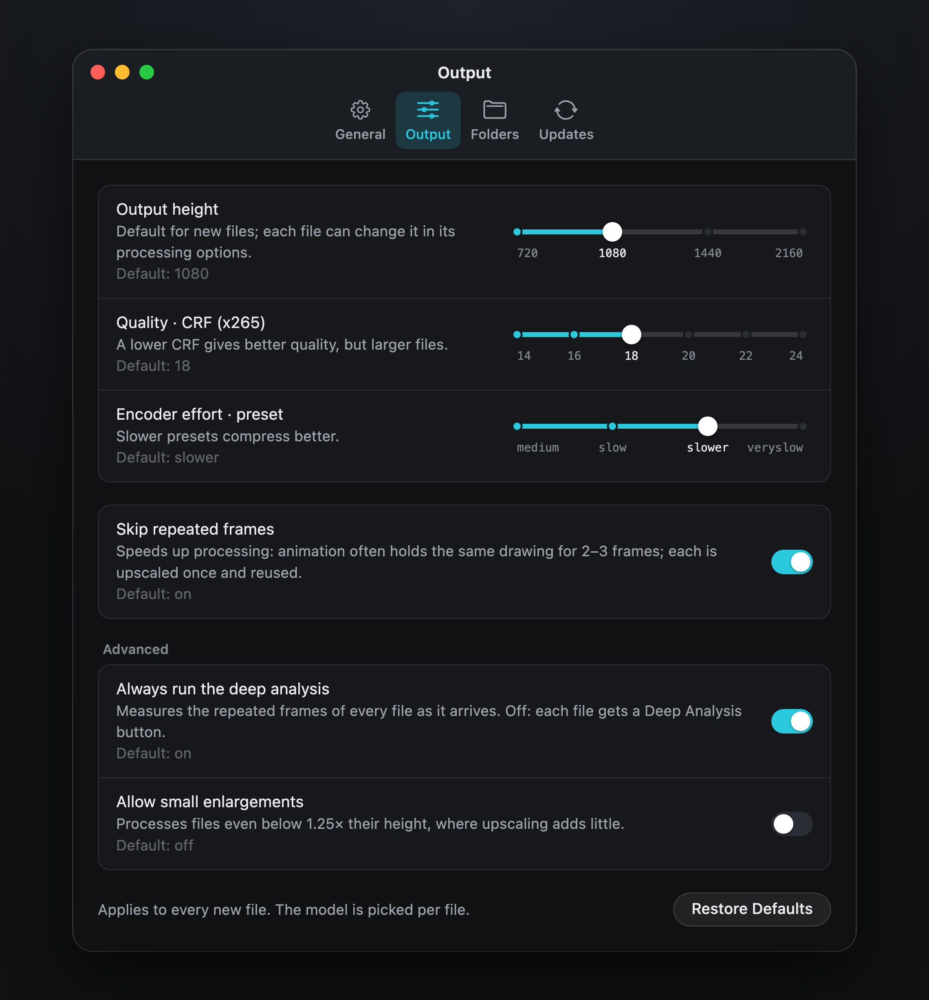

Using AnimeUp · Settings

# 07. Settings

**AnimeUp › Settings…** (⌘,) or the gear at the top of the sidebar. Four tabs. Most settings show their default under their description; the language, the work folder and the space per file don't, because they depend on your Mac.

{ .au }

!!! info "Locked while a job runs"
    While the queue runs, every setting except those in Updates is locked: the queue keeps the values it started with. Change them when it finishes, or after Stop All. A paused or interrupted file always resumes with its own values; Settings says so, with **Use Its Values** if you want them back.

## General

| Setting | Default | What it does |
|---|---|---|
| Language | macOS's | English or Italiano. Starts in the language of macOS; English if it isn't one of these. |
| macOS notifications | on | Banners when a file is done, the queue finishes, or something goes wrong |
| Progress on the Dock icon | on | A progress bar on the Dock icon while a file runs |
| Pause between files | 5 minutes | Lets the Mac cool down in long queues. **No pause** turns it off. |

## Output

These apply to every new file; the model is picked per file in the Queue.

| Setting | Default | What it does |
|---|---|---|
| Output height | 1080 | 720, 1080, 1440 or 2160. Each file can change it in its processing options. |
| Quality · CRF (x265) | 18 | A lower CRF gives better quality, but larger files |
| Encoder effort · preset | slower | Slower presets compress better, and take longer |
| Skip repeated frames | on | Each drawing held for several frames is upscaled once and reused. Much faster, same result. |
| Always run the deep analysis | on | Measures the repeated frames of every file as it arrives. Off: each file gets a **Deep Analysis** button. |
| Allow small enlargements | off | Processes files even below 1.25× their height, where upscaling adds little |

**Restore Defaults** puts them all back.

## Folders

| Setting | Default | What it does |
|---|---|---|
| Finished videos | next to the originals | The same choice as on Start |
| Work files | `AnimeUp Jobs` in Movies | Heavy while a job runs; an external disk is fine |
| Space per file while processing | the most the disk allows | The most one file may use while processed. More space means fewer chunks and a bit more speed; about 50 GB is the minimum at 1080p. If the disk has less free, AnimeUp lowers it for that file and says so. |
| After a file finishes | delete work files, keep the log | **Keep everything** leaves tens of GB per file, until you discard them from the list |

**Show Work Files in Finder** opens the work folder.

## Updates

| Setting | Default | What it does |
|---|---|---|
| Check for updates automatically | on | At every launch, in the background; **Check Now** asks straight away |

**Check Now** asks GitHub straight away; the tab says whether this is the latest version, with links to the release notes and to AnimeUp on GitHub.

[Next: 08. Files and folders →](08-files-and-folders.md)
