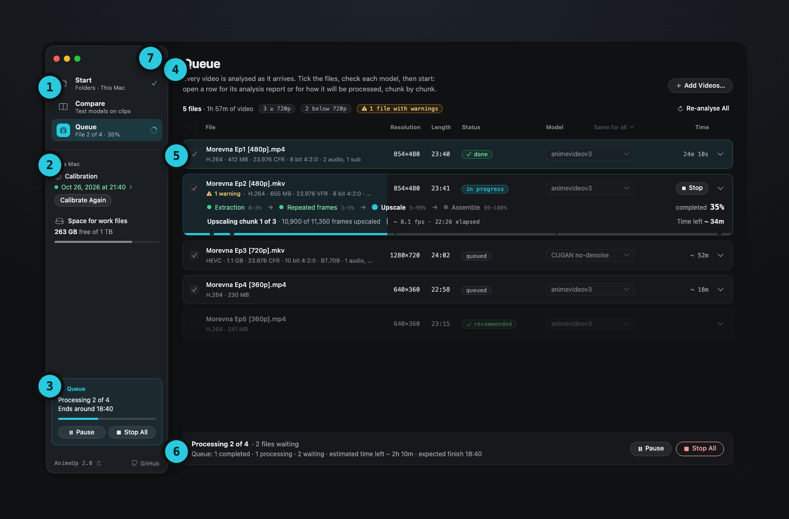

Appendix · Design

# Designing AnimeUp 2.0

{ .au }
{ .au }

How AnimeUp went from a page in the browser to a Mac app, and the decisions behind what you see. This page is for the curious, and for designers: you don't need it to use AnimeUp.

## Where it started

Up to 1.6, AnimeUp's interface was a web page served from the Mac and opened in the browser. It worked, and it taught me a lot about what people need to see while a file runs for two hours. But it never felt like an app:

- it lived in a browser tab, with the browser's address bar, back button and refreshes;
- dialogs, menus and alerts were web imitations of the Mac's own;
- every control, from buttons to dialogs, had grown on its own, so two similar actions could look different on two pages;
- closing the tab or the Terminal window could leave the work running with nothing on screen to say so.

For 2.0 I froze the browser interface and started again from a blank page, with one goal: an app that behaves like every other app on the Mac, and still looks like AnimeUp.

## The approach: native frame, own content

I explored a few directions before writing any code, and kept the one I called **hybrid**:

- **The frame is the Mac's.** A glass sidebar with the window controls inside it, a real Settings window (⌘,), real sheets and alerts, menus and shortcuts, notifications and progress on the Dock icon. SF Pro and SF Mono for text, SF Symbols for icons. Nothing the Mac already does is redrawn.
- **The content is AnimeUp's.** The things only AnimeUp has get a look of their own: the file rows that become their own progress bars, the four steps, the chunks, the comparison player, the calibration charts, one cyan accent.

The test for every screen was the same: would someone who has never seen AnimeUp know where to click, because it works like the Mac apps they already use?

{ .au }

## The process

1. **Inventory.** Every screen, state, message and control of 1.6, written down, with what was wrong with each.
2. **A design system first.** Colours, type, spacing, corners, icons, then every component with all its states, before any screen.
3. **Screens and states.** Every page drawn from those pieces only, then every state of every page: empty, analysing, running, paused, stopped, failed, a full disk, a disconnected drive, a narrow window. About a hundred boards.
4. **Code that adopts the system.** The SwiftUI app was built on the same tokens and components, and every difference between the app and the boards was treated as a bug of the app, or a decision to bring back into the boards.

Every board was reviewed, often several times. The rules below came out of those reviews.

## The design system

### Colour

{ .au }

- **One accent, one meaning.** Cyan says "AnimeUp is working" or "this is the way forward": the primary button, the progress, the current page. It's never decoration.
- **Status always comes in three**: a text colour, a tint and a line. Green is done, yellow is worth a look, red is stopped or failed. A status is never colour alone: it always has a word and, where it fits, an icon.
- **Surfaces in four levels**, from back to front: window, sidebar glass, surface, raised, plus an inset level for what sits inside a card.

### Type

Eight styles only, rounded to whole points and aligned with the macOS text styles (13 pt body). Numbers that change (times, frames, sizes) are in SF Mono, so they don't jump as they tick.

### Buttons

{ .au }

Six roles, three sizes, five states. A button is chosen by **what it does**, never by where it sits:

| Role | Used for |
|---|---|
| Primary | The one way forward in a view: **at most one per view** |
| Secondary | Everything else |
| Destructive | Ends or throws away work: outlined, so it never shouts louder than the primary |
| Confirm destructive | Solid red, only inside the alert that asks for confirmation |
| In a note | Takes the colour of its note: the yellow update note, for instance |
| Plain | Icon-only actions; they get a tooltip |

Disabled is always 40% opacity of the same button. Hover only lightens the same fill, it never changes colour family.

### Notes

One shape for every message: an icon, a bold title, the text, and the note's actions, all in the status colour. A note never says only that something is wrong: it says what AnimeUp will do about it, or what you can do.

## The study of states

A file in AnimeUp lives through many states, and the row in the Queue has to show each one at a glance, from across the room, while you're doing something else.

{ .au }

- **The row is its own progress bar.** A soft fill grows behind the row while it runs, with a slow wave moving through it; a thin bar along its bottom edge is split into the four steps, and the upscale into its chunks.
- **Paused is yellow and still.** No wave, no breathing dot: nothing moves, because nothing is happening.
- **Done is a static full fill**, green, or yellow when the file has warnings.
- **Failed is red**, and says where it stopped.

### Bars split by the real work

{ .au }

Progress bars are split into pieces sized by their real share of the work, measured on real episodes: extraction is about 3% of the time, repeated frames 2%, the upscale 94%, assembly 1%. A bar drawn to those shares would make the three short steps almost invisible, so on the bar they get a little more room (5%, 3% and 2%), taken from the upscale's 90%, and the fill is mapped so the pace stays even across the whole bar.

### Times that hold still

A time left that jumps every second is a time nobody trusts. The time left of a file comes from how long its finished chunks really took, and the queue's finish time moves only when the estimate really changes, at most once a minute. This is as much a design decision as a technical one.

## Rules fixed along the way

Some rules only appeared while reviewing real screens, and then applied everywhere:

- Texts side by side on one line share the same baseline.
- A page's intro runs on two lines of similar length, the second slightly longer.
- Never name a colour in a text ("the white mark"): it changes between light and dark.
- Always the full file name with its extension, never a shortened one.
- Clip times are a range: 05:28 – 05:38.
- **Next:** buttons have a trailing arrow; **Back** stays plain.
- Inside alerts every icon is an outline; small icons inside text are filled.
- English buttons in title case, Italian in sentence case, as Apple does.
- Long lists end with a fade, so it's clear there's more.
- Estimates read "~ 34m", with a space after the tilde.
- Warnings use the filled yellow triangle, errors the filled red octagon, always with the "!" drawn in.
- Small graphic pieces (an icon and a value, a line) rather than empty space, and never walls of text.

## Words

The wording went through the same reviews as the pixels. Two examples:

- A finished file you redo with the same model would overwrite its video. The first draft offered "Keep It as It Is"; it became **Don't Redo**, which says what happens, and the question moved into the note, in bold: "Are you sure you want to overwrite it?".
- Each Settings row shows its default under its description ("Default: 18"), so nobody has to remember what it was.

## What's next

2.0 is dark only. The light theme was designed alongside the dark one in the first boards, and comes back once the dark one has settled. The pictures in this guide will follow the theme of the page when it does.

[Next: How a job works inside →](how-it-works.md)
