Appendix · Design

# Designing AnimeUp 2.0

  
  
  <svg class="au-fade__edge" viewBox="0 0 100 100" preserveAspectRatio="none" aria-hidden="true"><line x1="0" y1="0" x2="0" y2="0" vector-effect="non-scaling-stroke"/></svg>

How AnimeUp went from a page in the browser to a Mac app, and the decisions behind what you see. This page is for the curious, and for designers: you don't need it to use AnimeUp.

## Where it started

Up to 1.6, AnimeUp was a web page opened in the browser, built with [Streamlit](https://streamlit.io). It was a great way to start: a few lines of Python, and I could try ideas on real files the same evening. But the further the design went, the harder it pushed back:

- **A design system was a fight.** Streamlit draws its own widgets; giving them AnimeUp's look meant fighting each one, and any update could undo it.
- **Responsive was bent, not designed.** The layout is a column of blocks Streamlit decides for you.
- **Every click reran the page.** The page flickered, scroll jumped, open rows closed.
- **The Mac was out of reach.** No native folder picker, notifications, Dock progress or quit confirmation without workarounds.
- **It lived in a tab.** Address bar, refresh, imitation dialogs, and work running with nothing on screen once the tab was closed.

  
  
  

## The approach

For 2.0 I started again in SwiftUI, with the same engine underneath and one goal: an app that behaves like every other Mac app, without losing what made AnimeUp recognisable, nor the skeleton of how it works: add videos, compare, process.

### Native frame, own content

Two halves, kept apart on purpose: what the Mac already does well is left to the Mac, and what only AnimeUp does is designed for it.

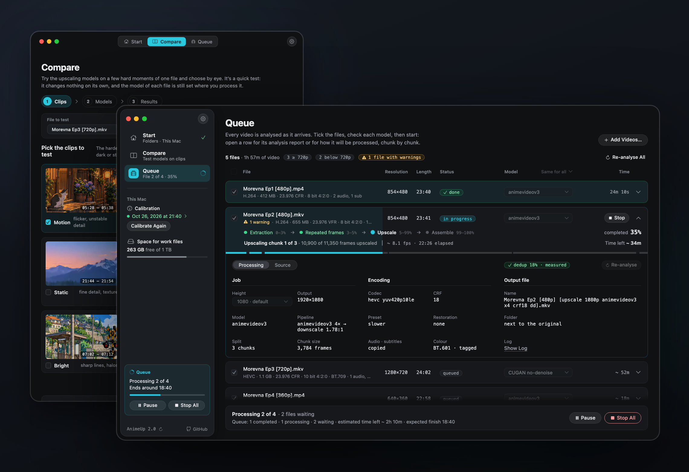{ .au }

- **The frame is the Mac's.** Glass sidebar, Settings window, sheets, alerts, menus, notifications, Dock progress, SF Pro and SF Symbols. Nothing the Mac already does is redrawn.
- **The content is AnimeUp's.** File rows that are their own progress bars, the four steps and their chunks, the comparison player, the calibration charts, one cyan accent.

### It fits the window

A Mac window can be any size, and AnimeUp often sits small beside a player or a folder while it works. So I designed every page at both widths, instead of letting the wide layout squeeze itself into the narrow one.

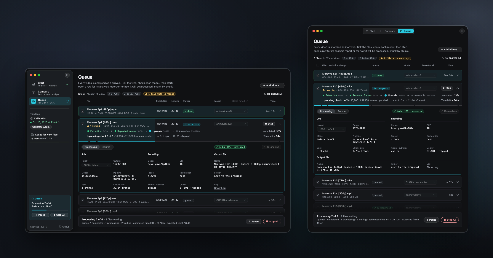{ .au }

- **Below 1240 pt the sidebar becomes tabs.** Start, Compare and Queue move into a segmented control at the top of the window. The Queue tab keeps its count of files, with a spinner next to it while work is going on.
- **Each page is drawn again, not shrunk.** Panels stack one above the other, and what you act on stays in view.
- **Nothing is lost.** Everything you can do in a wide window you can do in a narrow one: it's only arranged differently.

### Every screen drawn first

Every screen was drawn against a design system built first: colours, type, spacing and every component with all its states.

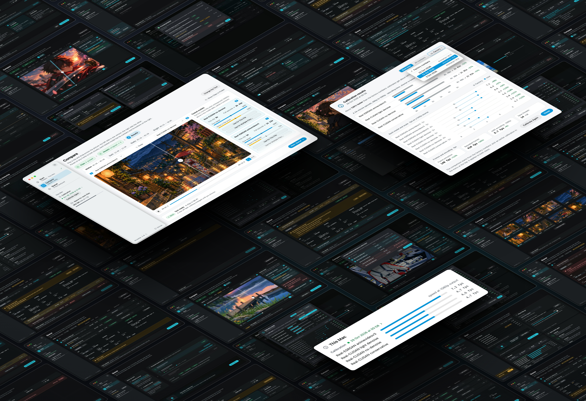{ .au }

Not just the pages, but each of their states: empty, analysing, running, paused, stopped, failed, a full disk, a disconnected drive, a narrow window. More than a hundred boards, each reviewed, often several times, before a line of code; then the app was built to match them, detail by detail.

## The design system

### Colour

Colour is kept for meaning: one accent for what AnimeUp is doing, three status colours, and greys for everything else.

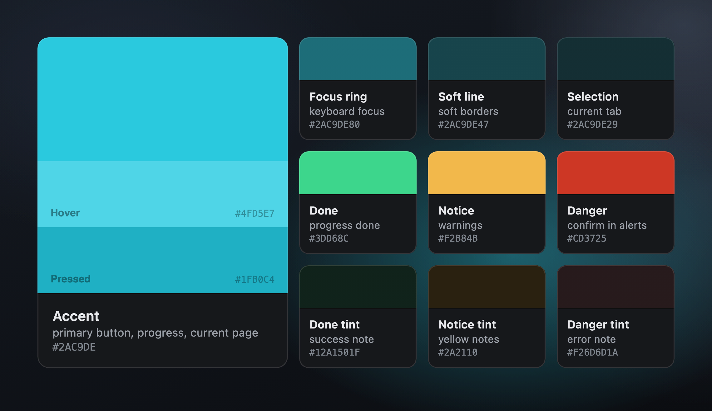{ .au }

- **One accent, one meaning.** Cyan says "AnimeUp is working" or "this is the way forward": the primary button, the progress, the current page. It's never decoration.
- **Status always comes in three**: a text colour, a tint and a line. Green is done, yellow is worth a look, red is stopped or failed. A status is never colour alone: it always has a word and, where it fits, an icon.
- **Surfaces in four levels**, from back to front: window, sidebar glass, surface, raised, plus an inset level for what sits inside a card.

### Type

AnimeUp uses the Mac's own type: SF Pro for text, SF Mono for every number that changes. A native app should read like the rest of the Mac, and these are the faces macOS itself is set in, drawn for the screen and already on every Mac.

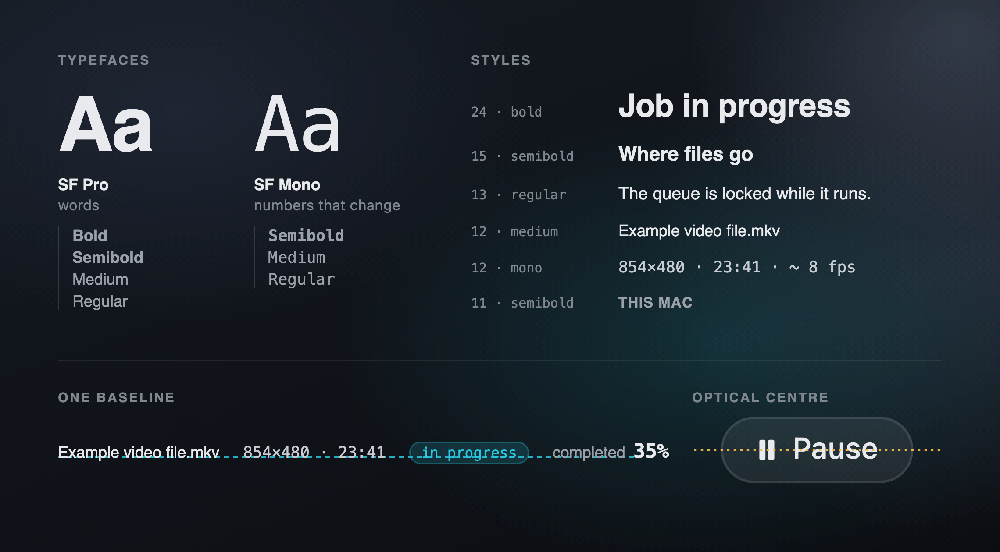{ .au }

- **SF Pro, because it's the Mac's.** AnimeUp lives inside a frame macOS draws for it: menus, alerts, sheets, the Settings window. Any other face inside would show the seam. SF Pro is also built for screens: it changes cut and spacing with the size, so 11 pt labels stay open and 24 pt titles stay tight, and it has every accent the app's languages need.
- **SF Mono, for numbers that change.** It's SF Pro's monospaced companion, drawn with the same proportions, so the two sit together without a jolt. Times, frames, sizes and speeds change while a job runs; with every digit the same width, a time left doesn't jitter as it counts down, and numbers in a column line up. It also tells data from words at a glance.
- **Few styles, whole points.** Eight styles in all, aligned with the macOS text styles: 13 pt body, 15 pt section titles, 24 pt page titles, 11 pt labels. With few sizes the hierarchy reads at a glance, and whole points keep the text sharp.
- **Centred, on one baseline.** Text is always centred in its container, and centred with the icon beside it. Words and numbers in different faces and sizes on the same line always share one baseline.
- **Three text levels.** The main text, a secondary grey for what explains it, a tertiary grey for labels and details. Each grey was chosen for contrast first, and only then for hierarchy.

**Contrast.** I measured the text colours against the backgrounds they sit on: the window, cards, controls, chips, notes and buttons. In the dark theme the three text levels reach 15.7, 7.3 and 5.1 to 1 on the window, and the coloured texts (cyan, green, yellow, red) between 6.6 and 12.3 to 1; in the light theme the text colours stay between 4.7 and 17.8 to 1. These meet the 4.5 to 1 that WCAG AA asks for normal text. Two exceptions I know of, both labels on solid buttons: white on the red confirm button is at 4.45 to 1, just short of the mark, and white on the cyan button of the light theme at 3.3 to 1, enough only for large text. Both are on the list for the next version.

Contrast is the part I measured. I haven't yet tested AnimeUp with VoiceOver or run a full accessibility review, so I won't claim more than that.

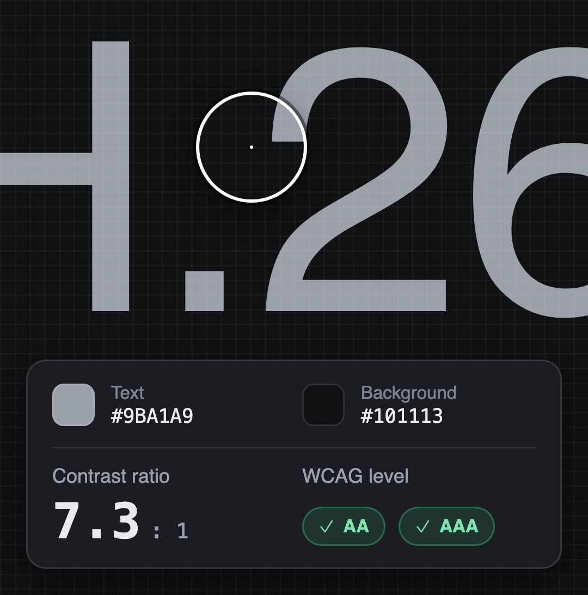

### Icons

Every icon is an SF Symbol, the Mac's own set: thousands of symbols drawn to sit with SF Pro. Out of all of them I picked, for each idea, the one that says it most plainly, and kept it for that idea everywhere.

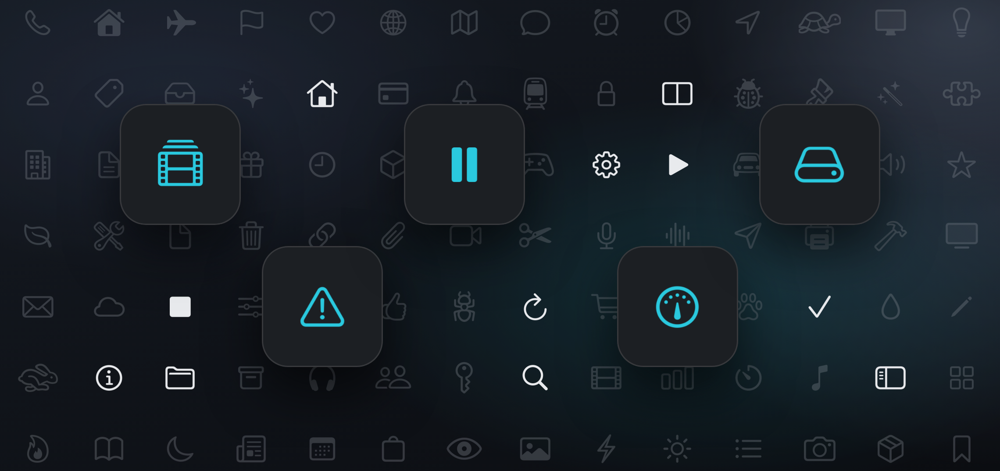{ .au }

- **One symbol, one meaning.** The film stack is the Queue, in the sidebar and in the tabs of a narrow window alike, and it never stands for anything else.
- **Regular weight, with the text.** An icon takes the weight and size of the label beside it, so the two read as one.
- **The Mac's, not mine.** They come with macOS, so they look like the rest of the system and stay sharp at any size.

### Buttons

Six roles, three sizes, four states. A button is chosen by **what it does**, never by where it sits.

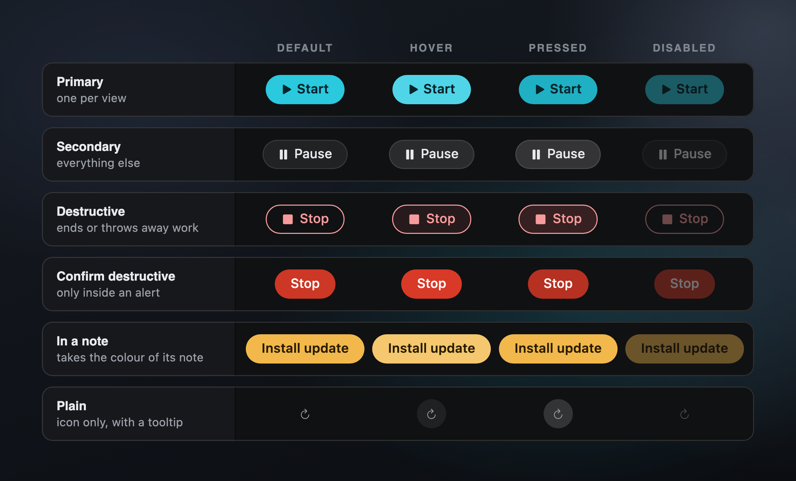{ .au }

- **Chosen by what it does.** The same action looks the same in a row, in the sidebar and in a dialog.
- **One primary per view.** If two actions compete, the second becomes secondary.
- **Order.** In a row of buttons the primary is on the right, as on macOS; in an alert they are stacked, with the answer on top and Cancel last.
- **Three sizes, chosen by the place.** Large (32 pt) in alerts and dialogs, Regular (28 pt) in page headers and panels, Small (24 pt) inside file rows and the sidebar.
- **Hover never changes the colour family.** It only lightens the same fill.
- **Disabled is 40% of the same button**, with a tooltip that says why.
- **An icon only when it helps** to recognise the action, always on the left; icon and label are centred in the capsule.
- **Labels follow Apple**: Title Case in English, sentence case in Italian.

### Status chips

A chip is a status in a word or two: a small capsule, in SF Mono and lowercase, so it reads as a label and never as a button.

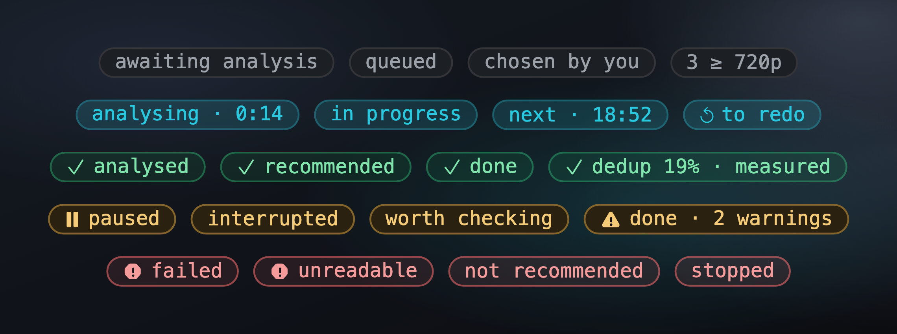{ .au }

- **Five families, one per meaning.** Grey is waiting, cyan is at work, green is done, yellow is worth a look, red has failed: the same colours as everywhere else in the app.
- **The word comes first.** The colour supports it and never replaces it; an icon is added only where it makes the state quicker to recognise, like the check for done or the two bars for paused.
- **A number when it helps.** "analysing · 0:14" says how long it has been going, so the chip answers the next question too.

### Notes

One shape for every message: an icon, a bold title, the text, and the note's actions, all in the status colour. A note never says only that something is wrong: it says what AnimeUp will do about it, or what you can do.

### Charts

After a calibration, AnimeUp shows what it measured on one sheet: how long an episode takes now, how fast each model runs on this Mac, and how fast the steps around the upscale are.

{ .au }

- **One sentence first.** Above the charts, the result in words: how much faster than the reference, and how much shorter the estimates get.
- **Time as two bars.** For each model, the reference above in grey and this Mac below in cyan, on an axis in hours: shorter is faster, and you see the difference before you read a number. It's a duration, so plain bars, never a track that could look like something still running.
- **Speed as a dumbbell.** A ring for the reference, a dot for now, joined by a line: the longer the line, the bigger the gain, and every model and scale lines up for comparison.
- **The rest in a band of figures.** Extraction, repeated frames, encoding and save threads don't need a chart: a number and its change say it all.
- **The reference is your choice.** The menu at the top compares with the factory numbers or with any earlier calibration, each with the version of AnimeUp that made it, and both views follow it.
- **Two views of the same numbers.** Overview draws them; All numbers lists every figure in a table, for whoever wants the detail.
- **The numbers sit beside the marks.** Every bar and dot has its value in SF Mono and its change in green: the chart shows the numbers, it doesn't replace them.

## The study of states

A file in AnimeUp lives through many states, and the row in the Queue has to show each one at a glance, from across the room, while you're doing something else.

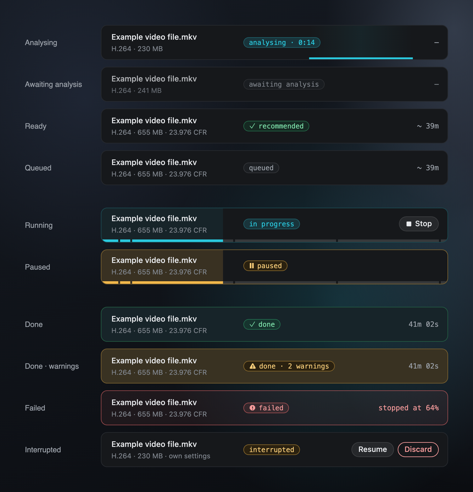{ .au }

- **The row is its own progress bar.** A soft fill grows behind the row while it runs, with a slow wave moving through it; a thin bar along its bottom edge is split into the four steps, and the upscale into its chunks.
- **Paused is yellow and still.** No wave, no breathing dot: nothing moves, because nothing is happening.
- **Done is a static full fill**, green, or yellow when the file has warnings.
- **Failed is red**, and says where it stopped.

### Bars split by the real work

Progress bars are split into pieces sized by their real share of the work, measured on real episodes: extraction is about 3% of the time, repeated frames 2%, the upscale 94%, assembly 1%.

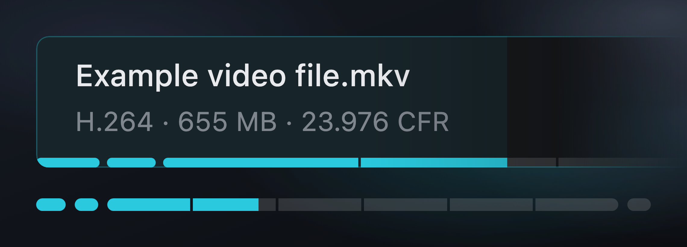{ .au }

Drawn to those exact shares, the three short steps would be almost invisible, so on the bar they get a little more room, while the bar still fills at an even pace.

### Times that hold still

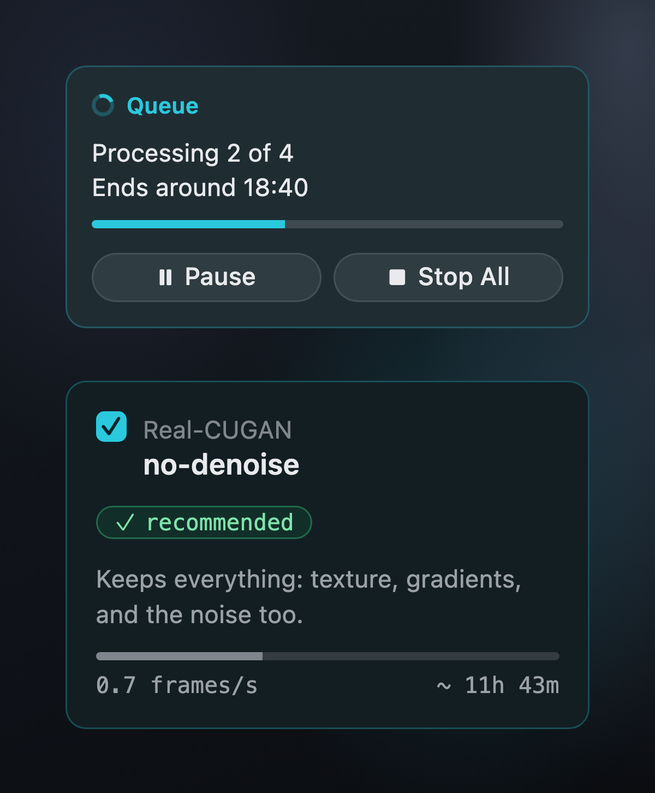

A time that jumps every second is a time nobody trusts, and a number that keeps moving pulls the eye even when nothing that matters has changed. Upscaling an episode takes a long while, and most of that time you're doing something else: when you look back at AnimeUp, the times should tell you something you can act on, at a glance.

- **The finish is a clock time.** "Ends around 18:40" answers the question you actually have, when it will be done, and it moves only when the estimate really changes.
- **The time left counts down calmly.** It follows the pace of the work already done, so it doesn't swing at the start of every step.
- **Estimates look like estimates.** "Around", "~ 34m", whole minutes: no seconds that pretend to a precision nobody has.

## Rules fixed along the way

Some rules only appeared while reviewing real screens, and then applied everywhere.

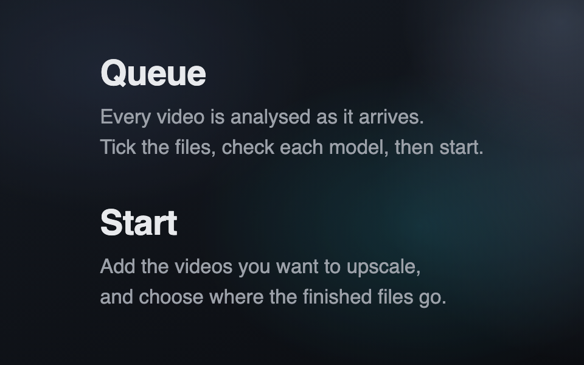

**Two lines, the second longer**
A page's intro runs on two lines of similar length, the second slightly longer, so it reads as one balanced block.

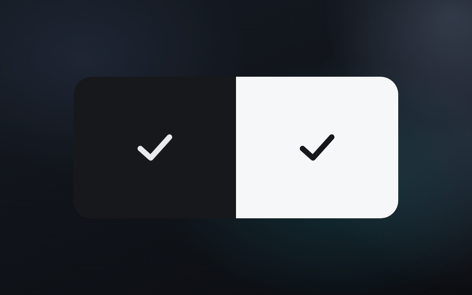

**No colour names**
A text never names a colour ("the white mark"): the same mark changes colour between the dark and the light theme.

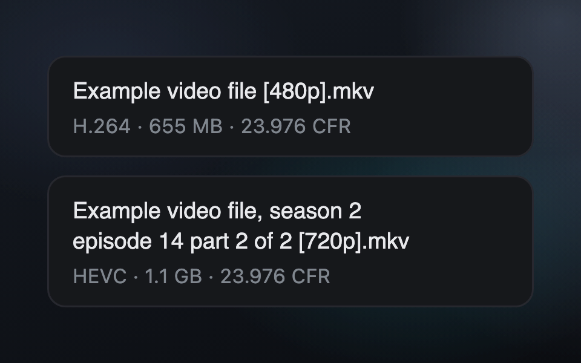

**The full file name**
Always the full file name with its extension, never a shortened one: files are often told apart by their last characters.

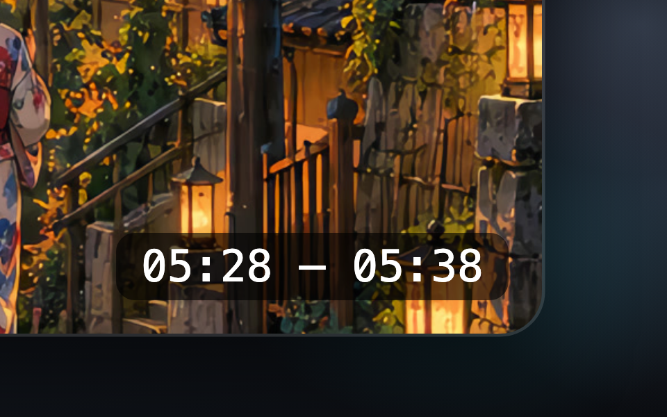

**Clip times as a range**
Clip times are a range, 05:28 – 05:38, so you can find the moment in the episode yourself.

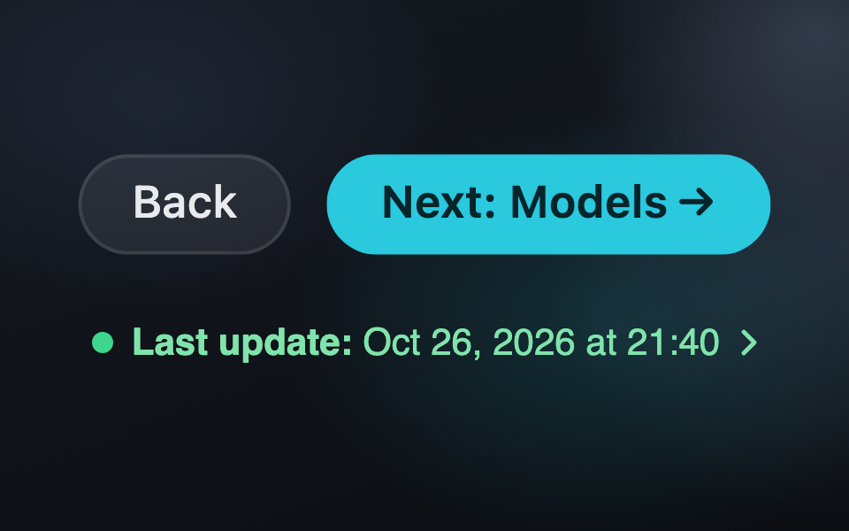

**Next has an arrow**
**Next** buttons carry a trailing arrow and **Back** stays plain, so the way forward is clear before you read it; a link that opens a page, like the calibration date, ends with a chevron.

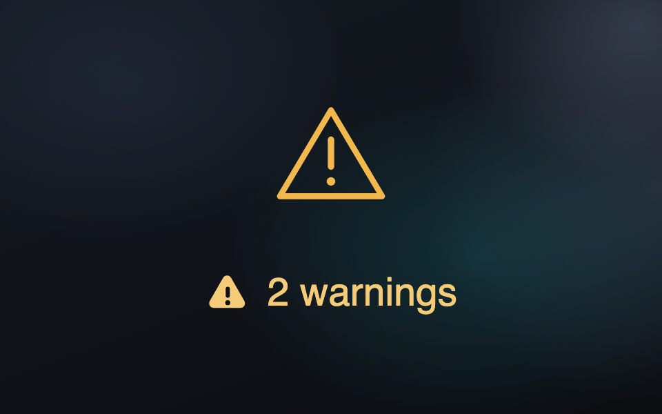

**Outline in alerts, filled in text**
Inside alerts every icon is an outline; small icons inside a line of text are filled, so they hold their shape.

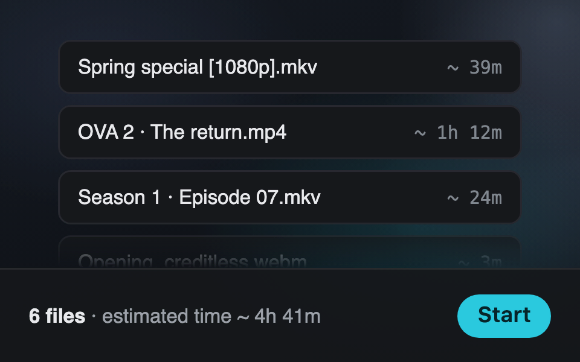

**Lists fade at the end**
Long lists fade out where they slide under a fixed bar, so it's clear there's more to scroll.

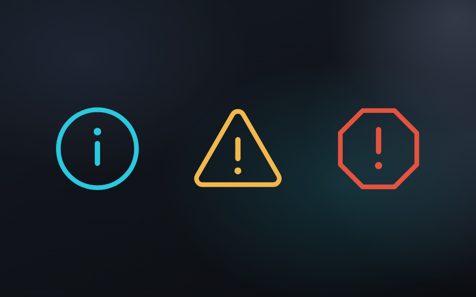

**Triangle warns, octagon stops**
Information uses the circle, warnings the yellow triangle, errors the red octagon, on every page and in every note.

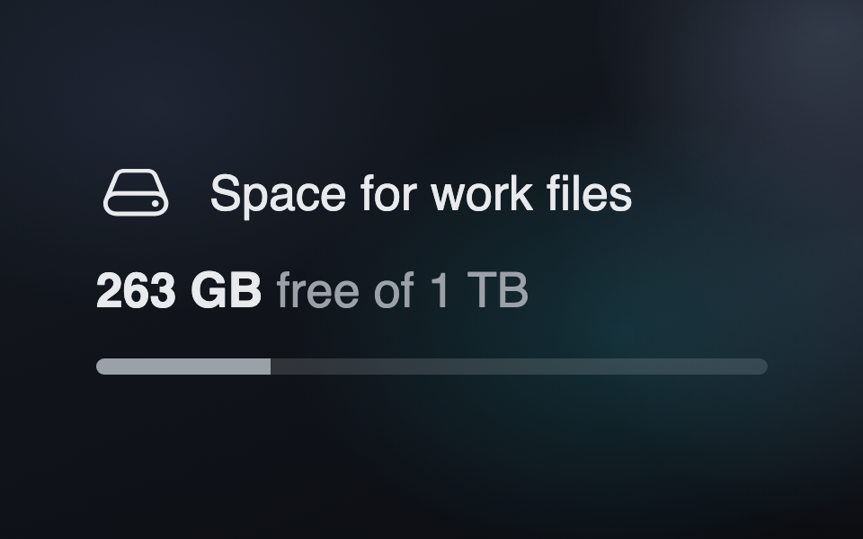

**Small pieces, not text**
Small graphic pieces, an icon and a value or a short bar, rather than empty space, and never walls of text.

## Words

The wording went through the same reviews as the pixels. Two examples:

- A finished file you redo with the same model would overwrite its video. The first draft offered "Keep It as It Is"; it became **Don't Redo**, which says what happens, and the question moved into the note, in bold: "Are you sure you want to overwrite it?".
- Each Settings row shows its default under its description ("Default: 18"), so nobody has to remember what it was.

## What's next

2.0 is dark only. The light theme was designed alongside the dark one in the first boards, and comes back once the dark one has settled. The pictures in this guide will follow the theme of the page when it does.

[Next: How a job works inside →](how-it-works.md)
