Deep dive · Model study

# Newer anime models, compared

AnimeUp's models date from 2022. Since then the community has trained many anime models, and some are often recommended over Real-ESRGAN and Real-CUGAN. I tested six of them against the four models AnimeUp ships, on the same frames from 360p to 1080p: what they look like, how fast they are, and what it would take to offer them.

You don't need this page to use AnimeUp. It explains why the model list is what it is, and what could change it. What the four AnimeUp models do to paper, grain and skies is in [How much texture each model keeps](texture-study.md).

## In short

-   **AnimeUp's models hold up**

    ---

    No candidate beats Real-ESRGAN animevideov3 on 360p and 480p sources, and none beats Real-CUGAN on clean HD by enough to justify a new model straight away.

-   **Fallin Soft and Adore are the interesting ones**

    ---

    Two "CUGAN fast" models. From 720p up they give clean lines **without the light halos** Real-CUGAN draws along outlines, keep the colours, and run about **twice as fast**.

-   **But they don't run in AnimeUp today**

    ---

    The upscalers AnimeUp ships lack some of the building blocks those two need. Using them means building and maintaining a new upscaler.

-   **The Compact models run, but add little**

    ---

    AnimeJaNai, Futsuu and HFA2kAVCCompact work in today's upscaler. AnimeJaNai stays barely sharper than Lanczos even at 1080p; HFA2kAVCCompact draws a checkerboard in saturated reds.

-   **Real-CUGAN conservative sits in between**

    ---

    Added in AnimeUp 1.6.8. It keeps painted texture and draws weaker halos than Real-CUGAN no-denoise, at the same speed. On compressed sources it keeps the artefacts too. More in [the texture study](texture-study.md).

-   **Decision: nothing is added for now**

    ---

    The path worth exploring later is Fallin Soft as an extra option for sources of 560 lines and above, which needs a rebuilt upscaler.

## How the test was done

- **Source:** episode 3 of *Morevna*, an open animated series (CC BY-SA), in its own 360p, 480p and 720p releases and the 1080p HQ release. Eight frames chosen for faces, lines, lettering, flat colours, dark gradients and painted texture.
- **Output:** every model at **2×**, the whole frame. Each case shows the frame for context, the same crop from all twelve versions at 1:1, and a slider to compare any two on a larger region.
- **The twelve versions:** the original (its pixels simply enlarged), a plain **Lanczos 2×** enlargement that adds no detail and serves as the reference, the four models AnimeUp ships, and the six candidates.
- **Under each crop:** **detail** is the fine-detail energy of the crop compared with Lanczos (100%): more means sharper lines and texture, but also more halos and more sharpened noise. **Tone** is the average brightness shift against Lanczos, in levels out of 255.
- **Machine:** Apple M4 Pro, GPU through Vulkan (ncnn), the same engine AnimeUp uses.
- **Dates:** first run on 24 October 2026, extended with 1080p and the other two Real-CUGAN models on 26 October 2026. Nothing in AnimeUp was changed for the test.

!!! warning "What this test can't tell"
    One source only, and a clean one: *Morevna* is produced digitally. No heavy broadcast compression, and only two 1080p frames. Before adopting any of these, the test should be repeated on more 1080p material.

## The candidates

| Model | Runs today | 720p frame | 1080p frame | Verdict |
|---|---|---|---|---|
| **Real-ESRGAN animevideov3** *(in AnimeUp)* <small>Compact · BSD-3</small> | yes | 201 ms | 449 ms | Thick, clean lines. Flattens texture; shadows slightly darker. Still the best at 360p. |
| **Real-CUGAN no-denoise** *(in AnimeUp)* <small>CUGAN · MIT</small> | yes | 273 ms | 575 ms | The sharpest, but with **light halos** along lines, more contrast, darker shadows. |
| **Real-CUGAN light denoise** *(in AnimeUp)* <small>CUGAN · MIT</small> | yes | 273 ms | 575 ms | On these clean frames, almost identical to Real-CUGAN no-denoise. |
| **Real-CUGAN conservative** *(in AnimeUp since 1.6.8)* <small>CUGAN · MIT</small> | yes | 255 ms | 577 ms | Keeps painted texture, weaker halos. Keeps compression artefacts too. |
| **AnimeJaNai HD V3 Compact** <small>Compact · CC BY-NC-SA 4.0</small> | yes | 187 ms | 439 ms | Very conservative at every size, 1080p included. The most faithful colours. |
| **HFA2kAVCCompact** <small>Compact · CC BY 4.0</small> | yes | 187 ms | 439 ms | A **checkerboard pattern** in saturated reds at 480p. Ruled out. |
| **Futsuu Anime** <small>Compact · WTFPL</small> | yes | 187 ms | 439 ms | Dark, clean lines. In practice a slightly less flattened Real-ESRGAN animevideov3: no clear gain. |
| **ModernSpanimation V1** <small>SPAN · MIT</small> | no | 271 ms | 630 ms | Soft, "painterly", a **green cast in the shadows**, darker reds. Ruled out. |
| **Fallin Soft** <small>CUGAN fast · CC BY 4.0</small> | no | **114 ms** | **236 ms** | Clean lines, no halos, hatching kept, shadows close to the source. Softer than Real-CUGAN, more faithful. |
| **Adore** <small>CUGAN fast ("pro") · CC BY-NC-SA 4.0</small> | no | **112 ms** | **250 ms** | The cleanest, a little sharper than Fallin Soft, no halos, no average colour shift. |

**Runs today** means it runs in the upscalers AnimeUp ships (more on that below). Speeds are for one frame upscaled 2×, whole frame on the GPU, median of five runs; the three Compact candidates share the same network size, so they run at the same speed. As a cross-check, AnimeUp's own upscalers on 48 real 720p frames took 257 ms for Real-ESRGAN animevideov3 and 368 ms for Real-CUGAN no-denoise: the ranking holds.

## The frames

Each case has the same layout: the whole frame, the twelve crops in the same order (source and reference, the four AnimeUp models, the six candidates), what to look at, and a slider. Click a crop to open it full size.

### 360p: a face in profile

*Morevna*'s own 360p release (640×360), 0:15 into the clip.

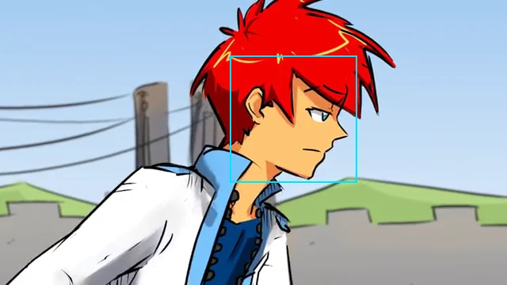{ loading=lazy }

*The whole frame for context; the box marks the crop below, shown at 1:1 after a 2× enlargement.*

<figure markdown>

[{ loading=lazy }](../img/model-study/p360_15/original.webp)

<figcaption>source<strong>Original</strong>640×360, pixels enlarged</figcaption>

</figure>

<figure markdown>

[{ loading=lazy }](../img/model-study/p360_15/lanczos.webp)

<figcaption>reference<strong>Lanczos 2×</strong>detail 100%</figcaption>

</figure>

<figure markdown>

[{ loading=lazy }](../img/model-study/p360_15/animevideov3.webp)

<figcaption>AnimeUp<strong>Real-ESRGAN animevideov3</strong>detail 138% · tone +0.3</figcaption>

</figure>

<figure markdown>

[{ loading=lazy }](../img/model-study/p360_15/cugan.webp)

<figcaption>AnimeUp<strong>Real-CUGAN no-denoise</strong>detail 150% · tone −0.6</figcaption>

</figure>

<figure markdown>

[{ loading=lazy }](../img/model-study/p360_15/denoise.webp)

<figcaption>AnimeUp<strong>Real-CUGAN light denoise</strong>detail 150% · tone −0.7</figcaption>

</figure>

<figure markdown>

[{ loading=lazy }](../img/model-study/p360_15/conservative.webp)

<figcaption>AnimeUp<strong>Real-CUGAN conservative</strong>detail 142% · tone −0.1</figcaption>

</figure>

<figure markdown>

[{ loading=lazy }](../img/model-study/p360_15/fallin.webp)

<figcaption>candidate<strong>Fallin Soft</strong>detail 126% · tone −0.6</figcaption>

</figure>

<figure markdown>

[{ loading=lazy }](../img/model-study/p360_15/adore.webp)

<figcaption>candidate<strong>Adore</strong>detail 125% · tone +0.2</figcaption>

</figure>

<figure markdown>

[{ loading=lazy }](../img/model-study/p360_15/janai.webp)

<figcaption>candidate<strong>AnimeJaNai HD V3 Compact</strong>detail 100% · tone +0.2</figcaption>

</figure>

<figure markdown>

[{ loading=lazy }](../img/model-study/p360_15/futsuu.webp)

<figcaption>candidate<strong>Futsuu Anime</strong>detail 125% · tone +0.8</figcaption>

</figure>

<figure markdown>

[{ loading=lazy }](../img/model-study/p360_15/avc.webp)

<figcaption>ruled out<strong>HFA2kAVCCompact</strong>detail 112% · tone +0.6</figcaption>

</figure>

<figure markdown>

[{ loading=lazy }](../img/model-study/p360_15/spanim.webp)

<figcaption>ruled out<strong>ModernSpanimation V1</strong>detail 128% · tone −3.8</figcaption>

</figure>

**What to look at:** The line weight along the jaw, the ear and the eye.

**Verdict:** **Real-ESRGAN animevideov3** draws the cleanest, most even lines. The three Real-CUGAN models come close, a little heavier; **Real-CUGAN conservative** is a touch softer. **Fallin Soft** and **Adore** are softer still, and **AnimeJaNai** is no sharper than Lanczos (detail 100%).

**Why:** The candidates were trained on HD sources and expect real detail to work with. At 360p there is little, while Real-ESRGAN animevideov3 was trained to redraw lines from small, compressed video. This is why AnimeUp recommends Real-ESRGAN animevideov3 below 380 lines.

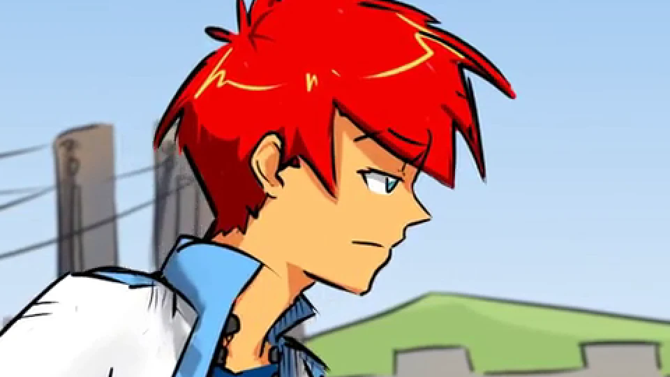

*A 960×540 region of the 2× results at 1:1. Choose any two versions, then move the pointer over the picture or drag the slider.*

### 360p: lettering and flat colours

*Morevna* 360p, 0:45. Hand-drawn lettering on a flat pink wall.

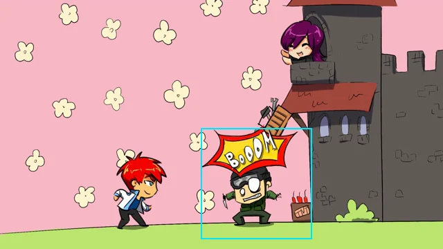{ loading=lazy }

*The whole frame for context; the box marks the crop below, shown at 1:1 after a 2× enlargement.*

<figure markdown>

[{ loading=lazy }](../img/model-study/p360_45/original.webp)

<figcaption>source<strong>Original</strong>640×360, pixels enlarged</figcaption>

</figure>

<figure markdown>

[{ loading=lazy }](../img/model-study/p360_45/lanczos.webp)

<figcaption>reference<strong>Lanczos 2×</strong>detail 100%</figcaption>

</figure>

<figure markdown>

[{ loading=lazy }](../img/model-study/p360_45/animevideov3.webp)

<figcaption>AnimeUp<strong>Real-ESRGAN animevideov3</strong>detail 141% · tone +2.2</figcaption>

</figure>

<figure markdown>

[{ loading=lazy }](../img/model-study/p360_45/cugan.webp)

<figcaption>AnimeUp<strong>Real-CUGAN no-denoise</strong>detail 148% · tone −0.8</figcaption>

</figure>

<figure markdown>

[{ loading=lazy }](../img/model-study/p360_45/denoise.webp)

<figcaption>AnimeUp<strong>Real-CUGAN light denoise</strong>detail 144% · tone −1.2</figcaption>

</figure>

<figure markdown>

[{ loading=lazy }](../img/model-study/p360_45/conservative.webp)

<figcaption>AnimeUp<strong>Real-CUGAN conservative</strong>detail 133% · tone −0.1</figcaption>

</figure>

<figure markdown>

[{ loading=lazy }](../img/model-study/p360_45/fallin.webp)

<figcaption>candidate<strong>Fallin Soft</strong>detail 121% · tone −0.3</figcaption>

</figure>

<figure markdown>

[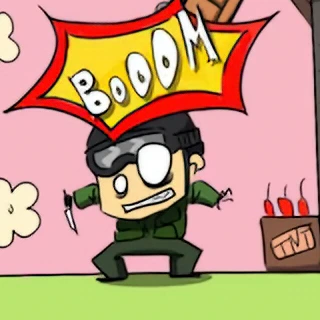{ loading=lazy }](../img/model-study/p360_45/adore.webp)

<figcaption>candidate<strong>Adore</strong>detail 112% · tone +0.2</figcaption>

</figure>

<figure markdown>

[{ loading=lazy }](../img/model-study/p360_45/janai.webp)

<figcaption>candidate<strong>AnimeJaNai HD V3 Compact</strong>detail 92% · tone +1.6</figcaption>

</figure>

<figure markdown>

[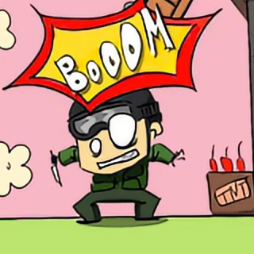{ loading=lazy }](../img/model-study/p360_45/futsuu.webp)

<figcaption>candidate<strong>Futsuu Anime</strong>detail 129% · tone +0.9</figcaption>

</figure>

<figure markdown>

[{ loading=lazy }](../img/model-study/p360_45/avc.webp)

<figcaption>ruled out<strong>HFA2kAVCCompact</strong>detail 116% · tone +0.7</figcaption>

</figure>

<figure markdown>

[{ loading=lazy }](../img/model-study/p360_45/spanim.webp)

<figcaption>ruled out<strong>ModernSpanimation V1</strong>detail 131% · tone −2.8</figcaption>

</figure>

**What to look at:** The outline of the lettering, and the flat pink around it.

**Verdict:** Every model keeps the lettering readable. **Real-ESRGAN animevideov3** and the Real-CUGAN models give the boldest outlines. **AnimeJaNai** stays at Lanczos level (92%). **ModernSpanimation** already darkens the pink (−2.8 levels).

**Why:** Flat colour hides nothing: any shift in tone shows at once, which is why ModernSpanimation V1's cast is easiest to see here.

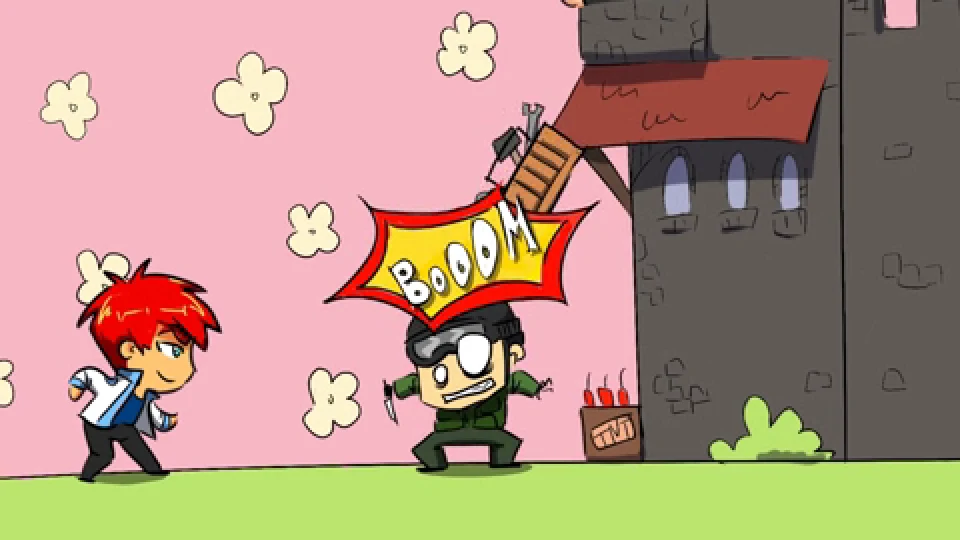

*A 960×540 region of the 2× results at 1:1. Choose any two versions, then move the pointer over the picture or drag the slider.*

### 480p: a dark corridor

*Morevna*'s 480p release (854×480), 0:15. Shadows and a soft light falloff.

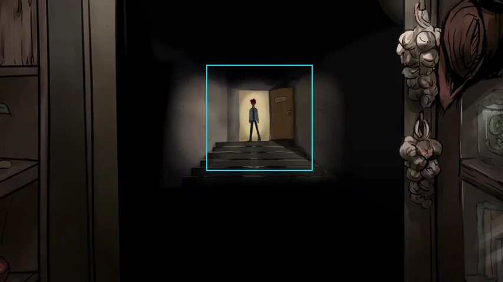{ loading=lazy }

*The whole frame for context; the box marks the crop below, shown at 1:1 after a 2× enlargement.*

<figure markdown>

[{ loading=lazy }](../img/model-study/p480_15/original.webp)

<figcaption>source<strong>Original</strong>854×480, pixels enlarged</figcaption>

</figure>

<figure markdown>

[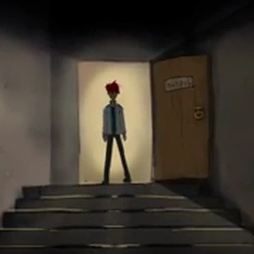{ loading=lazy }](../img/model-study/p480_15/lanczos.webp)

<figcaption>reference<strong>Lanczos 2×</strong>detail 100%</figcaption>

</figure>

<figure markdown>

[{ loading=lazy }](../img/model-study/p480_15/animevideov3.webp)

<figcaption>AnimeUp<strong>Real-ESRGAN animevideov3</strong>detail 140% · tone +0.9</figcaption>

</figure>

<figure markdown>

[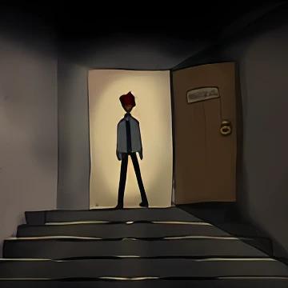{ loading=lazy }](../img/model-study/p480_15/cugan.webp)

<figcaption>AnimeUp<strong>Real-CUGAN no-denoise</strong>detail 207% · tone −1.2</figcaption>

</figure>

<figure markdown>

[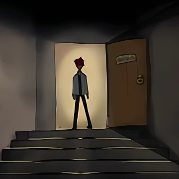{ loading=lazy }](../img/model-study/p480_15/denoise.webp)

<figcaption>AnimeUp<strong>Real-CUGAN light denoise</strong>detail 206% · tone −0.9</figcaption>

</figure>

<figure markdown>

[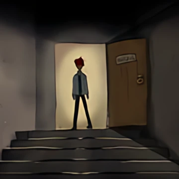{ loading=lazy }](../img/model-study/p480_15/conservative.webp)

<figcaption>AnimeUp<strong>Real-CUGAN conservative</strong>detail 173% · tone −0.2</figcaption>

</figure>

<figure markdown>

[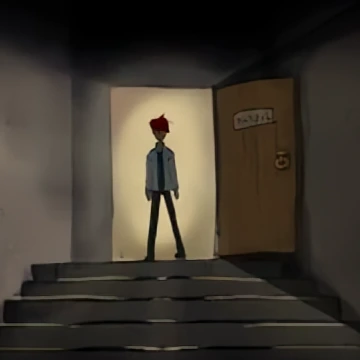{ loading=lazy }](../img/model-study/p480_15/fallin.webp)

<figcaption>candidate<strong>Fallin Soft</strong>detail 130% · tone 0.0</figcaption>

</figure>

<figure markdown>

[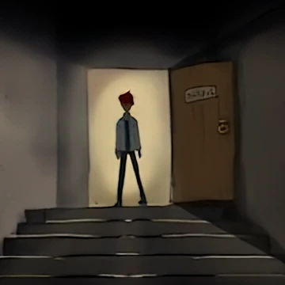{ loading=lazy }](../img/model-study/p480_15/adore.webp)

<figcaption>candidate<strong>Adore</strong>detail 157% · tone −0.2</figcaption>

</figure>

<figure markdown>

[{ loading=lazy }](../img/model-study/p480_15/janai.webp)

<figcaption>candidate<strong>AnimeJaNai HD V3 Compact</strong>detail 103% · tone −0.2</figcaption>

</figure>

<figure markdown>

[{ loading=lazy }](../img/model-study/p480_15/futsuu.webp)

<figcaption>candidate<strong>Futsuu Anime</strong>detail 135% · tone 0.0</figcaption>

</figure>

<figure markdown>

[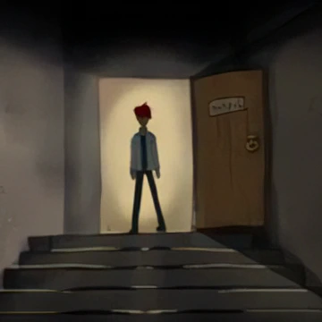{ loading=lazy }](../img/model-study/p480_15/avc.webp)

<figcaption>ruled out<strong>HFA2kAVCCompact</strong>detail 114% · tone +0.2</figcaption>

</figure>

<figure markdown>

[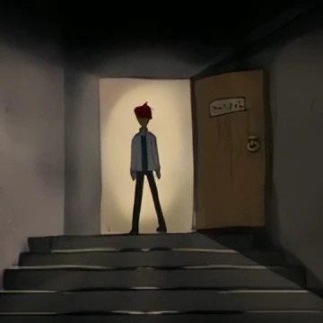{ loading=lazy }](../img/model-study/p480_15/spanim.webp)

<figcaption>ruled out<strong>ModernSpanimation V1</strong>detail 131% · tone −0.8</figcaption>

</figure>

**What to look at:** The shadows on the walls and the steps, and the gradient around the lit doorway.

**Verdict:** **No model adds new banding.** The three Real-CUGAN models sharpen the most (detail 173–207%) and darken the shadows slightly. **Fallin Soft** stays closest to the source's tones. **ModernSpanimation** tints the shadows green.

**Why:** In dark gradients the difference between texture and compression noise is smallest, so models that sharpen more also bring out more of the encoder's blotches.

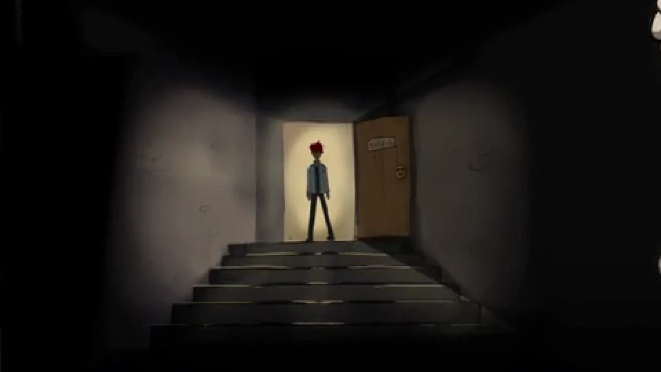

*A 960×540 region of the 2× results at 1:1. Choose any two versions, then move the pointer over the picture or drag the slider.*

### 480p: face and hair in a warm interior

*Morevna* 480p, 0:45. Saturated red hair, hatching on the cheek.

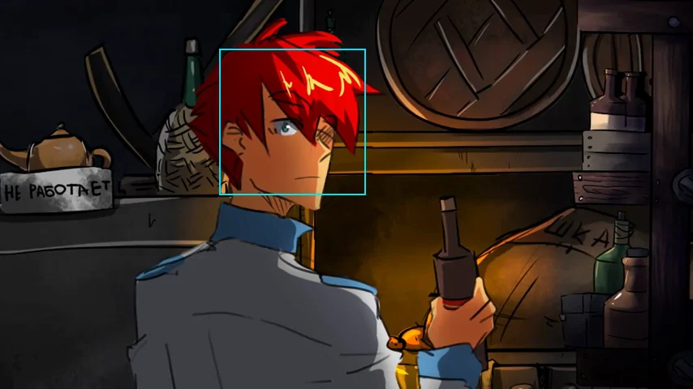{ loading=lazy }

*The whole frame for context; the box marks the crop below, shown at 1:1 after a 2× enlargement.*

<figure markdown>

[{ loading=lazy }](../img/model-study/p480_45/original.webp)

<figcaption>source<strong>Original</strong>854×480, pixels enlarged</figcaption>

</figure>

<figure markdown>

[{ loading=lazy }](../img/model-study/p480_45/lanczos.webp)

<figcaption>reference<strong>Lanczos 2×</strong>detail 100%</figcaption>

</figure>

<figure markdown>

[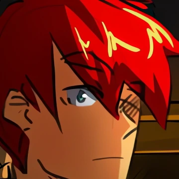{ loading=lazy }](../img/model-study/p480_45/animevideov3.webp)

<figcaption>AnimeUp<strong>Real-ESRGAN animevideov3</strong>detail 150% · tone +0.6</figcaption>

</figure>

<figure markdown>

[{ loading=lazy }](../img/model-study/p480_45/cugan.webp)

<figcaption>AnimeUp<strong>Real-CUGAN no-denoise</strong>detail 163% · tone −0.5</figcaption>

</figure>

<figure markdown>

[{ loading=lazy }](../img/model-study/p480_45/denoise.webp)

<figcaption>AnimeUp<strong>Real-CUGAN light denoise</strong>detail 160% · tone −0.4</figcaption>

</figure>

<figure markdown>

[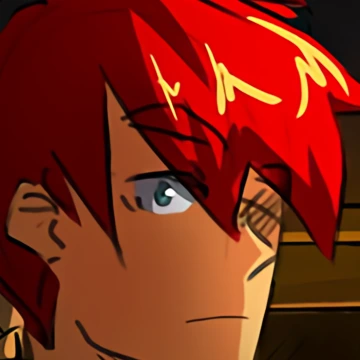{ loading=lazy }](../img/model-study/p480_45/conservative.webp)

<figcaption>AnimeUp<strong>Real-CUGAN conservative</strong>detail 148% · tone −0.5</figcaption>

</figure>

<figure markdown>

[{ loading=lazy }](../img/model-study/p480_45/fallin.webp)

<figcaption>candidate<strong>Fallin Soft</strong>detail 140% · tone −0.3</figcaption>

</figure>

<figure markdown>

[{ loading=lazy }](../img/model-study/p480_45/adore.webp)

<figcaption>candidate<strong>Adore</strong>detail 149% · tone −0.3</figcaption>

</figure>

<figure markdown>

[{ loading=lazy }](../img/model-study/p480_45/janai.webp)

<figcaption>candidate<strong>AnimeJaNai HD V3 Compact</strong>detail 108% · tone 0.0</figcaption>

</figure>

<figure markdown>

[{ loading=lazy }](../img/model-study/p480_45/futsuu.webp)

<figcaption>candidate<strong>Futsuu Anime</strong>detail 144% · tone +0.2</figcaption>

</figure>

<figure markdown>

[{ loading=lazy }](../img/model-study/p480_45/avc.webp)

<figcaption>ruled out<strong>HFA2kAVCCompact</strong>detail 119% · tone +0.6</figcaption>

</figure>

<figure markdown>

[{ loading=lazy }](../img/model-study/p480_45/spanim.webp)

<figcaption>ruled out<strong>ModernSpanimation V1</strong>detail 139% · tone −3.8</figcaption>

</figure>

**What to look at:** The saturated red of the hair (zoom in with the slider), and the hatching on the cheek.

**Verdict:** All models keep the hatching. **HFA2kAVCCompact** draws a faint **checkerboard pattern** in the saturated red, which rules it out. **Real-ESRGAN animevideov3** flattens the skin tones a little; **Adore** and **Fallin Soft** keep them.

**Why:** A checkerboard is the typical trace of a network's upsampling layer that never learned to blend its sub-pixels in strong colours.

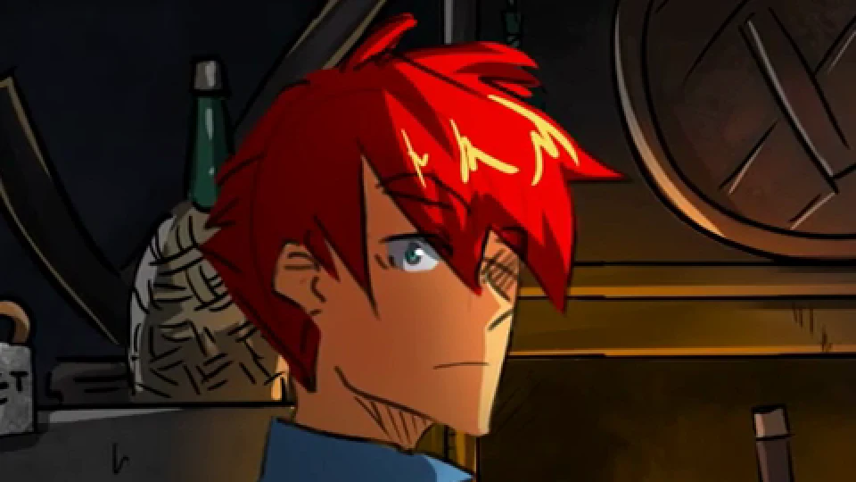

*A 960×540 region of the 2× results at 1:1. Choose any two versions, then move the pointer over the picture or drag the slider.*

### 720p: close-up of an eye

*Morevna*'s 720p release (1280×720), 1:45.

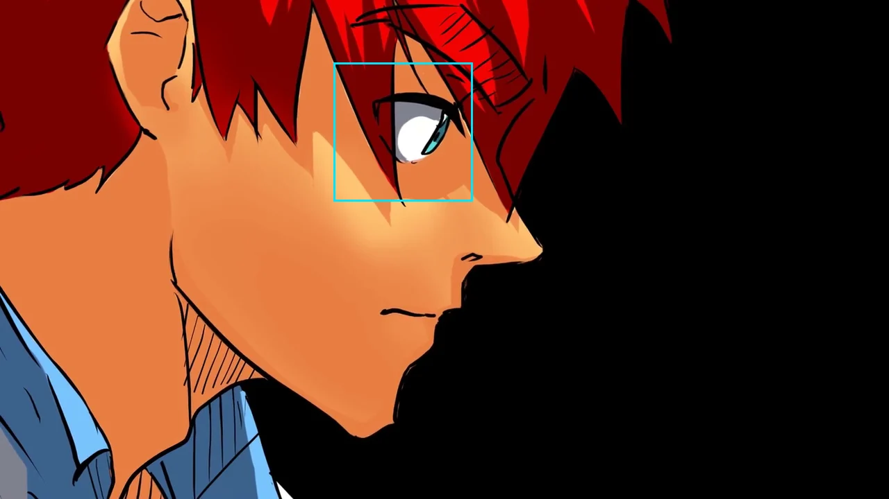{ loading=lazy }

*The whole frame for context; the box marks the crop below, shown at 1:1 after a 2× enlargement.*

<figure markdown>

[{ loading=lazy }](../img/model-study/p720_105/original.webp)

<figcaption>source<strong>Original</strong>1280×720, pixels enlarged</figcaption>

</figure>

<figure markdown>

[{ loading=lazy }](../img/model-study/p720_105/lanczos.webp)

<figcaption>reference<strong>Lanczos 2×</strong>detail 100%</figcaption>

</figure>

<figure markdown>

[{ loading=lazy }](../img/model-study/p720_105/animevideov3.webp)

<figcaption>AnimeUp<strong>Real-ESRGAN animevideov3</strong>detail 150% · tone +0.8</figcaption>

</figure>

<figure markdown>

[{ loading=lazy }](../img/model-study/p720_105/cugan.webp)

<figcaption>AnimeUp<strong>Real-CUGAN no-denoise</strong>detail 197% · tone −1.5</figcaption>

</figure>

<figure markdown>

[{ loading=lazy }](../img/model-study/p720_105/denoise.webp)

<figcaption>AnimeUp<strong>Real-CUGAN light denoise</strong>detail 198% · tone −1.2</figcaption>

</figure>

<figure markdown>

[{ loading=lazy }](../img/model-study/p720_105/conservative.webp)

<figcaption>AnimeUp<strong>Real-CUGAN conservative</strong>detail 167% · tone −0.3</figcaption>

</figure>

<figure markdown>

[{ loading=lazy }](../img/model-study/p720_105/fallin.webp)

<figcaption>candidate<strong>Fallin Soft</strong>detail 135% · tone −0.3</figcaption>

</figure>

<figure markdown>

[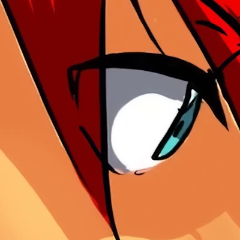{ loading=lazy }](../img/model-study/p720_105/adore.webp)

<figcaption>candidate<strong>Adore</strong>detail 130% · tone −0.3</figcaption>

</figure>

<figure markdown>

[{ loading=lazy }](../img/model-study/p720_105/janai.webp)

<figcaption>candidate<strong>AnimeJaNai HD V3 Compact</strong>detail 104% · tone +0.1</figcaption>

</figure>

<figure markdown>

[{ loading=lazy }](../img/model-study/p720_105/futsuu.webp)

<figcaption>candidate<strong>Futsuu Anime</strong>detail 126% · tone +0.3</figcaption>

</figure>

<figure markdown>

[{ loading=lazy }](../img/model-study/p720_105/avc.webp)

<figcaption>ruled out<strong>HFA2kAVCCompact</strong>detail 116% · tone +0.4</figcaption>

</figure>

<figure markdown>

[{ loading=lazy }](../img/model-study/p720_105/spanim.webp)

<figcaption>ruled out<strong>ModernSpanimation V1</strong>detail 132% · tone −3.1</figcaption>

</figure>

**What to look at:** The black outline of the eye and the hair: look for a thin light rim following the line.

**Verdict:** **Real-CUGAN no-denoise** is the crispest, but a **light rim** follows the outlines and the contrast is a little higher than the source; **Real-CUGAN light denoise** does the same. **Real-CUGAN conservative** keeps the rim weaker. **Adore** and **Fallin Soft** give equally continuous lines **without the rim**, and without changing the tones. **AnimeJaNai** is softer and lets compression show.

**Why:** Real-CUGAN sharpens by pushing the two sides of an edge apart, which overshoots into a light line. Real-CUGAN conservative is the same network tuned to change less, so it overshoots less.

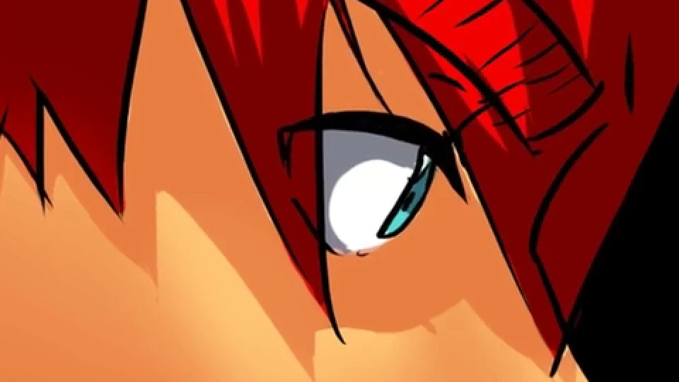

*A 960×540 region of the 2× results at 1:1. Choose any two versions, then move the pointer over the picture or drag the slider.*

### 720p: character and machinery

*Morevna* 720p, 0:45. Fine detail in the dark machinery.

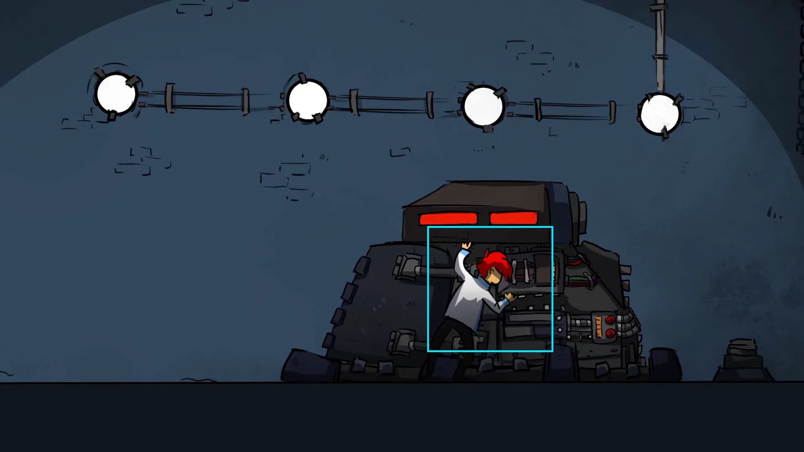{ loading=lazy }

*The whole frame for context; the box marks the crop below, shown at 1:1 after a 2× enlargement.*

<figure markdown>

[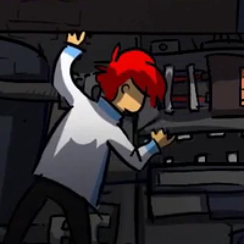{ loading=lazy }](../img/model-study/p720_45/original.webp)

<figcaption>source<strong>Original</strong>1280×720, pixels enlarged</figcaption>

</figure>

<figure markdown>

[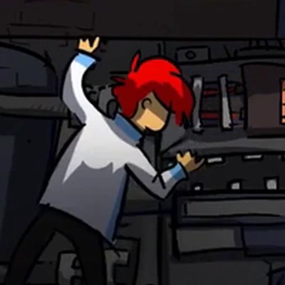{ loading=lazy }](../img/model-study/p720_45/lanczos.webp)

<figcaption>reference<strong>Lanczos 2×</strong>detail 100%</figcaption>

</figure>

<figure markdown>

[{ loading=lazy }](../img/model-study/p720_45/animevideov3.webp)

<figcaption>AnimeUp<strong>Real-ESRGAN animevideov3</strong>detail 137% · tone +0.1</figcaption>

</figure>

<figure markdown>

[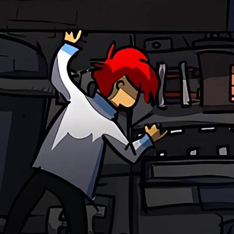{ loading=lazy }](../img/model-study/p720_45/cugan.webp)

<figcaption>AnimeUp<strong>Real-CUGAN no-denoise</strong>detail 165% · tone −0.7</figcaption>

</figure>

<figure markdown>

[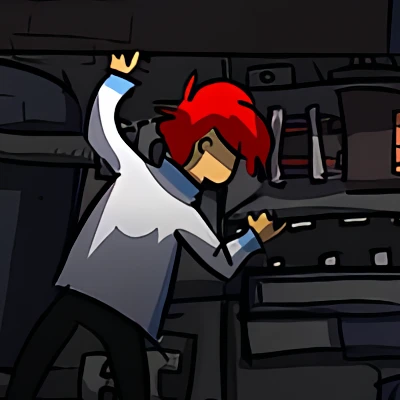{ loading=lazy }](../img/model-study/p720_45/denoise.webp)

<figcaption>AnimeUp<strong>Real-CUGAN light denoise</strong>detail 161% · tone −0.9</figcaption>

</figure>

<figure markdown>

[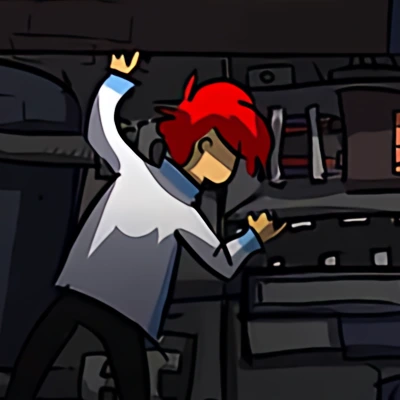{ loading=lazy }](../img/model-study/p720_45/conservative.webp)

<figcaption>AnimeUp<strong>Real-CUGAN conservative</strong>detail 147% · tone 0.0</figcaption>

</figure>

<figure markdown>

[{ loading=lazy }](../img/model-study/p720_45/fallin.webp)

<figcaption>candidate<strong>Fallin Soft</strong>detail 131% · tone 0.0</figcaption>

</figure>

<figure markdown>

[{ loading=lazy }](../img/model-study/p720_45/adore.webp)

<figcaption>candidate<strong>Adore</strong>detail 132% · tone +0.6</figcaption>

</figure>

<figure markdown>

[{ loading=lazy }](../img/model-study/p720_45/janai.webp)

<figcaption>candidate<strong>AnimeJaNai HD V3 Compact</strong>detail 99% · tone 0.0</figcaption>

</figure>

<figure markdown>

[{ loading=lazy }](../img/model-study/p720_45/futsuu.webp)

<figcaption>candidate<strong>Futsuu Anime</strong>detail 122% · tone +0.3</figcaption>

</figure>

<figure markdown>

[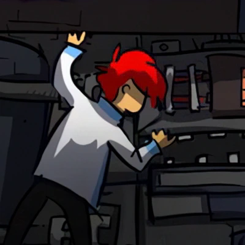{ loading=lazy }](../img/model-study/p720_45/avc.webp)

<figcaption>ruled out<strong>HFA2kAVCCompact</strong>detail 114% · tone +0.4</figcaption>

</figure>

<figure markdown>

[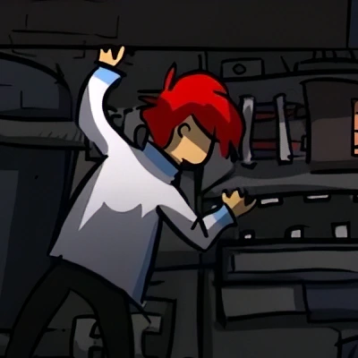{ loading=lazy }](../img/model-study/p720_45/spanim.webp)

<figcaption>ruled out<strong>ModernSpanimation V1</strong>detail 124% · tone −0.8</figcaption>

</figure>

**What to look at:** The small parts of the machinery, and the edge of the white coat against the dark.

**Verdict:** The Real-CUGAN models sharpen the machinery the most (detail 147–165%). **Adore** and **Fallin Soft** keep the detail (about 131%) with clean edges around the coat. The Compact models (**AnimeJaNai**, **Futsuu**, **HFA2kAVCCompact**) are softer.

**Why:** At 720p the source finally carries real detail, and the models trained for HD start to earn their place.

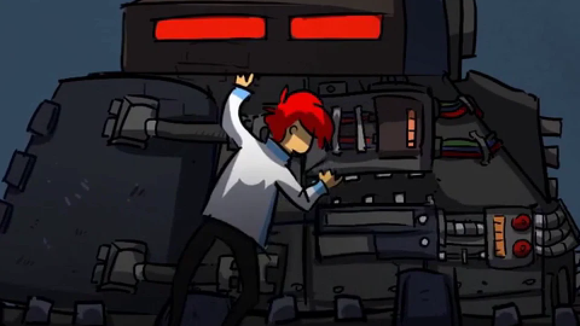

*A 960×540 region of the 2× results at 1:1. Choose any two versions, then move the pointer over the picture or drag the slider.*

### 1080p: a character waving

*Morevna*'s 1080p HQ release (1920×1080), 3:00. The 1080p source the October test was missing.

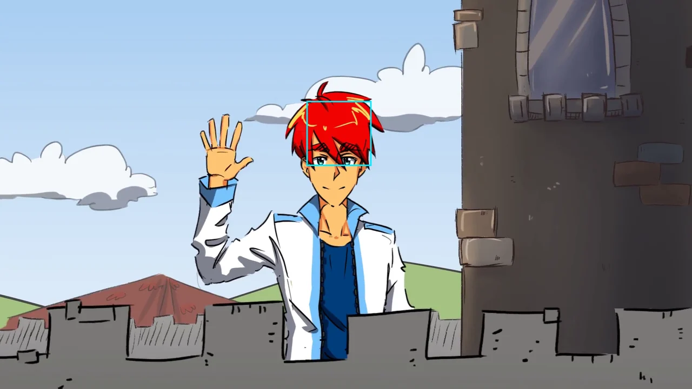{ loading=lazy }

*The whole frame for context; the box marks the crop below, shown at 1:1 after a 2× enlargement.*

<figure markdown>

[{ loading=lazy }](../img/model-study/p1080_180/original.webp)

<figcaption>source<strong>Original</strong>1920×1080, pixels enlarged</figcaption>

</figure>

<figure markdown>

[{ loading=lazy }](../img/model-study/p1080_180/lanczos.webp)

<figcaption>reference<strong>Lanczos 2×</strong>detail 100%</figcaption>

</figure>

<figure markdown>

[{ loading=lazy }](../img/model-study/p1080_180/animevideov3.webp)

<figcaption>AnimeUp<strong>Real-ESRGAN animevideov3</strong>detail 177% · tone −0.6</figcaption>

</figure>

<figure markdown>

[{ loading=lazy }](../img/model-study/p1080_180/cugan.webp)

<figcaption>AnimeUp<strong>Real-CUGAN no-denoise</strong>detail 205% · tone −0.2</figcaption>

</figure>

<figure markdown>

[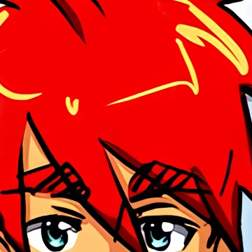{ loading=lazy }](../img/model-study/p1080_180/denoise.webp)

<figcaption>AnimeUp<strong>Real-CUGAN light denoise</strong>detail 204% · tone −0.7</figcaption>

</figure>

<figure markdown>

[{ loading=lazy }](../img/model-study/p1080_180/conservative.webp)

<figcaption>AnimeUp<strong>Real-CUGAN conservative</strong>detail 184% · tone −0.5</figcaption>

</figure>

<figure markdown>

[{ loading=lazy }](../img/model-study/p1080_180/fallin.webp)

<figcaption>candidate<strong>Fallin Soft</strong>detail 162% · tone −1.0</figcaption>

</figure>

<figure markdown>

[{ loading=lazy }](../img/model-study/p1080_180/adore.webp)

<figcaption>candidate<strong>Adore</strong>detail 173% · tone +0.3</figcaption>

</figure>

<figure markdown>

[{ loading=lazy }](../img/model-study/p1080_180/janai.webp)

<figcaption>candidate<strong>AnimeJaNai HD V3 Compact</strong>detail 119% · tone 0.0</figcaption>

</figure>

<figure markdown>

[{ loading=lazy }](../img/model-study/p1080_180/futsuu.webp)

<figcaption>candidate<strong>Futsuu Anime</strong>detail 142% · tone +0.5</figcaption>

</figure>

<figure markdown>

[{ loading=lazy }](../img/model-study/p1080_180/avc.webp)

<figcaption>ruled out<strong>HFA2kAVCCompact</strong>detail 119% · tone +0.8</figcaption>

</figure>

<figure markdown>

[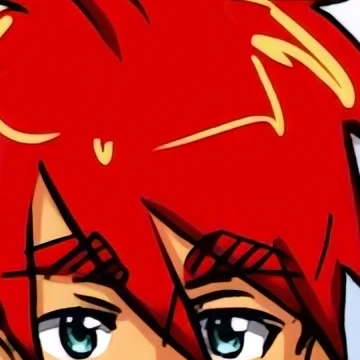{ loading=lazy }](../img/model-study/p1080_180/spanim.webp)

<figcaption>ruled out<strong>ModernSpanimation V1</strong>detail 155% · tone −6.3</figcaption>

</figure>

**What to look at:** The hatching in the hair, and the lines around the eyes.

**Verdict:** At 1080p the differences grow. The Real-CUGAN models draw the boldest lines (detail 184–205%), **Real-ESRGAN animevideov3** is close behind (177%), **Adore** (173%) and **Fallin Soft** (162%) stay clean. **AnimeJaNai**, made for exactly this kind of source, is still the most restrained (119%). **ModernSpanimation** darkens the reds (−6.3 levels).

**Why:** AnimeJaNai was trained to clean up 1080p video for real-time playback, so it changes as little as it can; the others were trained to sharpen.

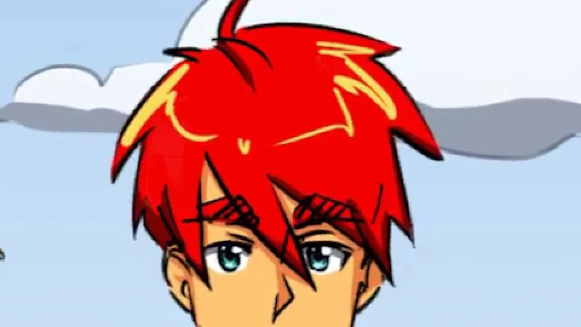

*A 960×540 region of the 2× results at 1:1. Choose any two versions, then move the pointer over the picture or drag the slider.*

### 1080p: castle with painted texture

*Morevna* 1080p HQ, 0:10. Brush texture on the walls, thin cables against the sky.

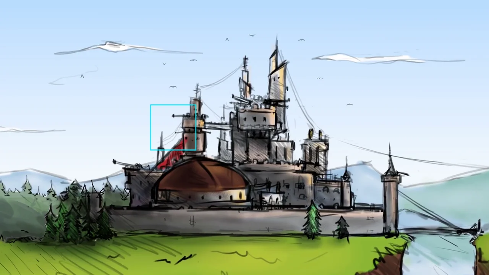{ loading=lazy }

*The whole frame for context; the box marks the crop below, shown at 1:1 after a 2× enlargement.*

<figure markdown>

[{ loading=lazy }](../img/model-study/p1080_10/original.webp)

<figcaption>source<strong>Original</strong>1920×1080, pixels enlarged</figcaption>

</figure>

<figure markdown>

[{ loading=lazy }](../img/model-study/p1080_10/lanczos.webp)

<figcaption>reference<strong>Lanczos 2×</strong>detail 100%</figcaption>

</figure>

<figure markdown>

[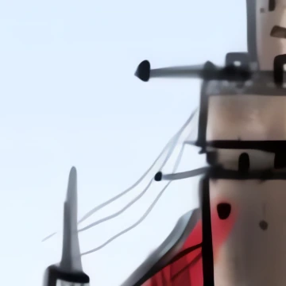{ loading=lazy }](../img/model-study/p1080_10/animevideov3.webp)

<figcaption>AnimeUp<strong>Real-ESRGAN animevideov3</strong>detail 195% · tone +1.7</figcaption>

</figure>

<figure markdown>

[{ loading=lazy }](../img/model-study/p1080_10/cugan.webp)

<figcaption>AnimeUp<strong>Real-CUGAN no-denoise</strong>detail 328% · tone 0.0</figcaption>

</figure>

<figure markdown>

[{ loading=lazy }](../img/model-study/p1080_10/denoise.webp)

<figcaption>AnimeUp<strong>Real-CUGAN light denoise</strong>detail 318% · tone +0.1</figcaption>

</figure>

<figure markdown>

[{ loading=lazy }](../img/model-study/p1080_10/conservative.webp)

<figcaption>AnimeUp<strong>Real-CUGAN conservative</strong>detail 240% · tone −0.1</figcaption>

</figure>

<figure markdown>

[{ loading=lazy }](../img/model-study/p1080_10/fallin.webp)

<figcaption>candidate<strong>Fallin Soft</strong>detail 191% · tone −0.1</figcaption>

</figure>

<figure markdown>

[{ loading=lazy }](../img/model-study/p1080_10/adore.webp)

<figcaption>candidate<strong>Adore</strong>detail 209% · tone −0.3</figcaption>

</figure>

<figure markdown>

[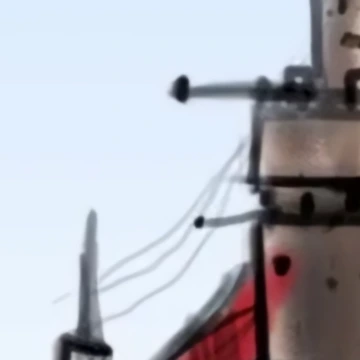{ loading=lazy }](../img/model-study/p1080_10/janai.webp)

<figcaption>candidate<strong>AnimeJaNai HD V3 Compact</strong>detail 122% · tone −0.2</figcaption>

</figure>

<figure markdown>

[{ loading=lazy }](../img/model-study/p1080_10/futsuu.webp)

<figcaption>candidate<strong>Futsuu Anime</strong>detail 155% · tone 0.0</figcaption>

</figure>

<figure markdown>

[{ loading=lazy }](../img/model-study/p1080_10/avc.webp)

<figcaption>ruled out<strong>HFA2kAVCCompact</strong>detail 119% · tone +0.3</figcaption>

</figure>

<figure markdown>

[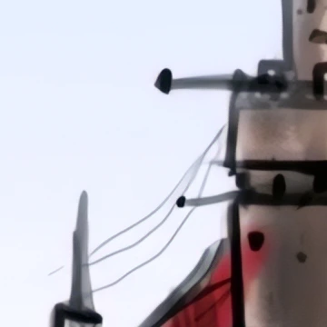{ loading=lazy }](../img/model-study/p1080_10/spanim.webp)

<figcaption>ruled out<strong>ModernSpanimation V1</strong>detail 201% · tone +2.4</figcaption>

</figure>

**What to look at:** The edge of the tower against the sky, and the brushwork on the wall.

**Verdict:** **Real-CUGAN no-denoise** and **Real-CUGAN light denoise** draw a clear **light halo** along the tower and the cables (detail 318–328%). **Real-CUGAN conservative** keeps the brushwork with a weaker halo (240%). **Adore** (209%) and **Fallin Soft** (191%) sharpen without halos. **Real-ESRGAN animevideov3** smooths the brushwork (195%).

**Why:** Sharp edges against a flat bright sky are where any overshoot shows most. This is the case that would justify Fallin Soft or Adore in AnimeUp.

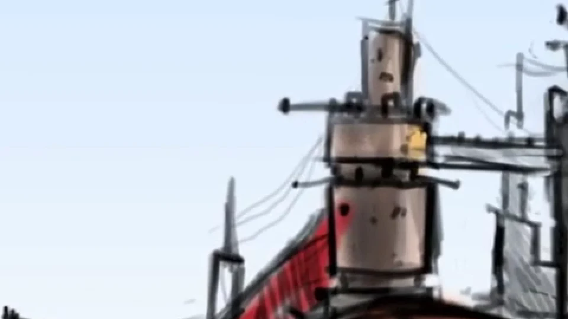

*A 960×540 region of the 2× results at 1:1. Choose any two versions, then move the pointer over the picture or drag the slider.*

## Colour

Average shift in the shadows of all eight frames (pixels darker than 40 out of 255), compared with Lanczos, in levels (red, green, blue):

| Model | R | G | B |
|---|---|---|---|
| Real-CUGAN light denoise | −4.8 | −3.5 | −3.3 |
| Real-CUGAN no-denoise | −4.2 | −3.4 | −2.7 |
| Real-CUGAN conservative | −4.1 | −2.9 | −2.6 |
| Real-ESRGAN animevideov3 | −2.7 | −2.3 | −2.0 |
| Fallin Soft | −2.7 | −2.2 | −2.1 |
| ModernSpanimation V1 | −2.7 | −1.0 | −1.3 |
| Adore | −1.9 | −1.5 | −1.1 |
| Futsuu Anime | −1.5 | −0.6 | −0.6 |
| HFA2kAVCCompact | −0.8 | −0.1 | +1.1 |
| AnimeJaNai HD V3 Compact | +0.3 | 0.0 | +0.3 |

Small numbers, but they agree with what the eye sees: the three Real-CUGAN models darken shadows slightly, the newer ones stay closer to the source. ModernSpanimation V1 darkens red much more than green, which is the green cast in its shadows.

## Why most of them can't simply be dropped in

AnimeUp runs models through two small programs, `realesrgan-ncnn-vulkan` and `realcugan-ncnn-vulkan`. Both were built in 2022 with a **trimmed-down** ncnn: to keep them small, most of the network building blocks were switched off when they were compiled. A model can only run if every block it uses is there.

| Building block | realesrgan | realcugan |
|---|---|---|
| Convolution, PixelShuffle, Interp, BinaryOp, Crop, Padding, InnerProduct | yes | yes |
| PReLU, Concat | yes | no |
| Deconvolution, Pooling, Reduction, Sigmoid | no | yes |
| Swish, Clip, Reorg, MemoryData, UnaryOp | no | no |

What that means for each family:

- **Compact models run today** in `realesrgan-ncnn-vulkan`: they only need blocks it has. Once converted to ncnn, they're used exactly like Real-ESRGAN animevideov3.
- **SPAN doesn't run:** it needs Swish, Sigmoid and MemoryData.
- **"CUGAN fast" (Fallin Soft, Adore) doesn't run in either program.** Despite the name it isn't the original Real-CUGAN network. `realcugan-ncnn-vulkan` is built around that original network, and `realesrgan-ncnn-vulkan` lacks Deconvolution, Pooling and Reorg.

The conversions themselves are sound: with a complete ncnn, SPAN, Fallin Soft and Adore run on the GPU and match the reference implementation closely (PSNR 46 to 61 dB). What's missing is the program, not the model. The crops on this page for those three come from that complete ncnn.

??? info "Two traps found along the way"
    - **Half precision turned whole frames into NaN.** Fallin Soft and Adore average each channel over the image in their attention blocks. In half precision (fp16, what the GPU uses) that sum overflows and the frame comes out blank. Rewriting those blocks the way the official Real-CUGAN models do it fixes it with the same weights.
    - **Tiles change the result slightly.** Upscalers split large frames into tiles. Those attention blocks then average per tile, and line strength varies a little between tiles: 0.6 levels on average for Adore, 0.25 for Fallin Soft, 0.07 for a Compact model. No visible grid, and larger tiles shrink it further. Real-CUGAN's own upscaler solves the same problem with a dedicated step.

## Licences

AnimeUp is licensed GPL-3.0-or-later (MIT up to 1.6.7), and its zips bundle the models they use. A model can join them only if its licence fits.

| Model | Licence | Could ship inside AnimeUp | As an optional download |
|---|---|---|---|
| Fallin Soft | CC BY 4.0 | **Yes**, with attribution to its author (renarchi) and a note that it was converted | yes |
| Futsuu Anime | WTFPL | yes | yes |
| HFA2kAVCCompact | CC BY 4.0 | yes (but ruled out on quality) | — |
| ModernSpanimation V1 | MIT | yes (but ruled out on quality) | — |
| Adore | CC BY-NC-SA 4.0 | Not advisable | **Yes**, as a separate file with its licence shown before download, like FFmpeg |
| AnimeJaNai HD V3 Compact | CC BY-NC-SA 4.0 | Not advisable | Yes, but AnimeUp would have to host its own converted files |

The NC-SA models are allowed in a free program: Adore's author states that free open-source integrations are fine. Bundling them would still muddy the licence of the package, though. The GPL lets anyone sell a copy of AnimeUp as long as the source goes with it; those weights forbid any commercial use at all. Keeping them as a separate download, like FFmpeg, keeps that clear.

## What it would take

| Option | Effort | What you'd get |
|---|---|---|
| **A Compact model** (e.g. AnimeJaNai) | about half a day per model, tests included | Works with today's upscalers. Little visible gain, at 1080p too. |
| **Fallin Soft or Adore** | 3 to 5 days, plus maintaining a custom upscaler build | An HD option cleaner than Real-CUGAN (no halos) and about twice as fast. |

The second needs `realesrgan-ncnn-vulkan` rebuilt against a complete, current ncnn, with frame sizes aligned to multiples of 4, then a reproducible, signed build and a new checksum in setup. It's worth it only if Real-CUGAN's halos are a real problem on your 720p and 1080p sources; Real-CUGAN conservative already softens them.

!!! tip "Seeing the halos on your own files"
    The halos show most on sharp dark outlines over flat, bright colour, at 560 lines and above. Run [05. Compare](../05-compare.md) on such a clip and look at the outlines in the Real-CUGAN no-denoise version at 2× or 3× zoom, then in Real-CUGAN conservative. If you can't see them while the video plays, today's models are already the right choice for you.

## Credits

The test frames come from [*Morevna*](https://morevnaproject.org/) by the Morevna Project, licensed CC BY-SA; the images on this page are derived from it and carry the same licence. Models tested: AnimeJaNai HD V3 (the-database), Fallin Soft and Adore (renarchi), HFA2kAVCCompact (Phhofm), Futsuu Anime, ModernSpanimation V1 (TNTwise), found through [OpenModelDB](https://openmodeldb.info/).

[Next: Tuning notes →](../../TUNING.md)
