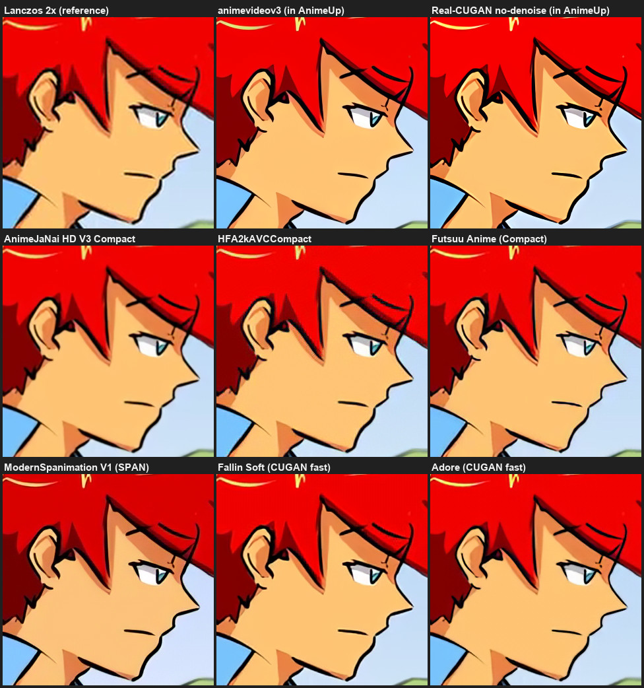
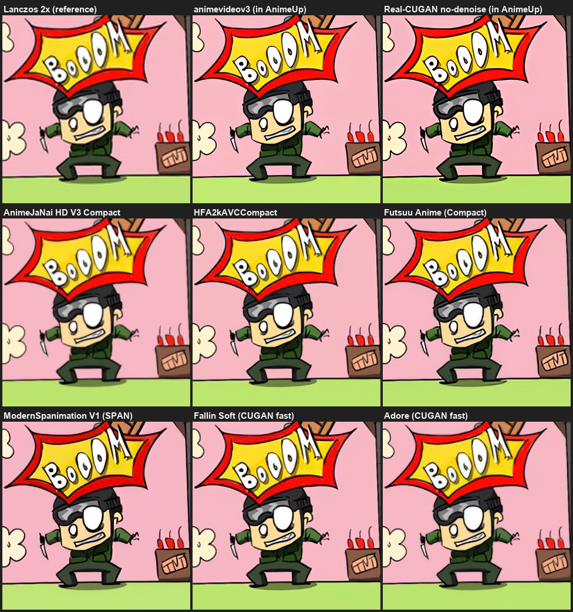
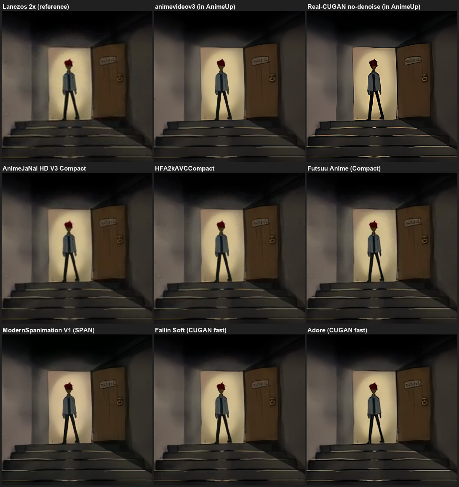
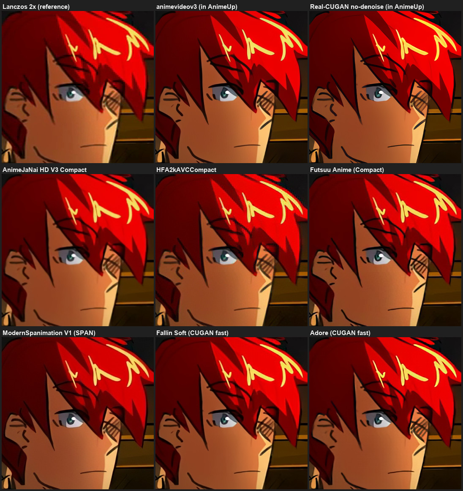
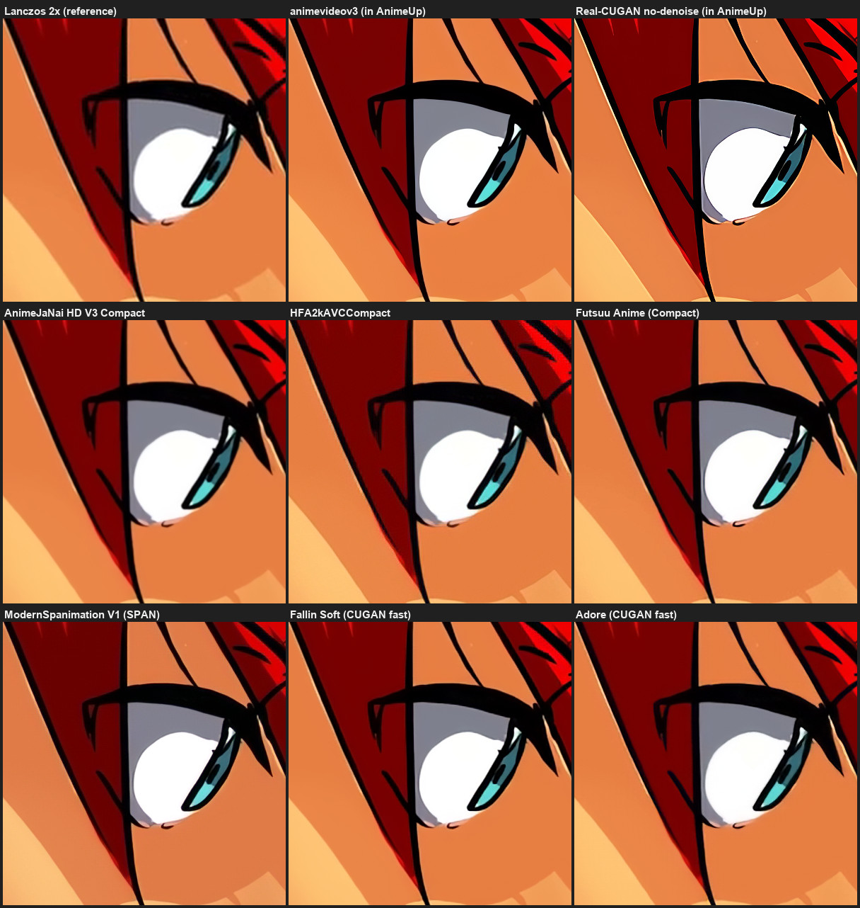
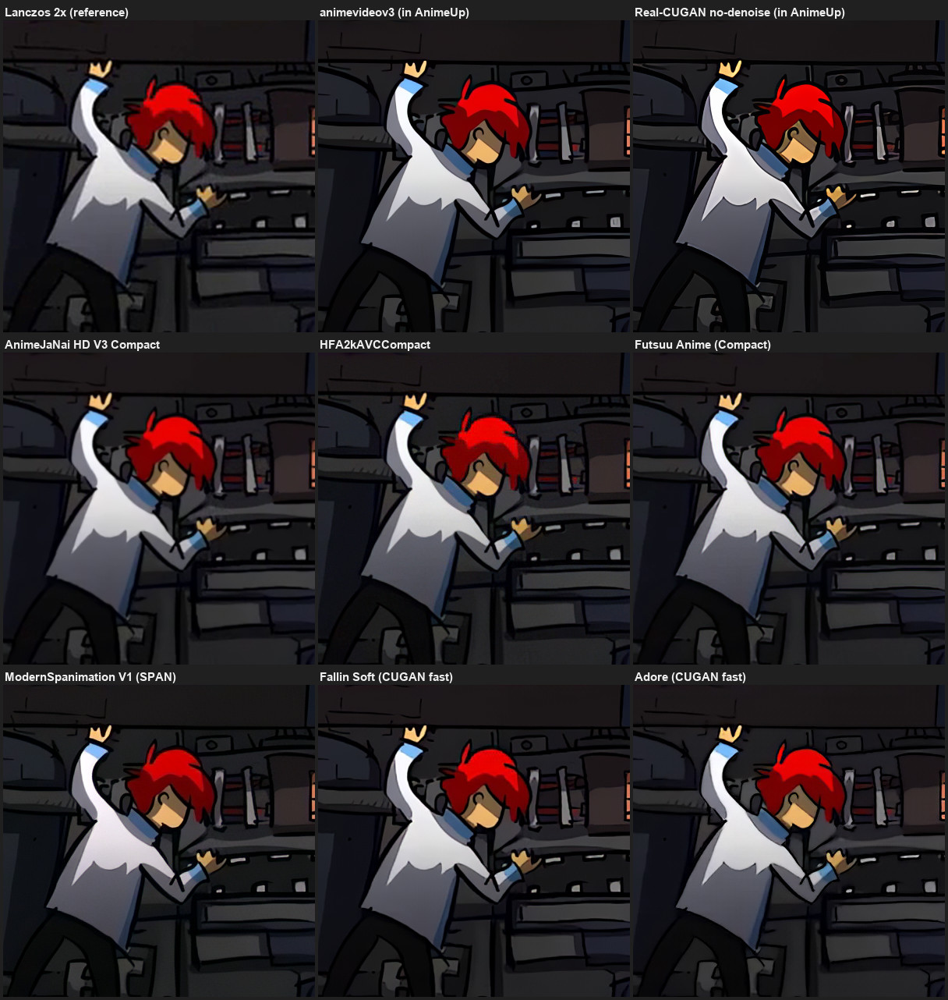

Deep dive · Model study

# Newer anime models, compared

AnimeUp's models date from 2022. Since then the community has trained many anime models, and some are often recommended over Real-ESRGAN and Real-CUGAN. This page records a test of six of them against the two AnimeUp uses: what they look like on the same frames, how fast they are, and what it would take to offer them.

You don't need this page to use AnimeUp. It explains why the model list is what it is, and what could change it.

!!! abstract "In short"
    - **The two models AnimeUp uses are not outclassed.** No candidate beats animevideov3 on low sources, and none beats Real-CUGAN no-denoise on HD sources by enough to justify a new model straight away.
    - **The most interesting candidates are Fallin Soft and Adore**, two "Real-CUGAN fast" models. At 720p they give clean lines **without the light halos** Real-CUGAN draws along outlines, keep the colours, and run about **twice as fast**. But they **don't run** in the upscalers AnimeUp ships today.
    - **The only ones that run today are the "Compact" models** (AnimeJaNai, Futsuu, HFA2kAVC). Up to 720p they add nothing clear.
    - **Decision: nothing is added for now.** The path worth exploring later is Fallin Soft as a third option for sources of 560 lines and above, which needs a rebuilt upscaler.

## How the test was done

- **Source:** episode 3 of *Morevna*, an open animated series (CC BY-SA), at 360p, 480p and 720p. Six frames chosen for faces, lines, flat colours, dark gradients and fine detail.
- **Output:** every model at **2×**, compared as 1:1 crops against a plain **Lanczos 2×** enlargement, which adds no detail and serves as the reference.
- **Machine:** Apple M4 Pro, GPU through Vulkan (ncnn), the same engine AnimeUp uses.
- **Date:** 24 October 2026. Nothing in AnimeUp was changed for the test.

!!! warning "What this test can't tell"
    One source only, and a clean one: *Morevna* is produced digitally. No 1080p source, which is exactly what AnimeJaNai, Fallin and Adore were trained for. No heavy broadcast compression. Six frames. Before adopting any of these, the test should be repeated on a real 1080p episode.

## The candidates

| Model | Family | Licence | Runs in AnimeUp's upscalers? | Speed, 720p frame | Verdict |
|---|---|---|---|---|---|
| **animevideov3** *(in AnimeUp)* | Compact | BSD-3 | yes | 191 ms | Thick, clean black lines. Flattens texture; shadows slightly darker. Still the best at 360p. |
| **Real-CUGAN no-denoise** *(in AnimeUp)* | CUGAN | MIT | yes | 253 ms | The sharpest, but with **light halos** along lines, more contrast, darker shadows. |
| **AnimeJaNai HD V3 Compact** | Compact | CC BY-NC-SA 4.0 | yes | 183 ms | Very conservative: below 720p it's little more than a cleaned-up Lanczos and leaves compression blocks visible. The most faithful colours. Made for 1080p to 4K, not tested here. |
| **HFA2kAVCCompact** | Compact | CC BY 4.0 | yes | 183 ms | A **checkerboard pattern** in saturated reds at 480p (hair). Ruled out. |
| **Futsuu Anime** | Compact | WTFPL | yes | 183 ms | Dark, clean lines, holds up well. In practice a slightly less flattened animevideov3: no clear gain. |
| **ModernSpanimation V1** | SPAN | MIT | no | 254 ms | Soft, "painterly", a **green cast in the shadows**. As slow as Real-CUGAN. Ruled out. |
| **Fallin Soft** | CUGAN fast | **CC BY 4.0** | no | **104 ms** | Clean lines, no halos, hatching kept, shadows close to the source. Softer than Real-CUGAN, more faithful. |
| **Adore** | CUGAN fast ("pro") | CC BY-NC-SA 4.0 | no | **107 ms** | The cleanest, a little sharper than Fallin, no halos, no average colour shift. |

Speeds are for one 720p frame upscaled to 1440p, whole frame on the GPU, median of five runs. As a cross-check, AnimeUp's own upscalers on 48 real 720p frames took 257 ms for animevideov3 and 368 ms for Real-CUGAN: the ranking holds.

## What the crops show

Each sheet has nine 1:1 crops of the same spot: Lanczos as the reference, the two models AnimeUp uses, then the six candidates. Click a sheet to see it full size.

### 360p: lines from a small source

**animevideov3 is still the reference here.** It rebuilds solid lines where the source has no real detail. The models trained for HD sources (AnimeJaNai, Fallin, Adore) are softer at this size. This matches AnimeUp's rule of recommending animevideov3 below 380 lines.

### 480p: dark gradients and hair

The dark corridor tests shadows and banding. **No model adds new banding.** Real-CUGAN and animevideov3 darken the shadows; ModernSpanimation tints them green.

HFA2kAVCCompact shows its checkerboard in the saturated red of the hair.

### 720p: where AnimeUp picks Real-CUGAN today

Real-CUGAN no-denoise is the crispest, but look along the black outline of the eye and the hair: a **light rim** follows the line, and contrast is a little higher than the source. **Adore and Fallin give equally continuous lines without the rim**, and without changing the tones. AnimeJaNai is softer and lets compression show.

### Colour

Average shift in the shadows of the corridor frame, compared with Lanczos, in levels out of 255 (red, green, blue):

| Model | R | G | B |
|---|---|---|---|
| Real-CUGAN no-denoise | −3.6 | −2.7 | −2.1 |
| animevideov3 | −2.2 | −1.7 | −1.4 |
| Adore | −1.2 | −0.8 | −0.4 |
| AnimeJaNai HD V3 | +0.8 | +0.6 | +0.9 |

Small numbers, but they agree with what the eye sees: the two current models darken shadows slightly, the newer ones stay closer to the source.

## Why most of them can't simply be dropped in

AnimeUp runs models through two small programs, `realesrgan-ncnn-vulkan` and `realcugan-ncnn-vulkan`. Both were built in 2022 with a **trimmed-down** ncnn: to keep them small, most of the network building blocks were switched off when they were compiled. A model can only run if every block it uses is there.

| Building block | realesrgan | realcugan |
|---|---|---|
| Convolution, PixelShuffle, Interp, BinaryOp, Crop, Padding, InnerProduct | yes | yes |
| PReLU, Concat | yes | no |
| Deconvolution, Pooling, Reduction, Sigmoid | no | yes |
| Swish, Clip, Reorg, MemoryData, UnaryOp | no | no |

What that means for each family:

- **Compact models run today** in `realesrgan-ncnn-vulkan`: they only need blocks it has. Once converted to ncnn, they're used exactly like animevideov3.
- **SPAN doesn't run:** it needs Swish, Sigmoid and MemoryData.
- **"CUGAN fast" (Fallin, Adore) doesn't run in either program.** Despite the name it isn't the original Real-CUGAN network. `realcugan-ncnn-vulkan` is built around that original network, and `realesrgan-ncnn-vulkan` lacks Deconvolution, Pooling and Reorg.

The conversions themselves are sound: with a complete ncnn, SPAN, Fallin and Adore run on the GPU and match the reference implementation closely (PSNR 46 to 61 dB). What's missing is the program, not the model.

??? info "Two traps found along the way"
    - **Half precision turned whole frames into NaN.** Fallin and Adore average each channel over the image in their attention blocks. In half precision (fp16, what the GPU uses) that sum overflows and the frame comes out blank. Rewriting those blocks the way the official Real-CUGAN models do it fixes it with the same weights.
    - **Tiles change the result slightly.** Upscalers split large frames into tiles. Those attention blocks then average per tile, and line strength varies a little between tiles: 0.6 levels on average for Adore, 0.25 for Fallin, 0.07 for a Compact model. No visible grid, and larger tiles shrink it further. Real-CUGAN's own upscaler solves the same problem with a dedicated step.

## Licences

AnimeUp is MIT-licensed, and its zips bundle the models they use. A model can join them only if its licence fits.

| Model | Licence | Could ship inside AnimeUp | As an optional download |
|---|---|---|---|
| Fallin Soft | CC BY 4.0 | **Yes**, with attribution to its author (renarchi) and a note that it was converted | yes |
| Futsuu Anime | WTFPL | yes | yes |
| HFA2kAVCCompact | CC BY 4.0 | yes (but ruled out on quality) | — |
| ModernSpanimation V1 | MIT | yes (but ruled out on quality) | — |
| Adore | CC BY-NC-SA 4.0 | Not advisable | **Yes**, as a separate file with its licence shown before download, like FFmpeg |
| AnimeJaNai HD V3 | CC BY-NC-SA 4.0 | Not advisable | Yes, but AnimeUp would have to host its own converted files |

The NC-SA models are allowed in a free program: Adore's author states that free open-source integrations are fine. Bundling them would still muddy the licence of the package, though. Anyone may sell a fork of an MIT project, but not those weights. Keeping them as a separate download, like FFmpeg, keeps that clear.

## What it would take

| Option | Effort | What you'd get |
|---|---|---|
| **A Compact model** (e.g. AnimeJaNai) | about half a day per model, tests included | Works with today's upscalers. Little visible gain up to 720p; possibly more on 1080p sources, not tested. |
| **Fallin Soft or Adore** | 3 to 5 days, plus maintaining a custom upscaler build | An HD option cleaner than Real-CUGAN (no halos) and about twice as fast. |

The second needs `realesrgan-ncnn-vulkan` rebuilt against a complete, current ncnn, with frame sizes aligned to multiples of 4, then a reproducible, signed build and a new checksum in setup. It's worth it only if Real-CUGAN's halos are a real problem on your 720p and 1080p sources.

!!! tip "Seeing the halos on your own files"
    The halos show most on sharp black outlines over flat colour, at 560 lines and above. Run [05. Compare](../05-compare.md) on such a clip and look at the outlines in the Real-CUGAN version at 2× or 3× zoom. If you can't see them while the video plays, today's models are already the right choice for you.

## Credits

The test frames come from [*Morevna*](https://morevnaproject.org/) by the Morevna Project, licensed CC BY-SA; the crops on this page are derived from it and carry the same licence. Models tested: AnimeJaNai HD V3 (the-database), Fallin Soft and Adore (renarchi), HFA2kAVCCompact (Phhofm), Futsuu Anime, ModernSpanimation V1 (TNTwise), found through [OpenModelDB](https://openmodeldb.info/).

[Back to the models →](models.md) · [Back to the guide home →](../index.md)
