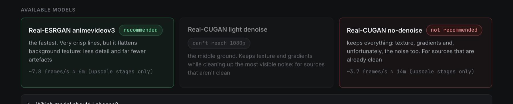
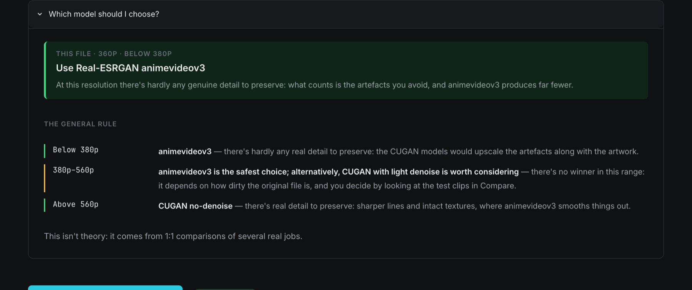

Deep dive · Models

# The models and when to use them

AnimeUp offers three models. This page explains how they differ, what AnimeUp recommends and why, and the arithmetic that decides the scale and whether a model can reach your target.

The short version: the recommendation is a good starting point, and [05. Compare](../05-compare.md) is where you decide. AnimeUp never locks you into its suggestion.

## The three models

They're listed in the interface in the same order as here, from the one that keeps the least to the one that keeps the most.

| Model (as shown) | Name in the output file | Scales | Cleans noise | Character |
|---|---|---|---|---|
| **Real-ESRGAN animevideov3** | `animevideov3` | x2, x3, x4 | Yes, built in | The fastest. Very crisp lines, but it flattens background texture: less detail and far fewer artefacts. |
| **Real-CUGAN light denoise** | `cugan-denoise` | x2 only | Yes, lightly | The middle ground. Keeps texture and gradients while cleaning up the most visible noise: for sources that aren't clean. |
| **Real-CUGAN no-denoise** | `cugan` | x2, x3, x4 | No | Keeps everything: texture, gradients and, unfortunately, the noise too. For sources that are already clean. |

All three run on the Mac's GPU through ncnn with Vulkan. Real-CUGAN is roughly 2.7 times slower than animevideov3.

### Factory speeds

Until you [calibrate](../02-calibration.md), estimates use these speeds, in megapixels of *source* per second, measured on one Mac on 240-frame batches:

| Model | x2 | x3 | x4 |
|---|---|---|---|
| Real-ESRGAN animevideov3 | 1.95 | 1.79 | 1.80 |
| Real-CUGAN light denoise | 1.02 | — | — |
| Real-CUGAN no-denoise | 1.02 | 0.66 | 0.85 |

Your Mac will differ, sometimes by a third in either direction. That's what calibration is for. [TUNING.md](../../TUNING.md) has a factory-versus-measured comparison on one machine.

!!! note "Why x4 can be faster than x3"
    These are speeds per megapixel of input, and each scale is a separate network. For Real-CUGAN no-denoise the x4 figure comes from the logs of real jobs, and calibration on one Mac confirmed the order (0.70 for x3, 0.87 for x4). It's not a typo.

## What AnimeUp recommends

The recommendation depends only on the **source's height** (the encoded height, as listed in Sources). There are three bands:

| Source height | Recommended | Light denoise | No-denoise |
|---|---|---|---|
| Below 380 | **animevideov3** · *recommended* | *not recommended* | *not recommended* |
| 380 to 559 | **animevideov3** · *recommended* | *worth checking* | *not recommended* |
| 560 and above | **CUGAN no-denoise** · *recommended* | — | — |

The words in italics are the chips you see on the model cards in Compare. In the top band the other two models simply get no chip.

### Why the bands are where they are

It's not that small files are necessarily dirty (among the samples, a 360p file was cleaner than a 480p one). It's that the trade-off flips with resolution, and both sides of it push the same way:

- **Noise kept by the model grows with the square of the enlargement.** Going from 360p to 1080p, any noise preserved covers nine times the area it would going from 720p to 1080p.
- **Fine detail sacrificed by denoising matters less the lower the source.** At 288p there's hardly any real detail to preserve. CUGAN preserves and enlarges the compression mush, while animevideov3 gives clean strands of hair: less detailed, far fewer artefacts.

The boundaries come from judging real jobs **during playback**, not just on still crops: three sources (720p, 400p, 288p), each processed with two models. Motion shows things a still frame can't, like flicker and how stable detail stays from one frame to the next. At 720p CUGAN was clearly better: sharper black lines, and background texture that animevideov3 flattens. At 400p CUGAN was still ahead, by less. At 288p animevideov3 was clearly better.

**The middle band is honestly uncertain.** Three comparisons aren't enough to place two boundaries precisely, and between 380 and 559 lines the result changes from file to file depending on how dirty it is. There, animevideov3 is the safe baseline and light denoise is the candidate to check by eye. The Compare tab's **Which model should I choose?** panel says the same thing.

!!! info "Why there's no noise meter"
    A measurement of noise was built and tested to drive the recommendation automatically. It was dropped because it was unstable: on the same three files, measuring one frame or four changed the values threefold and swapped which source looked noisier. A metric that changes its mind every run is worse than none, so the decision is left to your eyes in Compare.

## How the scale is chosen

A model enlarges by a whole factor: 2, 3 or 4. Your output height is rarely an exact multiple of the source, so AnimeUp upscales **past** the target and then resizes down to it with lanczos, in the same pass as encoding.

Shrinking after upscaling isn't waste. Averaging pixels is anti-aliasing: it smooths the model's ringing and shimmer. The ideal is an exact 2:1 reduction. So AnimeUp picks, among the scales the model offers that reach the target, the one whose final reduction is closest to 2:1. On a tie, it picks the lower (cheaper) scale.

Examples with **Output height** at 1080p, for animevideov3 or CUGAN no-denoise:

| Source height | Scale chosen | Model output | Reduction to 1080 |
|---|---|---|---|
| 288 | x4 | 1152 | 1.07 : 1 |
| 360 | x4 | 1440 | 1.33 : 1 |
| 480 | x4 | 1920 | 1.78 : 1 |
| 540 | x4 | 2160 | 2 : 1 exactly |
| 576 | x4 | 2304 | 2.13 : 1 |
| 720 | x3 | 2160 | 2 : 1 exactly |

And for other targets: 720p to 1440p and 1080p to 2160p both use x4 (2:1 exactly).

The scale appears in the output file name (`x3`, `x4`). On the command line you can force it with `--scala`; see the [command-line reference](../reference/command-line.md).

## When a model can't reach the target

If even the model's largest scale doesn't reach your output height, the last stretch would have to be covered by lanczos alone: plain enlargement with no added detail, which is exactly what the GPU hours are meant to avoid. So AnimeUp refuses. In Compare that model's card is greyed out with the chip ***can't reach 1080p*** (or whatever your height is). This overrides any recommendation chip: it's arithmetic, not opinion.

This mostly concerns **Real-CUGAN light denoise**, which only exists at x2. It can reach a target only from a source at least half as tall:

| Output height | Light denoise needs a source of at least |
|---|---|
| 720p | 360 lines |
| 1080p | 540 lines |
| 1440p | 720 lines |
| 2160p | 1080 lines |

!!! warning "Light denoise and 1080p in the middle band"
    At a 1080p target, light denoise can't reach from sources between 380 and 539 lines, which is most of the band where it's suggested as *worth checking*. On those files it shows *can't reach 1080p*. If you want to try it there, lower **Output height** to 720p, or turn on **Allow upscales below the minimum** and accept that lanczos covers the gap (the plan then carries a "Forced:" warning).

Two more limits from the plan apply to every model:

- **4× at most.** AnimeUp won't ask a model for more than 4× the source height. From a 240p source, a 1080p request becomes 960p, with a warning.
- **1.25× at least.** Below that gain the job is refused as "upscale too small", unless **Allow upscales below the minimum** is on, in which case it's processed as `supersampling`.

## Where you choose

| Where | How |
|---|---|
| [05. Compare](../05-compare.md) | Run the models on short difficult clips of the episode and compare the results by eye |
| [06. Processing](../06-processing.md) | Each file's row has a model selector, preset to the recommendation. **Same model for all…** sets every selected file at once. |
| Command line | `./animeup run -m cugan` (or `cugan-denoise`, `animevideov3`). Left empty, the recommended model is used. |

If you choose a model AnimeUp doesn't recommend for that file, it's still allowed. Compare reminds you with a note: *"…can still be selected, but isn't recommended for this file."*

The **Denoise before upscaling** setting in the sidebar is separate from the model. It applies an FFmpeg denoise filter to the source frames before any model sees them, and can be combined with any of the three. It's rarely needed with animevideov3 or light denoise, which already clean.

## Models that aren't offered

The upscaler downloads come with more model files than AnimeUp uses (in `bin/models*`). These were tried on real files and left out:

| Model | Why it isn't offered |
|---|---|
| Real-CUGAN "pro" | Silently corrupted 2 frames out of 240: one with altered colour channels, one completely black |
| Real-CUGAN conservative | Visible banding on soft gradients |
| Real-ESRGAN x4plus-anime | Softer than animevideov3, and 4 times slower |

## Before you move on

!!! success "Check"
    - [ ] You know which band your sources fall in, and what AnimeUp suggests for it
    - [ ] You know the middle band (380 to 559 lines) is a judgement call for Compare
    - [ ] You know why light denoise may show *can't reach* at 1080p
    - [ ] You know the scale in the file name is chosen to get close to a 2:1 reduction

[Back to the guide home →](../index.md)
