Deep dive · Texture study

# How much texture each model keeps

AnimeUp can run four models. I wanted to know what each one does to the parts of a frame that are not lines: paper grain, painted shadows, the gradient of a sky. It started with a chapter card printed on paper that came out of an upscale smooth, as if the paper had been ironed. This page runs the test on material anyone may reuse: decent 1080p frames, small 360p and 480p releases, and a starved encode.

You don't need this page to use AnimeUp. It explains why Real-CUGAN conservative exists and when to pick it. For the newer community models, see [Newer anime models, compared](model-study.md).

## In short

-   **Real-CUGAN conservative keeps the grain**

    ---

    On the brown paper card it keeps 103% of the grain. Real-ESRGAN animevideov3 keeps 75%, Real-CUGAN no-denoise and Real-CUGAN light denoise about 55%: the paper turns into a smooth wash.

-   **…and invents the least**

    ---

    On the creased white paper the other three turn a smooth surface into fine speckle (2.8–3.3× the fine detail of a plain enlargement). Real-CUGAN conservative stays at 1.2×.

-   **Edges: the three Real-CUGAN models are alike**

    ---

    All three sharpen outlines by a similar amount, more than Real-ESRGAN animevideov3. The difference between Real-CUGAN no-denoise and Real-CUGAN conservative is in the flat areas, not in the lines.

-   **Skies: Real-ESRGAN animevideov3 cleans, Real-CUGAN copies**

    ---

    The source sky has faint stripes from its own compression. Real-ESRGAN animevideov3 smooths them away; the three Real-CUGAN models reproduce them as they are. None of them added banding of its own.

-   **Small or starved sources: Real-ESRGAN animevideov3**

    ---

    From 360p and 480p releases, or at CRF 32, the Real-CUGAN models keep and sharpen mostly compression: blotches, ringing next to the outlines. Real-ESRGAN animevideov3's built-in denoising cleans them away.

-   **Which one to pick**

    ---

    - Clean 1080p with paper, grain or film: **Real-CUGAN conservative**
    - Clean 720p–1080p, everything else: **Real-CUGAN no-denoise**
    - Around 480p, or not quite clean: compare **Real-CUGAN light denoise** and **Real-ESRGAN animevideov3**
    - Below 380p, or a starved encode: **Real-ESRGAN animevideov3**

## How the test was done

- **Material:** six frames of *Morevna* episode 3 from its 1080p release (1.4 Mbit/s H.264), two chapter cards drawn on CC0 paper textures and encoded as a streaming episode would be (H.264, CRF 23), four frames from *Morevna*'s own 360p and 480p releases, and three of the 1080p pictures re-encoded at CRF 32.
- **Output:** every model at **2×**, the whole frame, as in [the model study](model-study.md). Each case shows the frame for context, the same crop from all six versions at 1:1, and a slider to compare any two on a larger region.
- **The six versions:** the original (its pixels simply enlarged), a plain **Lanczos 2×** enlargement that adds and removes nothing and serves as the reference, and the four models AnimeUp ships.
- **Under each crop**, measured in the flat parts of the frame and given as a share of Lanczos (100%):
    - **grain:** variation between blotches a few pixels wide (paper, brush);
    - **fine:** pixel-to-pixel variation;
    - **edges:** contrast of the sharpest 3% of the frame;
    - **pattern:** whether the grain is the source's or a new one. 1.00 is the same blotches in the same places; lower means the model moved or invented them.

    So 103% means 3% more than a plain enlargement, 55% a bit over half. Differences of a few points are within the noise of the measure.
- **Machine:** Apple M4 Pro, the same upscalers AnimeUp uses. Tested on 26 October 2026.

## Closest to the source

Average distance from Lanczos's grain and fine detail over the eight frames from decent sources (lower is closer). Sharpening lines is what upscalers are for, so edges are left out.

| Model | Average distance |
|---|---|
| Real-CUGAN conservative | ±12% |
| Real-ESRGAN animevideov3 | ±28% |
| Real-CUGAN no-denoise | ±39% |
| Real-CUGAN light denoise | ±43% |

## Paper and painted texture

The three frames where grain is the subject.

### Chapter card on brown paper

A card drawn for this test on a CC0 kraft paper texture, encoded as a streaming episode would be (H.264, CRF 23).

{ loading=lazy }

*The whole frame for context; the box marks the crop below, shown at 1:1 after a 2× enlargement.*

<figure markdown>

[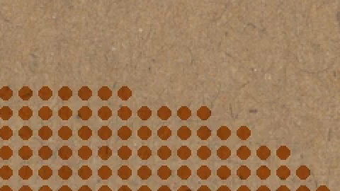{ loading=lazy }](../img/texture-study/beige/original.webp)

<figcaption>source<strong>Original</strong>1920×1080, pixels enlarged</figcaption>

</figure>

<figure markdown>

[{ loading=lazy }](../img/texture-study/beige/lanczos.webp)

<figcaption>reference<strong>Lanczos 2×</strong>the reference: 100%</figcaption>

</figure>

<figure markdown>

[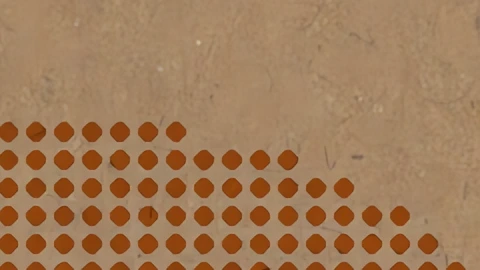{ loading=lazy }](../img/texture-study/beige/animevideov3.webp)

<figcaption>AnimeUp<strong>Real-ESRGAN animevideov3</strong>grain 75% · fine 56% · edges 91% · pattern 0.96</figcaption>

</figure>

<figure markdown>

[{ loading=lazy }](../img/texture-study/beige/denoise.webp)

<figcaption>AnimeUp<strong>Real-CUGAN light denoise</strong>grain 56% · fine 34% · edges 104% · pattern 0.91</figcaption>

</figure>

<figure markdown>

[{ loading=lazy }](../img/texture-study/beige/cugan.webp)

<figcaption>AnimeUp<strong>Real-CUGAN no-denoise</strong>grain 55% · fine 34% · edges 102% · pattern 0.90</figcaption>

</figure>

<figure markdown>

[{ loading=lazy }](../img/texture-study/beige/conservative.webp)

<figcaption>AnimeUp<strong>Real-CUGAN conservative</strong>grain 103% · fine 80% · edges 103% · pattern 0.98</figcaption>

</figure>

**What to look at:** The paper between the halftone dots: fibres, dark specks, the fine speckle.

**Verdict:** **Real-CUGAN conservative** keeps the paper almost exactly as it was (grain 103%, same pattern 0.98). **Real-ESRGAN animevideov3** keeps three quarters of it and softens the speckle. **Real-CUGAN light denoise** and **Real-CUGAN no-denoise** iron it flat, to about 55%.

**Why:** Real-CUGAN conservative is the same network as Real-CUGAN no-denoise, tuned to remove less: whatever might be texture stays. Real-CUGAN light denoise is a separately trained model, not no-denoise plus a filter: it removes the fine noise just as no-denoise does.

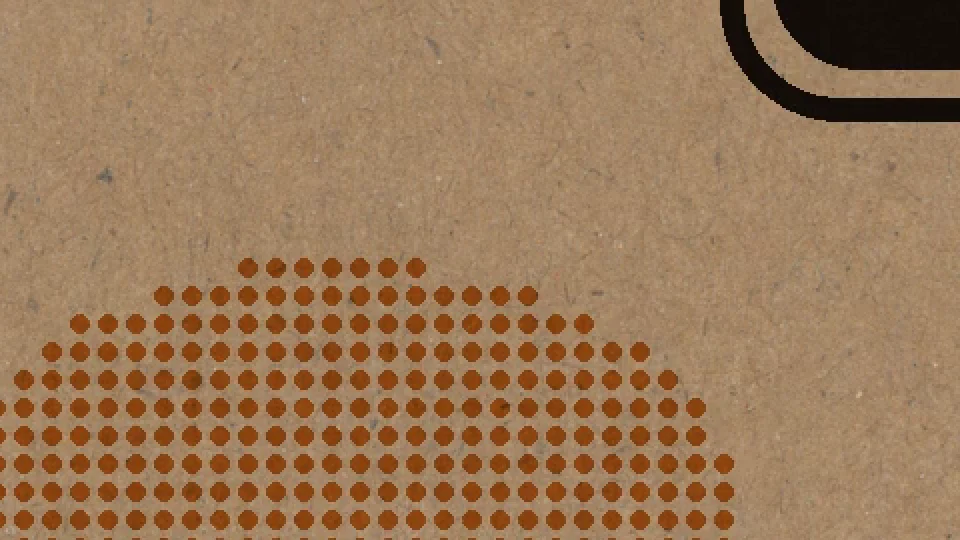

*A 960×540 region of the 2× results at 1:1. Choose any two versions, then move the pointer over the picture or drag the slider.*

### Chapter card on creased white paper

The same kind of card on a smooth, creased white paper. Very little texture to keep.

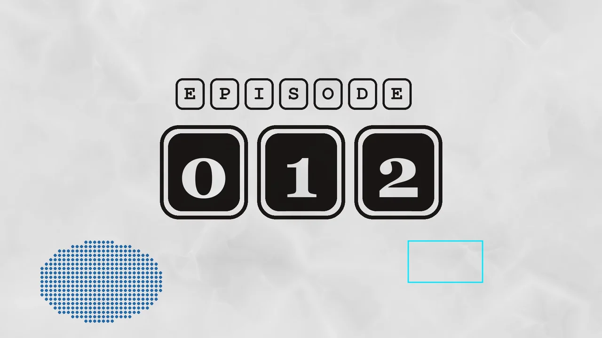{ loading=lazy }

*The whole frame for context; the box marks the crop below, shown at 1:1 after a 2× enlargement.*

<figure markdown>

[{ loading=lazy }](../img/texture-study/bianco/original.webp)

<figcaption>source<strong>Original</strong>1920×1080, pixels enlarged</figcaption>

</figure>

<figure markdown>

[{ loading=lazy }](../img/texture-study/bianco/lanczos.webp)

<figcaption>reference<strong>Lanczos 2×</strong>the reference: 100%</figcaption>

</figure>

<figure markdown>

[{ loading=lazy }](../img/texture-study/bianco/animevideov3.webp)

<figcaption>AnimeUp<strong>Real-ESRGAN animevideov3</strong>grain 88% · fine 325% · edges 95% · pattern 0.98</figcaption>

</figure>

<figure markdown>

[{ loading=lazy }](../img/texture-study/bianco/denoise.webp)

<figcaption>AnimeUp<strong>Real-CUGAN light denoise</strong>grain 76% · fine 276% · edges 115% · pattern 0.98</figcaption>

</figure>

<figure markdown>

[{ loading=lazy }](../img/texture-study/bianco/cugan.webp)

<figcaption>AnimeUp<strong>Real-CUGAN no-denoise</strong>grain 79% · fine 302% · edges 113% · pattern 0.98</figcaption>

</figure>

<figure markdown>

[{ loading=lazy }](../img/texture-study/bianco/conservative.webp)

<figcaption>AnimeUp<strong>Real-CUGAN conservative</strong>grain 76% · fine 124% · edges 109% · pattern 0.98</figcaption>

</figure>

**What to look at:** The flat white between the creases.

**Verdict:** All four keep the creases. **Real-ESRGAN animevideov3**, **Real-CUGAN light denoise** and **Real-CUGAN no-denoise** sharpen the faint compression noise of the white into visible speckle (276–325% of Lanczos's fine detail). **Real-CUGAN conservative** leaves it almost as smooth as it was (124%).

**Why:** On a nearly flat surface the faint compression noise is the only detail there is, and models built to sharpen treat it as texture to bring out. Real-CUGAN conservative leaves alone what it is not sure about.

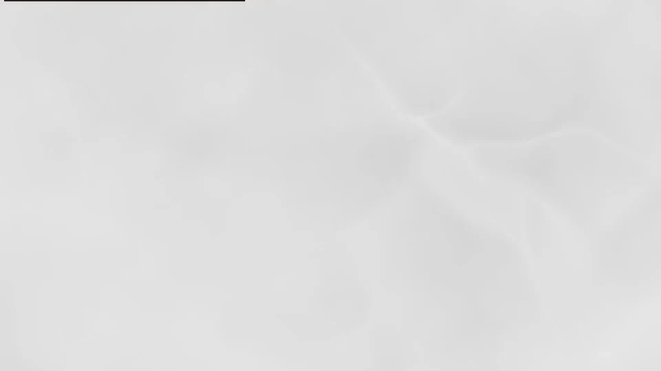

*A 960×540 region of the 2× results at 1:1. Choose any two versions, then move the pointer over the picture or drag the slider.*

### Dark painted metal

*Morevna*, 6:50. Brush texture at low contrast, in the shadows.

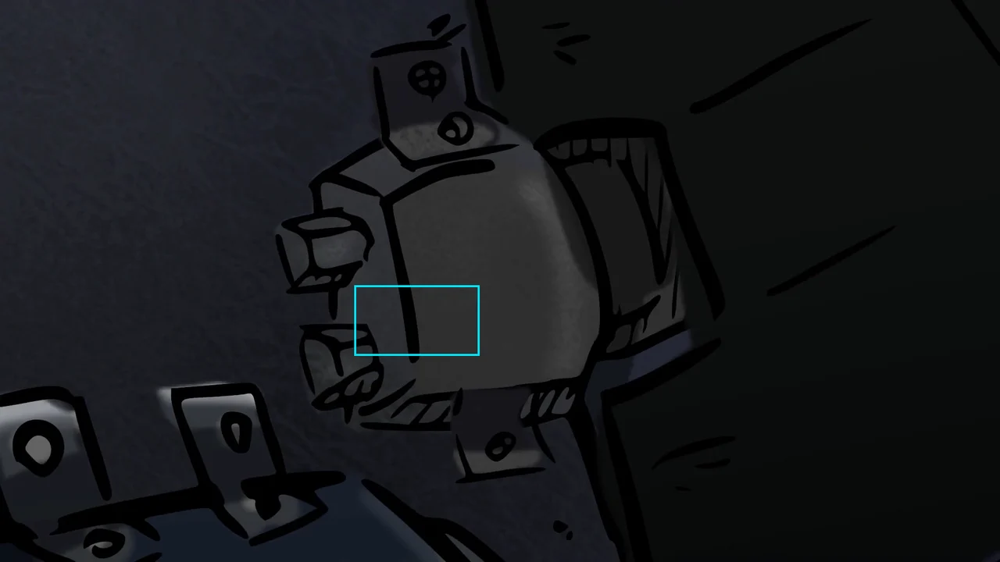{ loading=lazy }

*The whole frame for context; the box marks the crop below, shown at 1:1 after a 2× enlargement.*

<figure markdown>

[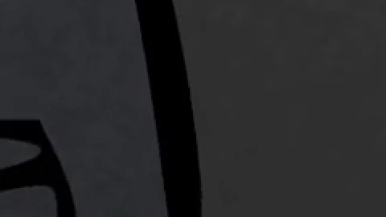{ loading=lazy }](../img/texture-study/m410/original.webp)

<figcaption>source<strong>Original</strong>1920×1080, pixels enlarged</figcaption>

</figure>

<figure markdown>

[{ loading=lazy }](../img/texture-study/m410/lanczos.webp)

<figcaption>reference<strong>Lanczos 2×</strong>the reference: 100%</figcaption>

</figure>

<figure markdown>

[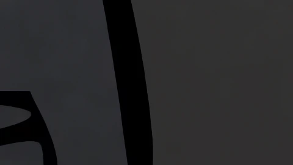{ loading=lazy }](../img/texture-study/m410/animevideov3.webp)

<figcaption>AnimeUp<strong>Real-ESRGAN animevideov3</strong>grain 100% · fine 85% · edges 102% · pattern 0.87</figcaption>

</figure>

<figure markdown>

[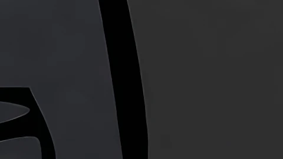{ loading=lazy }](../img/texture-study/m410/denoise.webp)

<figcaption>AnimeUp<strong>Real-CUGAN light denoise</strong>grain 77% · fine 108% · edges 139% · pattern 0.89</figcaption>

</figure>

<figure markdown>

[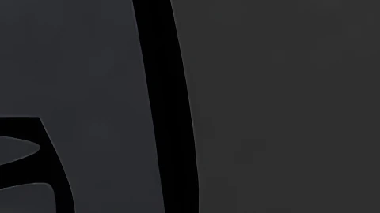{ loading=lazy }](../img/texture-study/m410/cugan.webp)

<figcaption>AnimeUp<strong>Real-CUGAN no-denoise</strong>grain 73% · fine 84% · edges 128% · pattern 0.89</figcaption>

</figure>

<figure markdown>

[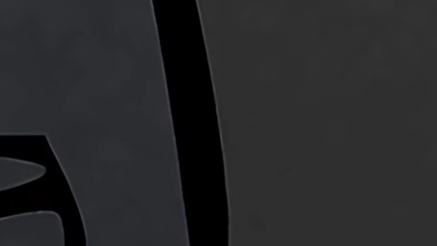{ loading=lazy }](../img/texture-study/m410/conservative.webp)

<figcaption>AnimeUp<strong>Real-CUGAN conservative</strong>grain 86% · fine 80% · edges 141% · pattern 0.94</figcaption>

</figure>

**What to look at:** The blotchy brushwork on the dark plates, and the outlines of the bolts.

**Verdict:** **Real-CUGAN conservative** keeps the pattern closest to the source (same pattern 0.94) and draws the strongest outlines (141%). **Real-ESRGAN animevideov3** keeps the amount of texture (100%) but moves it around (0.87). **Real-CUGAN no-denoise** and **light denoise** lose about a quarter of it.

**Why:** In the shadows texture and noise are hardest to tell apart, so every model gives up or rearranges some of it.

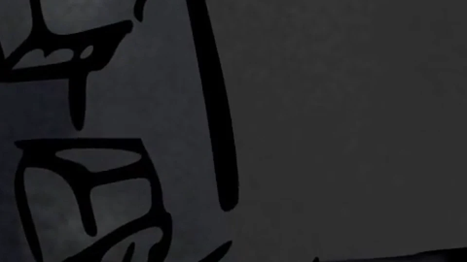

*A 960×540 region of the 2× results at 1:1. Choose any two versions, then move the pointer over the picture or drag the slider.*

## Gradients

Large smooth areas, where an upscaler can add bands or smooth away compression stripes. Tick **Stretch contrast** under the slider to make bands and blotches visible.

### Castle under a blue sky

*Morevna*, 0:10. The sky carries faint horizontal stripes from the source's own compression.

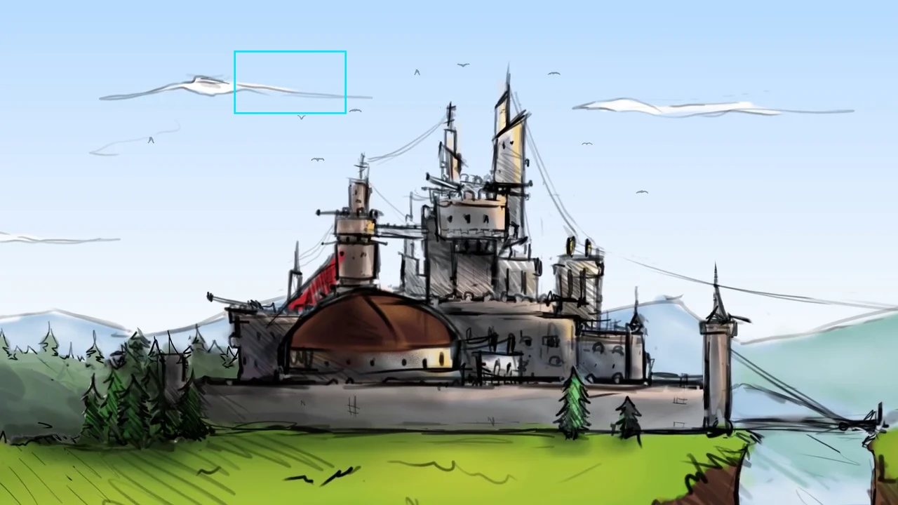{ loading=lazy }

*The whole frame for context; the box marks the crop below, shown at 1:1 after a 2× enlargement.*

<figure markdown>

[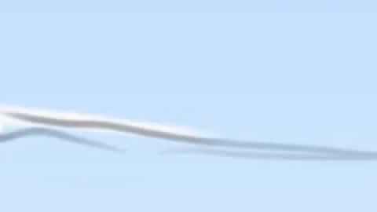{ loading=lazy }](../img/texture-study/m10/original.webp)

<figcaption>source<strong>Original</strong>1920×1080, pixels enlarged</figcaption>

</figure>

<figure markdown>

[{ loading=lazy }](../img/texture-study/m10/lanczos.webp)

<figcaption>reference<strong>Lanczos 2×</strong>the reference: 100%</figcaption>

</figure>

<figure markdown>

[{ loading=lazy }](../img/texture-study/m10/animevideov3.webp)

<figcaption>AnimeUp<strong>Real-ESRGAN animevideov3</strong>grain 100% · fine 112% · edges 137% · pattern 0.98</figcaption>

</figure>

<figure markdown>

[{ loading=lazy }](../img/texture-study/m10/denoise.webp)

<figcaption>AnimeUp<strong>Real-CUGAN light denoise</strong>grain 111% · fine 124% · edges 174% · pattern 0.98</figcaption>

</figure>

<figure markdown>

[{ loading=lazy }](../img/texture-study/m10/cugan.webp)

<figcaption>AnimeUp<strong>Real-CUGAN no-denoise</strong>grain 103% · fine 123% · edges 178% · pattern 0.98</figcaption>

</figure>

<figure markdown>

[{ loading=lazy }](../img/texture-study/m10/conservative.webp)

<figcaption>AnimeUp<strong>Real-CUGAN conservative</strong>grain 104% · fine 115% · edges 166% · pattern 0.98</figcaption>

</figure>

**What to look at:** With the contrast stretched, the stripes across the sky; in the normal view, the outline of the cloud.

**Verdict:** **Real-ESRGAN animevideov3** softens the stripes; the three Real-CUGAN models reproduce them as they are. None of them adds banding of its own. The Real-CUGAN models draw the cloud outline harder (166–178% against 137%).

**Why:** Real-ESRGAN animevideov3 was trained with denoising built in, and compression stripes look like noise to it. The Real-CUGAN models rebuild the structure they see, stripes included.

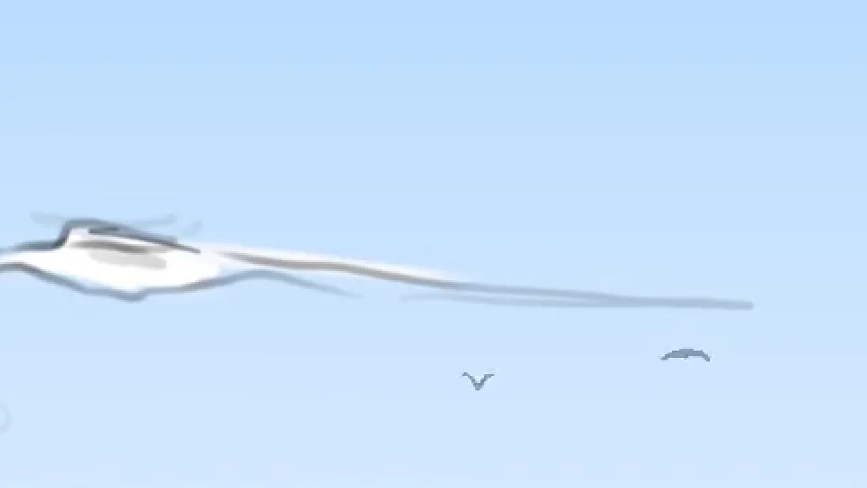

*A 960×540 region of the 2× results at 1:1. Choose any two versions, then move the pointer over the picture or drag the slider.*

### Close-up on a red background

*Morevna*, 3:20. A large flat red with a soft falloff.

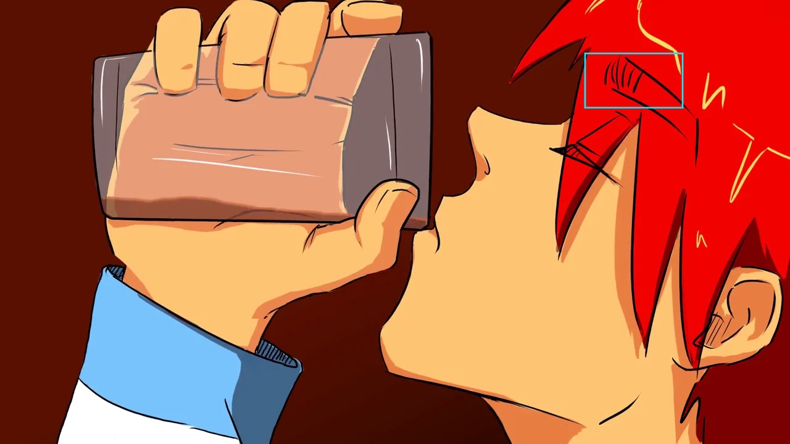{ loading=lazy }

*The whole frame for context; the box marks the crop below, shown at 1:1 after a 2× enlargement.*

<figure markdown>

[{ loading=lazy }](../img/texture-study/m200/original.webp)

<figcaption>source<strong>Original</strong>1920×1080, pixels enlarged</figcaption>

</figure>

<figure markdown>

[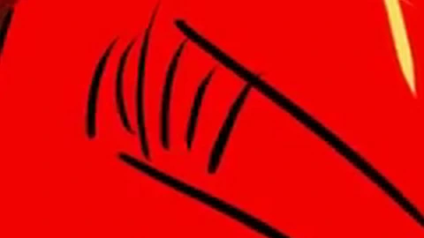{ loading=lazy }](../img/texture-study/m200/lanczos.webp)

<figcaption>reference<strong>Lanczos 2×</strong>the reference: 100%</figcaption>

</figure>

<figure markdown>

[{ loading=lazy }](../img/texture-study/m200/animevideov3.webp)

<figcaption>AnimeUp<strong>Real-ESRGAN animevideov3</strong>grain 104% · fine 152% · edges 118% · pattern 0.99</figcaption>

</figure>

<figure markdown>

[{ loading=lazy }](../img/texture-study/m200/denoise.webp)

<figcaption>AnimeUp<strong>Real-CUGAN light denoise</strong>grain 133% · fine 174% · edges 135% · pattern 0.99</figcaption>

</figure>

<figure markdown>

[{ loading=lazy }](../img/texture-study/m200/cugan.webp)

<figcaption>AnimeUp<strong>Real-CUGAN no-denoise</strong>grain 104% · fine 184% · edges 135% · pattern 0.99</figcaption>

</figure>

<figure markdown>

[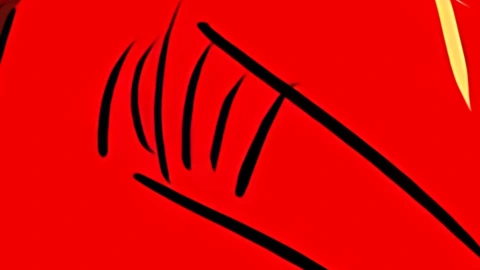{ loading=lazy }](../img/texture-study/m200/conservative.webp)

<figcaption>AnimeUp<strong>Real-CUGAN conservative</strong>grain 100% · fine 122% · edges 132% · pattern 0.99</figcaption>

</figure>

**What to look at:** The flat red away from the lines, and the soft edge of the hair with the contrast stretched.

**Verdict:** The red stays flat in all four. **Real-CUGAN light denoise** and **Real-CUGAN no-denoise** add a fine speckle to it (174–184% of Lanczos's fine detail), **Real-ESRGAN animevideov3** a little less (152%), **Real-CUGAN conservative** the least (122%).

**Why:** As on the white paper: on a flat colour the only fine texture is compression noise, and sharpening models amplify it.

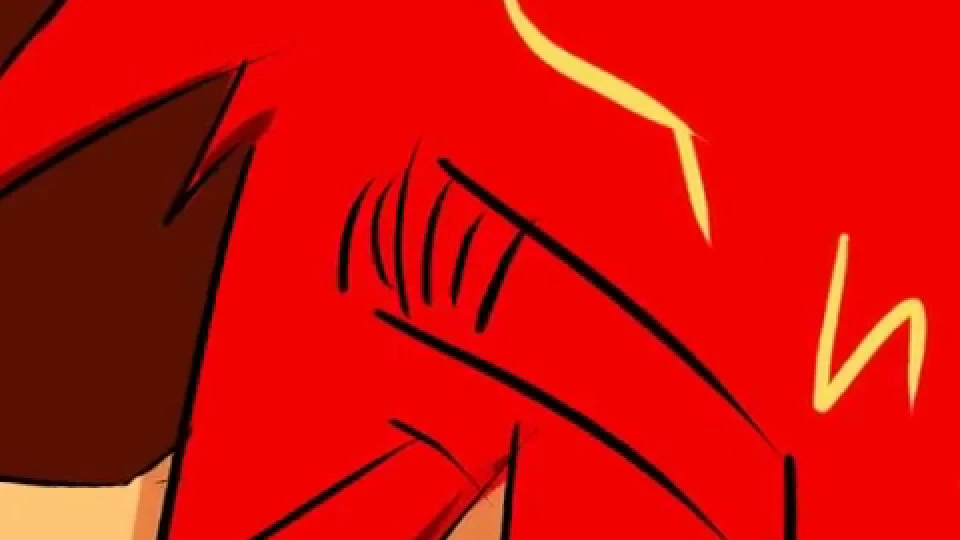

*A 960×540 region of the 2× results at 1:1. Choose any two versions, then move the pointer over the picture or drag the slider.*

## Lines and flat colour

What these models are mostly used for.

### Tower and pine trees

*Morevna*, 1:00. Hand-drawn lines on a painted wall.

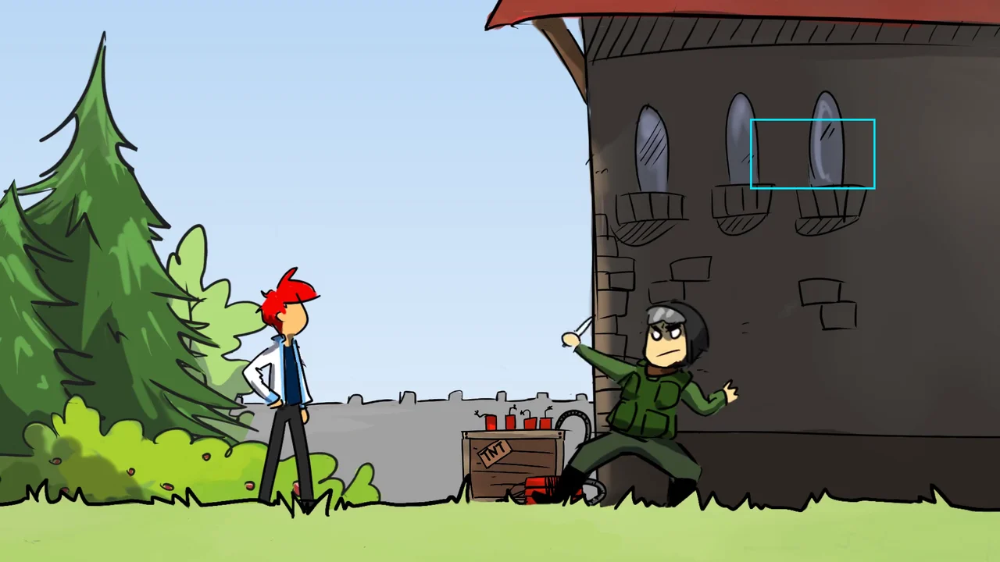{ loading=lazy }

*The whole frame for context; the box marks the crop below, shown at 1:1 after a 2× enlargement.*

<figure markdown>

[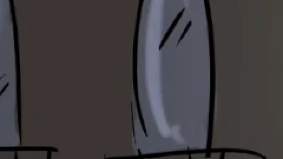{ loading=lazy }](../img/texture-study/m60/original.webp)

<figcaption>source<strong>Original</strong>1920×1080, pixels enlarged</figcaption>

</figure>

<figure markdown>

[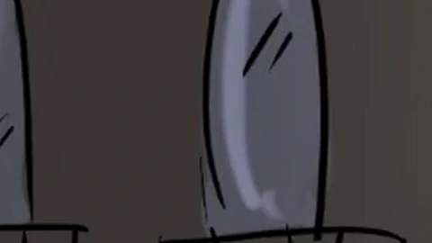{ loading=lazy }](../img/texture-study/m60/lanczos.webp)

<figcaption>reference<strong>Lanczos 2×</strong>the reference: 100%</figcaption>

</figure>

<figure markdown>

[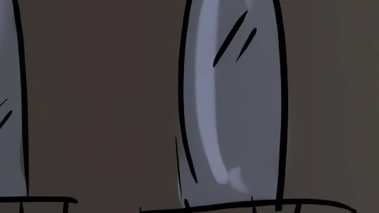{ loading=lazy }](../img/texture-study/m60/animevideov3.webp)

<figcaption>AnimeUp<strong>Real-ESRGAN animevideov3</strong>grain 114% · fine 137% · edges 121% · pattern 0.99</figcaption>

</figure>

<figure markdown>

[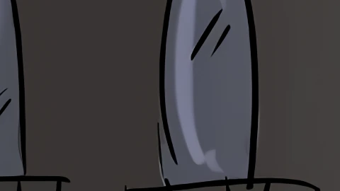{ loading=lazy }](../img/texture-study/m60/denoise.webp)

<figcaption>AnimeUp<strong>Real-CUGAN light denoise</strong>grain 104% · fine 130% · edges 128% · pattern 0.99</figcaption>

</figure>

<figure markdown>

[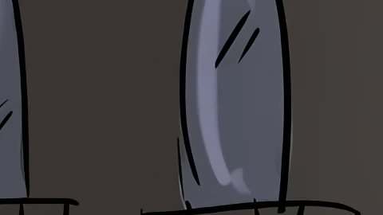{ loading=lazy }](../img/texture-study/m60/cugan.webp)

<figcaption>AnimeUp<strong>Real-CUGAN no-denoise</strong>grain 111% · fine 125% · edges 129% · pattern 0.99</figcaption>

</figure>

<figure markdown>

[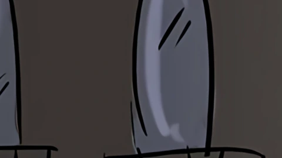{ loading=lazy }](../img/texture-study/m60/conservative.webp)

<figcaption>AnimeUp<strong>Real-CUGAN conservative</strong>grain 98% · fine 110% · edges 126% · pattern 0.99</figcaption>

</figure>

**What to look at:** The painted wall around the windows, and the window outlines.

**Verdict:** **Real-ESRGAN animevideov3** and **Real-CUGAN no-denoise** raise the wall's texture a little (114% and 111%); **Real-CUGAN conservative** keeps it as it was (98%). The outlines come out the same in the three Real-CUGAN models (128–129%).

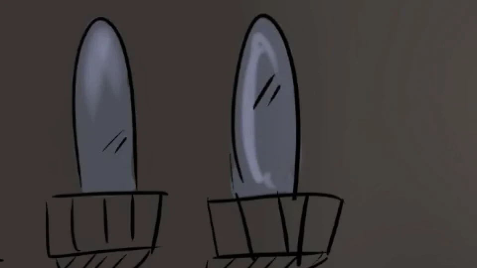

*A 960×540 region of the 2× results at 1:1. Choose any two versions, then move the pointer over the picture or drag the slider.*

### Flowers on flat pink

*Morevna*, 2:20. Flat fills and clean outlines.

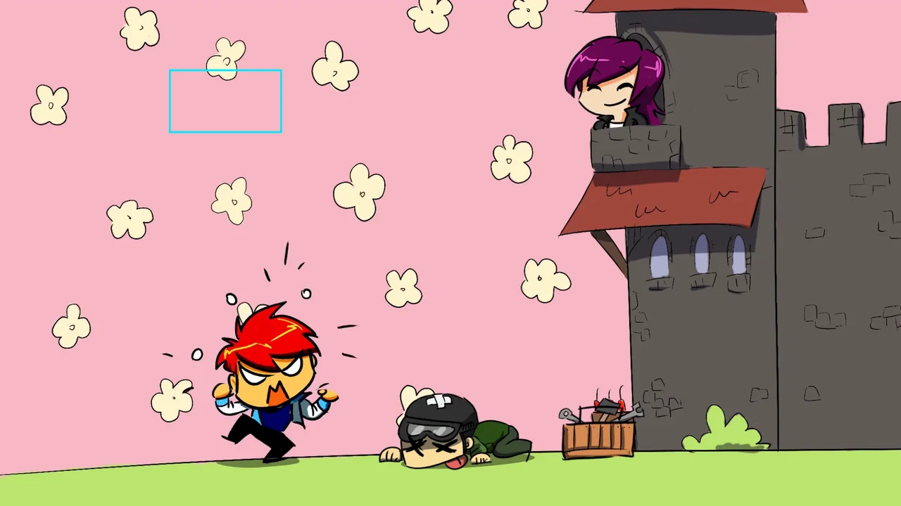{ loading=lazy }

*The whole frame for context; the box marks the crop below, shown at 1:1 after a 2× enlargement.*

<figure markdown>

[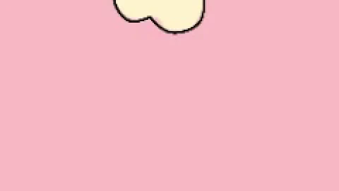{ loading=lazy }](../img/texture-study/m140/original.webp)

<figcaption>source<strong>Original</strong>1920×1080, pixels enlarged</figcaption>

</figure>

<figure markdown>

[{ loading=lazy }](../img/texture-study/m140/lanczos.webp)

<figcaption>reference<strong>Lanczos 2×</strong>the reference: 100%</figcaption>

</figure>

<figure markdown>

[{ loading=lazy }](../img/texture-study/m140/animevideov3.webp)

<figcaption>AnimeUp<strong>Real-ESRGAN animevideov3</strong>grain 131% · fine 89% · edges 117% · pattern 0.99</figcaption>

</figure>

<figure markdown>

[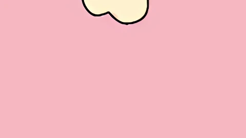{ loading=lazy }](../img/texture-study/m140/denoise.webp)

<figcaption>AnimeUp<strong>Real-CUGAN light denoise</strong>grain 121% · fine 158% · edges 119% · pattern 0.99</figcaption>

</figure>

<figure markdown>

[{ loading=lazy }](../img/texture-study/m140/cugan.webp)

<figcaption>AnimeUp<strong>Real-CUGAN no-denoise</strong>grain 108% · fine 128% · edges 120% · pattern 0.99</figcaption>

</figure>

<figure markdown>

[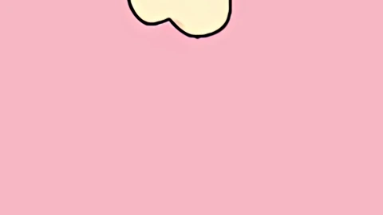{ loading=lazy }](../img/texture-study/m140/conservative.webp)

<figcaption>AnimeUp<strong>Real-CUGAN conservative</strong>grain 102% · fine 100% · edges 118% · pattern 1.00</figcaption>

</figure>

**What to look at:** The flat pink, and the outline of the flowers.

**Verdict:** The pink stays flat everywhere. **Real-ESRGAN animevideov3** is the cleanest: it removes the source's own compression noise (fine detail 89%). **Real-CUGAN light denoise** adds pixel noise (158%), **Real-CUGAN no-denoise** a little (128%), **Real-CUGAN conservative** leaves it as it was (100%).

**Why:** Real-ESRGAN animevideov3's built-in denoising again: it treats the source's own compression noise as something to remove.

*A 960×540 region of the 2× results at 1:1. Choose any two versions, then move the pointer over the picture or drag the slider.*

### Character waving

*Morevna*, 3:00. Face, hands, line weight.

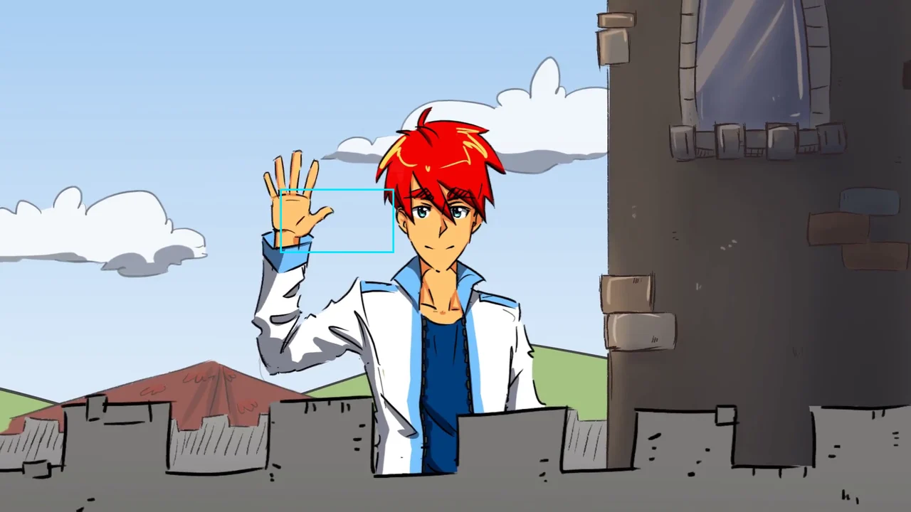{ loading=lazy }

*The whole frame for context; the box marks the crop below, shown at 1:1 after a 2× enlargement.*

<figure markdown>

[{ loading=lazy }](../img/texture-study/m180/original.webp)

<figcaption>source<strong>Original</strong>1920×1080, pixels enlarged</figcaption>

</figure>

<figure markdown>

[{ loading=lazy }](../img/texture-study/m180/lanczos.webp)

<figcaption>reference<strong>Lanczos 2×</strong>the reference: 100%</figcaption>

</figure>

<figure markdown>

[{ loading=lazy }](../img/texture-study/m180/animevideov3.webp)

<figcaption>AnimeUp<strong>Real-ESRGAN animevideov3</strong>grain 111% · fine 116% · edges 130% · pattern 0.99</figcaption>

</figure>

<figure markdown>

[{ loading=lazy }](../img/texture-study/m180/denoise.webp)

<figcaption>AnimeUp<strong>Real-CUGAN light denoise</strong>grain 105% · fine 135% · edges 148% · pattern 0.98</figcaption>

</figure>

<figure markdown>

[{ loading=lazy }](../img/texture-study/m180/cugan.webp)

<figcaption>AnimeUp<strong>Real-CUGAN no-denoise</strong>grain 107% · fine 120% · edges 149% · pattern 0.98</figcaption>

</figure>

<figure markdown>

[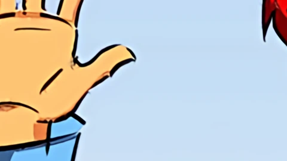{ loading=lazy }](../img/texture-study/m180/conservative.webp)

<figcaption>AnimeUp<strong>Real-CUGAN conservative</strong>grain 99% · fine 114% · edges 144% · pattern 0.99</figcaption>

</figure>

**What to look at:** The line weight on the face and hand, and the light blue sky behind.

**Verdict:** The Real-CUGAN models draw bolder lines than **Real-ESRGAN animevideov3** (144–149% against 130%). In the sky **Real-CUGAN light denoise** adds the most fine detail (135%), **Real-CUGAN conservative** the least (114%).

*A 960×540 region of the 2× results at 1:1. Choose any two versions, then move the pointer over the picture or drag the slider.*

## Small, compressed sources

*Morevna*'s own 360p and 480p releases, under 1 Mbit/s: little real detail and a lot of compression. Here the percentages say how much each model adds over a plain Lanczos enlargement.

### 360p: wall and a small figure

*Morevna*'s 360p release (640×360, about 0.7 Mbit/s).

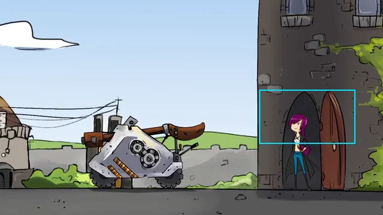{ loading=lazy }

*The whole frame for context; the box marks the crop below, shown at 1:1 after a 2× enlargement.*

<figure markdown>

[{ loading=lazy }](../img/texture-study/l360a/original.webp)

<figcaption>source<strong>Original</strong>640×360, pixels enlarged</figcaption>

</figure>

<figure markdown>

[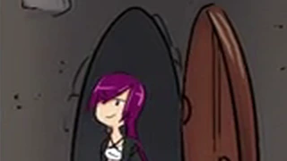{ loading=lazy }](../img/texture-study/l360a/lanczos.webp)

<figcaption>reference<strong>Lanczos 2×</strong>the reference: 100%</figcaption>

</figure>

<figure markdown>

[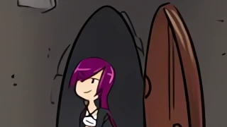{ loading=lazy }](../img/texture-study/l360a/animevideov3.webp)

<figcaption>AnimeUp<strong>Real-ESRGAN animevideov3</strong>grain 96% · fine 121% · edges 133% · pattern 0.99</figcaption>

</figure>

<figure markdown>

[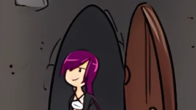{ loading=lazy }](../img/texture-study/l360a/denoise.webp)

<figcaption>AnimeUp<strong>Real-CUGAN light denoise</strong>grain 97% · fine 124% · edges 139% · pattern 0.99</figcaption>

</figure>

<figure markdown>

[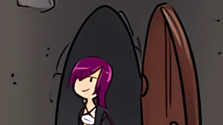{ loading=lazy }](../img/texture-study/l360a/cugan.webp)

<figcaption>AnimeUp<strong>Real-CUGAN no-denoise</strong>grain 100% · fine 126% · edges 142% · pattern 0.98</figcaption>

</figure>

<figure markdown>

[{ loading=lazy }](../img/texture-study/l360a/conservative.webp)

<figcaption>AnimeUp<strong>Real-CUGAN conservative</strong>grain 98% · fine 118% · edges 131% · pattern 0.99</figcaption>

</figure>

**What to look at:** The specks on the stone wall, and the small face in the doorway.

**Verdict:** **Real-ESRGAN animevideov3** gives clean surfaces and solid lines. **Real-CUGAN no-denoise** keeps every speck and blocking artefact and sharpens them; **Real-CUGAN conservative** sits in between, a little softer.

**Why:** From 360p there is little real detail to save: most of what the Real-CUGAN models keep and sharpen is compression.

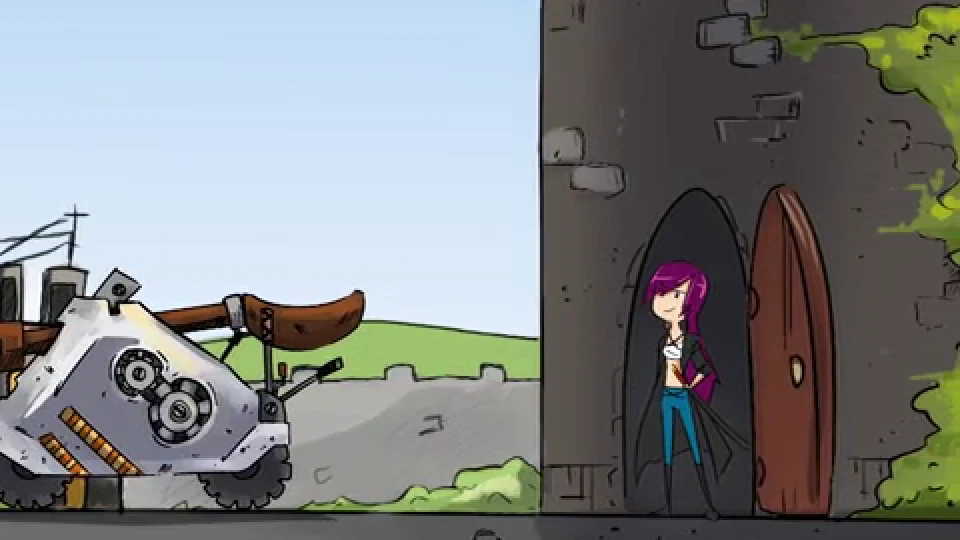

*A 960×540 region of the 2× results at 1:1. Choose any two versions, then move the pointer over the picture or drag the slider.*

### 360p: close-up face

*Morevna* 360p, a face filling the frame.

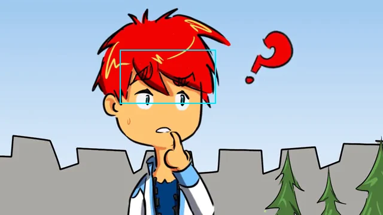{ loading=lazy }

*The whole frame for context; the box marks the crop below, shown at 1:1 after a 2× enlargement.*

<figure markdown>

[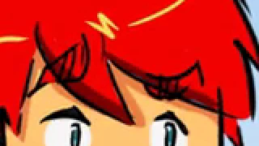{ loading=lazy }](../img/texture-study/l360b/original.webp)

<figcaption>source<strong>Original</strong>640×360, pixels enlarged</figcaption>

</figure>

<figure markdown>

[{ loading=lazy }](../img/texture-study/l360b/lanczos.webp)

<figcaption>reference<strong>Lanczos 2×</strong>the reference: 100%</figcaption>

</figure>

<figure markdown>

[{ loading=lazy }](../img/texture-study/l360b/animevideov3.webp)

<figcaption>AnimeUp<strong>Real-ESRGAN animevideov3</strong>grain 116% · fine 115% · edges 135% · pattern 0.98</figcaption>

</figure>

<figure markdown>

[{ loading=lazy }](../img/texture-study/l360b/denoise.webp)

<figcaption>AnimeUp<strong>Real-CUGAN light denoise</strong>grain 96% · fine 121% · edges 140% · pattern 0.99</figcaption>

</figure>

<figure markdown>

[{ loading=lazy }](../img/texture-study/l360b/cugan.webp)

<figcaption>AnimeUp<strong>Real-CUGAN no-denoise</strong>grain 105% · fine 112% · edges 141% · pattern 0.98</figcaption>

</figure>

<figure markdown>

[{ loading=lazy }](../img/texture-study/l360b/conservative.webp)

<figcaption>AnimeUp<strong>Real-CUGAN conservative</strong>grain 94% · fine 108% · edges 136% · pattern 0.99</figcaption>

</figure>

**What to look at:** The line weight around the eyes and in the hair.

**Verdict:** **Real-ESRGAN animevideov3** draws even, clean lines. **Real-CUGAN no-denoise** makes them heavier and picks up the blocking in the hair; **Real-CUGAN conservative** is softer but carries the same artefacts.

**Why:** Real-ESRGAN animevideov3 redraws lines as clean strokes; the Real-CUGAN models enlarge the strokes they find, blocking included.

*A 960×540 region of the 2× results at 1:1. Choose any two versions, then move the pointer over the picture or drag the slider.*

### 480p: lantern and books

*Morevna*'s 480p release (854×480, about 0.66 Mbit/s).

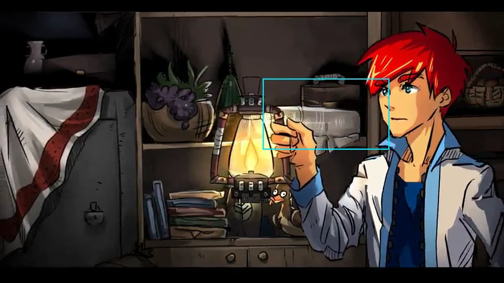{ loading=lazy }

*The whole frame for context; the box marks the crop below, shown at 1:1 after a 2× enlargement.*

<figure markdown>

[{ loading=lazy }](../img/texture-study/l480a/original.webp)

<figcaption>source<strong>Original</strong>854×480, pixels enlarged</figcaption>

</figure>

<figure markdown>

[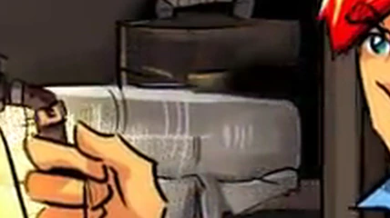{ loading=lazy }](../img/texture-study/l480a/lanczos.webp)

<figcaption>reference<strong>Lanczos 2×</strong>the reference: 100%</figcaption>

</figure>

<figure markdown>

[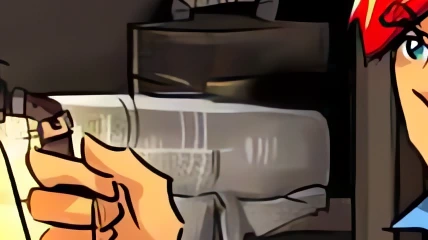{ loading=lazy }](../img/texture-study/l480a/animevideov3.webp)

<figcaption>AnimeUp<strong>Real-ESRGAN animevideov3</strong>grain 101% · fine 123% · edges 133% · pattern 0.99</figcaption>

</figure>

<figure markdown>

[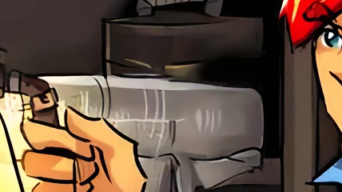{ loading=lazy }](../img/texture-study/l480a/denoise.webp)

<figcaption>AnimeUp<strong>Real-CUGAN light denoise</strong>grain 97% · fine 122% · edges 133% · pattern 0.99</figcaption>

</figure>

<figure markdown>

[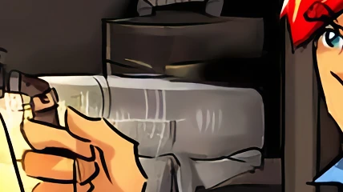{ loading=lazy }](../img/texture-study/l480a/cugan.webp)

<figcaption>AnimeUp<strong>Real-CUGAN no-denoise</strong>grain 97% · fine 122% · edges 134% · pattern 0.99</figcaption>

</figure>

<figure markdown>

[{ loading=lazy }](../img/texture-study/l480a/conservative.webp)

<figcaption>AnimeUp<strong>Real-CUGAN conservative</strong>grain 99% · fine 111% · edges 127% · pattern 1.00</figcaption>

</figure>

**What to look at:** The book under the hand and the shelf: the source there is compression mush.

**Verdict:** The Real-CUGAN models turn the mush into crisp patterns that were never drawn. **Real-ESRGAN animevideov3** smooths it into plausible shading.

**Why:** Where the source is mush, a model that preserves detail preserves mush, and sharpens it into patterns.

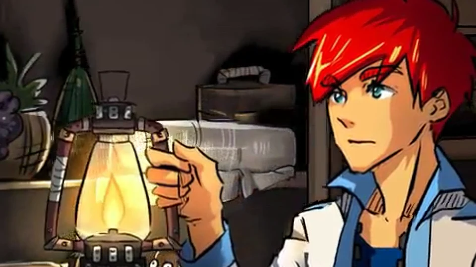

*A 960×540 region of the 2× results at 1:1. Choose any two versions, then move the pointer over the picture or drag the slider.*

### 480p: dark wall and door

*Morevna* 480p, a dim wall with a soft light falloff.

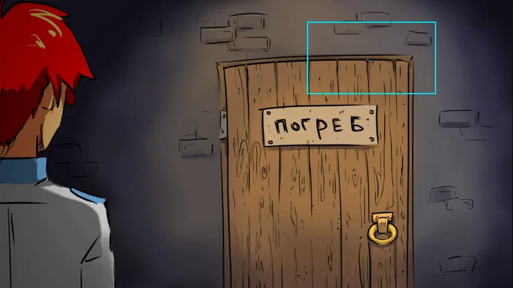{ loading=lazy }

*The whole frame for context; the box marks the crop below, shown at 1:1 after a 2× enlargement.*

<figure markdown>

[{ loading=lazy }](../img/texture-study/l480b/original.webp)

<figcaption>source<strong>Original</strong>854×480, pixels enlarged</figcaption>

</figure>

<figure markdown>

[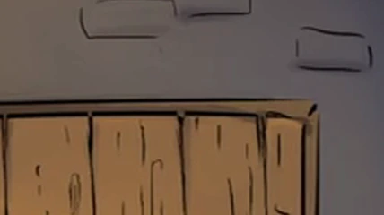{ loading=lazy }](../img/texture-study/l480b/lanczos.webp)

<figcaption>reference<strong>Lanczos 2×</strong>the reference: 100%</figcaption>

</figure>

<figure markdown>

[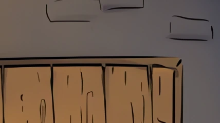{ loading=lazy }](../img/texture-study/l480b/animevideov3.webp)

<figcaption>AnimeUp<strong>Real-ESRGAN animevideov3</strong>grain 102% · fine 129% · edges 134% · pattern 0.99</figcaption>

</figure>

<figure markdown>

[{ loading=lazy }](../img/texture-study/l480b/denoise.webp)

<figcaption>AnimeUp<strong>Real-CUGAN light denoise</strong>grain 108% · fine 142% · edges 144% · pattern 0.99</figcaption>

</figure>

<figure markdown>

[{ loading=lazy }](../img/texture-study/l480b/cugan.webp)

<figcaption>AnimeUp<strong>Real-CUGAN no-denoise</strong>grain 109% · fine 142% · edges 145% · pattern 0.99</figcaption>

</figure>

<figure markdown>

[{ loading=lazy }](../img/texture-study/l480b/conservative.webp)

<figcaption>AnimeUp<strong>Real-CUGAN conservative</strong>grain 104% · fine 129% · edges 137% · pattern 0.99</figcaption>

</figure>

**What to look at:** With the contrast stretched, the blotches on the wall around the door.

**Verdict:** **Real-ESRGAN animevideov3** leaves a smooth wall. The Real-CUGAN models keep the blotches of the compression as if they were plaster.

**Why:** The dark wall's blotches are compression, not paint: only Real-ESRGAN animevideov3's denoising knows to drop them.

*A 960×540 region of the 2× results at 1:1. Choose any two versions, then move the pointer over the picture or drag the slider.*

## A starved encode

The same pictures re-encoded at CRF 32. Here keeping everything means keeping the encoder's damage too.

### Brown paper, starved encode

The brown paper card again, encoded at CRF 32: the encoder has already smeared part of the grain.

{ loading=lazy }

*The whole frame for context; the box marks the crop below, shown at 1:1 after a 2× enlargement.*

<figure markdown>

[{ loading=lazy }](../img/texture-study/hbeige/original.webp)

<figcaption>source<strong>Original</strong>1920×1080, pixels enlarged</figcaption>

</figure>

<figure markdown>

[{ loading=lazy }](../img/texture-study/hbeige/lanczos.webp)

<figcaption>reference<strong>Lanczos 2×</strong>the reference: 100%</figcaption>

</figure>

<figure markdown>

[{ loading=lazy }](../img/texture-study/hbeige/animevideov3.webp)

<figcaption>AnimeUp<strong>Real-ESRGAN animevideov3</strong>grain 75% · fine 72% · edges 93% · pattern 0.96</figcaption>

</figure>

<figure markdown>

[{ loading=lazy }](../img/texture-study/hbeige/denoise.webp)

<figcaption>AnimeUp<strong>Real-CUGAN light denoise</strong>grain 55% · fine 40% · edges 106% · pattern 0.91</figcaption>

</figure>

<figure markdown>

[{ loading=lazy }](../img/texture-study/hbeige/cugan.webp)

<figcaption>AnimeUp<strong>Real-CUGAN no-denoise</strong>grain 54% · fine 41% · edges 104% · pattern 0.90</figcaption>

</figure>

<figure markdown>

[{ loading=lazy }](../img/texture-study/hbeige/conservative.webp)

<figcaption>AnimeUp<strong>Real-CUGAN conservative</strong>grain 103% · fine 81% · edges 103% · pattern 0.98</figcaption>

</figure>

**What to look at:** The paper next to the dots: compare it with the clean version above.

**Verdict:** The ranking does not change. **Real-CUGAN conservative** keeps what the encoder left (103%), **Real-CUGAN light denoise** and **Real-CUGAN no-denoise** flatten it to about 54%, **Real-ESRGAN animevideov3** to 75%.

**Why:** The ranking follows what each model was trained to remove, not how much information the source has left.

*A 960×540 region of the 2× results at 1:1. Choose any two versions, then move the pointer over the picture or drag the slider.*

### Sky, starved encode

*Morevna* 0:10 re-encoded at CRF 32.

{ loading=lazy }

*The whole frame for context; the box marks the crop below, shown at 1:1 after a 2× enlargement.*

<figure markdown>

[{ loading=lazy }](../img/texture-study/hm10/original.webp)

<figcaption>source<strong>Original</strong>1920×1080, pixels enlarged</figcaption>

</figure>

<figure markdown>

[{ loading=lazy }](../img/texture-study/hm10/lanczos.webp)

<figcaption>reference<strong>Lanczos 2×</strong>the reference: 100%</figcaption>

</figure>

<figure markdown>

[{ loading=lazy }](../img/texture-study/hm10/animevideov3.webp)

<figcaption>AnimeUp<strong>Real-ESRGAN animevideov3</strong>grain 102% · fine 108% · edges 134% · pattern 0.98</figcaption>

</figure>

<figure markdown>

[{ loading=lazy }](../img/texture-study/hm10/denoise.webp)

<figcaption>AnimeUp<strong>Real-CUGAN light denoise</strong>grain 113% · fine 122% · edges 173% · pattern 0.97</figcaption>

</figure>

<figure markdown>

[{ loading=lazy }](../img/texture-study/hm10/cugan.webp)

<figcaption>AnimeUp<strong>Real-CUGAN no-denoise</strong>grain 105% · fine 121% · edges 176% · pattern 0.98</figcaption>

</figure>

<figure markdown>

[{ loading=lazy }](../img/texture-study/hm10/conservative.webp)

<figcaption>AnimeUp<strong>Real-CUGAN conservative</strong>grain 104% · fine 113% · edges 164% · pattern 0.98</figcaption>

</figure>

**What to look at:** With the contrast stretched, the stripes, now stronger in the source.

**Verdict:** As in the clean version: no model amplifies the stripes, and **Real-ESRGAN animevideov3** smooths them the most.

*A 960×540 region of the 2× results at 1:1. Choose any two versions, then move the pointer over the picture or drag the slider.*

### Character, starved encode

*Morevna* 3:00 re-encoded at CRF 32.

{ loading=lazy }

*The whole frame for context; the box marks the crop below, shown at 1:1 after a 2× enlargement.*

<figure markdown>

[{ loading=lazy }](../img/texture-study/hm180/original.webp)

<figcaption>source<strong>Original</strong>1920×1080, pixels enlarged</figcaption>

</figure>

<figure markdown>

[{ loading=lazy }](../img/texture-study/hm180/lanczos.webp)

<figcaption>reference<strong>Lanczos 2×</strong>the reference: 100%</figcaption>

</figure>

<figure markdown>

[{ loading=lazy }](../img/texture-study/hm180/animevideov3.webp)

<figcaption>AnimeUp<strong>Real-ESRGAN animevideov3</strong>grain 113% · fine 114% · edges 132% · pattern 0.98</figcaption>

</figure>

<figure markdown>

[{ loading=lazy }](../img/texture-study/hm180/denoise.webp)

<figcaption>AnimeUp<strong>Real-CUGAN light denoise</strong>grain 105% · fine 134% · edges 152% · pattern 0.98</figcaption>

</figure>

<figure markdown>

[{ loading=lazy }](../img/texture-study/hm180/cugan.webp)

<figcaption>AnimeUp<strong>Real-CUGAN no-denoise</strong>grain 105% · fine 120% · edges 152% · pattern 0.98</figcaption>

</figure>

<figure markdown>

[{ loading=lazy }](../img/texture-study/hm180/conservative.webp)

<figcaption>AnimeUp<strong>Real-CUGAN conservative</strong>grain 98% · fine 113% · edges 147% · pattern 0.98</figcaption>

</figure>

**What to look at:** Around the fingers and the hair: the pale ringing the encoder leaves next to dark lines.

**Verdict:** Here **Real-CUGAN conservative**'s honesty costs something: it keeps the ringing next to the outlines as a faint white halo. **Real-ESRGAN animevideov3** and **Real-CUGAN light denoise** clean it away. On a badly compressed source, Real-CUGAN conservative is the wrong choice.

**Why:** Ringing is a pattern that runs along the edges: exactly the kind of structure Real-CUGAN conservative is tuned to keep.

*A 960×540 region of the 2× results at 1:1. Choose any two versions, then move the pointer over the picture or drag the slider.*

## Credits

*Morevna* episode 3 © [Morevna Project](https://morevnaproject.org/), licensed CC BY-SA 3.0; the frames and crops on this page are derived from it and shared under the same licence. Paper textures Paper006 and Paper003 from [ambientCG](https://ambientcg.com/), CC0; the chapter cards were drawn for this test. Models: Real-ESRGAN animevideov3 (BSD-3-Clause) and Real-CUGAN (MIT), run with their ncnn-vulkan builds as AnimeUp does.

[Next: Newer anime models, compared →](model-study.md)
