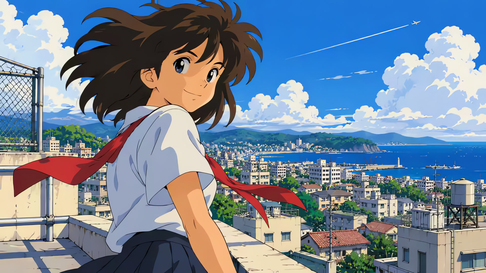
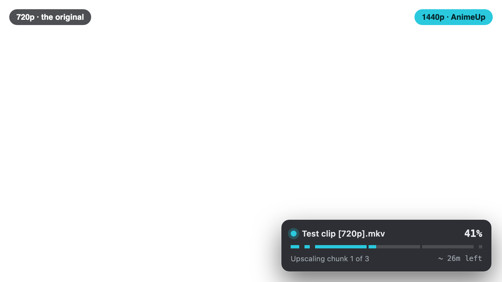
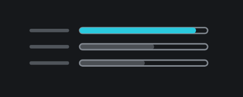
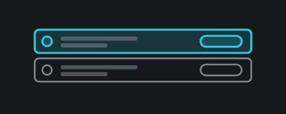
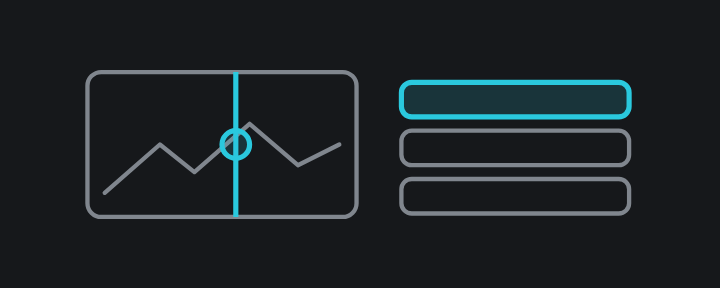
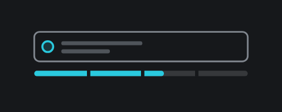

<header class="animeup-hero">
  
    
    
  
  

    Version 2.0 · Apple Silicon
    <h1>AnimeUp user guide</h1>
    
Upscale anime episodes to 1080p and beyond on your own Mac, offline, with Real-ESRGAN and Real-CUGAN, and choose the model by looking at the result.

  

</header>

  

    
    
    <svg width="20" height="14" viewBox="0 0 20 14" aria-hidden="true"><path d="M7 2 2 7l5 5M13 2l5 5-5 5" fill="none" stroke="currentColor" stroke-width="2.2" stroke-linecap="round" stroke-linejoin="round"/></svg>
    
    <button class="au-hero__zoom" type="button" title="Compare at 100%, one picture pixel per screen pixel">1:1</button>
  

  

    
    
    <svg width="20" height="14" viewBox="0 0 20 14" aria-hidden="true"><path d="M7 2 2 7l5 5M13 2l5 5-5 5" fill="none" stroke="currentColor" stroke-width="2.2" stroke-linecap="round" stroke-linejoin="round"/></svg>
    
    <button class="au-hero__zoom" type="button" title="Compare at 100%, one picture pixel per screen pixel">1:1</button>
  

  

    <button type="button" role="tab" class="is-on" aria-selected="true"><b>480p → 1080p</b> Real-ESRGAN animevideov3</button>
    <button type="button" role="tab" aria-selected="false"><b>720p → 1440p</b> Real-CUGAN no-denoise</button>
  

Drag across the picture: a close-up of the same frame plainly enlarged on the left, and upscaled by AnimeUp on the right. An old DVD-size file wants Real-ESRGAN animevideov3, which redraws clean lines; a clean 720p file wants Real-CUGAN, which keeps painted texture. <b>1:1</b> shows the whole frame at full size.

## What AnimeUp is

AnimeUp is a Mac app that makes old anime look good on a modern screen. You give it episodes at DVD or web-rip resolution (240p to 720p, typically), it enlarges every frame with an AI model on your Mac's GPU, and it writes a new video next to the original, with all the audio, subtitles, chapters and fonts carried over.

Everything happens on your Mac. Nothing is uploaded, there is no account, and after the first launch AnimeUp works offline.

It takes care of the parts that are tedious to do by hand:

- **It checks every file as it arrives**: frame rate, interlacing, tracks, truncated files. Problems show up before a job starts, not halfway through it.
- **It lets you choose the model by eye**: it finds the hardest moments of an episode, renders them with each model and shows them side by side.
- **It runs long jobs safely**: work is saved one chunk at a time, so stopping, quitting or a crash costs at most the chunk in progress.
- **It tells you honestly how long it will take**, from the real speed of your Mac.

!!! info "What AnimeUp is not"
    - It isn't a real-time player filter: an episode takes from minutes to hours, depending on its resolution, the model and your Mac.
    - It doesn't deinterlace or inverse-telecine. Such a file is flagged when it arrives; prepare it with a dedicated tool first.
    - It processes **one file at a time**. Two upscalers on the same GPU only slow each other down.

## How a batch goes

Four steps, and only the first two are needed.

**1 · Calibrate.** Once per Mac, about 10 minutes with the GPU idle. AnimeUp times each model on your Mac, so every estimate fits it. [Calibrate your Mac](03-calibration.md)

**2 · Add videos.** Drop files or whole folders on the window. Each one is analysed as it arrives, and gets a recommended model and an estimate. [Start](04-start.md)

**3 · Compare** *(optional)*. Render a few hard clips with each model and pick the one you like by eye. [Compare](06-compare.md)

**4 · Process.** Start the queue and follow it. Pause, stop, resume and redo: nothing done is lost. [The Queue](05-queue.md)

## Requirements

| Requirement | Details |
|---|---|
| Mac | Apple Silicon (M1 or later). Intel Macs aren't supported. |
| macOS | macOS 26 (Tahoe) or later. |
| Internet | On the **first launch only**, to download the video tools (about 220 MB). After that, AnimeUp works offline. |
| Disk space | Upscaling works on extracted frames: a single episode can temporarily take tens of GB. AnimeUp shows how much it may use and lets you set a limit. An external drive works fine. |

## How this guide is organised

**Overview**

| Page | What it covers |
|---|---|
| [01. Install and first launch](01-install.md) | Downloading the app, Open Anyway, the video tools, where AnimeUp keeps its files, updating |
| [02. The interface at a glance](02-interface.md) | The window and its areas, the sidebar, menus, alerts, notifications, the narrow layout |

**Using AnimeUp**

| Page | What it covers |
|---|---|
| [03. Calibrate your Mac](03-calibration.md) | Why, what it measures, the results and how to read them |
| [04. Start](04-start.md) | Adding videos, where files go, This Mac |
| [05. The Queue](05-queue.md) | Analysis, the plan for each file, running, pausing, stopping, the outcome, Redo |
| [06. Compare](06-compare.md) | Testing the models on hard clips and choosing by eye |
| [07. Settings](07-settings.md) | Every setting, its default, and when it applies |
| [08. Files and folders](08-files-and-folders.md) | Finished videos, work files, logs, names |

**Reference**

| Page | What it covers |
|---|---|
| [Command line](reference/command-line.md) | The portable folder and `./animeup` |
| [Troubleshooting](reference/troubleshooting.md) | Symptom → fix |

**Appendix**

| Page | What it covers |
|---|---|
| [How a job works inside](deep-dives/how-it-works.md) | Analysis, plan, extraction, repeated frames, chunks, encoding, resuming |
| [The models and when to use them](deep-dives/models.md) | The four models, and which source each one suits |
| [Newer anime models, compared](deep-dives/model-study.md) | Twelve versions of eight frames, side by side |
| [How much texture each model keeps](deep-dives/texture-study.md) | Paper and grain through each model |
| [Tuning notes](../TUNING.md) | The measurements behind every default |
| [Designing AnimeUp 2.0](deep-dives/design.md) | The design study behind the app: the approach, the design system, the states |

!!! note "Language"
    AnimeUp is available in English and Italian: it starts in the language of macOS, and you can switch in **Settings › General**. This guide uses the English labels.

[Next: 01. Install and first launch →](01-install.md)

---

<small>The two cover pictures were made for this guide, then shrunk to 480p and 720p and upscaled by AnimeUp. Other pictures show footage from
[Morevna Episode 3](https://archive.org/details/morevna-ep3) (© Morevna
Project, [CC BY-SA 3.0](https://creativecommons.org/licenses/by-sa/3.0/))
and [Big Buck Bunny](https://peach.blender.org) (© 2008 Blender Foundation,
[CC BY 3.0](https://creativecommons.org/licenses/by/3.0/)); the images are
CC BY-SA 3.0. AnimeUp itself is free software under the
[GNU GPL v3 or later](https://github.com/Interstellar0verdrive/AnimeUp/blob/main/LICENSE).</small>
