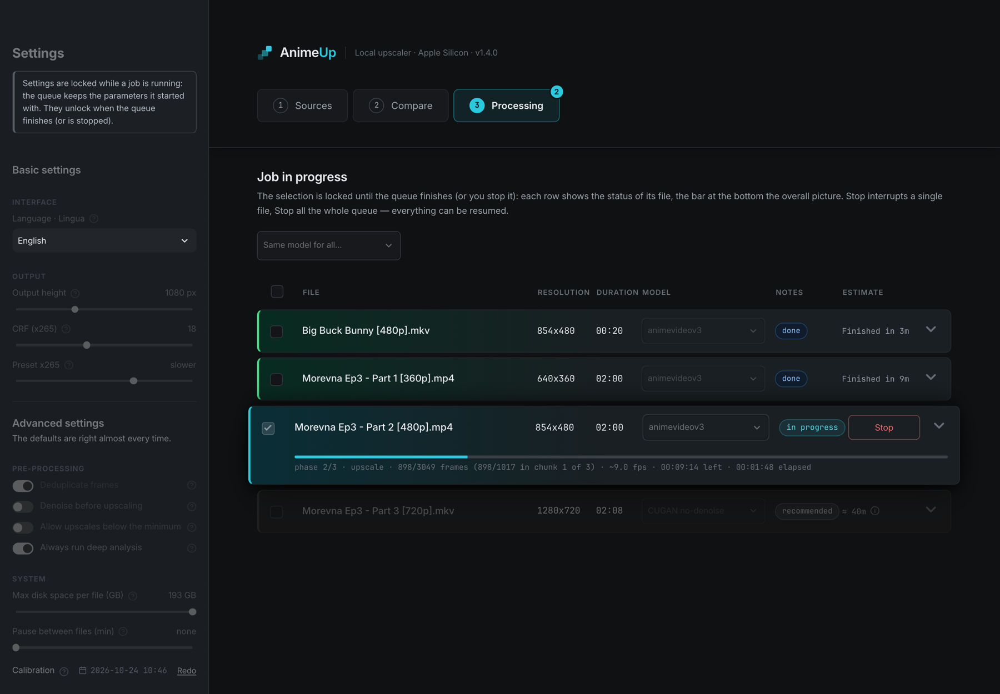

User guide · AnimeUp 1.4

# AnimeUp user guide

Upscale anime episodes to 1080p and beyond on your own Mac, offline, with Real-ESRGAN and Real-CUGAN, and choose the model by looking at the result.

## What AnimeUp is

AnimeUp is a batch upscaler for anime that runs entirely on your Mac. It takes the episodes you copy into its `INPUT/` folder, enlarges them with an AI model on the Mac's GPU, and writes finished files to `OUTPUT/` with all the original audio, subtitles, chapters and fonts carried over.

It wraps four pieces of work that are tedious to do by hand:

- **Source analysis**: resolution, frame rate, interlacing and telecine, truncated files and odd formats are detected before a job starts, not halfway through it.
- **Model choice by eye**: AnimeUp finds difficult 10-second clips in your episode (dark, bright, static, fast motion), renders them with the models you pick and shows them side by side.
- **Long, resumable jobs**: work is saved one chunk at a time, so a crash, a closed lid or a stopped job loses at most the chunk in progress.
- **Honest time estimates**: once you have calibrated your Mac, the estimates use its real speed, encoding included.

Everything lives in one folder: the Python runtime, the dependencies, the upscaler binaries and the models. Nothing is installed system-wide, and no Homebrew is needed.

## Who it's for

AnimeUp is for people who keep a local anime library at DVD or web-rip resolution (240p to 720p, typically) and want a sharper 1080p version without uploading anything anywhere. You don't need to know what Real-ESRGAN or x265 are: the defaults are chosen from measurements, and each setting has a help bubble.

!!! info "What AnimeUp is not"
    - It isn't a real-time player filter: an episode takes from minutes to hours, depending on its resolution, the model and your Mac.
    - It doesn't deinterlace or inverse-telecine: an interlaced or telecined source is flagged (the job would still run, upscaling the combing lines), and you prepare it with a dedicated tool first.
    - It runs **one job at a time**. Two upscalers on the same GPU only slow each other down, so the interface queues files rather than running them in parallel.

## The path at a glance

| Step | What you do | Time |
|---|---|---|
| 1. Install | Unzip, double-click **Start AnimeUp.command**, allow it in Privacy & Security | A few minutes, once |
| 2. Calibrate | **Run now** next to **Calibration** in the sidebar | About 10 minutes, once per Mac |
| 3. Sources | Copy episodes into `INPUT/` and read their analysis | Seconds per file |
| 4. Compare | Test the models on difficult clips and pick one by eye | A few minutes per series |
| 5. Processing | Tick the files, check the model, **Start processing** | Minutes to hours per episode |
| 6. Output | Collect the files from `OUTPUT/` | — |

Step 2 is optional but recommended: without it AnimeUp still works, but every time estimate comes from a different Mac.

## Requirements

| Requirement | Details |
|---|---|
| Mac | Apple Silicon (M1 or later). Intel Macs aren't supported. |
| macOS | Developed and tested on macOS 26 (Tahoe). |
| Internet | On the **first launch only**, to download a private Python runtime and FFmpeg into the AnimeUp folder. After that, AnimeUp works offline. |
| Disk space | Upscaling extracts frames to disk: a single episode can temporarily take tens of GB. The interface shows how much a file needs and lets you set a cap. An external drive works fine. |
| Browser | Any modern browser. The interface opens at <http://localhost:8899> and never leaves your Mac. |
| Optional | [video-compare](https://github.com/pixop/video-compare) (installed with Homebrew) or [IINA](https://iina.io), to compare renders in motion from the Compare tab. |

## Chapters

| Chapter | What it covers |
|---|---|
| [01. Install and first launch](01-install.md) | Release zip or `git clone`, the Gatekeeper prompt, what the first launch downloads, updating |
| [02. Calibrate your Mac](02-calibration.md) | Measuring your Mac's real speed so the estimates are right |
| [03. The interface and its settings](03-interface.md) | Layout, tabs, help bubbles, every sidebar setting, closing AnimeUp |
| [04. Sources: check your files](04-sources.md) | The analysis of each file and what its warnings mean |
| [05. Compare: choose the model by eye](05-compare.md) | Difficult clips, test renders, image indicators, 1:1 crops |
| [06. Processing: run, monitor, stop and resume](06-processing.md) | The queue, progress, Stop, Pause, Resume, Discard, the end summary |
| [07. Output files and folders](07-output-and-folders.md) | What lands in `OUTPUT/`, and what every folder is for |

**Reference**

| Page | What it covers |
|---|---|
| [Command-line reference](reference/command-line.md) | Every `./animeup` command and option |
| [Troubleshooting](reference/troubleshooting.md) | Symptom → fix tables |

**Deep dives**

| Page | What it covers |
|---|---|
| [How a job works inside](deep-dives/how-it-works.md) | Analysis, plan, extraction, deduplication, upscale, encoding, remux |
| [The models and when to use them](deep-dives/models.md) | Real-ESRGAN animevideov3 and the Real-CUGAN variants |
| [Tuning notes](../TUNING.md) | The measurements behind every default |

!!! note "Language"
    The interface is available in English and Italian: switch with **Language · Lingua** at the top of the sidebar. The command-line messages follow the same choice. This guide uses the English labels.

[Start: 01. Install and first launch →](01-install.md)

---

<small>Screenshots in this guide show footage from
[Morevna Episode 3](https://archive.org/details/morevna-ep3) (© Morevna
Project, CC BY-SA 3.0) and [Big Buck Bunny](https://peach.blender.org)
(© 2008 Blender Foundation, CC BY 3.0); the images are CC BY-SA 3.0.</small>
